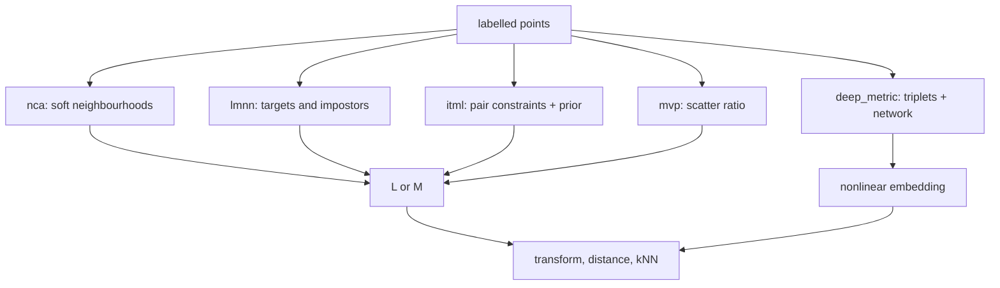

# Metric learning — learn the distance instead of assuming it

`metric_learning.py` · Kernels and instance · Tier 3 · 5 variants

## Intuition

Every method in this chapter takes a distance as given. kNN measures Euclidean
distance, the RBF network measures it after a bandwidth, the SVM measures it in
a kernel's feature space. But a feature vector is an argument about relevance,
and Euclidean distance is the claim that every coordinate matters equally. When
one axis is a measurement in metres and the next is a count of children, that
claim is false before the data arrives.

Metric learning replaces the claim with a parameter. The model is a positive
semidefinite matrix $M$, and the distance is

$$
d_M(x,z)^2=(x-z)^{\top}M(x-z),
$$

or, equivalently, a linear map $L$ with $M=L^{\top}L$ and

$$
d_M(x,z)=\lVert L(x-z)\rVert_2 .
$$

The map is the useful form: it sends the data into a new space where ordinary
Euclidean distance is the right one. Supervision is the only thing that can
choose it, and the labels say which pairs should land close and which should
land far:

```
      raw space                       learned space
   ┌────────────────┐              ┌──────────────┐
   │  ●    ●        │              │  ● ●         │
   │      noise ────┼──► L ──►     │ ● ●          │
   │  ●    ●        │              │         ○ ○  │
   └────────────────┘              │          ○   │
                                   └──────────────┘
```

The picture is a rotation plus a stretch, but the stretch is learned from pairs,
not from the marginal variance. That distinction is the whole subject: PCA and
whitening also produce an $M$, but they never look at a label, so they cannot
know that the loudest direction is noise.

Once $M$ exists, everything downstream is free. `predict` is a kNN vote in the
learned space, but the same `transform` output can feed a linear SVM, a
clustering routine, a nearest-centroid classifier, or a retrieval index. The
metric is a reusable view of the data rather than a model of one task.

The five variants are five answers to "far according to what".

## Variants

| variant | optimises | needs | convex? | output |
|:--|:--|:--|:--|:--|
| `nca` | soft leave-one-out accuracy | labels | no | linear map |
| `lmnn` | target pull plus impostor margin | labels, $k$ | yes in $M$ | metric |
| `itml` | LogDet distance to a prior | pairs, bounds | yes (Bregman) | metric |
| `mvp` | between over within variance | labels | closed form | linear map |
| `deep_metric` | triplet margin in a network | labels | no | network |



**`nca`** maximises the expected accuracy of a soft nearest-neighbour rule.
Each point spreads a unit of probability over the others in inverse proportion
to distance, and the objective is the mass that lands on its own class. It is
smooth enough to differentiate and directly optimises the quantity kNN is
judged by, at the price of a non-convex landscape.

**`lmnn`** asks for a margin. Each point's $k$ nearest same-class neighbours
become targets to pull in, and every different-class point that comes within one
unit more than a target becomes an impostor to push out. With the targets held
fixed the objective is convex in $M$, which is why it is the variant people
trust when the answer has to be reproducible.

**`itml`** starts from a prior metric, usually the identity, and projects it onto
the constraints "these pairs are within $u$" and "those pairs are beyond $l$".
The measure of how far the metric moved is the KL divergence between the
Gaussians with those covariance matrices, which makes each projection a
closed-form rank-one update. There is no gradient and no learning rate.

**`mvp`** is the closed-form relative. It maximises the mean squared distance of
different-class pairs over the mean squared distance of same-class pairs. That
ratio is a generalised eigenproblem, so the answer is a whitening followed by an
eigendecomposition, and the leading directions are the ones in which the classes
are most separated relative to their own spread. This is the between/within
criterion of linear discriminant analysis, read as a Mahalanobis metric rather
than as a classifier.

**`deep_metric`** drops the linearity. A two-layer network embeds the data on
the unit sphere, and a triplet loss pulls each anchor towards a positive and
away from a negative by a margin. The metric is still Euclidean, but in a space
the network chooses, so the decision boundary can bend around classes that no
single $M$ can separate.

The demo has two problems. On three Gaussian clusters buried under eight noise
axes, Euclidean 1-nearest-neighbour gets 59 % and every linear variant gets at
least 87 %. On an xor — the sign of $x_0x_1$ — Euclidean gets 52 %, the best
linear metric 81 %, and the network 94 %.

## Derivation

### One matrix, two shapes

A Mahalanobis distance is a quadratic form, and every quadratic form with a
positive semidefinite matrix has a square root. Write the eigendecomposition
$M=V\Lambda V^{\top}$ with $\Lambda\succeq0$ and set

$$
L=\Lambda^{1/2}V^{\top},
\qquad
L^{\top}L=V\Lambda^{1/2}\Lambda^{1/2}V^{\top}=M .
\qquad (1)
$$

The factor is not unique — any orthogonal $Q$ gives $(QL)^{\top}(QL)=M$ — but
the distances are. Working with $L$ turns a constrained problem on the PSD cone
into an unconstrained one on rectangular matrices, and computing
$\lVert L(x-z)\rVert^2$ never forms the $d\times d$ matrix. The code uses both
shapes: `nca`, `mvp`, and `deep_metric` optimise a map, while `lmnn` and `itml`
optimise $M$ and factor it at the end.

The PSD constraint is not decoration. Without it, the "distance" can be negative
on some directions, the triangle inequality fails, and the kNN vote is decided
by a quantity that is not a distance. Every variant either works inside the cone
or projects back onto it with

$$
\mathrm{proj}_{\succeq0}(A)=V\max(\Lambda,0)V^{\top}.
\qquad (2)
$$

### NCA

For a point $i$, assign every other point $j$ the probability

$$
p_{ij}=\frac{\exp(-d_{ij})}{\sum_{k\ne i}\exp(-d_{ik})},
\qquad d_{ij}=\lVert L(x_i-x_j)\rVert^2,
\qquad (3)
$$

and define the objective as the probability mass on same-class neighbours:

$$
P(L)=\sum_i\sum_{j:\,y_j=y_i}p_{ij}.
\qquad (4)
$$

This is the expected accuracy of a stochastic nearest-neighbour classifier: with
probability $p_{ij}$, point $i$ copies the label of $j$. The exponential makes
the objective smooth, and the normalisation makes each row a distribution rather
than a sum of independent terms.

Differentiate. Let $\Delta_{ij}=x_i-x_j$. Since
$\partial d_{ij}/\partial L=2L\Delta_{ij}\Delta_{ij}^{\top}$ and
$\partial p_{ij}/\partial L=p_{ij}(\partial\log p_{ij}/\partial L)$,

$$
\frac{\partial P}{\partial L}
=2L\sum_i\left[
\left(\sum_{j\in C_i}p_{ij}\right)\sum_k p_{ik}\Delta_{ik}\Delta_{ik}^{\top}
-\sum_{j\in C_i}p_{ij}\Delta_{ij}\Delta_{ij}^{\top}
\right],
\qquad (5)
$$

where $C_i$ is the set of same-class indices. The first bracket is the scatter
of all neighbours, scaled by how much of the row's mass is already correct; the
second is the scatter of the correct neighbours. Ascending the
gradient pulls mass off the wrong neighbours and onto the right ones. The code
computes exactly this bracket as `scatter` and multiplies by $2L$.

The objective is not concave in $L$, so the code takes a gradient step and then
halves the rate until the objective improves. A fixed learning rate would work
on easy data and stall on hard data; the line search is what makes the variant
usable without tuning.

### LMNN

LMNN replaces the likelihood with a margin. For each point $i$, choose its $k$
nearest same-class neighbours and call them targets, with indicator
$\eta_{ij}=1$. The objective is

$$
\varepsilon(M)=(1-\mu)\sum_{i,j}\eta_{ij}d_{ij}
+\mu\sum_{i,j,l}\eta_{ij}
\left[1+d_{ij}-d_{il}\right]_+ ,
\qquad (6)
$$

where $l$ ranges over different-class points, $[z]_+=\max(z,0)$, and $\mu$
trades the pull towards targets against the push away from impostors. The first
term is a sum of squared distances inside each class; the second punishes any
different-class point that comes within one unit of a target.

With the targets fixed, both terms are convex in $M$ — the first linear, the
second a sum of hinges — so (6) is convex. Its subgradient is

$$
\frac{\partial\varepsilon}{\partial M}
=(1-\mu)\sum_{i,j}\eta_{ij}\Delta_{ij}\Delta_{ij}^{\top}
+\mu\sum_{i,j,l}\eta_{ij}\left[
\Delta_{il}\Delta_{il}^{\top}-\Delta_{ij}\Delta_{ij}^{\top}\right],
\qquad (7)
$$

over the active triples $(i,j,l)$ satisfying $1+d_{ij}-d_{il}>0$. The code
alternates two loops: recompute targets with the current metric, then take
projected gradient steps on $M$, re-evaluating the active set after each step.
The alternation is what makes the problem non-convex again — the targets depend
on $M$ — but each inner problem is convex and the outer loop usually settles in
a few passes.

### ITML

ITML begins with a prior $M_0$, usually $I$, and a set of pairs labelled similar
(desired distance at most $u$) or dissimilar (at least $l$). The measure of a
metric's distance from the prior is the LogDet divergence,

$$
D_{\mathrm{ld}}(M,M_0)
=\mathrm{tr}(M_0^{-1}M)-\log\det(M_0^{-1}M)-d ,
\qquad (8)
$$

which is the KL divergence between zero-mean Gaussians with covariance matrices
$M$ and $M_0$, up to a constant. It is convex in $M$, finite only on positive
definite matrices, and its Bregman projection onto a half-space has a rank-one
closed form. For one constraint $v^{\top}Mv\le u$ or $\ge l$, written as a
target $\delta$, the update is

$$
M\leftarrow M+\beta\,(Mv)(Mv)^{\top},
\qquad
\beta=\frac{\delta-p}{p^2},
\qquad p=v^{\top}Mv .
\qquad (9)
$$

The identity behind (9) is one line: after the update the distance along $v$ is
$p+\beta p^2=\delta$, so the constraint is met exactly. The Bregman geometry
picks the rank-one direction that changes the metric as little as possible, and
$\beta$ has the sign that moves $p$ towards $\delta$: negative for a similar
pair that is too far, positive for a dissimilar pair that is too close.

Cycling through the constraints converges to a point in their intersection,
or to a cycle when they are inconsistent. The code makes one pass per
`max_iter`, so the count is the number of updates actually performed, and it
projects onto the PSD cone once at the end in case rounding has pushed an
eigenvalue below zero.

### MVP

Write $S_w$ for the mean outer product of same-class differences and $S_b$ for
the mean outer product of different-class differences:

$$
S_w=\frac{1}{N_s}\sum_{y_i=y_j}\Delta_{ij}\Delta_{ij}^{\top},
\qquad
S_b=\frac{1}{N_d}\sum_{y_i\ne y_j}\Delta_{ij}\Delta_{ij}^{\top}.
\qquad (10)
$$

The criterion is the ratio of the two mean squared distances,

$$
r(M)=\frac{\mathrm{tr}(MS_b)}{\mathrm{tr}(MS_w)},
\qquad (11)
$$

and it is homogeneous of degree zero, so only the direction of $M$ matters.
Every stationary point of the ratio is a generalised eigenvector,

$$
S_b u=\lambda S_w u ,
\qquad (12)
$$

and the maximum is the largest eigenvalue. The metric that attains it is the
rank-one projector $uu^{\top}$. A rank-$r$ map keeps the span of the top $r$
eigenvectors instead, and the code weights each direction by its ratio.

When $S_w$ is positive definite, whiten it: with $W=S_w^{-1/2}$ and
$B=W S_b W$, the problem becomes the ordinary eigenproblem for $B$. If
$B=\sum_k\lambda_k v_kv_k^{\top}$ with eigenvalues in descending order, set
$u_k=Wv_k$. The rank-$r$ map is

$$
L=\left[\lambda_1^{1/2}u_1,\ldots,\lambda_r^{1/2}u_r\right]^{\top},
\qquad (13)
$$

so $L^{\top}L=\sum_{k\le r}\lambda_k u_ku_k^{\top}$ weights each kept direction
by how well it separates the classes. Dropping the $\lambda_k$ gives the
orthogonal projector onto the same subspace, the other common convention; the
subspace is what matters, and the demo's $r=d$ case keeps every direction and
still lifts accuracy from 0.59 to 0.99 because the noisy axes have small
between-class variance and large within-class variance, so their eigenvalues are
near zero.

A ridge term $\rho I$ is added to $S_w$ before the factorisation. It makes the
whitening finite when a direction has no within-class variance, which happens
whenever a feature is constant inside every class.

### Deep metric

A linear map can rotate and stretch, but it cannot bend. The xor is the smallest
example: the classes occupy alternating quadrants, and the boundary between them
is two crossing lines. An invertible affine map sends crossing lines to crossing
lines, so the classes stay interleaved; no choice of $M$ turns the problem into
two separated blobs. A network can fold the plane.

The network is two layers with a ReLU, followed by a projection onto the unit
sphere. For a triplet of anchor, positive, and negative, the loss is

$$
\ell(\theta)=\left[m+\lVert f_\theta(a)-f_\theta(p)\rVert^2
-\lVert f_\theta(a)-f_\theta(n)\rVert^2\right]_+ ,
\qquad (14)
$$

and the training objective is the mean over the sampled triples. The gradient
with respect to the three embeddings is

$$
\frac{\partial\ell}{\partial f(a)}=2(f(n)-f(p)),\qquad
\frac{\partial\ell}{\partial f(p)}=2(f(p)-f(a)),\qquad
\frac{\partial\ell}{\partial f(n)}=2(f(a)-f(n)),
\qquad (15)
$$

and backpropagation through the sphere projection and the ReLU turns that into
parameter gradients. The code samples one positive and one negative per anchor
on every epoch, so the negatives change as the embedding moves, and uses Adam
with bias correction.

The projection to the unit sphere is not cosmetic. Without it, rescaling every
embedding by $c$ changes the loss to

$$
m+c^2\left(\lVert a-p\rVert^2-\lVert a-n\rVert^2\right),
\qquad (16)
$$

which decreases without bound whenever the negative is farther than the
positive: the network can win by inflating the space instead of separating the
classes. Fixing the norm removes that direction, and it also makes the margin
$m$ a meaningful angle-like quantity. In two dimensions the embeddings live on a
circle, which is a tight budget — enough for the demo's two classes, not enough
for a hundred.

## Code walkthrough

### Projecting onto the PSD cone

```python
def _psd(matrix: np.ndarray) -> np.ndarray:
    """Project a symmetric matrix onto the positive semidefinite cone."""
    symmetric = 0.5 * (matrix + matrix.T)
    values, vectors = np.linalg.eigh(symmetric)
    values = np.maximum(values, 0.0)
    return (vectors * values) @ vectors.T
```

(2), with the symmetrisation that floating-point arithmetic makes necessary.
`eigh` returns ascending eigenvalues and orthonormal eigenvectors, so clipping
the eigenvalues and reassembling gives the nearest PSD matrix in Frobenius norm.
`lmnn` calls this after every trial step; `itml` calls it once at the end.

### The NCA gradient

```python
            mass = np.sum(probability * same, axis=1)
            scatter = np.zeros((width, width))
            for index in range(rows):
                offset = points[index] - points
                outer = (probability[index][:, None] * offset).T @ offset
                own = (probability[index] * same[index])[:, None] * offset
                scatter += mass[index] * outer - own.T @ offset
            gradient = 2.0 * map_ @ scatter
```

The two matrix products are the two terms of (5). `outer` is
$\sum_j p_{ij}\Delta_{ij}\Delta_{ij}^{\top}$, the scatter of every neighbour;
`own` keeps only the same-class part; `mass` is $\sum_{j\in C_i}p_{ij}$. The
loop is over rows because each row has its own normalisation, which is the only
place NCA differs from a plain weighted scatter. With $n$ points and $d$
features the inner product is $d\times n$ times $n\times d$, so the gradient is
$O(n^2d^2)$ and the $n^2$ weight matrix is the memory ceiling.

### The LMNN active set

```python
                across = active.sum(axis=1).astype(float)
                gradient -= self.mu * np.einsum(
                    "nl,nld,nle->de", across, difference, difference)
                within = active.sum(axis=2).astype(float)
                gradient += self.mu * np.einsum(
                    "nk,nkd,nke->de", within, pulled, pulled)
```

`active` has shape $n\times k\times n$: one entry per target and potential
impostor. Summing over the target axis gives, for every pair $(i,l)$, how many
targets of $i$ are violated by $l$; that count weights the impostor scatter
$\Delta_{il}\Delta_{il}^{\top}$. Summing over the impostor axis gives, for every
target $(i,j)$, how many impostors violate it; that count weights the target
scatter. The signs are the ones in (7): impostors increase the distance, targets
decrease it. A loop over active triples would add exactly the same outer
products one at a time; the counts are what let the whole gradient be two
`einsum` calls.

### The ITML update

```python
                beta = (target - current) / (current * current)
                metric = metric + beta * np.outer(metric_v, metric_v)
                metric = 0.5 * (metric + metric.T)
```

(9), with `current` equal to $p$ and `metric_v` equal to $Mv$. The update is
rank one, so a pass over $O(n^2)$ pairs costs $O(n^2d^2)$ but never forms an
$n\times n$ matrix. The symmetrisation is not needed in exact
arithmetic; it is cheap insurance against the asymmetry that a long sequence of
outer products accumulates.

### The MVP whitening

```python
        values, vectors = np.linalg.eigh(within)
        values = np.maximum(values, 1e-12)
        root = (vectors / np.sqrt(values)) @ vectors.T
        symmetric = root @ between @ root
        eigenvalues, eigenvectors = np.linalg.eigh(
            0.5 * (symmetric + symmetric.T))
```

This is (12) in two eigendecompositions. `root` is $S_w^{-1/2}$, built by
dividing the eigenvector columns by the square roots of the eigenvalues; the
floor keeps a direction with no within-class variance from producing an
infinity. `symmetric` is $W S_b W$, and its eigenvalues are the ratios
$\lambda_k$ in (13). The code sorts them descending, keeps the positive ones, and
maps the eigenvectors back through `root` — the second `eigh` is on a
symmetric matrix, which is why `eigh` rather than `eig` is enough.

### The triplet gradient

```python
        violation = self.margin + apart - away
        active = violation > 0.0
        loss = float(np.mean(np.maximum(violation, 0.0)))
        if not active.any():
            return [np.zeros_like(part) for part in self.weights_], loss
        chosen = np.flatnonzero(active)
        anchor, positive = anchors[chosen], positives[chosen]
        negative = negatives[chosen]
        grad = np.zeros_like(embedding)
        np.add.at(grad, anchor,
                  2.0 * (embedding[negative] - embedding[positive]))
        np.add.at(grad, positive,
                  2.0 * (embedding[positive] - embedding[anchor]))
        np.add.at(grad, negative,
                  2.0 * (embedding[anchor] - embedding[negative]))
        grad /= anchors.size
```

(15), accumulated into a per-point gradient. The `np.add.at` calls are the
important detail: a point can appear as the anchor of one triplet and the
negative of another, and ordinary fancy-index addition would write the last
contribution and silently drop the rest. The final division is by the number of
anchors, because the reported loss is the mean over all triplets, not only the
active ones. Once every point has one gradient, the chain rule through the
sphere projection is

$$
\frac{\partial\ell}{\partial r}
=\frac{1}{\lVert r\rVert}\left(g-f\,(g^{\top}f)\right),
$$

which is exactly the `grad - embedding * sum(...)` expression in the next few
lines, and the ReLU passes the gradient only where the hidden pre-activation was
positive. Adam then scales each parameter by the running second moment, which is
what makes a single learning rate work for the weights and the biases at once.

### Applying the metric

```python
        if self.variant == "deep_metric":
            standardised = (points - self._centre) / self._scale
            return self._forward(standardised)[0]
        return points @ self.L_.T
```

Both branches produce a point in the learned space, so `transform`, `distance`,
`predict`, and `score` are shared. The linear branch is one matrix product; the
deep branch standardises with the training statistics before the forward pass,
which is why `fit` stores `_centre` and `_scale`. `predict` then runs a plain
kNN vote on the embedded training rows, so the metric is the only thing that was
learned — the classifier stayed the same.

## Complexity

Let $n$ be the training count, $d$ the features, $r$ the output dimension, $k$
the target neighbours, $h$ the hidden width, and $e$ the epochs.

| operation | time | memory |
|:--|:--|:--|
| `nca`, one iteration | $O(n^2d^2)$ | $O(n^2+nd)$ |
| `lmnn`, one inner step | $O(n^2d^2)$ | $O(n^2d)$ |
| `itml`, one pair pass | $O(n^2d^2)$ | $O(n^2d)$ |
| `mvp` | $O(n^2d^2+d^3)$ | $O(n^2d)$ |
| `deep_metric`, one epoch | $O(nhd+nhr)$ | $O(nh+hd)$ |
| transform $m$ points | $O(mdr)$ or $O(mhd)$ | $O(mr)$ |
| predict $m$ points | $O(mnr)$ | $O(mn)$ |

The pairwise variants — NCA, LMNN, ITML, and MVP — all form an $n\times n$
object before they can learn anything, and that is their practical limit.
`lmnn` keeps the whole
$n\times n\times d$ difference tensor, which is the most expensive of the three;
`mvp` could be computed from class means in $O(nd^2+Kd^2)$ but the code uses
pairs to keep the derivation literal; `itml` streams the pairs in a Python loop,
so its constant is large even though its memory is only the pair list.
`deep_metric` is the only variant whose cost is linear in $n$ per epoch, which
is why it is the one that scales to images.

The demo's counts are modest: `lmnn` accepts at most 150 inner steps on the
150-point cluster problem and 50 on the 250-point xor; `itml` visits 11 175
pairs five times on the first and 31 125 pairs five times on the second. Those
are operations, not seconds: the demo reports counts rather than timings, so
its comparison does not depend on the machine.

## Failure modes

**Forgetting the scale.** A metric can undo a bad unit only if the optimiser
sees the bad unit. `itml`'s prior is the identity, so a feature measured in
millimetres starts with a hundred times the influence of the same feature in
centimetres; `lmnn`'s margin of one is in whatever units the data arrived in;
`mvp`'s eigenvectors are not invariant to a diagonal rescaling, and when two
eigenvalues are close the rescaling decides which direction wins. Standardise
before fitting unless the units are meaningful, and remember that standardising
changes the prior as well.

**Too few points per class.** NCA needs neighbours to assign probability to, and
LMNN needs $k$ same-class targets. The code clamps the target count to the
smallest class, but a class with two points gives one target and no real choice;
the learned metric then reflects one pair. The same shortage makes ITML's
quantile bounds unstable and MVP's within-class scatter rank deficient.

**The quadratic memory.** At $n=10^5$, an $n\times n$ matrix is 80 GB in float64.
LMNN and ITML are for thousands of points, not millions. The usual remedies are
to sample pairs, to use a linear map with a low-rank factorisation, or to switch
to a deep embedding trained on mini-batches.

**Non-convexity.** NCA and `deep_metric` have local minima, and the demo shows
the consequence: NCA reaches 0.875 on the cluster problem where the closed-form
MVP reaches 0.994. Different seeds give different deep embeddings, and a
different initialisation can give a different metric. Average over seeds or
validate the metric on held-out pairs; do not read a single run as the method's
quality.

**A collapsed or overfit metric.** A learned $M$ has $d(d+1)/2$ parameters. With
$n$ small it can satisfy every training pair and still be arbitrary on new ones;
the symptom is near-perfect training accuracy and a test accuracy no better than
Euclidean. The deep variant adds a second failure: if the normalization is
removed, the loss is unbounded below and the embedding inflates; if the margin
is too large, every triplet stays active and the embedding collapses onto a few
directions. Keep a validation split of pairs, not just of points.

**Judging a metric by its own objective.** LMNN's objective can fall while kNN
accuracy falls, because the objective is a surrogate with a fixed margin and
fixed targets. ITML's `objective_` is a log determinant, not an error. The demo
therefore reports test accuracy after a separate kNN vote, and the doc's numbers
are those accuracies.

**Using the wrong head.** A learned metric does not turn kNN into a parametric
classifier. The vote still has a $k$, still ties, and still fails when a class
has no nearby example. If the downstream model is a linear SVM, the metric's
job is different from what a kNN objective rewards, and the two can disagree.

**Evaluating on the pairs that trained the metric.** A pair used in the ITML
constraints is not evidence that the metric generalises, and a triplet used in
the deep loss is not a test triplet. Split by identity or by group, not just by
row, whenever the same subject appears more than once.

## Applications

**Face and vehicle verification.** The triplet loss with a normalized embedding
is the standard recipe: train on identities, then verify by a threshold on the
distance between two embeddings. FaceNet made the margin and the mining scheme
famous; the same pattern appears in every retrieval system that has to decide
whether two images are the same thing.

**Speaker recognition.** x-vectors are embeddings trained with a metric-like
objective and scored with a learned backend; PLDA is a probabilistic linear
metric on the same embeddings. The pipeline is the same shape as this atom: a
map, a distance, and a threshold.

**Recommendation and ranking.** A user-item pair is close if the user will
interact with the item. Learned metrics on user and item features are the
retrieval half of a recommender, and the same pull-together/push-apart pattern
appears in implicit-feedback models under the name of a contrastive loss.

**Clustering and anomaly detection.** A metric learned from a small labelled
subset makes k-means or a nearest-neighbour anomaly score respect the labels
without changing the algorithm. One-class models elsewhere in the book become
much stronger when the distance is learned from normal examples.

**Science and engineering with a prior.** ITML is useful when the prior is
physical: a Mahalanobis metric from a covariance matrix, updated with a handful
of expert constraints. The LogDet divergence keeps the update interpretable as a
change of Gaussian, which matters when the metric is going into a report rather
than a leaderboard.

**Few-shot learning.** Prototypical networks and their relatives learn an
embedding on the base classes and classify a new class by the distance to its
prototype. That is nearest-centroid in a learned metric, and it is the reason
metric learning is a standard baseline for low-data vision.

**Dimensionality reduction.** MVP with a rank smaller than $d$ is linear
discriminant analysis: the same whitening and eigendecomposition, used for
visualisation or as a preprocessing step. The difference from PCA is exactly the
label-aware part — PCA keeps the loudest directions, MVP keeps the directions
that separate the classes.

## References

- E. P. Xing, A. Y. Ng, M. I. Jordan, and S. Russell. Distance metric learning,
  with application to clustering with side-information. *NeurIPS*, 2002.
- K. Q. Weinberger and L. K. Saul. Distance metric learning for large margin
  nearest neighbor classification. *JMLR*, 10:207–244, 2009.
- J. Goldberger, S. Roweis, G. Hinton, and R. Salakhutdinov. Neighbourhood
  components analysis. *NeurIPS*, 2004.
- J. V. Davis, B. Kulis, P. Jain, S. Sra, and I. S. Dhillon. Information
  theoretic metric learning. *ICML*, 2007.
- A. Globerson and S. Roweis. Metric learning by collapsing classes. *NeurIPS*,
  2005.
- K. Q. Weinberger, J. Blitzer, and L. K. Saul. Distance metric learning for
  large margin nearest neighbor classification. *NeurIPS*, 2005.
- D. P. Kingma and J. Ba. Adam: a method for stochastic optimization. *ICLR*,
  2015.
- F. Schroff, D. Kalenichenko, and J. Philbin. FaceNet: a unified embedding for
  face recognition and clustering. *CVPR*, 2015.
- B. Kulis. Metric learning: a survey. *Foundations and Trends in Machine
  Learning*, 5(4):287–364, 2013.
- A. Bellet, A. Habrard, and M. Sebban. Metric learning. *Synthesis Lectures on
  Artificial Intelligence and Machine Learning*, 2015.
- J. L. Suárez-Díaz, S. García, and F. Herrera. A tutorial on distance metric
  learning. *arXiv:1812.05944*, 2021.
