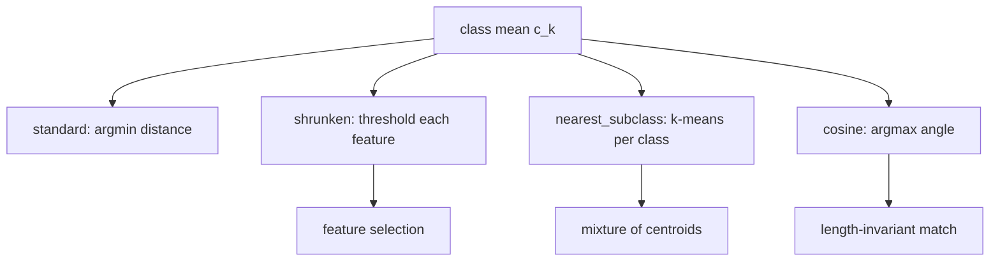

# Nearest centroid — the classifier you can fit with an average

`nearest_centroid.py` · Kernels and instance · Tier 2 · 4 variants

## Intuition

Take the average of each class and send a new point to the nearest average.
That is the whole model, it costs one pass over the training set, and it stores
$K$ vectors instead of $n$:

```
       x₂
        │        class 1
        │       ·  ·  ·
        │      ·  ·⊕·  ·        ⊕ = class mean, c₁
        │       ·  ·  ·
        │            ╲
        │             ╲  the boundary is the perpendicular bisector
        │              ╲
        │   ·  ·  ·     ╲
        │  ·  ·⊕·  ·     ╲      ⊕ = class mean, c₀
        │   ·  ·  ·       ╲
        └──────────────────────── x₁
```

The decision boundary is a straight line, always, because the rule compares two
squared distances and their difference is linear in $x$. It is therefore the
cheapest linear classifier there is — cheaper than logistic regression and
cheaper than a linear SVM, with no iterations and no margin parameter.

The rule is not a heuristic. If every class is a Gaussian with the *same*
covariance matrix, the Bayes-optimal classifier is a linear function of the
distance to the mean, and when that covariance is the identity the optimal rule
is exactly "nearest mean". Nearest centroid is linear discriminant analysis with
the covariance assumed away, which explains both why it is so cheap and where it
fails: a class that is a banana, or two blobs, has a mean that is nowhere near
its own points.

The three other variants are the repairs, and each repairs a different lie:

- `shrunken` repairs the lie that every feature is informative. It standardises
  each feature by its within-class spread and soft-thresholds the class means
  towards the overall mean, so a feature whose class means are within noise is
  set to the same value in every class and stops voting. This is the nearest
  shrunken centroid of Tibshirani and coauthors, and it is why the method worked
  on gene expression data with twenty thousand columns and sixty rows.
- `nearest_subclass` repairs the lie that each class is one blob. It replaces a
  class by a small k-means mixture, so a class made of two clusters gets two
  centroids and the average stops lying.
- `cosine` repairs the lie that distance is the right comparison. When the
  length of a vector is noise — document length, exposure time, embedding norm —
  the angle is the signal and the Euclidean distance is not.

The demo is a sequence of failure and repair. On three separated blobs the plain
rule is right 92.8 % of the time and a 1-nearest-neighbour baseline is at
90.5 %, because one estimated mean has less variance than four hundred stored
points. On a class made of two blobs the plain rule falls to 0.502 — a coin
flip, and the centroids are both at the origin — while two subclasses reach
1.000. On 600 features with 30 training points, shrinkage lifts held-out
accuracy from 0.929 to 0.993 while the retained set falls from 600 features to
11, and then, once the threshold passes the signal, the model collapses to the
majority class, which is the correct behaviour of a rule that has been told
every feature is noise. On documents of random length, Euclidean distance gets
0.890 and cosine gets 1.000.

## Variants

| variant | replaces | parameter | fixes |
|:--|:--|:--|:--|
| `standard` | — | — | the baseline |
| `shrunken` | the mean by a thresholded mean | `shrinkage` | uninformative features |
| `nearest_subclass` | one mean by $k$ means | `n_subclasses` | multimodal classes |
| `cosine` | the distance by the angle | — | magnitude as noise |



**`standard`** is the rule in the title: one mean per class, squared Euclidean
distance, no parameters. Its `decision_function` returns the negative squared
distance per class, so larger is better and `predict` is an `argmax`.

**`shrunken`** is the nearest shrunken centroid. It estimates a pooled
within-class standard deviation per feature, converts each class mean into a
standardised deviation from the overall mean, soft-thresholds that deviation at
`shrinkage`, and reconstructs the centroid. The classifier then scores with the
standardised distance and the class log-prior. Zero shrinkage reproduces the
plain rule on standardised data; infinite shrinkage sends every centroid to the
overall mean and the model to the majority class.

**`nearest_subclass`** runs k-means inside each class and keeps the resulting
centres with a pointer back to their class. Scoring takes the best subclass per
class. With `n_subclasses=1` and a fixed seed it is the plain rule; with two it
is a piecewise-linear boundary that can carve out a class with two modes.

**`cosine`** normalises both the point and the centroid and scores with the dot
product, which is the cosine of the angle between them. The centroid is still
the arithmetic mean of the class, which is a subtle choice: the mean of
unnormalised vectors is the direction of their sum, and that is exactly the
Rocchio relevance centroid from information retrieval.

## Derivation

### The rule

Let class $k$ have $n_k$ points and mean

$$
c_k=\frac{1}{n_k}\sum_{j:\,y_j=k}x_j ,
\qquad (1)
$$

and predict the class whose mean is closest, $\hat y(x)=\arg\min_k\|x-c_k\|^2$.
Expanding the square, $\|x-c_k\|^2=\|x\|^2-2x^{\top}c_k+\|c_k\|^2$, and the
$\|x\|^2$ term is the same for every class, so the rule is

$$
\hat y(x)=\arg\max_k\left(x^{\top}c_k-\tfrac12\|c_k\|^2\right).
\qquad (2)
$$

The boundary between two classes is where the two scores are equal, which is a
hyperplane with normal $c_i-c_j$: nearest centroid is a linear classifier whose
weights are differences of class means.

### Why it is LDA without the covariance

Let class $k$ be Gaussian with mean $\mu_k$ and covariance $\Sigma$, the same
for every class, and prior $\pi_k$. The discriminant is

$$
\log p(x\mid k)+\log\pi_k
=-\tfrac12(x-\mu_k)^{\top}\Sigma^{-1}(x-\mu_k)+\log\pi_k+\mathrm{const} .
\qquad (3)
$$

The quadratic term in $x$ does not depend on $k$, so the comparison reduces to

$$
\hat y(x)=\arg\max_k\left(\mu_k^{\top}\Sigma^{-1}x
-\tfrac12\mu_k^{\top}\Sigma^{-1}\mu_k+\log\pi_k\right),
\qquad (4)
$$

which is LDA. Now write $W=\Sigma^{-1/2}$ and complete the square:

$$
\mu_k^{\top}\Sigma^{-1}x-\tfrac12\|\Sigma^{-1/2}\mu_k\|^2
=\tfrac12\|Wx\|^2-\tfrac12\|Wx-W\mu_k\|^2 .
\qquad (5)
$$

The first term is common to all classes, so the optimal rule is exactly
nearest-centroid in whitened space: transform every point by $W$ and take the
nearest mean. Nearest centroid is LDA with the whitening step skipped, which is
optimal when $\Sigma$ is a multiple of the identity and otherwise merely cheap.

With unequal priors the rule gains the term $\log\pi_k$, and with a per-feature
standard deviation $s_i$ it becomes the standardised distance the `shrunken`
variant uses. The demo's closed-form LDA agrees with the whitened nearest
centroid on every held-out point, which is a direct check of (5).

### Shrinkage

The nearest shrunken centroid starts from a pooled within-class standard
deviation per feature,

$$
s_i=\sqrt{\frac{1}{n-K}\sum_{k=1}^{K}\sum_{j:\,y_j=k}
\left(x_{ji}-\bar x_{ki}\right)^2},
\qquad (6)
$$

and the overall mean $\bar x_i$. The class mean is turned into a standardised
deviation from the overall mean, scaled by how much a mean of $n_k$ points can
wander:

$$
d_{ik}=\frac{\bar x_{ki}-\bar x_i}{m_k\,s_i},
\qquad m_k=\sqrt{\frac{1}{n_k}-\frac{1}{n}} .
\qquad (7)
$$

The factor $m_k$ is the standard error of the difference between the class mean
and the overall mean, so $d_{ik}$ is a $t$-like statistic: how many standard
errors the class sits away from the pool. Soft-thresholding it,

$$
d'_{ik}=\mathrm{sign}(d_{ik})\,\max\left(|d_{ik}|-\Delta,\,0\right),
\qquad (8)
$$

sets to zero every feature whose class deviation is within $\Delta$ standard
errors, and the shrunken centroid is the reconstruction

$$
\bar x'_{ik}=\bar x_i+m_k\,s_i\,d'_{ik} .
\qquad (9)
$$

Classification uses the standardised distance and the log-prior,

$$
\hat y(x)=\arg\min_k\left(\sum_i\frac{(x_i-\bar x'_{ik})^2}{s_i^2}
-2\log\pi_k\right),
\qquad (10)
$$

which is (4) with a diagonal covariance and the shrunken means. The variant is
therefore a feature selector and a classifier in one: a feature whose $d'_{ik}$
is zero in every class contributes the same value to every score and cannot
change the answer. The demo measures the two ends of that trade: at $\Delta=3$
the model keeps 11 of 600 features and 11 of the 12 informative ones, and
accuracy peaks; at $\Delta=10$ it keeps nothing, every centroid equals the
overall mean, and the answer is the majority class.

### Subclasses

For a class with several modes, replace one centroid by $J$ of them and solve

$$
\min_{\{c_{kj}\}}\sum_{k}\sum_{j:\,y_j=k}\min_{m}\|x_j-c_{km}\|^2 ,
\qquad (11)
$$

which is $K$ independent k-means problems, each solved by Lloyd's algorithm from
a k-means++ start. The decision rule becomes

$$
\hat y(x)=\arg\min_k\min_m\|x-c_{km}\|^2 ,
\qquad (12)
$$

still piecewise linear, but with as many pieces as there are subclasses. This is
a crude Gaussian mixture classifier: the mixture weights and covariances are
dropped, and only the centres are kept.

### Cosine

For the angle, score

$$
\hat y(x)=\arg\max_k\frac{x^{\top}c_k}{\|x\|\,\|c_k\|},
\qquad (13)
$$

which ignores $\|x\|$ entirely. It is the right rule when a point's direction is
its content and its length is an accident of how it was measured, and it costs
one normalisation per row.

## Code walkthrough

### The distance, without a loop

```python
    squared = (np.sum(X ** 2, axis=1)[:, None]
               + np.sum(C ** 2, axis=1)[None, :]
               - 2.0 * X @ C.T)
    return np.maximum(squared, 0.0)
```

The expansion of $\|x-c\|^2$ as three matrix operations: the row norms of the
points, the row norms of the centroids, and the cross term. It is the standard
identity, and the `maximum` is not decoration — for nearly identical vectors the
subtraction leaves a small negative number, and a negative squared distance
would sort below zero and win an `argmax` it should not.

### Shrinkage in ten lines

```python
        for group in groups:
            centred = points[group] - points[group].mean(axis=0)
            total += np.sum(centred ** 2, axis=0)
        spread = np.sqrt(total / max(rows - len(groups), 1))
```

The pooled within-class variance of (6), accumulated one class at a time: each
class is centred on its own mean, so the class means themselves do not inflate
the spread. The denominator is the residual degrees of freedom, $n-K$.

```python
        for group in groups:
            scale = np.sqrt(1.0 / group.size - 1.0 / rows)
            deviation = (points[group].mean(axis=0) - overall) / (scale * spread)
            keep = np.sign(deviation) * np.maximum(
                np.abs(deviation) - self.shrinkage, 0.0)
            centroids.append(overall + scale * spread * keep)
```

(7), (8) and (9) in order. The `scale` is $m_k$, which is where the method
differs from naive thresholding of the means: a class with ten points is allowed
to sit further from the pool before its deviation counts as real than a class
with a thousand. `np.sign` times `maximum` is the soft threshold, and the
reconstruction multiplies back by exactly the factor that standardised it, so a
feature with $d'=d$ comes back unchanged.

### Scoring the shrunken model

```python
        if self.variant == "shrunken":
            standardised = (points[:, None, :]
                            - self.centroids_[None, :, :]) / self.scales_
            return -np.sum(standardised ** 2, axis=2) + 2.0 * np.log(self.priors_)
```

(10) with the sign flipped so that larger is still better. The broadcasting
builds an $(m, K, d)$ array of differences — one temporary of size
$m\cdot K\cdot d$ — and reduces it in one pass. The log-prior is the
$-\log\pi_k$ of (10) moved to the left. The `standard` and `nearest_subclass`
variants do not use priors, which is a deliberate asymmetry: they are the
unregularised baseline, and adding a prior to them would hide the effect the
demo is trying to measure.

### Subclass scoring

```python
        scores = np.full((points.shape[0], self.classes_.size), -np.inf)
        for column, owner in enumerate(self.centroid_classes_):
            scores[:, owner] = np.maximum(scores[:, owner], distance[:, column])
        return scores
```

(12): each subclass scores its own class, and the class takes the best of its
subclasses. `-inf` is the identity for `maximum`, so a class with no centroid
cannot accidentally win — impossible here, but the initialisation says what the
reduction means. The cost is one pass over the subclass columns after the
distance matrix, not a second distance matrix.

### Cosine

```python
        if self.variant == "cosine":
            norms = np.linalg.norm(points, axis=1, keepdims=True)
            norms[norms == 0.0] = 1.0
            unit = points / norms
            target = self.centroids_ / np.linalg.norm(
                self.centroids_, axis=1, keepdims=True)
            return unit @ target.T
```

(13), with one guard: a zero vector has no angle, so its norm is replaced by one
and the point is scored against the origin. Without the guard the division
propagates `nan` into the `argmax`, and `nan` comparisons are false, so the
prediction becomes the first class — a silent, data-dependent bug rather than an
error. The centroids are normalised at predict time rather than stored
normalised, because `centroids_` is part of the public state and should be the
means, not a rescaled version of them.

## Complexity

Let $n$ be the training count, $d$ the features, $K$ the classes, $J$ the
subclasses per class, $I$ the k-means iterations, and $m$ the test count.

| operation | time | memory |
|:--|:--|:--|
| fit, `standard` | $O(nd)$ | $O(Kd)$ |
| fit, `shrunken` | $O(nd+Kd)$ | $O(Kd+d)$ |
| fit, `nearest_subclass` | $O(nKJI)$ | $O(KJd)$ |
| fit, `cosine` | $O(nd)$ | $O(Kd)$ |
| predict on $m$ points | $O(mKd)$ | $O(mK)$ |
| model size | — | $O(Kd)$ |

Fitting is a single pass to accumulate sums, and prediction is one matrix
product. That is the entire appeal: no Gram matrix, no iterations, no
hyperparameters except the two the repairs introduce. The k-means inside
`nearest_subclass` is the only part that iterates, and it is $I\approx50$ passes
over one class at a time, so it stays linear in $n$ with a constant that depends
on $J$.

The model is also small in the way that matters on a device: 600 features and
three classes is 1 800 numbers plus the scales, against $n\cdot d$ for a
nearest-neighbour rule and $n$ support vectors for an SVM. The demo's 1-NN
baseline has to keep every training point to be beaten by a model with one mean
per class.

## Failure modes

**A class that is not one blob.** The mean of two separated clusters sits
between them, where no sample lives. The demo's XOR geometry puts both class
means within 0.1 of the origin and the plain rule at 0.502; two subclasses take
it to 1.000. Any time the within-class scatter is larger than the
between-class separation, suspect this before tuning anything.

**Features on different scales.** A feature measured in thousands dominates one
measured in fractions, and the nearest mean is effectively chosen by the loudest
column. Standardise first, or use `shrunken`, which divides by the within-class
spread and is scale-invariant by construction. The plain variant has no such
protection, and it is the most common reason nearest centroid loses to logistic
regression on tabular data.

**High dimensions and small samples.** With $d$ comparable to $n$, each class
mean is estimated from a handful of points per coordinate, and the estimate's
variance is $O(d/n)$. Shrinkage is the fix, and the demo shows both sides: the
optimum at $\Delta=3$ keeps 11 features and scores 0.993; $\Delta=4$ keeps 9 and
drops to 0.969, because it has started to delete signal. The threshold is a
hyperparameter and needs a validation split — the training accuracy is monotone
in it and useless for choosing.

**Magnitude that is not content.** A long document and a short one on the same
topic are far apart in Euclidean distance and identical in angle. The demo's
short documents of the long class sit closer to the wrong centroid than to the
right one, and Euclidean distance scores 0.890. `cosine` fixes it, but only if
length really is noise; for measurements where magnitude carries information,
cosine throws that information away.

**Unequal class sizes and no priors.** `standard` and `nearest_subclass` ignore
$n_k$, so a rare class with a noisy mean can lose to a common one that happens
to be nearby. `shrunken` is the only variant that adds $\log\pi_k$. If the
priors matter, the fix is a line of code, but it has to be a deliberate one.

**A single class, or a class with no points.** Both are refused at `fit`. One
class has nothing to compare against and the classifier would return that class
for everything; the code raises rather than doing that quietly.

**Ties.** Two equidistant means resolve to the lower class index because
`argmax` returns the first maximum. With continuous features this is measure
zero; with integer or categorical features it is common, and the tie-break is
documented by the code rather than chosen by the data.

**Reading `decision_function` as a probability.** The scores are negative
squared distances, so they are unbounded below and have no calibration. A score
of $-0.3$ and a score of $-30$ both mean "closest so far". Only the ranking
within one fitted model is meaningful, exactly as with the one-class decision
values.

## Applications

**Text classification.** The Rocchio classifier — centroid per category, cosine
similarity — is the classic relevance-feedback method in information retrieval
and remains a strong baseline for topic tagging. It needs no training loop, and
it degrades gracefully as categories are added.

**Gene expression and biomarkers.** PAM (prediction analysis for microarrays)
is the shrunken variant applied to expression data, where $d$ is in the
thousands and $n$ in the dozens. It was designed for exactly the regime in which
the plain rule fails, and the shrunken centroids double as a gene panel.

**Speaker and writer identification.** A centroid per speaker in MFCC or
embedding space, scored by cosine, is a standard text-independent baseline and
the fallback when an i-vector or neural system is unavailable.

**Prototype networks and few-shot learning.** A class mean of embedded examples
is the nearest-centroid rule in a learned metric, and prototypical networks are
its modern form: the embedding replaces the raw features and the rest of the
algorithm is unchanged.

**Retrieval over embeddings.** For a fixed set of categories, one vector per
category is an approximate index that fits in cache and answers in one matrix
product, which is often the right trade against an exact nearest-neighbour
search.

**Anomaly triage.** The distance to the nearest class centroid is a crude
novelty score: a point far from every mean is worth a second look even if the
`argmax` is confident. It is the cheapest version of the one-class idea in the
previous atom.

**A baseline that is hard to beat.** On small, noisy, roughly Gaussian data the
variance of the estimate matters more than its bias, and one mean per class
beats $k$-NN — the demo's 0.928 against 0.905 at 400 points. Reporting nearest
centroid in a comparison is a service to the reader.

## References

- Tibshirani, R., Hastie, T., Narasimhan, B. & Chu, G. (2002). Diagnosis of
  multiple cancer types by shrunken centroids of gene expression. *PNAS* 99(10),
  6567–6572. The nearest shrunken centroid, (6)–(10).
- Hastie, T., Tibshirani, R. & Friedman, J. (2009). *The Elements of Statistical
  Learning*, 2nd ed., §4.3 and §18.3. Springer. Nearest centroid as LDA with a
  diagonal or skipped covariance, and the PAM algorithm.
- Rocchio, J. J. (1971). Relevance feedback in information retrieval. In
  *The SMART Retrieval System*, Prentice-Hall. The centroid classifier with
  cosine similarity.
- Manning, C. D., Raghavan, P. & Schütze, H. (2008). *Introduction to
  Information Retrieval*, ch. 14. Cambridge University Press. Rocchio
  classification and its use in text.
- Cover, T. M. & Hart, P. E. (1967). Nearest neighbor pattern classification.
  *IEEE Transactions on Information Theory* 13(1), 21–27. The baseline the
  centroid is compared against.
- Friedman, J. H. (1989). Regularized discriminant analysis. *JASA* 84(405),
  165–175. Shrinkage between a full and a diagonal covariance, the idea
  `shrunken` applies to the means.
- Snell, J., Swersky, K. & Zemel, R. (2017). Prototypical networks for few-shot
  learning. *NeurIPS*. The class mean in a learned metric.
- Hand, D. J. & Yu, K. (2001). Idiot's Bayes — not so stupid after all?
  *International Statistical Review* 69(3), 385–398. Why a naive, independence-
  assuming classifier so often wins.
