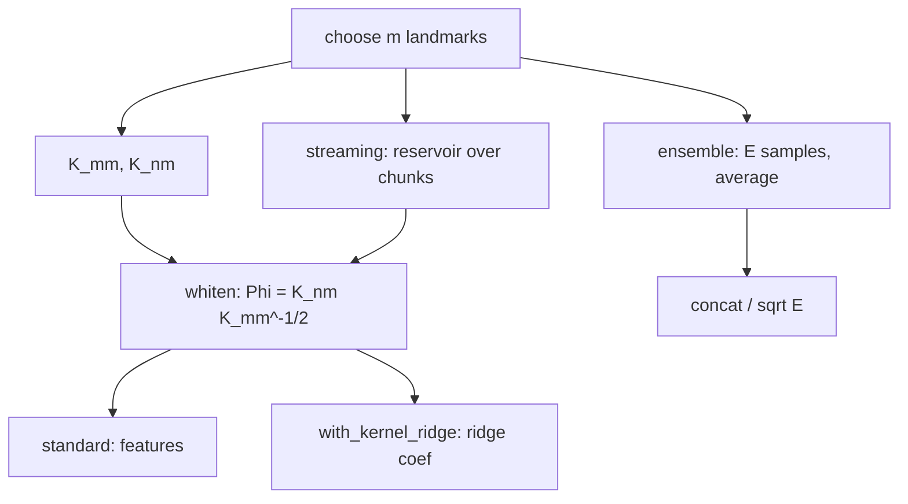

# Nyström approximation — read a kernel from a handful of its rows

`nystrom.py` · Kernels and instance · Tier 3 · 4 variants

## Intuition

A kernel method never needs the points, only their inner products, and that is
usually a gift. Here it is the bill: the inner products are an $n\times n$ matrix
that has to be built, stored and often inverted, so a hundred thousand points is
ten billion entries and a kernel ridge fit is a cubic solve. The Nyström method
answers the obvious question — do we really need every entry? — by keeping $m$
rows and reconstructing the rest:

```
             all pairs                       m landmarks
        ┌──────────────────┐            ┌──────┬───────────┐
        │                  │            │ K_mm │   K_mn    │  ← keep these rows
        │    K  (n × n)    │     →      ├──────┼───────────┤
        │                  │            │ K_nm │     ?     │  ← rebuild from K_mm
        └──────────────────┘            └──────┴───────────┘

        K  ≈  K_nm K_mm⁻¹ K_mn  =  Φ Φᵀ        Φ = K_nm K_mm^{-1/2}
```

The landmarks are rows of the data, so $K_{nm}$ is one kernel evaluation per
pair of a point and a landmark, and $K_{mm}^{-1}$ is the only inverse — of an
$m\times m$ matrix. The approximation is the exact kernel matrix of a feature
map $\Phi$ with $m$ columns, so anything linear in the features is a kernel
method with an $m$-dimensional budget: kernel ridge, kernel PCA, a linear SVM,
spectral clustering, MMD.

Why it works is a projection. A kernel is an inner product in some feature
space, $k(x,z)=\langle\varphi(x),\varphi(z)\rangle$. Let $P$ be the orthogonal
projection onto the span of the landmark features. Then

$$
\langle P\varphi(x),P\varphi(z)\rangle
=k(x,\cdot)^{\top}K_{mm}^{-1}k(z,\cdot)
=\Phi(x)^{\top}\Phi(z),
\qquad (1)
$$

so the Nyström approximation is the kernel of the projected features. That one
sentence explains everything good and bad about it. A projection never makes a
vector longer, so the approximation never overstates a self-similarity: the
diagonal is at most the true $k(x,x)$. A projection is exact on the subspace it
projects onto, so the approximation is exact on the landmarks. And a projection
loses whatever lies outside the span, so the error is the part of the kernel the
landmarks cannot see — which is small when the kernel matrix is close to rank
$m$ and large when it is not.

The variants are four ways to spend the $m$ landmarks. `standard` samples them
uniformly. `ensemble` spends $E$ times the memory on independent samples and
averages, which leaves each map's bias alone and divides its seed-to-seed
spread. `streaming` keeps a reservoir sample as the data arrives, so the Gram
matrix is never formed and memory is $O(md)$ rather than $O(nd)$.
`with_kernel_ridge` puts the features to work: a ridge readout on $\Phi$ is
exactly kernel ridge with the approximated kernel, by the Woodbury identity, and
the demo checks that equality rather than assuming it.

## Variants

| variant | landmarks | memory | gives |
|:--|:--|:--|:--|
| `standard` | one uniform sample of $m$ rows | $O(nm)$ | the feature map |
| `ensemble` | $E$ samples, averaged | $O(Enm)$ | lower seed variance |
| `streaming` | reservoir, $m$ rows held | $O(md)$ | one pass, bounded memory |
| `with_kernel_ridge` | one sample of $m$ rows | $O(nm)$ | ridge readout |



**`standard`** is the method as usually stated: choose $m$ rows uniformly
without replacement, form $K_{mm}$ and $K_{nm}$, and return
$\Phi=K_{nm}K_{mm}^{-1/2}$. This variant accepts no targets; its job is the
approximation, and `reconstruction_error` is how you judge it.

**`ensemble`** fits $E$ independent landmark samples with `n_components // E`
landmarks each and concatenates their features divided by $\sqrt{E}$. The dot
product in the concatenated space is the average of the $E$ approximations, so
the feature dimension is still `n_components` — the same downstream cost as one
map of that size, but $E$ times the fitting cost and memory because every map
keeps its own rows.

**`streaming`** keeps a reservoir sample of at most $m$ rows. Each arriving row
replaces a uniformly chosen slot with probability $m/t$, which makes the stored
set a uniform sample of everything seen so far. The whitener is recomputed
lazily, so a stream pays one $O(m^3)$ factorisation at the first `transform`
after the last replacement, not one per chunk.

**`with_kernel_ridge`** fits $\Phi$ on the training data and solves the
$m\times m$ ridge system. `predict` is a linear function of the features, which
by the identity in the next section is the same predictor as kernel ridge with
the approximated kernel.

## Derivation

### The block inverse

Partition the kernel matrix into the landmark block and the rest:

$$
K=\begin{bmatrix}K_{mm} & K_{mn}\\ K_{nm} & K_{nn}\end{bmatrix}.
\qquad (2)
$$

The exact Schur complement of $K_{mm}$ gives

$$
K_{nn}=K_{nm}K_{mm}^{-1}K_{mn}
+\left(K_{nn}-K_{nm}K_{mm}^{-1}K_{mn}\right),
\qquad (3)
$$

and the second term is the part of the kernel that the landmarks cannot explain.
The Nyström approximation is exactly the first term — it *assumes the residual is
zero*. That is the whole method, and it is why the error is a rank statement
rather than a sampling statement: if $K$ has rank at most $m$, the residual
vanishes for any $m$ independent landmarks and the approximation is exact.

### Whitening

$K_{mm}$ is symmetric positive semidefinite, so write $K_{mm}=V\Lambda V^{\top}$
with $V$ orthogonal and $\Lambda$ the eigenvalues. Then

$$
K_{mm}^{-1/2}=V\Lambda^{-1/2}V^{\top},\qquad
\Phi=K_{nm}K_{mm}^{-1/2}=K_{nm}V\Lambda^{-1/2}V^{\top}.
\qquad (4)
$$

The code stores $W=V\Lambda^{-1/2}$ and computes $\Phi=K_{nm}W$. This is a valid
square root without the second $V^{\top}$, because

$$
\Phi\Phi^{\top}=K_{nm}V\Lambda^{-1}V^{\top}K_{mn}
=K_{nm}K_{mm}^{-1}K_{mn},
\qquad (5)
$$

and it is cheaper: one matrix product instead of two. On the landmarks
themselves $K_{mm}W=K_{mm}^{1/2}$, so $\Phi_m\Phi_m^{\top}=K_{mm}$ exactly:
the approximation interpolates its own rows.

### The projection bound

Because $\Phi(x)=K_{mm}^{-1/2}k(x,\cdot)$ is the coordinate vector of the
projection of $\varphi(x)$ onto the landmark span, the residual is a squared
distance and cannot be negative:

$$
k(x,x)-\Phi(x)^{\top}\Phi(x)
=\|\varphi(x)-P\varphi(x)\|^2\ \ge\ 0 .
\qquad (6)
$$

This is the "shrinker" property the demo checks on the diagonal: the
approximation understates self-similarity away from the landmarks and gets it
exactly right on them. It also says the approximation is a valid kernel — a
Gram matrix of real vectors — which is why a linear model on $\Phi$ is a kernel
model and why the features can be passed to any downstream method.

### Ensemble

Let $\Phi_e$ be the feature map of the $e$-th landmark sample, and define the
concatenated features

$$
\Psi(x)=\frac{1}{\sqrt{E}}\left[\Phi_1(x);\ldots;\Phi_E(x)\right].
\qquad (7)
$$

Then $\Psi(x)^{\top}\Psi(z)=\frac1E\sum_e\Phi_e(x)^{\top}\Phi_e(z)$: the kernel
approximation is the average of the $E$ maps. If each map is an unbiased draw of
the same random approximation, the average has the same expectation and its
variance is $1/E$ of one map's. The bias is untouched, which is why ensembling
cannot rescue too few landmarks per map — and why the demo's equal-dimension
comparison is the honest one.

### Streaming

After $t$ rows, the reservoir holds a uniformly random subset of size
$\min(m,t)$: the $t$-th row is kept with probability $m/t$, and every earlier
row has the same chance of being displaced. By induction the set is exchangeable,
so the final $m$ rows are a uniform sample of the $n$ without ever storing more
than $m$. That is the same landmark distribution `standard` draws, which is why
the demo's streaming errors have the same mean and spread as the batch ones.

### Ridge and Woodbury

The primal readout on the features is

$$
\hat\beta=\left(\Phi^{\top}\Phi+\lambda I_m\right)^{-1}\Phi^{\top}y ,
\qquad (8)
$$

and the prediction on a test block is $\Phi_t\hat\beta$. Kernel ridge with the
approximated kernel instead works in dual space,

$$
\hat\alpha=\left(\hat K+\lambda I_n\right)^{-1}y,
\qquad \hat K=\Phi\Phi^{\top},
\qquad (9)
$$

and predicts $\hat K_t\hat\alpha=\Phi_t\Phi^{\top}\hat\alpha$. The two agree
because of the identity

$$
\left(\Phi^{\top}\Phi+\lambda I_m\right)^{-1}\Phi^{\top}
=\Phi^{\top}\left(\Phi\Phi^{\top}+\lambda I_n\right)^{-1},
\qquad (10)
$$

which is Woodbury with $U=\Phi^{\top}$, $V=\Phi$, $C=\lambda I_m$. Multiplying
(10) on the right by $y$ and on the left by $\Phi_t$ gives

$$
\Phi_t\hat\beta=\Phi_t\Phi^{\top}\hat\alpha ,
\qquad (11)
$$

so the $m$-dimensional primal solve and the $n$-dimensional dual solve are the
same predictor. The demo measures the difference as $6.7\times10^{-14}$.

### Cost

Building $\Phi$ costs $O(nmd)$ for the kernel block, $O(m^2d)$ for $K_{mm}$ and
$O(m^3)$ for the eigendecomposition. A prediction costs $O(md)$. The point of
the method is the comparison with the exact route, whose Gram matrix is
$O(n^2d)$ and whose solve is $O(n^3)$: for $m\ll n$ every term is smaller.

## Code walkthrough

### The whitener

```python
    @staticmethod
    def _whitener(gram: np.ndarray) -> np.ndarray:
        """``K^{-1/2}`` through an eigendecomposition with a floor."""
        values, vectors = np.linalg.eigh(gram)
        scale = float(np.max(np.abs(values)))
        floor = max(scale, 1.0) * 1e-12
        values = np.maximum(values, floor)
        return vectors / np.sqrt(values)
```

(4) with a guard. `eigh` returns ascending eigenvalues and orthonormal vectors,
so dividing the columns of `vectors` by $\sqrt{\lambda}$ gives
$V\Lambda^{-1/2}$, which is the stored map. The floor is what makes duplicate or
nearly dependent landmarks survivable: a zero eigenvalue would make
$K_{mm}^{-1/2}$ infinite, so it is lifted to $10^{-12}$ of the largest. That is
not free — the lifted direction gets a huge feature value — but it keeps the
factorisation finite and the failure visible in the feature norms rather than in
a `LinAlgError`.

### Choosing landmarks

```python
        count = min(self.n_components, points.shape[0])
        chosen = rng.choice(points.shape[0], size=count, replace=False)
        chosen.sort()
        self.landmarks_ = points[chosen].copy()
        self.map_ = self._whitener(self._kernel(self.landmarks_,
                                                self.landmarks_))
```

Uniform sampling without replacement, then the factorisation. Sorting the
indices is cosmetic for the result but makes the stored landmarks reproducible
row for row, which matters when two models are compared. `count` is clamped to
$n$: asking for more landmarks than points is not an error, it just means the
approximation is exact.

### Features

```python
        if self.map_ is None:
            self.map_ = self._whitener(self._kernel(self.landmarks_,
                                                    self.landmarks_))
        return self._kernel(points, self.landmarks_) @ self.map_
```

$K(X,Z)W$ for a test block $X$: one kernel evaluation per point-landmark pair,
one $m\times m$ product. Nothing here is $n\times n$, which is the entire
reason the method exists. The lazy factorisation is shared with the streaming
variant, where the landmarks can change after the map was computed.

### The ensemble

```python
        if self.variant == "ensemble":
            width = np.sqrt(len(self.parts_))
            return np.concatenate(
                [self._kernel(points, landmarks) @ mapping
                 for landmarks, mapping in self.parts_], axis=1) / width
```

(7). Each part contributes its own $m/E$ columns and the concatenation is scaled
by $1/\sqrt{E}$, so the squared norm of a row is the average of the parts'
squared norms. Dividing by $E$ instead of $\sqrt{E}$ would shrink the kernel
by $1/\sqrt{E}$ and silently change the ridge penalty's meaning.

### The reservoir

```python
        for row in points:
            self.n_seen_ += 1
            held = self.landmarks_.shape[0]
            if held < self.n_components:
                self._buffer[held] = row
                self.landmarks_ = self._buffer[:held + 1]
                self.map_ = None
            else:
                slot = int(self._rng.integers(self.n_seen_))
                if slot < self.n_components:
                    self._buffer[slot] = row
                    self.map_ = None
```

Algorithm R. `integers(self.n_seen_)` draws uniformly from $0,\ldots,t-1$; if
the draw lands in the buffer the row replaces that slot, which happens with
probability $m/t$ once the buffer is full. The buffer is preallocated, so the
stream never copies the array, and `landmarks_` is a view of length
`held`. `map_ = None` is the invalidation: the next `transform` refactors, and a
stream that ends without another `transform` never pays for the factorisation.

### The readout

```python
        if self.variant == "with_kernel_ridge":
            if targets is None:
                raise ValueError("with_kernel_ridge needs targets y")
            features = self.transform(points)
            system = (features.T @ features
                      + self.lam * np.eye(self.n_components_))
            self.coef_ = np.linalg.solve(system, features.T @ targets)
```

(8) in three lines. The system is $m\times m$; the $O(nm)$ product
$\Phi^{\top}\Phi$ is the expensive part, not the solve. There is no intercept,
which is deliberate: an unpenalised bias would need an extra coordinate and a
modified Woodbury identity, and the identity is what the demo checks. Centre
$y$ first if a bias is wanted.

## Complexity

Let $n$ be the training count, $d$ the features, $m$ the landmarks, $E$ the
ensemble size, and $m_t$ the test count.

| operation | time | memory |
|:--|:--|:--|
| kernel block $K_{nm}$ | $O(nmd)$ | $O(nm)$ |
| factorisation of $K_{mm}$ | $O(m^3)$ | $O(m^2)$ |
| features of $m_t$ points | $O(m_tmd)$ | $O(m_tm)$ |
| full kernel matrix | — | $O(n^2)$ |
| exact kernel ridge solve | $O(n^3)$ | $O(n^2)$ |
| ensemble fit | $O(Enmd+Em^3)$ | $O(Enm)$ |
| streaming pass | $O(nmd+m^3)$ | $O(md+m^2)$ |

The comparison that matters is $m$ against $n$: every term is linear in $n$ and
cubic in $m$, so the method turns an $O(n^3)$ problem into $O(nm^2)$ with a
memory ceiling of $m$ rows. In the demo, 400 points with 40 landmarks mean a
$40\times40$ solve instead of a $400\times400$ one, and predict at 3.1 times the
exact test error; the crossover depends on how fast the spectrum of $K$ decays.

## Failure modes

**Too few landmarks.** This is the only failure that matters in practice, and
it is not subtle: at $m=5$ the ridge readout's test error is 76.8 times the exact
one, and even the reconstruction is off by 0.31 in relative Frobenius norm. The
error tracks the tail of the kernel's spectrum. A useful diagnostic is to plot
`reconstruction_error` against $m$ and stop where it flattens; a useful default
is $m\approx\sqrt{n}$ for smooth kernels, with the caveat that the constant
depends on the dimension and the bandwidth.

**Spending the budget on an ensemble.** Four maps of 15 landmarks have the same
feature dimension as one map of 60 and reconstruct at 0.0596 against 0.0071 —
eight times worse. The ensemble reduces the variance of an approximation whose
bias is set by the landmarks per map, and the bias dominates. Use it to stabilise
a map size you have already chosen, not to replace a bigger map.

**A kernel that is not low rank.** If the kernel matrix has a flat spectrum —
a very narrow RBF kernel, or a linear kernel on high-dimensional data — then no
small set of rows spans it and the approximation is bad at every $m<n$. The
symptom is a reconstruction error that barely falls as landmarks are added. The
cure is a different kernel or exact methods, not more landmarks.

**Nearly dependent landmarks.** Duplicate rows make $K_{mm}$ singular, and the
eigenvalue floor turns the null directions into enormous feature values. The
model still runs, but the features are dominated by rounding noise and the ridge
solve is badly conditioned. Deduplicate before sampling, or raise the floor and
accept the bias.

**Indefinite kernels.** The Laplacian kernel is conditionally positive definite
and the sigmoid kernel is not positive definite at all. Their landmark Gram
matrices can have negative eigenvalues; clipping them at the floor is a
projection onto the PSD cone, and the resulting features approximate a different
kernel from the one you asked for. The approximation is still a valid kernel,
which is why it does not crash, but `reconstruction_error` is measuring the
distance to the wrong target.

**Data whose distribution moves.** Landmarks drawn from the first half of a
stream say nothing about the second half if the distribution shifts, and the
projection error becomes a covariate-shift error. Reservoir sampling keeps the
landmark set representative of everything seen, but it cannot represent what has
not arrived. Re-fit or slide the reservoir when the stream changes regime.

**Judging by reconstruction error alone.** The two criteria disagree in the
demo: at $m=80$ the reconstruction improves to 0.0038 while the ridge test error
is 0.00058, slightly worse than 0.00055 at $m=40$. Reconstruction measures the
whole matrix; the downstream model cares about a few directions. Choose $m$ on
the task's validation error, using the reconstruction curve only as a sanity
check.

**Forgetting the missing intercept.** The readout has no bias, so a target with
a large mean is fitted by shifting every feature instead of the prediction. On
centred targets this is invisible; on raw counts it is a constant error that
looks like underfitting. Centre $y$ (and, for the RBF kernel, nothing else) or
add the bias explicitly with its own unpenalised column.

## Applications

**Gaussian processes at scale.** The Nyström approximation of the kernel is the
standard route to a sparse GP: the inducing points are the landmarks, and the
$m\times m$ system replaces the $n\times n$ one. Williams and Seeger's paper is
the origin of the method in machine learning, and the "subset of regressors"
approximation is exactly (1).

**Kernel ridge and SVM on large data.** Feeding $\Phi$ to a linear solver turns
a kernel method into a linear one with $m$ features: the primal ridge solve is
$m\times m$, and a linear SVM on $\Phi$ is a kernel SVM with the approximated
kernel. The demo's Woodbury identity is the licence for that substitution.

**Kernel PCA and spectral clustering.** Both need the top eigenvectors of the
kernel matrix. The Nyström features give them from an $m\times m$ eigendecomposition
plus a thin $n\times m$ product, which is the difference between feasible and not
on a million points.

**Two-sample and independence tests.** MMD and HSIC are quadratic forms in the
kernel matrix; replacing $K$ by $\Phi\Phi^{\top}$ turns them into norms and
inner products of $m$-dimensional averages, which is the linear-time estimator
in the next atom.

**Streaming and federated settings.** A reservoir of landmarks is a summary that
can be shipped, merged and refactored without the raw data: each site sends its
landmarks, the centre concatenates and subsamples, and every site can score with
the same $\Phi$. The privacy is not formal, but the data movement is $m$ rows
instead of $n$.

**A cheap first model.** Before committing to a full kernel method, fit the
Nyström version at $m=100$ and look at the validation curve. If it is already
good, the exact solve may not be worth its cost; if it is bad at every $m$, the
kernel or the features are wrong, and no amount of exact arithmetic will fix
that.

## References

- Williams, C. K. I. & Seeger, M. (2001). Using the Nyström method to speed up
  kernel machines. *NeurIPS*. The approximation (1) and its use for Gaussian
  processes.
- Drineas, P. & Mahoney, M. W. (2005). On the Nyström method for approximating a
  Gram matrix for improved kernel-based learning. *COLT*. Sampling guarantees
  and the column-based view.
- Kumar, S., Mohri, M. & Talwalkar, A. (2009). Ensemble Nyström method.
  *NeurIPS*. The averaged feature map (7) and its variance analysis.
- Gittens, A. & Mahoney, M. W. (2016). Revisiting the Nyström method for
  improved large-scale machine learning. *JMLR* 17(65), 1–71. The error
  analysis in terms of the spectrum, and the failure of uniform sampling on
  skewed kernels.
- Musco, C. & Musco, C. (2017). Recursive sampling for the Nyström method.
  *NeurIPS*. Leverage-score sampling, the fix for the skewed-kernel failure.
- Smola, A. J. & Schölkopf, B. (2000). Sparse greedy matrix approximation for
  machine learning. *ICML*. Choosing landmarks by greedy residual reduction
  instead of uniformly.
- Rudi, A., Camoriano, R. & Rosasco, L. (2015). Less is more: Nyström
  computational regularization. *NeurIPS*. Why the approximation can beat the
  exact solve on test error, as the demo's $m=160$ row does.
- Woodbury, M. A. (1950). *Inverting modified matrices*. Memorandum 42, Princeton.
  The identity (10).
