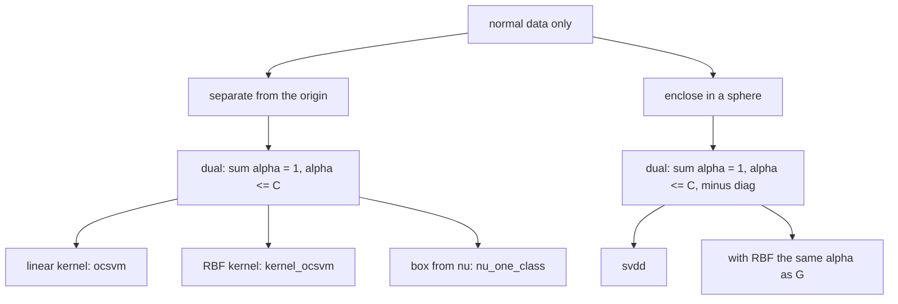

# One-class models — a boundary around the normal, learned from the normal

`one_class.py` · Kernels and instance · Tier 2 · 4 variants

## Intuition

Every classifier in this chapter so far needed two classes. Novelty detection
has one: the training set is normal, and the job is to say when a new point is
not. There is nothing to separate the data from except empty space, so the
one-class SVM separates it from the origin:

```
      x₂
       │            ·  ·  ·
       │         ·   ·   ·     ← the training set, all "normal"
       │        ·  ·  ·  ·
       │      ╭──────────╮  ← wᵀφ(x) = ρ, the boundary
       │     ╱            ╲
       │    │   margin ρ/‖w‖ │
       └────┼──────────────┼──────── wᵀφ(x) = 0
            │              │
      0 ────┴──────────────┴──────── x₁     the origin, on the wrong side
```

The model is the hyperplane with the largest margin from the training points
that still keeps the origin out. Points the margin cannot reach pay a slack, the
slack costs $C$ each, and the dual is therefore the same kind of program as the
SVM's — weights on training points, box-constrained — with one change that
rewrites the interpretation: the equality constraint $\sum_i\alpha_i=1$ replaces
$\sum_i\alpha_i y_i=0$. There is no label to balance against, so the weights are
a *distribution* over the training set, and every support vector's weight is a
share of one.

That constraint is also where $\nu$ comes from. If each weight is at most
$1/(\nu n)$, then at least $\nu n$ points must carry weight, and only a point at
the box can be on the wrong side of the boundary, so at most $\nu n$ points can
be rejected. Both bounds are counts, not averages, which is why $\nu$ is the
parameter people actually set: it is the fraction of the training set the model
is allowed to call abnormal.

The fourth variant is a different geometry with the same algebra. Instead of the
widest slab between the data and the origin, take the smallest sphere that
encloses the data — the support vector data description. With a linear kernel
the sphere and the slab are different models, and the demo's two centres differ
by a factor of two. With an RBF kernel they are the *same* model: the kernel
diagonal is one everywhere, so the sphere's radius term is a constant in the
dual, and the two decision functions differ by exactly a factor of two — a fact
the demo checks to $10^{-9}$.

## Variants

| variant | geometry | kernel | parameter |
|:--|:--|:--|:--|
| `ocsvm` | widest margin from the origin | linear | $C$ is the box |
| `kernel_ocsvm` | the same in feature space | RBF | $C$ is the box |
| `svdd` | smallest enclosing sphere | linear or RBF | $C$ is the box |
| `nu_one_class` | widest margin from the origin | RBF | $\nu$, box $=1/(\nu n)$ |



**`ocsvm`** is the linear model. The boundary is a hyperplane, the normal is
`w_`, and the margin is $\rho/\|w\|$ — the distance from the origin to the
plane. It is the reference point for everything else and the easiest to check by
hand.

**`kernel_ocsvm`** is the same program with a Gaussian kernel. The boundary is
now a level set of a sum of bumps, so it can close around a cluster instead of
cutting the space in half, which is what makes the method useful on real data.

**`svdd`** swaps the objective for the smallest enclosing sphere: minimise $R^2$
with every point inside it, allowing $C$-priced exceptions. Its dual differs
from the one-class SVM's by a linear term $\sum_i\alpha_i k(x_i,x_i)$, which is
the sphere's radius contribution.

**`nu_one_class`** is not a different program, only a different parameterisation:
the box is $1/(\nu n)$ instead of a free $C$. The two bounds in the intuition
then hold exactly, and the demo checks both.

## Derivation

### The primal

Let $\phi$ be the feature map of a kernel. The one-class SVM solves

$$
\min_{w,\rho,\xi}\ \tfrac12\|w\|^2+C\sum_i\xi_i-\rho
\quad\text{s.t.}\quad
w^{\top}\phi(x_i)\ge\rho-\xi_i,\ \ \xi_i\ge0 .
\qquad (1)
$$

The $\rho$ term is what stops the trivial answer: without it, scaling the
boundary outward would be free and the model would enclose everything. With it,
the objective rewards a boundary as far from the origin as the data allows.

### The dual

With multipliers $\alpha_i\ge0$ for the constraints and $\beta_i\ge0$ for the
slacks, stationarity gives

$$
w=\sum_i\alpha_i\phi(x_i),\qquad
\sum_i\alpha_i=1,\qquad
0\le\alpha_i\le C ,
\qquad (2)
$$

and substituting back leaves the program the code actually solves:

$$
\min_{\alpha}\ \tfrac12\alpha^{\top}K\alpha
\quad\text{s.t.}\quad
\mathbf{1}^{\top}\alpha=1,\ \ 0\le\alpha_i\le C .
\qquad (3)
$$

There is no linear term and no label: the objective is the squared norm of the
expansion, made small by spreading the unit weight over points that are similar
to each other. The constraint $\mathbf{1}^{\top}\alpha=1$ is the whole method;
drop it and the answer is $\alpha=0$, an empty model.

### The KKT table

With $G=K\alpha$ and $\rho$ the multiplier of the equality constraint, the
complementary slackness conditions split the training set three ways:

| weight | position of the point | condition |
|:--|:--|:--|
| $\alpha_i=0$ | inside the boundary | $G_i\ge\rho$ |
| $0<\alpha_i<C$ | on the boundary | $G_i=\rho$ |
| $\alpha_i=C$ | outside the boundary | $G_i\le\rho$ |

The decision function is the same expansion minus the offset,

$$
f(x)=\sum_i\alpha_i K(x_i,x)-\rho ,
\qquad (4)
$$

so a free support vector satisfies $f(x_i)=0$ exactly, and the demo checks
$10^{-16}$. Points at the box are the ones allowed to be on the wrong side:
$f<0$ means novel. That is the *only* route to a negative decision, which is why
the outlier count is bounded by the number of box weights.

The offset itself is read off the free support vectors. When none exist, the
conditions become the interval

$$
\max_{\alpha_i=C}G_i\ \le\ \rho\ \le\ \min_{\alpha_j=0}G_j ,
\qquad (5)
$$

and the code takes its midpoint. Getting this interval backwards is a subtle
bug: the model still trains and still looks reasonable, but the outlier count
drifts above $\nu n$ because points at zero weight are classified as novel. The
demo's $\nu=0.1$ row was thirteen instead of at most twelve before the fix.

### The sphere

The support vector data description replaces the slab with a ball. Its primal is

$$
\min_{R,a,\xi}\ R^2+C\sum_i\xi_i
\quad\text{s.t.}\quad
\|\phi(x_i)-a\|^2\le R^2+\xi_i,\ \ \xi_i\ge0 ,
\qquad (6)
$$

and stationarity in $a$ gives $a=\sum_i\alpha_i\phi(x_i)$ as before, with
$\sum_i\alpha_i=1$ from the derivative in $R^2$. Substituting back,

$$
\min_{\alpha}\ \alpha^{\top}K\alpha-\sum_i\alpha_i k(x_i,x_i)
\quad\text{s.t.}\quad
\mathbf{1}^{\top}\alpha=1,\ \ 0\le\alpha_i\le C .
\qquad (7)
$$

The only difference from (3) is the linear term $-\mathrm{diag}(K)^{\top}\alpha$.
Two consequences follow. For a kernel with constant diagonal — RBF, or any
normalised kernel — that term is a constant, so the minimiser is the same
$\alpha$ as the one-class SVM's, and the two models are the same model. For a
kernel whose diagonal varies, like the linear one, the term changes the answer,
and the ball is not the slab.

For a free support vector the radius is

$$
R^2=k(x_i,x_i)-2\sum_j\alpha_jK(x_i,x_j)+\alpha^{\top}K\alpha ,
\qquad (8)
$$

which is the squared distance from the point to the centre. Because the gradient
(7) at a free point is $2(K\alpha)_i-k(x_i,x_i)=\alpha^{\top}K\alpha-R^2$, the
stored offset is $\rho_{\text{svdd}}=\alpha^{\top}K\alpha-R^2$, and the decision
function is

$$
f_{\text{svdd}}(x)=2\sum_i\alpha_iK(x_i,x)-k(x,x)-\rho_{\text{svdd}} .
\qquad (9)
$$

With $k(x,x)=1$ everywhere this collapses to $2f_{\text{ocsvm}}(x)$ exactly,
which is the identity the demo measures as $1.4\times10^{-9}$ — the size of the
KKT tolerance, not of a modelling gap.

### Why nu is a fraction

Set the box to $1/(\nu n)$. Two counting arguments follow.

Every non-zero weight is at least the box divided by nothing in particular, so
the number of support vectors is not bounded below by the weights — but their
*sum* is fixed at one, and each is at most $1/(\nu n)$, so

$$
\#\{\alpha_i>0\}\ \ge\ \nu n .
\qquad (10)
$$

And a point can only be rejected if its weight is at the box, so the number of
box weights, each contributing $1/(\nu n)$ to a total of one, is at most

$$
\#\{f(x_i)<0\}\ \le\ \#\{\alpha_i=C\}\ \le\ \nu n .
\qquad (11)
$$

These are the two facts that make $\nu$ interpretable, and the demo's table is
their measurement: at $\nu=0.5$ on 120 points, 62 support vectors and 59
outliers against bounds of 60 and 60. Both are tight, and both are counts rather
than expectations — a stronger statement than the usual "fraction of outliers on
average".

### The pair step

The solver is the same sequential minimal optimisation as the SVM's, specialised
to the equality $\mathbf{1}^{\top}\alpha=1$. A move keeps it by taking weight
from one coordinate and giving it to another: $\alpha_i\leftarrow\alpha_i-t$,
$\alpha_j\leftarrow\alpha_j+t$. Along that direction the objective is a
one-dimensional quadratic with curvature

$$
K_{ii}+K_{jj}-2K_{ij}=\|\phi(x_i)-\phi(x_j)\|^2 ,
\qquad (12)
$$

and the exact minimiser is $t^\star=(G_i-G_j)/\text{curvature}$, clipped to the
box. The working set takes $i$ as the largest gradient among the points that can
give weight ($\alpha_i>0$) and $j$ as the smallest among the points that can
take it ($\alpha_j<C$). At the optimum no such pair has $G_i>G_j$, so the pair
violation is the stopping criterion.

## Code walkthrough

### The working set

```python
            up = alpha < box - 1e-12 * box
            down = alpha > 1e-12 * box
            if not up.any() or not down.any():
                break
            i = int(np.argmax(np.where(down, gradient, -np.inf)))
            j = int(np.argmin(np.where(up, gradient, np.inf)))
            violation = gradient[i] - gradient[j]
```

`i` gives weight away and must have some to give, so it comes from `down`; `j`
takes weight and must have room, so it comes from `up`. The tolerance on the
box is relative — `box - 1e-12 * box` — because the box can be as small as
$1/n$ and an absolute tolerance would then exclude every point. Note that a free
point is in both sets, and that is fine here: if it were both the maximum of
`down` and the minimum of `up`, then every gradient would be equal and the
violation would be zero, so the loop stops for the right reason.

### The step

```python
            curvature = (hessian[i, i] + hessian[j, j]
                         - 2.0 * hessian[i, j])
            if curvature <= 0.0:
                curvature = 1e-12
            step = violation / curvature
            low = max(-alpha[j], alpha[i] - box)
            high = min(box - alpha[j], alpha[i])
            step = float(np.clip(step, low, high))
            if step == 0.0:
                break
            alpha[i] -= step
            alpha[j] += step
            gradient += step * (hessian[:, j] - hessian[:, i])
```

The four clips in (12) are the two box constraints on each of the two
coordinates, written once: `alpha[i] - box` keeps $i$ from leaving the top,
`alpha[j]` keeps $j$ from going below zero, and so on. The gradient update is
two columns of the Hessian, so a step costs $O(n)$ and the whole fit costs
$O(Tn)$ after the $O(n^2)$ Gram matrix. The `curvature` floor catches duplicate
points, where the pair direction has zero length and the exact step is infinite.

### The offset

```python
        scale = 1e-9 * max(box, 1.0)
        free = (alpha > scale) & (alpha < box - scale)
        if free.any():
            return float(gradient[free].mean())
        at_zero = alpha <= scale
        at_box = alpha >= box - scale
        lower = float(gradient[at_box].max()) if at_box.any() else -np.inf
        upper = float(gradient[at_zero].min()) if at_zero.any() else np.inf
```

This is (5), and the two branch names are worth reading carefully: `lower` comes
from the points *at the box*, whose gradient is below $\rho$, and `upper` from
the points *at zero*, whose gradient is above it. With free points the answer is
an average of exact equations; without them it is the midpoint of an interval
that the training data leaves undetermined, which is an honest statement about a
model that does not pin its own threshold.

### The two problems in one solver

```python
        if self.variant == "svdd":
            hessian = 2.0 * gram
            linear = -np.diag(gram)
        else:
            hessian = gram
            linear = np.zeros(rows)
```

(7) multiplied by two, so that the quadratic form is $\tfrac12\alpha^{\top}H\alpha$
in both cases and one solver handles both. The factor two is cosmetic; the
linear term is not. For the RBF kernel `np.diag(gram)` is a vector of ones and
the term only shifts the objective by a constant, which is why the weights come
out identical.

### Two decision functions

```python
        if self.variant == "svdd":
            diagonal = np.diag(_kernel_matrix(points, points, self.kernel,
                                              self.gamma_, self.degree,
                                              self.coef0))
            return 2.0 * (kernel @ self.alpha_) - diagonal - self.rho_
        return kernel @ self.alpha_ - self.rho_
```

(9) and (4) in the same method. The $k(x,x)$ term is the squared norm of the
test point's feature vector, which the kernel can compute without ever forming
the features — that is the only reason a sphere in an infinite-dimensional space
is affordable. Note that both branches return "positive means normal", so the
downstream `predict` does not need to know which model it has.

## Complexity

Let $n$ be the training count, $d$ the features, and $T$ the pair updates.

| operation | time | memory |
|:--|:--|:--|
| Gram matrix | $O(n^2d)$ | $O(n^2)$ |
| one pair update | $O(n)$ | $O(1)$ |
| the whole fit | $O(Tn)$ | $O(n)$ |
| prediction on $m$ points | $O(m\,n_{\text{sv}}\,d)$ | $O(n_{\text{sv}})$ |
| radius | $O(n_{\text{sv}}n)$ | $O(n)$ |

The Gram matrix dominates in $n$, and it is the reason this atom does not scale
to millions of points: the dual needs every pair. The step count is where the
data matters. The demo's linear problem converges in 55 updates; the RBF
problem at $\gamma=8$ takes 9124, because a nearly diagonal kernel gives a
nearly degenerate pair direction and the solver crawls. That is the same
conditioning story as the SVM and the SVR, and the same cure: scale $\gamma$ to
the data.

The model is sparse in the only sense that matters at serving time — it stores
the support vectors, which in the demo's RBF fit are 11 of 120 points.

## Failure modes

**Training data centred on the origin.** The linear problem then has no margin
to find: the best hyperplane passes through the origin, $\rho\approx0$, and
almost every point is free. The demo's blob is deliberately at $(1.6,1.2)$ for
this reason. A one-class SVM does not know where "away from the origin" is until
the data tells it, so centring the data *before* fitting changes the linear model
completely — and does nothing at all to the RBF one, which is a hint about which
model you actually want.

**Reading $\rho$ as a density threshold.** $\rho$ is not a quantile and
$f(x)$ is not a probability. Its scale is set by the kernel and the weights, so
a decision value of $0.3$ in one fit and $0.3$ in another mean different things.
Only the sign, and the ranking within one model, are meaningful.

**A box so small that the problem is infeasible.** The weights have to sum to
one and each is at most $C$, so $Cn\ge1$ is required. The code raises rather
than returning a model that cannot exist, which is the right behaviour and worth
knowing about when $C$ is swept automatically.

**$\nu$ on clean data.** $\nu=0.5$ rejects half the training set *whether or not
half of it is abnormal*. The parameter is a budget, not an estimate: if the
training set is clean, a large $\nu$ manufactures outliers. Set it from the
contamination you expect, not from what you would like the model to find.

**An over-wide kernel.** At $\gamma=8$ the boundary follows the training sample
instead of the distribution: 31 support vectors and only $72\%$ of held-out
inliers kept, against $92\%$ at $\gamma=0.5$. The failure looks like
overfitting and is: a narrow kernel makes the training points nearly orthogonal,
so the model memorises their positions rather than their region.

**Expecting SVDD and the one-class SVM to agree in general.** They agree for a
constant-diagonal kernel and nowhere else. With a linear kernel the demo's
centres are $(0.82,0.39)$ and $(1.69,1.06)$ — the ball is centred on the blob,
the slab is oriented by the margin — and the two reject different points.

**Confusing the radius with the margin.** For the sphere, $R$ is part of the
model and (8) is how it is computed. For the slab there is no radius; the
comparable quantity is $\rho/\|w\|$, the distance from the origin to the
boundary. Printing one where the other is meant produces a number that looks
plausible and ranks models backwards.

**Thresholding the decision value by hand.** `predict` uses zero because the
offset was chosen so that free support vectors sit at zero. An arbitrary
threshold moves the boundary without refitting, so the support vectors no longer
sit on it and the $\nu$ bounds no longer hold.

## Applications

**Fault and intrusion detection.** The normal regime is easy to record and the
failures are not, which is exactly the one-class setting. A model per machine,
trained on a week of healthy telemetry, is the standard industrial deployment.

**Medical screening.** A detector trained on healthy scans, where the abnormal
class is rare, expensive and heterogeneous, is the classic use of SVDD in imaging
pipelines, usually as a first filter ahead of a supervised reader.

**Fraud and account takeover.** The transaction stream is normal almost
everywhere, and a boundary learned on it flags the rest. The $\nu$ parameter is
attractive here because the operations team knows how many alerts per day it can
handle, which is a count of the training set, not a $C$.

**Document and topic novelty.** One-class models on TF-IDF features were the
standard way to detect a document outside a known corpus before embedding-based
detectors, and the linear variant is still a strong cheap baseline.

**Novelty in time series.** A window of recent values is a point; a boundary
around the windows of a healthy signal flags a regime change. The kernel choice
is a choice of which kinds of change matter.

**Supporting a generative model.** A one-class model is a cheap likelihood-free
score, and it is often used to filter samples from a generative model before an
expensive evaluation. The sphere geometry is a natural fit for embeddings, where
distance is meaningful but coordinates are not.

**Warm-starting a supervised detector.** When a handful of labelled anomalies
appear, the one-class solution is a sensible initialisation and its support
vectors are the points worth labelling first.

## References

- Schölkopf, B., Platt, J. C., Shawe-Taylor, J., Smola, A. J. & Williamson, R.
  C. (2001). Estimating the support of a high-dimensional distribution.
  *Neural Computation* 13(7), 1443–1471. The primal (1), the dual (3) and the
  $\nu$ bounds.
- Tax, D. M. J. & Duin, R. P. W. (2004). Support vector data description.
  *Machine Learning* 54(1), 45–66. The sphere in (6) and its dual (7).
- Schölkopf, B. & Smola, A. J. (2002). *Learning with Kernels*, chapter 8. MIT
  Press. The unified treatment of both geometries and the RBF equivalence.
- Platt, J. C. (1999). Fast training of support vector machines using sequential
  minimal optimization. In *Advances in Kernel Methods*. The pair update the
  solver uses.
- Chang, C.-C. & Lin, C.-J. (2011). LIBSVM: a library for support vector
  machines. *ACM Transactions on Intelligent Systems and Technology* 2(3), 1–27.
  The one-class solver, including the offset interval in (5).
- Manevitz, L. M. & Yousef, M. (2001). One-class SVMs for document
  classification. *JMLR* 2, 139–154. The text application and the first careful
  comparison with supervised baselines.
- Ruff, L. et al. (2018). Deep one-class classification. *ICML*. The modern
  descendant, where the sphere is learned by a network instead of a kernel.
- Perera, P., Oza, P., Patel, V. M. et al. (2021). One-class classification:
  a survey. *IEEE Transactions on Artificial Intelligence*. A map of the
  variants and their failure modes.
