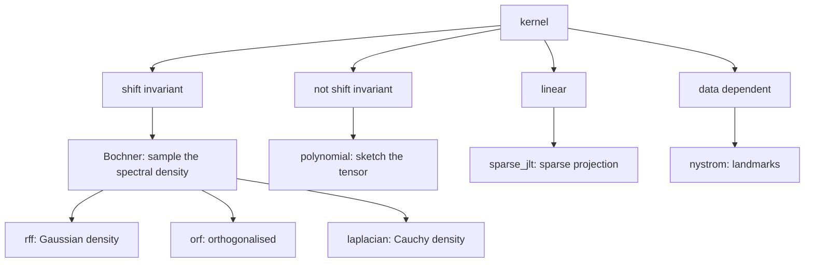

# Random features — a kernel replaced by a finite inner product

`random_features.py` · Kernels and instance · Tier 2 · 6 variants

## Intuition

A kernel method never looks at the features. It looks at one number per pair of
points, so before it can fit anything it needs the whole $n\times n$ Gram
matrix, and before it can predict it needs the training set. That is a hard
ceiling: at $n=10^{6}$ the matrix is $10^{12}$ numbers.

Random features remove the ceiling by giving the kernel a feature map:

```
 x ──▶ ω₁, …, ω_D  ──▶  cos(ωᵀx + b)  ──▶  z(x) ∈ ℝ^D  ──▶  wᵀ z(x)

 kernel method:  K(x, z)          needs the n × n matrix and the data
 random features: z(x)ᵀ z(z)      needs D numbers and a weight vector
```

If a map $z$ exists with $z(x)^{\top}z(z)\approx K(x,z)$ then every kernel
algorithm becomes a linear algorithm on $D$ columns: kernel ridge becomes ridge,
the kernel expansion becomes a weight vector, and prediction costs $O(D)$
instead of $O(n)$. The map is chosen at random, so the approximation is
different every run, but its average is the kernel exactly.

For a kernel that depends only on $x-z$ there is a theorem that hands you the
map. Bochner's theorem says such a kernel is the Fourier transform of a
probability measure, so it is an average of cosines over frequencies drawn from
that measure — and an average over a measure is what a Monte Carlo estimate
does. The whole family follows from that one observation, plus the detail that
matters most in practice: the measure *is* the kernel. Draw Gaussian frequencies
and you get the Gaussian kernel; draw them for a Laplacian kernel and you get a
different function, and the demo measures the difference as a bias of $0.34$
that no number of features removes.

Two kernels do not fit. The polynomial kernel is not shift-invariant, so it has
no spectral measure, and the only route is to write it as an inner product of
explicit tensors and then sketch the tensor. That works, and it is the noisiest
map in the file: at $D=256$ a degree-two sketch has a spread of $0.82$ against
true entries whose mean size is $4.1$. The linear kernel is the opposite
extreme — its
feature map is the identity, so "random features" means a random projection, and
the interesting question is how sparse that projection can be.

The last variant abandons randomness for the features and takes them from the
data. A Nyström map needs $m$ landmarks, computes the kernel between them, and
uses its inverse square root as a whitener. It is a low-rank approximation
rather than a Monte Carlo one, and it comes with a signature failure: the
approximation can never overstate a self-similarity, so far from a landmark the
diagonal of the approximate kernel is below one. The demo shows it falling to
$0.0068$ with five landmarks.

## Variants

| variant | feature map | target kernel | uses the data |
|:--|:--|:--|:--|
| `rff` | $\sqrt{2/D}\cos(\Omega x+b)$, $\omega\sim N(0,2\gamma)$ | Gaussian | no |
| `orf` | the same, with $\Omega$ orthogonalised | Gaussian | no |
| `laplacian` | the same, $\omega\sim\mathrm{Cauchy}(0,1/\sigma)$ | Laplacian | no |
| `polynomial` | sketch of $[x;\sqrt{c}]^{\otimes d}$ | $(x^{\top}z+c)^{d}$ | no |
| `sparse_jlt` | $s$ signed entries per column | linear | no |
| `nystrom` | $K_{nm}K_{mm}^{-1/2}$ | Gaussian | yes |



**`rff`** draws $D$ frequencies from the spectral density, pairs each with a
uniform phase, and takes cosines. It is the original random kitchen sink and the
default.

**`orf`** draws the same frequencies and then orthogonalises them in blocks,
rescaling each row to keep the marginal Gaussian. Orthogonal directions cannot
clump, which is the one source of variance the $1/D$ bound does not control.

**`laplacian`** keeps the estimator and changes the density to a Cauchy, which
is the Fourier transform of $e^{-\|x-z\|_1/\sigma}$. The variant exists to make
the point that the density is part of the model.

**`polynomial`** replaces the whole construction with a tensor sketch: hash each
copy of the input, convolve the sketches, and get an unbiased estimate of
$(x^{\top}z+c)^{d}$.

**`sparse_jlt`** treats the linear kernel, whose feature map is the identity, and
replaces it with a projection that has only $s$ non-zeros per column.

**`nystrom`** selects landmarks and factorises their Gram matrix. It is the only
variant whose feature map depends on the training data, and the only one that is
a projection rather than an average.

## Derivation

### Bochner's theorem

A continuous function $k:\mathbb{R}^{d}\to\mathbb{R}$ with $k(0)=1$ is positive
definite and shift-invariant exactly when it is the characteristic function of a
probability measure $p$:

$$
k(x-z)=\int e^{i\omega^{\top}(x-z)}\,dp(\omega)
=\mathbb{E}_{\omega\sim p}\big[\cos\big(\omega^{\top}(x-z)\big)\big],
\qquad (1)
$$

where the second equality uses $k$ real and even: the sine part integrates to
zero because $p$ is symmetric, and the cosine part is real. Two densities are
needed in this file. For the Gaussian kernel with bandwidth $\gamma$,

$$
k(\Delta)=e^{-\gamma\|\Delta\|^2}
\quad\Longleftarrow\quad
p=N(0,\,2\gamma I),
\qquad (2)
$$

which is the Fourier transform pair $\int e^{i\omega^{\top}\Delta}
e^{-\|\omega\|^2/(4\gamma)}\,d\omega = e^{-\gamma\|\Delta\|^2}$ after rescaling.
For the Laplacian kernel with scale $\sigma$ the coordinates separate,

$$
k(\Delta)=\prod_{j=1}^{d}e^{-|\Delta_j|/\sigma}
\quad\Longleftarrow\quad
p(\omega)=\prod_{j=1}^{d}\frac{\sigma}{\pi\,(1+\sigma^2\omega_j^2)},
\qquad (3)
$$

which is a Cauchy density of scale $1/\sigma$ in every coordinate.

### The estimator and its variance

Draw $\omega_1,\ldots,\omega_D$ independently from $p$ and $b_1,\ldots,b_D$
independently uniform on $[0,2\pi)$, and set

$$
z(x)=\sqrt{\frac{2}{D}}\,
\big(\cos(\omega_1^{\top}x+b_1),\ldots,\cos(\omega_D^{\top}x+b_D)\big).
\qquad (4)
$$

Write $A=\omega^{\top}x+b$ and $B=\omega^{\top}z+b$. The product identity
$2\cos A\cos B=\cos(A-B)+\cos(A+B)$ together with
$\mathbb{E}_b[\cos(A+B)]=0$ gives

$$
\mathbb{E}\big[2\cos A\cos B\big]
=\mathbb{E}_\omega\big[\cos\big(\omega^{\top}(x-z)\big)\big]=k(x-z),
\qquad (5)
$$

so $D$ such terms averaged with the $1/D$ from (4) are unbiased:
$\mathbb{E}[z(x)^{\top}z(z)]=k(x-z)$. The variance is small enough to be useful.
Squaring the product identity and using independence of $\omega$ and $b$,

$$
\mathrm{Var}\big[2\cos A\cos B\big]
=1+\tfrac12 k(2(x-z))-k(x-z)^2\ \le\ 1 ,
\qquad (6)
$$

so $\mathrm{Var}[z(x)^{\top}z(z)]\le 1/D$ and the standard deviation is
$1/\sqrt{D}$. That is the whole accuracy story: four times the features halves
the error, which is what the demo's $0.127\to0.058\to0.029$ table measures. To
control a whole Gram matrix at once the union bound needs $D$ larger by a
$\log$ of the number of entries, which is why the bound is stated per entry.

### Orthogonal frequencies

The bound in (6) is an average over directions, and it is loose when the draws
happen to cluster. Orthogonal random features replace the independent rows of
$\Omega$ by rows of a random orthogonal matrix, rescaled to keep the right
marginal:

$$
G\in\mathbb{R}^{D\times d},\quad
G=QR,\quad
\Omega=\sqrt{2\gamma}\,\mathrm{diag}(s)\,Q^{\top},
\qquad s_i=\|g_i\| , \qquad (7)
$$

where $g_i$ is the $i$-th row of a fresh Gaussian matrix. The $i$-th frequency
is $s_i$ times a unit vector, so its marginal is still $N(0,2\gamma I)$, but two
frequencies are now orthogonal instead of independent. When $D>d$ there are not
$D$ orthogonal directions in $\mathbb{R}^{d}$, so the code orthogonalises blocks
of $d$ rows independently and permutes the result. The demo measures the payoff
at $D=100$: the spread falls from $0.0911$ to $0.0849$, a $7\%$ reduction, and
the reduction is between $6\%$ and $13\%$ across the sizes measured.

### The polynomial kernel

The polynomial kernel is not shift-invariant, so there is no measure to sample.
What exists is an exact expansion: with $\tilde x=(x,\sqrt{c})$,

$$
(\tilde x^{\top}\tilde z)^{d}=\langle \tilde x^{\otimes d},\tilde z^{\otimes d}\rangle
=\sum_{\alpha:\,|\alpha|=d}\binom{d}{\alpha}\prod_i (x_iz_i)^{\alpha_i},
\qquad (8)
$$

which is a feature map of dimension $\binom{d+r-1}{r}$ for inputs of dimension
$r$ — exponential in the degree. TensorSketch computes the count sketch of the
tensor without ever forming it. For each of the $d$ tensor copies choose a hash
$h_j:[r]\to[D]$ and a sign $s_j$, build the sketched vector

$$
u_j(x)_{h_j(i)}\mathrel{+}=s_j(i)\,x_i ,
\qquad (9)
$$

and combine the copies by circular convolution, which the FFT does in
$O(D\log D)$:

$$
\phi(x)=u_1(x)*u_2(x)*\cdots*u_d(x)
=\mathcal{F}^{-1}\Big(\prod_{j=1}^{d}\mathcal{F}u_j(x)\Big).
\qquad (10)
$$

Because a count sketch is unbiased for the inner product and the tensor hash is
the sum of the per-copy hashes, $\mathbb{E}[\phi(x)^{\top}\phi(z)]
=(x^{\top}z)^{d}$; adding $\sqrt{c}$ as one more coordinate gives the constant.
The variance is much worse than the Fourier maps — the demo measures a spread of
$0.82$ at $D=256$ for degree two and $4.89$ for degree three — because a
convolution of sketches is a much noisier estimator than an average of cosines.
The bias is zero, which is why averaging 300 seeds lands within $0.036$ of the
truth.

### Sparse projections

The linear kernel $K(x,z)=x^{\top}z$ already has a feature map: the identity. A
random projection replaces it with $R\in\mathbb{R}^{d\times D}$ and
$z(x)=R^{\top}x$, and the only requirement is $\mathbb{E}[RR^{\top}]=I$ so that
$\mathbb{E}[z(x)^{\top}z(z)]=x^{\top}z$. The sparse choice puts $s$ signed
entries in each column,

$$
R_{ij}\in\Big\{0,\ \pm\sqrt{\tfrac{d}{sD}}\Big\},
\qquad
\mathbb{P}(R_{ij}\ne0)=\frac{s}{d},
\qquad (11)
$$

with exactly $s$ non-zeros per column. The scale is what makes it unbiased: each
column has squared norm $d/D$, so $\mathbb{E}[RR^{\top}]=I$. This is the Johnson-
Lindenstrauss transform, and the classical statement is that with
$D=O(\varepsilon^{-2}\log n)$ every pairwise distance is preserved to a factor
$1\pm\varepsilon$. Sparsity buys speed, not accuracy: at $s=1$ the map keeps
$200$ non-zeros where the dense projection needs $12800$, and the demo's bias
stays at $0.0093$ against true entries of size one. The variance grows as $s$
falls, which is the trade.

### Nyström features

The data-dependent route starts from a low-rank factorisation of the Gram
matrix. Choose $m$ landmarks, and note that for any matrix $B$ with
$BB^{\top}=K_{mm}$,

$$
K\approx K_{nm}K_{mm}^{-1}K_{mn}
=\big(K_{nm}K_{mm}^{-1/2}\big)\big(K_{nm}K_{mm}^{-1/2}\big)^{\top},
\qquad (12)
$$

so $z(x)=K(x,\text{landmarks})\,K_{mm}^{-1/2}$ is a feature map of dimension $m$.
The inverse square root is computed by eigendecomposition of the symmetric
positive semi-definite $K_{mm}$, with the eigenvalues floored at $10^{-10}$ times
the largest so that a nearly singular landmark set does not overflow. On the
landmarks themselves the approximation is exact, because
$K_{mm}K_{mm}^{-1}K_{mm}=K_{mm}$; away from them it is a projection of the kernel
onto the span of the landmark features, and a projection cannot increase a
diagonal, so the approximate self-similarity is at most one. The demo uses that
as an assertion.

## Code walkthrough

### The two spectral densities

```python
        if self.variant == "laplacian":
            self.omega_ = rng.standard_cauchy((self.n_features, width))
            self.omega_ /= self.bandwidth
        elif self.variant == "orf":
            self.omega_ = self._orthogonal_frequencies(width, rng)
        else:
            self.omega_ = rng.normal(0.0, np.sqrt(2.0 * self.gamma_),
                                     (self.n_features, width))
        self.phase_ = rng.uniform(0.0, 2.0 * np.pi, self.n_features)
```

Three lines, three kernels, and the only difference is which measure is being
sampled. The Gaussian draw is scaled by $\sqrt{2\gamma}$, not $\sqrt{\gamma}$:
the extra factor of two comes from the Fourier transform in (2) and getting it
wrong estimates $e^{-\|\Delta\|^2/2\gamma}$, a kernel with half the bandwidth.
The Laplacian draw is a standard Cauchy divided by the bandwidth, which is (3)
read as a sampling instruction. The phase is uniform on a full turn, not a half,
because $\cos(A+B)$ must average to zero for (5) to hold.

### Orthogonal blocks

```python
        blocks = -(-self.n_features // width)
        rows = []
        for _ in range(blocks):
            draw = rng.normal(size=(width, width))
            orthogonal, _ = np.linalg.qr(draw)
            norms = np.linalg.norm(rng.normal(size=(width, width)), axis=1)
            rows.append(orthogonal.T * norms[:, None])
        stacked = np.concatenate(rows, axis=0)[: self.n_features]
        stacked = stacked[rng.permutation(self.n_features)]
        return np.sqrt(2.0 * self.gamma_) * stacked
```

`-(-a // b)` is ceiling division: the number of blocks of $d$ rows needed to
cover $D$ features. Each block is an orthogonal matrix from a QR decomposition
of a Gaussian draw, which is the Haar distribution on the orthogonal group, and
each row is then rescaled by the norm of an independent Gaussian vector so that
the marginal of every row is $N(0,I)$. The permutation at the end matters when
$D$ is not a multiple of $d$: without it the truncated tail of the last block
would be a systematically different set of directions.

### The tensor sketch

```python
        copies = np.zeros((self.degree, rows, self.n_features))
        slot = np.arange(rows)[:, None]
        for copy in range(self.degree):
            index = np.broadcast_to(self.hashes_[copy],
                                    (rows, augmented.shape[1]))
            np.add.at(copies[copy], (slot, index),
                      augmented * self.signs_[copy])
        spectrum = np.fft.rfft(copies, axis=2)
        product = np.prod(spectrum, axis=0)
        return np.fft.irfft(product, n=self.n_features, axis=1)
```

One count sketch per tensor copy, built with `np.add.at` because several input
coordinates can hash to the same bucket and the additions must accumulate rather
than overwrite. The convolution in (10) is the product of the spectra: `rfft`
over the last axis, multiply across copies, `irfft` back. The `n=` argument is
required — without it `irfft` returns `D//2+1` samples and the map silently has
the wrong width. For real inputs the DC and Nyquist entries of each `rfft` are
real, so their product is too and the transform is the exact circular
convolution, not an approximation of it.

### The sparse projection

```python
        result = np.zeros((points.shape[0], self.n_features))
        for entry in range(self.values_.shape[0]):
            result += points[:, self.rows_[entry]] * self.values_[entry]
        return result
```

$s$ vectorised gathers and $s$ scaled additions, so the transform costs
$O(nDs)$ multiplications and never materialises the $d\times D$ matrix. The
index array `rows_[entry]` has one entry per output column — the input
coordinate that feeds it — which is exactly the column-sparse structure of (11),
and `values_[entry]` carries the signs and the $\sqrt{d/(sD)}$ scale. At $s=1$
this is a signed subsampling of coordinates and every output column is a
multiple of a single input column.

### The landmark whitener

```python
        count = min(self.n_features, points.shape[0])
        chosen = rng.choice(points.shape[0], count, replace=False)
        self.landmarks_ = points[np.sort(chosen)]
        gram = gaussian_kernel(self.landmarks_, self.landmarks_, self.gamma_)
        eigenvalues, eigenvectors = np.linalg.eigh(gram)
        floor = max(float(eigenvalues.max()), 1e-12) * 1e-10
        eigenvalues = np.maximum(eigenvalues, floor)
        self.whitener_ = (eigenvectors * eigenvalues ** -0.5) @ eigenvectors.T
```

`eigh` rather than `svd` because the matrix is symmetric; the reconstruct is
$U\Lambda^{-1/2}U^{\top}$ written as a scaled product, which is $O(m^{3})$ once
and then $O(m^{2})$ per transformed row. The floor is the difference between a
map and a `nan`: a Gaussian Gram matrix on clustered landmarks has eigenvalues
that are numerically zero, and their inverse square root is enormous. Clipping
turns those directions into a projection onto the numerically positive
eigenspace, which is the same thing a pseudo-inverse would do.

### Prediction through the map

```python
        if self.variant == "nystrom":
            return gaussian_kernel(points, self.landmarks_, self.gamma_) \
                @ self.whitener_
        return self._fourier(points)
```

The dispatch at the end of `transform` is the claim of the whole atom in three
lines: a Nyström map is a kernel evaluation against landmarks followed by a
matrix, a Fourier map is a matrix product followed by a cosine, and everything
downstream sees only a feature matrix. That is why a kernel ridge regression, a
linear SVM, or a neural network can all be trained on the same object.

## Complexity

Let $n$ be the training count, $d$ the input dimension, $D$ the feature count,
and $m$ the landmark count.

| operation | time | memory |
|:--|:--|:--|
| draw the map | $O(Dd)$ or $O(Dd^{2})$ for `orf` | $O(Dd)$ |
| transform $n$ points, Fourier | $O(nDd)$ | $O(nD)$ |
| transform $n$ points, tensor sketch | $O(nDd + nD\log D)$ | $O(nD)$ |
| transform $n$ points, sparse | $O(nDs)$ | $O(nD)$ |
| transform $n$ points, Nyström | $O(ndm + nm^{2})$ | $O(nm)$ |
| ridge on the features | $O(nD^{2}+D^{3})$ | $O(nD)$ |
| prediction on $M$ points | $O(MD)$ | $O(D)$ |
| exact kernel ridge, for comparison | $O(n^{2}d+n^{3})$ | $O(n^{2})$ |

The crossover is the whole point. Exact kernel ridge pays $n^{2}$ in memory and
$n^{3}$ in time; the feature version pays $nD^{2}+D^{3}$ and $nD$. At $n=10^{5}$
and $D=10^{3}$ that is a factor of $10^{5}$ in memory and a factor of $10^{2}$ in
time, and the model shrinks from a stored dataset to a vector of $D$ weights.
The cost that does not vanish is the $O(nDd)$ transform, and for the polynomial
sketch it is the FFT that dominates. Nyström is cheaper than a Fourier map when
$m<D$ but needs the kernel evaluated against every landmark at prediction time,
so it gives back some of the serving advantage.

## Failure modes

**Using the wrong spectral density.** The most common bug by far, and the only
one that no amount of data fixes. A Gaussian draw on a Laplacian kernel is
biased by $0.34$ at $D=800$, against $0.0023$ for the matched Cauchy draw, and
the bias does not shrink with $D$ because it is not variance. If the kernel has
no closed-form transform, the density has to be sampled numerically or the
kernel has to be approximated by one that does.

**Forgetting the $\sqrt{2/D}$.** Drop it and the feature map estimates
$(D/2)K$ instead of $K$. Every downstream model then trains on a kernel with the
wrong scale, which is invisible in a training error and shows up as a badly
tuned regulariser: the penalty is now competing with a kernel twenty times too
large.

**Confusing "unbiased" with "accurate".** At $D=50$ the kernel estimate has an
RMSE of $0.127$; a ridge regression fitted on those features is a genuinely
different estimator from the exact one, not a noisy copy of it. The demo's
regression table has the error climbing from $0.0309$ at $D=64$ to $0.0364$ at
$D=512$ towards the exact $0.0408$, because a low-rank fit regularises more than
the full kernel does. More features means closer to the kernel, and closer to
the kernel is not always closer to the truth.

**A feature count too small for the kernel's effective rank.** A narrow Gaussian
kernel has an effective dimension that grows with $n$; $D=100$ features cannot
represent it, and the error plateaus instead of falling like $1/\sqrt{D}$. The
symptom is a learning curve that flattens early. The cure is a wider kernel or
more features, and the first is usually cheaper.

**Reading the Nyström diagonal as a bug.** $K_{nm}K_{mm}^{-1}K_{mn}$ has diagonal
at most one, because it is a projection. With five landmarks on eighty points
the smallest diagonal is $0.0068$ and the worst entry error is $0.99$. That is
the method behaving correctly; it is also why a Nyström approximation is a bad
choice for a kernel that is used as a similarity score rather than as a
regulariser.

**A tensor sketch with too few buckets.** The polynomial sketch is unbiased at
any $D$ and usable at none of the small ones: at $D=64$ the spread is $1.61$
against true entries of mean size $4.1$, and at degree three it is $4.89$. The
variance is a convolution of $d$ sketches, so it grows with the degree. For
small degrees the explicit feature map in (8) is exact and often smaller than a
sketch large enough to be accurate; the sketch is for when it is not.

**Assuming the features are data-independent when they are not.** For all the
Fourier variants the map is drawn before the data is seen, so it can be fitted on
one batch and applied to another, and the variance is a property of the kernel
alone. Nyström breaks that: its landmarks come from the training set, a test
point far from every landmark gets an uninformative row, and refitting on a new
batch changes the map. Anything that caches transformed features has to know
which kind it has.

**A sparse projection with $s=1$ on wide data.** One non-zero per column means
each output coordinate sees exactly one input coordinate. Distances are still
preserved in expectation, but the variance is the largest the family allows and
correlated coordinates are reconstructed poorly. The theory allows $s=1$ for
$D$ large enough; the demo's $0.0093$ bias is at $D=200$ on 64 dimensions, which
is a regime where it happens to work.

**Comparing against the exact solver with a different regulariser.** The
feature-space ridge with $D<n$ is a rank-$D$ estimator and the dual ridge is a
full-rank one. On the demo's data the rank-$D$ version wins, which makes the
"approximation" look better than the thing it approximates. That is not a
property of random features; it is what shrinkage does.

## Applications

**Large-scale kernel machines.** Kernel approximations were invented for this:
an SVM or a kernel ridge on millions of points is impossible in the dual and
routine on a few thousand random features. The `nystrom` variant of this atom is
the usual choice when the data is clustered and landmarks can be sampled
cheaply.

**Gaussian processes at scale.** A GP with a Nyström or Fourier feature map is a
Bayesian linear model on those features, so the posterior is a $D\times D$
system instead of an $n\times n$ one. The predictive variance is then an
approximation too, which is the part people forget.

**Implicit neural representations and positional encodings.** The Fourier
features of a NeRF are exactly (4) with fixed frequencies, and the random
version is used as a kernel-like embedding for tabular and time-series models. A
cosine of a random frequency is a cheap way to give a linear model a notion of
distance.

**Efficient attention.** The Performer replaces the softmax kernel with a
positive random feature map so that attention becomes a matrix product
associativity trick, and linear attention in general is a kernel feature map
applied to the keys and queries. The same variance analysis governs the quality
of the approximation.

**Sketching and streaming.** Sparse JL projections are how a covariance matrix
or a least-squares problem is compressed without storing the data, and the
tensor sketch is how a polynomial kernel is evaluated on a stream when the
feature dimension rules out the explicit map.

**Fastfood and structured projections.** Replacing a dense Gaussian matrix by a
product of sparse and diagonal ones gives a map that can be applied in
$O(D\log d)$ instead of $O(Dd)$. It is the same approximation with a cheaper
multiply, and the variance analysis is unchanged.

**Kernel two-sample tests.** An MMD test with a random feature map is an
$O(nD)$ test instead of an $O(n^{2})$ one, and the approximation error is a
well-understood additive term rather than an unknown. This is the approximation
behind most large-scale distribution comparisons.

**Teaching kernel methods.** The whole chapter is one idea seen three ways:
a kernel is an inner product in some space, random features exhibit the space,
and Nyström exhibits it from the data. Working through the four derivations in
one file makes the "kernel trick" stop being a trick.

## References

- Rahimi, A. & Recht, B. (2007). Random features for large-scale kernel
  machines. *NeurIPS*. The estimator in (4) and the Bochner argument.
- Rahimi, A. & Recht, B. (2008). Weighted sums of random kitchen sinks:
  replacing minimization with randomization in learning. *NeurIPS*. The
  convergence bound and the ridge application.
- Rahimi, A. & Recht, B. (2009). Random features for large-scale kernel
  machines. *IEEE Transactions on Information Theory* 55(10). The full analysis,
  including the variance in (6).
- Bochner, S. (1932). *Vorlesungen über Fouriersche Integrale*. Akademische
  Verlagsgesellschaft. The theorem behind (1).
- Yu, F. X., Suresh, A. T., Choromanski, K., Holtmann-Rice, D. & Kumar, S.
  (2016). Orthogonal random features. *NeurIPS*. The construction in (7) and the
  variance reduction the demo measures.
- Pham, N. & Pagh, R. (2013). Fast and scalable polynomial kernels via explicit
  feature maps. *KDD*. TensorSketch, (9) and (10).
- Kar, P. & Karnick, H. (2012). Random feature maps for dot product kernels.
  *AISTATS*. The positive-definite argument that makes the polynomial sketch
  work at all.
- Achlioptas, D. (2003). Database-friendly random projections. *Journal of
  Computer and System Sciences* 66(4), 671–687. The sparse projection family.
- Li, P., Hastie, T. J. & Church, K. W. (2006). Very sparse random projections.
  *KDD*. The $s$-sparse variant in (11) and the variance analysis.
- Kane, D. M. & Nelson, J. (2014). Sparser Johnson-Lindenstrauss transforms.
  *Journal of the ACM* 61(1). How sparse a JL transform can be and stay a JL
  transform.
- Williams, C. K. I. & Seeger, M. (2001). Using the Nyström method to speed up
  kernel machines. *NeurIPS*. The factorisation in (12).
- Drineas, P. & Mahoney, M. W. (2005). On the Nyström method for approximating a
  Gram matrix for improved kernel-based learning. *COLT*. The error analysis and
  the role of the landmark sample.
- Choromanski, K. et al. (2021). Rethinking attention with performers. *ICLR*.
  Positive random features for the softmax kernel.
- Le, Q. V., Sarlós, T. & Smola, A. J. (2013). Fastfood: approximating kernel
  expansions in loglinear time. *ICML*. Structured projections for the same
  estimator.
