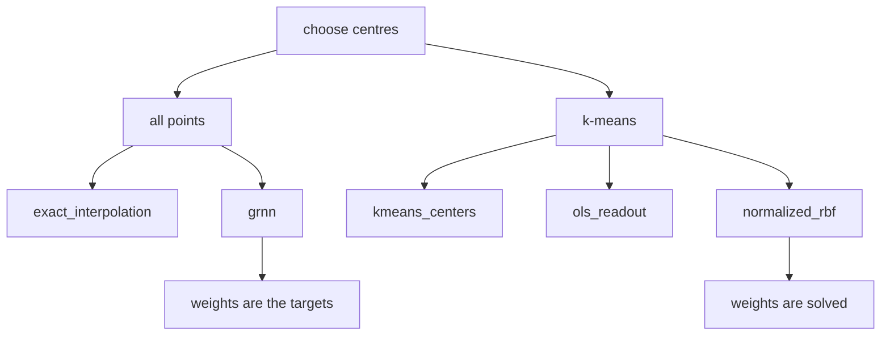

# Radial basis function networks — bumps, centres and a linear readout

`rbf_network.py` · Kernels and instance · Tier 2 · 5 variants

## Intuition

A radial basis function network is a sum of bumps:

```
 y
 │        ╭─╮        ╭─╮
 │   ╭────╯ ╰──╮  ╭──╯ ╰────╮
 │  ╱          ╰──╯          ╲      f(x) = Σ w_j φ_j(x)
 │ ╱                          ╲
 └──────────────────────────────── x
        c₁        c₂        c₃
```

Each hidden unit is a Gaussian centred at $c_j$, and the output is a weighted
sum of them plus an intercept. Two things follow from that shape. First, the
model is *local*: a bump only answers for inputs near its centre, so a training
point far from a centre cannot influence the prediction there. Second, and more
importantly for fitting, the weights enter linearly. Once the centres and the
width are fixed, the network is a linear model whose features happen to be
bumps, and the weights are a least-squares solution with no backpropagation,
no learning rate and no epochs.

That makes the whole atom the answer to two questions. *Where do the bumps go?*
Put one on every training point and the system becomes square, so it has a
unique solution and the fit is exact interpolation. Put a handful of them where
the data is dense and the system is overdetermined, so the weights are a
regression, and the model generalises instead of memorising. *How wide are
they?* The width sets the scale of "near". A narrow bump makes each unit see
one point and the network becomes a lookup table; a wide bump makes every unit
see everything and the model becomes nearly constant. The demo measures the
first effect as a condition number climbing from $7\times10^{4}$ to $10^{18}$
over the same sweep that drives the error to zero.

The last idea is normalisation. The Gaussian bumps overlap, so their sum is not
one — the demo measures between $1.09$ and $2.70$ across the input range.
Dividing by that sum turns the layer into a partition of unity: a probability
vector per input, so the output is an *average* of the weights and cannot leave
their range. With the weights set equal to the targets this is the
Nadaraya-Watson estimator, and the atom's `grnn` variant is exactly that: no
readout to solve, just a distance-weighted average of what was observed. It
reproduces a constant target to $2\times10^{-15}$ where the raw basis is off by
$3.8\times10^{-2}$, and the difference is not a detail — it is why the
normalised form is the one used in practice.

## Variants

| variant | centres | readout | bias | interpolates |
|:--|:--|:--|:--|:--|
| `exact_interpolation` | every point | solve the square system | no | yes |
| `kmeans_centers` | $k$ from Lloyd's algorithm | least squares | no | no |
| `ols_readout` | $k$ from Lloyd's algorithm | least squares plus ridge | yes | no |
| `normalized_rbf` | $k$ from Lloyd's algorithm | least squares | no, sums to one | no |
| `grnn` | every point | none, the weights are the targets | no | no |



**`exact_interpolation`** puts a centre on every training point. The design
matrix is square, Gaussian, and nonsingular for distinct points, so the weights
are unique and the training residual is zero to rounding. It is the classical
RBF interpolant, and it is a terrible predictor on noisy data.

**`kmeans_centers`** chooses $k$ centres with Lloyd's algorithm and solves the
overdetermined least-squares problem. This is the standard recipe from the
1990s: unsupervised centres, supervised readout, one pass, no gradients.

**`ols_readout`** keeps the k-means centres and adds an intercept and a ridge
penalty. The intercept is what lets the model represent a constant without
spending a bump on it, and the penalty is a shrinkage path: at $\lambda=10^6$
the weights vanish and the prediction is the target mean.

**`normalized_rbf`** divides each activation by the row sum. The basis becomes a
partition of unity, a constant target is reproducible exactly, and the output
is bounded by the weights' range.

**`grnn`** is the normalised form with one centre per point and the weights set
to the targets. There is no linear system at all; the prediction is a
distance-weighted average of the training targets, which is the generalised
regression network of Specht and the Nadaraya-Watson estimator of the
statistics literature.

## Derivation

### The model

With centres $c_1,\ldots,c_k$, widths $\sigma$, weights $w$ and intercept $b$,

$$
\phi_j(x)=\exp\left(-\frac{\|x-c_j\|^2}{2\sigma^2}\right),\qquad
f(x)=\sum_{j=1}^{k}w_j\phi_j(x)+b .
\qquad (1)
$$

For $n$ training points with targets $y$ this is the linear system
$\Phi w+\mathbf{1}b=y$ with $\Phi_{ij}=\phi_j(x_i)$. Everything below is a
choice about how to solve it.

### Interpolation is nonsingular

For distinct centres the Gaussian matrix

$$
\Phi_{ij}=\exp\left(-\frac{\|x_i-x_j\|^2}{2\sigma^2}\right)
\qquad (2)
$$

is symmetric positive definite. The Fourier transform of the Gaussian is
positive everywhere, so for any coefficient vector $a\ne0$,

$$
a^{\top}\Phi a=\sum_{i,j}a_i a_j e^{-\|x_i-x_j\|^2/2\sigma^2}
=\int \Big|\sum_i a_i e^{i\omega^{\top}x_i}\Big|^2
\hat\varphi(\omega)\,d\omega>0 ,
\qquad (3)
$$

because the integrand is a non-negative function times a positive one and the
sum is not identically zero. Hence $\Phi$ is invertible, the interpolant
$w=\Phi^{-1}y$ exists and is unique, and this is Micchelli's theorem
specialised to the Gaussian. The demo checks the conclusion directly: the
smallest eigenvalue of $\Phi$ is $3.9\times10^{-5}$.

### The width is a trade-off, not a hyperparameter

Interpolation on the training points says nothing about the gaps between them.
Writing the error of the interpolant in terms of the power function $P_\Phi$ of
the centre set, the standard bound is

$$
|f(x)-s(x)|\le P_\Phi(x)\,\|f\|_{\mathcal{H}} ,
\qquad (4)
$$

and for the Gaussian $P_\Phi$ shrinks as $\sigma$ grows while the condition
number of $\Phi$ grows with it. The two cannot both be small — that is
Schaback's uncertainty relation — and the demo's table is the measurement:

| $\sigma$ | error between points | condition number |
|:--|:--|:--|
| 0.1 | 0.38616 | $7.4\times10^{04}$ |
| 0.3 | 0.09107 | $1.6\times10^{08}$ |
| 0.8 | 0.00019 | $3.6\times10^{16}$ |
| 1.5 | $2\times10^{-5}$ | $1.0\times10^{18}$ |

The practical reading is that a Gaussian interpolant wants a wide bump and a
solver that tolerates an ill-conditioned matrix, or a small bump and more
centres. Both are worse than choosing fewer centres, which is the next section.

### Fewer centres: the least-squares fit

With $k<n$ the system is overdetermined and the natural solution is

$$
w=\arg\min_{\tilde w}\ \|\Phi\tilde w-y\|^2
=(\Phi^{\top}\Phi)^{-1}\Phi^{\top}y ,
\qquad (5)
$$

the same normal equations as linear regression, solved by the SVD rather than
by forming $\Phi^{\top}\Phi$, because $\Phi$ is typically ill-conditioned and
squaring the condition number is avoidable. This is where k-means enters: the
centres are chosen to minimise

$$
\sum_i\min_j\|x_i-c_j\|^2 ,
\qquad (6)
$$

which is the k-means objective and has nothing to do with the targets. The two
stages are trained separately, which is why this is not a neural network in any
useful sense: there is no gradient flowing from the output to the centres.

Lloyd's algorithm alternates two steps, assign each point to its nearest centre
and move each centre to the mean of its cluster, and both steps decrease (6),
so it converges to a local minimum. Initialisation matters, and the code uses
k-means++: the first centre is uniform, and each subsequent one is drawn with
probability proportional to the squared distance to the nearest centre already
chosen. That single change is what keeps the result from depending on the seed.

### The readout with an intercept and a ridge

Adding a column of ones to $\Phi$ makes the model affine rather than linear.
The ridge version solves

$$
\min_{w,b}\ \|\Phi w+\mathbf{1}b-y\|^2+\lambda\|w\|^2 ,
\qquad (7)
$$

with the penalty deliberately not applied to $b$: shrinking the intercept would
bias the model towards zero. The normal equations are

$$
\begin{bmatrix}\Phi^{\top}\Phi+\lambda I & \Phi^{\top}\mathbf{1}\\
\mathbf{1}^{\top}\Phi & n\end{bmatrix}
\begin{bmatrix}w\\ b\end{bmatrix}
=
\begin{bmatrix}\Phi^{\top}y\\ \mathbf{1}^{\top}y\end{bmatrix}.
\qquad (8)
$$

As $\lambda\to\infty$ the first block dominates, $w\to0$, and the second row
gives $b\to\bar y$: the model collapses to the constant predictor. The demo
walks that path and measures the weight norm falling from $3.21$ to zero while
the error rises to the spread of the signal, $0.6999$ — which is exactly what a
constant predictor costs, and a good sanity check that the path is doing what
the algebra says.

### Normalisation

The raw basis does not sum to one because the bumps overlap. Defining

$$
\psi_j(x)=\frac{\phi_j(x)}{\sum_{m}\phi_m(x)},\qquad \sum_j\psi_j(x)=1 ,
\qquad (9)
$$

turns the layer into a convex combination: for non-negative weights the output
is a weighted average, and in general it lies between the smallest and largest
weight. Two consequences are testable. A constant target $y\equiv c$ is
reproduced exactly by $w_j=c$ for every $j$, with no error and regardless of
the centres — the demo gets $2\times10^{-15}$. And the prediction at a point is
an interpolation of the weights, so as $\sigma\to0$ it converges to the weight
of the nearest centre.

The same argument with $w=y$ gives the Nadaraya-Watson estimator

$$
\hat f(x)=\frac{\sum_i y_i\,\phi_i(x)}{\sum_i \phi_i(x)} ,
\qquad (10)
$$

and its two limits are what make it trustworthy. As $\sigma\to0$ the nearest
bump dominates and the estimate is the nearest neighbour's target; as
$\sigma\to\infty$ every weight tends to $1/n$ and the estimate is the mean. The
demo checks both to $0$ and $8\times10^{-13}$ respectively.

### The normalisation is a scale

Dividing by the row sum also removes the global scale of the width. Replacing
$\sigma$ by $\sigma/s$ multiplies every activation in a row by the same factor
$e^{-\|x-c_j\|^2(s^2-1)/2\sigma^2}$ only if that factor is common to the row —
which it is not, so the invariance is exact only in the limit of small $\sigma$.
What *is* exact is the invariance to a common multiplicative factor on the
activations, for example from a rescaling of one feature, which is why the
normalised variant is the one to use with unnormalised inputs.

## Code walkthrough

### Distances

```python
def _sq_dists(X: np.ndarray, C: np.ndarray) -> np.ndarray:
    """Squared Euclidean distances, shape ``(len(X), len(C))``."""
    squared = (np.sum(X ** 2, axis=1)[:, None]
               + np.sum(C ** 2, axis=1)[None, :]
               - 2.0 * X @ C.T)
    return np.maximum(squared, 0.0)
```

The expansion $\|x-c\|^2=\|x\|^2+\|c\|^2-2x^{\top}c$ turns an $n\times k$ distance
problem into one matrix product. The clamp is required: for two identical rows
the subtraction leaves a negative number of order the machine epsilon times the
norm, and a negative number under a square root — or, later, in an exponent —
is the kind of bug that shows up once in ten thousand calls.

### k-means++

```python
    chosen = [int(rng.integers(rows))]
    for _ in range(1, count):
        nearest = _sq_dists(X, X[chosen]).min(axis=1)
        total = float(nearest.sum())
        weights = None if total <= 0.0 else nearest / total
        chosen.append(int(rng.choice(rows, p=weights)))
    centres = X[chosen].copy()
```

Each new centre is drawn in proportion to the squared distance to the set
already chosen, so a cluster that no existing centre covers is likely to get
one. The `weights = None` case is not defensive padding: if every remaining
point coincides with a centre, all the probabilities are zero and
`rng.choice` would raise on a distribution that does not sum to one, so the
draw falls back to uniform.

### Lloyd's iteration

```python
    for _ in range(iterations):
        labels = _sq_dists(X, centres).argmin(axis=1)
        updated = centres.copy()
        for index in range(count):
            members = labels == index
            if members.any():
                updated[index] = X[members].mean(axis=0)
        if np.allclose(updated, centres):
            break
        centres = updated
    return centres
```

Assign, average, repeat. Keeping `updated[index]` at the old position when a
cluster is empty is what stops a centre from being dragged to the origin by a
mean over no points. The loop is a Python loop over centres because $k$ is
small and the inner work is a masked mean; vectorising it would need a
scatter-add that is slower for the sizes this atom is for.

### The hidden layer

```python
    def _design(self, X: np.ndarray) -> np.ndarray:
        """The hidden layer, shape ``(len(X), k)``."""
        squared = _sq_dists(X, self.centers_)
        if self.variant in _NORMALIZED:
            squared = squared - squared.min(axis=1, keepdims=True)
        phi = np.exp(-squared / (2.0 * self.sigma_ ** 2))
        if self.variant in _NORMALIZED:
            phi = phi / phi.sum(axis=1, keepdims=True)
        return phi
```

The subtraction before the exponent is the log-sum-exp trick applied to the
Gaussian: shifting a whole row by its minimum leaves every ratio unchanged, so
for the normalised variants the result is identical while the largest entry
becomes exactly one. Without it, a narrow width underflows every activation to
zero, the row sum is zero, and the division produces `nan` — which is precisely
the regime the `grnn` small-width limit lives in. For the raw variants the
shift would change the model, so it is applied only where it cancels.

### Choosing the width

```python
        nearest = _sq_dists(self.centers_, self.centers_)
        np.fill_diagonal(nearest, np.inf)
        distance = float(np.sqrt(nearest.min(axis=1)).mean())
        if not np.isfinite(distance) or distance <= 0.0:
            return 1.0
        return distance
```

The default width is the mean distance from a centre to its nearest neighbour —
the scale at which neighbouring bumps just touch. `fill_diagonal` with infinity
is what makes the minimum skip the distance from a centre to itself, which is
always zero and would otherwise set every width to zero and every matrix to the
identity. The `finite` guard catches a single centre, where the minimum over an
empty off-diagonal is infinite.

### The readout

```python
        if self.variant == "ols_readout":
            design = np.concatenate([phi, np.ones((phi.shape[0], 1))], axis=1)
            penalty = self.ridge * np.eye(design.shape[1])
            penalty[-1, -1] = 0.0
            solution, *_ = np.linalg.lstsq(
                design.T @ design + penalty, design.T @ y, rcond=None)
            self.weights_ = solution[:-1]
            self.bias_ = float(solution[-1])
            return
```

This is (8) in four lines. Forming the normal equations and adding the penalty
as a diagonal matrix is what makes the ridge a two-character change; the
penalty is zeroed at the last entry so that (7) penalises the weights and not
the intercept. The readout is the only place where the variants differ after
the centres are chosen, which is why the whole class has one `fit`.

### Prediction

```python
        points = self._check_X(X)
        if points.shape[1] != self.centers_.shape[1]:
            raise ValueError("X has the wrong number of features")
        return self._design(points) @ self.weights_ + self.bias_
```

One matrix product against the stored centres and one against the weights. The
cost is $O(mkd)$ for $m$ predictions, and the memory is the centres alone —
$k\times d$ numbers — which is the reason a bump network is cheap to serve even
though it is expensive to train at large $k$.

## Complexity

Let $n$ be the training count, $k$ the number of centres, $d$ the features, and
$T$ the Lloyd iterations.

| operation | time | memory |
|:--|:--|:--|
| distance matrix | $O(nkd)$ | $O(nk)$ |
| k-means++ initialisation | $O(nk^2d)$ | $O(nk)$ |
| Lloyd iterations | $O(Tnkd)$ | $O(n)$ |
| readout (SVD) | $O(nk^2)$ | $O(nk)$ |
| prediction on $m$ points | $O(mkd)$ | $O(mk)$ |
| stored model | — | $O(kd)$ |

The training cost is dominated by k-means, and both stages are linear in the
number of points, which is the whole point: no kernel matrix is formed, so
nothing is $O(n^2)$. Compare the kernel ridge atom in this chapter, which needs
the full $n\times n$ matrix and a dense solve. At $n=10^5$ that difference is
decisive, and it is why the RBF recipe was the scalable method before random
features and before minibatches.

The readout is a tall-skinny least-squares problem, $O(nk^2)$, and is solved by
the SVD. Forming $\Phi^{\top}\Phi$ would square the condition number, which for
a Gaussian basis is already $10^{4}$ to $10^{18}$ depending on the width — the
demo's table shows both ends — so the SVD is not a stylistic choice.

## Failure modes

**A width that makes the system singular.** A tiny $\sigma$ makes $\Phi$ the
identity, so the interpolant is a lookup table: zero training error and a
prediction that is wrong between every pair of points. The demo's $\sigma=0.1$
row still interpolates to $10^{-15}$ and is off by $0.386$ between the points.
A large $\sigma$ fixes the accuracy and pushes the condition number past
$10^{16}$, where the solve is rounding noise.

**Duplicate or nearly duplicate centres.** Two identical centres give two
identical columns, the matrix is singular, and `lstsq` silently returns a
minimum-norm solution that splits the weight between them. Nothing errors and
nothing is wrong, but the weights are no longer interpretable.

**k-means with the wrong $k$.** The demo's sweep is the whole story: two centres
give a held-out error of $0.645$, eight give $0.077$, sixty give $1.804$. The
unsupervised stage optimises distance to the data, not fit to the targets, so
it will happily place two centres where the function has three features.

**A raw basis where a normalised one is needed.** The raw sum ranges from
$1.09$ to $2.70$ over the input range, so the effective weight of each centre
changes with position and a constant target is not representable. The demo's
constant test is the sharp one: $3.8\times10^{-2}$ residual for the raw basis,
$2\times10^{-15}$ for the normalised one.

**Confusing the output bound.** The normalised output is bounded by the
*weights*, not by the targets — that bound is only the target range for
`grnn`, where the two coincide. A normalised RBF fitted on the demo's noisy
targets has weights from $-6.04$ to $6.77$ and predictions from $-1.24$ to
$1.24$, so the weight bound is real but not tight.

**Extrapolation.** A Gaussian bump decays to zero, so outside the convex hull
of the centres a raw RBF network predicts its intercept and a normalised one
predicts a weighted average of the weights at the boundary. Neither knows
anything about the trend of the data. The demo's grid stays inside $[-3,3]$,
which is the support of the training points, for exactly this reason.

**Using backpropagation out of habit.** The centres are trained without the
targets and the weights are a closed-form solution, so there is nothing to
descend. Adding gradient descent over all the parameters turns this atom into a
small neural network with a much worse conditioning and no advantage; if you
want that, you want a network atom, not this one.

**The intercept on the wrong side of the penalty.** Penalising $b$ alongside
the weights pulls the model towards zero rather than towards the mean, and on
data with a large offset it produces a visibly biased fit. The code zeroes the
last diagonal entry of the penalty for this reason.

## Applications

**Function approximation from scattered data.** The original use: interpolate
measurements at irregular locations, which is what the `exact_interpolation`
variant does and what the width trade-off in (4) is about.

**Control and system identification.** A small RBF network is a one-shot
surrogate for a plant model, and the linear readout makes it cheap to refit
online as new data arrives.

**Time-series forecasting.** The normalised form with a fixed width is a
kernel smoother, and the generalised regression network was a standard
short-horizon forecaster before gradient boosting took over.

**Pattern classification.** With one output per class and a winner-take-all
readout this was the "RBF classifier" of the late 1980s, and the k-means
centre choice is where the name "hybrid learning" comes from: unsupervised for
the hidden layer, supervised for the output.

**Nonparametric regression and density estimation.** The Nadaraya-Watson
estimator in (10) is the same object, and the two limits in the demo are the
standard bias-variance argument for its bandwidth.

**Surrogate models and design optimisation.** An RBF fitted to a design of
experiments is smooth, differentiable, and cheap to evaluate a million times,
which is exactly what an optimiser needs.

**Credit for the kernel view.** An RBF network is kernel ridge regression with
a finite basis: the centres are the support points and the readout is the
kernel expansion truncated to them. Reading the two atoms side by side is the
shortest route to understanding why kernel methods are not a different species.

## References

- Broomhead, D. S. & Lowe, D. (1988). Multivariable functional interpolation and
  adaptive networks. *Complex Systems* 2, 321–355. The RBF network as an
  interpolation scheme.
- Moody, J. & Darken, C. J. (1989). Fast learning in networks of locally tuned
  processing units. *Neural Computation* 1(2), 281–294. The two-stage recipe:
  k-means centres, least-squares readout.
- Micchelli, C. A. (1986). Interpolation of scattered data: distance matrices
  and conditionally positive definite functions. *Constructive Approximation*
  2, 11–22. Nonsingularity of the Gaussian interpolation matrix, (2) and (3).
- Schaback, R. (1995). Error estimates and condition numbers for radial basis
  function interpolation. *Advances in Computational Mathematics* 3, 251–264.
  The uncertainty relation behind the width trade-off.
- Specht, D. F. (1991). A general regression neural network. *IEEE Transactions
  on Neural Networks* 2(6), 568–576. The `grnn` variant.
- Nadaraya, E. A. (1964). On estimating regression. *Theory of Probability and
  its Applications* 9(1), 141–142. The estimator in (10).
- Arthur, D. & Vassilvitskii, S. (2007). k-means++: the advantages of careful
  seeding. *SODA*. The initialisation used in the code.
- Park, J. & Sandberg, I. W. (1991). Universal approximation using radial-basis-
  function networks. *Neural Computation* 3(2), 246–257. Why this architecture
  can approximate any continuous function.
- Poggio, T. & Girosi, F. (1990). Networks for approximation and learning.
  *Proceedings of the IEEE* 78(9), 1481–1497. The regularisation view that
  connects the RBF network to the kernel methods in this chapter.
