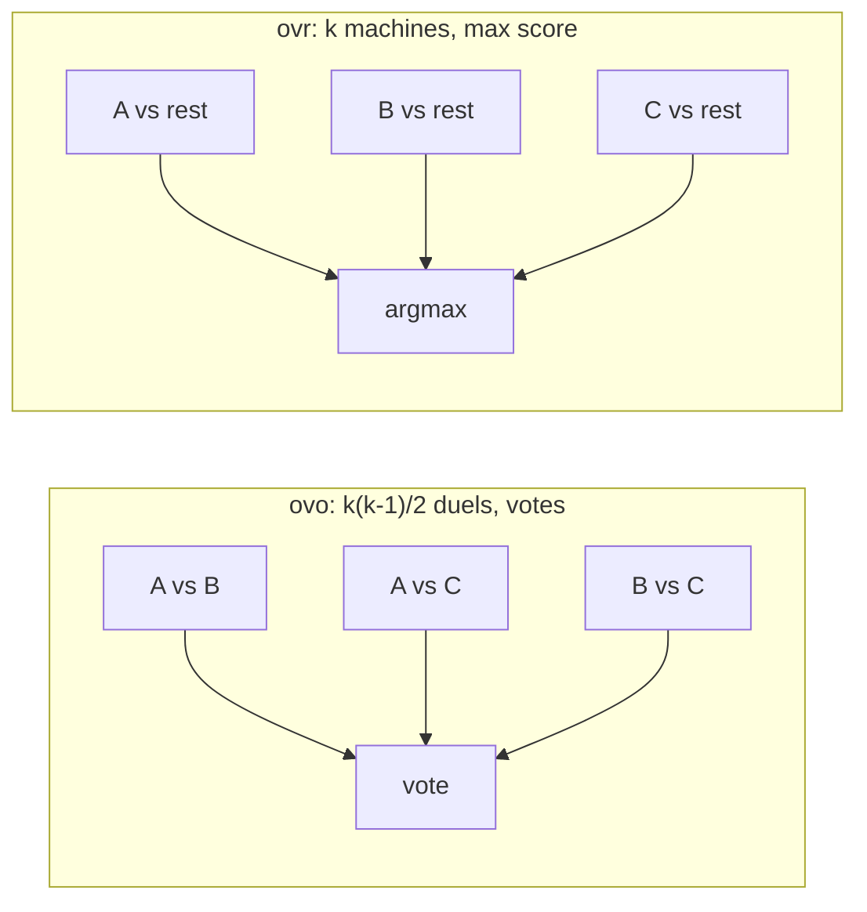

# Support vector machines

`svm.py` · Kernels & instance-based · Tier 1 · 12 variants

## Intuition

Among all hyperplanes that separate two classes, infinitely many do the job.
The SVM picks the one with the widest empty street between them. That single
choice buys a lot: the solution is unique, it depends on only the points that
touch the street's edge, and — once you write the problem in its dual form — the
data enters only through inner products, so you can replace the inner product
with a kernel and get nonlinear boundaries for free.

```
        y = +1            │
      o   o   o           │
        o   o  o  ─ ─ ─ ─ ─┤  margin = 2/‖w‖
    ───────────────────────┼─────────────── wᵀφ(x) + b = 0
      x   x  x  ─ ─ ─ ─ ─ ─┤
        x   x              │
        y = −1             │
        ↑                    ↑
      support vectors: the only points with α > 0
```

Three claims carry the whole chapter. The *street width* is `2/‖w‖`, so
maximising it is minimising `‖w‖`. The *weights* `α` are zero for every point
that is safely outside the street, so the model is a sparse subset of the
training set. And when the data cannot be separated, replacing "outside the
street" by a *hinge penalty* keeps the whole derivation intact, with `C`
controlling how much a violator pays.

## Variants

| Variant | What changes | Why you would pick it |
|:--|:--|:--|
| `hard_margin` | `C = ∞`; no slack | only legal on separable data; exposes the geometry |
| `soft_margin` | box bound `0 ≤ α ≤ C` | the default; the hinge absorbs overlap |
| `dual` | first-order working set (maximal violating pair) | simplest correct solver, easy to read |
| `smo` | second-order working set (Fan–Chen–Lin) | same solution, far fewer iterations |
| `linear` | `K = X Zᵀ` | `d` large, `n` large; supports are the classifier |
| `polynomial` | `K = (γ X Zᵀ + r)^p` | interactions of order `p`, exact and finite-dimensional |
| `rbf` | `K = exp(−γ‖x − z‖²)` | smooth, universal; the default for tabular data |
| `sigmoid` | `K = tanh(γ X Zᵀ + r)` | historical (it is *not* a kernel — see failure modes) |
| `nu_svm` | parameterise by SV fraction `ν`, not by `C` | when you can say "≈10% of points may violate" |
| `class_weight` | per-class box bound | imbalanced data, where accuracy hides the minority |
| `ovo` | `k(k−1)/2` duels, one vote each | the standard multiclass reduction |
| `ovr` | `k` one-against-rest machines, max score | `k` large, or when per-class scores are wanted |

## Derivation

### Hard margin

With `φ(x)` a feature map and labels `y_i ∈ {±1}`, the primal is

$$
\min_{w,b}\ \tfrac12\|w\|^2 \quad \text{s.t.}\quad y_i\big(w^\top φ(x_i) + b\big) \ge 1 .
$$

The constraint is two statements at once: every point sits on its correct side,
and at least `1/‖w‖` away from the plane, because the distance from `x` to the
plane is `|wᵀφ(x)+b| / ‖w‖`. Two parallel planes at that distance give a street
of width `2/‖w‖`. Minimising `‖w‖` is therefore literally maximising the margin.

With multipliers `α_i ≥ 0` and `L = ½‖w‖² − Σ α_i[y_i(wᵀφ_i + b) − 1]`:

$$
\frac{\partial L}{\partial w} = 0 \;\Rightarrow\; w = \sum_i α_i y_i φ(x_i),
\qquad
\frac{\partial L}{\partial b} = 0 \;\Rightarrow\; \sum_i α_i y_i = 0 .
$$

Substituting back gives the dual

$$
\max_{α}\ \sum_i α_i - \tfrac12 α^\top Q α
\quad\text{s.t.}\quad α \ge 0,\ \ y^\top α = 0,
\qquad Q_{ij} = y_i y_j K(x_i, x_j).
$$

`Q` is the label-signed Gram matrix. Only the inner products survived, which is
the entire reason kernels work: swap `K` and the hypothesis space changes, but
the optimiser does not.

The KKT conditions are the model's table of contents:

| Where `α_i` sits | What it means | Value of `y_i f(x_i)` |
|:--|:--|:--|
| `α_i = 0` | safely outside the street | `≥ 1` |
| `0 < α_i < C` | on the street's edge — a *free* support vector | `= 1` |
| `α_i = C` | inside the street or misclassified — a margin error | `≤ 1` |

### Soft margin and the hinge

Slack variables `ξ_i ≥ 0` relax the constraint to `y_i f_i ≥ 1 − ξ_i`:

$$
\min_{w,b,ξ}\ \tfrac12\|w\|^2 + C\sum_i ξ_i .
$$

Eliminating `ξ` gives the same objective as

$$
\min_{w,b}\ \tfrac12\|w\|^2 + C \sum_i \max\big(0,\, 1 - y_i f(x_i)\big),
$$

so a soft-margin SVM *is* an L2-regularised linear model with the hinge loss.
The dual is unchanged except that each `α_i` is capped: `0 ≤ α_i ≤ C`. `C → ∞`
recovers the hard margin, and `C → 0` gives a street so wide that it ignores the
data.

### SMO: two variables at a time

The dual is a box-constrained QP with one equality. Coordinate descent cannot
move a single `α_i` — it would violate `Σ α_i y_i = 0` — so the atom is a pair
move. The code uses `α_i += y_i t`, `α_j −= y_j t`, which keeps the equality for
*any* pair:

$$
y_i\,(y_i t) + y_j\,(-y_j t) = t - t = 0 .
$$

Write `W(α) = ½αᵀQα − Σα` and `f = K(α ⊙ y)`, so `(Qα)_i = y_i f_i` and
`∂W/∂α_i = y_i f_i − 1`. Along the direction above,

$$
\frac{dW}{dt} = (f_i - y_i) - (f_j - y_j),
\qquad
\frac{d^2W}{dt^2} = K_{ii} + K_{jj} - 2K_{ij} \equiv a ,
$$

because the `y` factors cancel twice: `Q_{ii} y_i² = K_{ii}` and
`Q_{ij} y_i y_j = K_{ij}`. The optimal step is the ratio

$$
t^\star = \frac{(y_i - y_j) - (f_i - f_j)}{a},
$$

clipped to the interval where both coordinates stay in `[0, C]`. This is the
analytic two-variable subproblem; nothing is iterated inside it.

The *incremental* update of `f` hides the same trap. Since `f = Σ_l α_l y_l K_l`,

$$
Δf = Δα_i\, y_i K_i + Δα_j\, y_j K_j = y_i t\, y_i K_i - y_j t\, y_j K_j = t\,(K_i - K_j).
$$

Writing `t (y_i K_i - y_j K_j)` — the tempting version, because the `y`'s are
sitting right there — corrupts `f` on the first step and the objective diverges.
The `y_i² = 1` cancellation has to happen in the code, not just on paper.

Choosing the pair is where the two solver variants differ. Define
`viol = y − f`, the signed amount by which a point violates its margin, let
`up` be the indices allowed to grow (`y_i > 0, α_i < C` or `y_i < 0, α_i > 0`),
and `low` those allowed to shrink. The first-order rule takes the largest
`viol` in `up` and the smallest in `low` — the maximal violating pair. The
second-order rule instead maximises the predicted decrease `b²/2a` with
`b = viol_j − viol_i`, which is what libsvm does and typically cuts iterations
by an order of magnitude on kernel problems.

The subtlety: the second-order criterion *must* be restricted to pairs with
`viol_j < viol_i`. Otherwise it happily picks a `j` whose unconstrained step
points the wrong way, the clip returns `t ≈ 0`, and the loop stops at a point
that is not optimal — with no error message. The descent filter is a
correctness condition, not a heuristic.

`b` comes from the free support vectors: for them `y_i f_i = 1`, so
`b = mean_{free}(y_i − f_i)`.

### ν-SVM: parameterise the support vectors, not the slack

`C` has no units, so tuning it is guesswork. The ν parameterisation replaces it
with a fraction you can state:

$$
\min_{w,b,ρ,ξ}\ \tfrac12\|w\|^2 + C\sum_i ξ_i - νρ
\quad\text{s.t.}\quad y_i f_i \ge ρ - ξ_i,\ \ ξ_i ≥ 0,\ \ ρ ≥ 0 .
$$

The margin is now `ρ`, a variable, and `ν` prices it. The dual is

$$
\min_{α}\ \tfrac12 α^\top Q α
\quad\text{s.t.}\quad 0 ≤ α_i ≤ 1/n,\ \ y^\top α = 0,\ \ \sum_i α_i = ν .
$$

Schölkopf's bounds follow in two lines. A margin error must satisfy `α_i = 1/n`
and `Σ α_i = ν`, so `#{margin errors} / n ≤ ν`. Symmetrically, every support
vector carries at most `1/n`, so `Σ α_i = ν` forces `#SV / n ≥ ν`. The single
number `ν` brackets both counts.

The tempting shortcut is to bisect `C` on a C-SVM until `Σα(C) = Cνn`, on the
theory that the two problems coincide at the right `C`. They do not: the ν KKT
condition is `Qα = ρ·1 − b·y` plus box terms, one `ρ·1` away from the C-SVM's
`Qα = 1 − b·y`. Bisection converges to a solution of a *different* problem
(measured: `max|Δα| ≈ 0.99` and an objective gap of 10 against a reference QP).

Solving it directly is easier than it looks. The two equalities

$$
\sum_{y=+1} α - \sum_{y=-1} α = 0, \qquad \sum_{y=+1} α + \sum_{y=-1} α = ν
$$

imply `Σ_{+} α = Σ_{-} α = ν/2`: each class block carries exactly half the mass.
So the feasible set is a *product* of two simplices, and every feasible
direction is a same-class pair move `(α_i + t, α_j − t)` with `y_i = y_j`.
The working set never crosses classes — that is the whole difference from the
C-SVM solver. Within a block the KKT condition is a scalar `θ`:
`α_i = 0 ⇒ g_i ≥ θ`, `0 < α_i < U ⇒ g_i = θ`, `α_i = U ⇒ g_i ≤ θ`, with
`g = Qα`, so a maximum-violation pair rule works exactly as before.

Recovery uses `y_i g_i = ρ − y_i b` on the free set, which separates because the
free set contains both classes:

$$
ρ = \tfrac12 (g_{+} + g_{-}), \qquad b = \tfrac12 (g_{-} - g_{+}).
$$

### More than two classes

There is no canonical multiclass SVM, only reductions. `ovo` trains one machine
per pair of classes on the `k(k−1)/2` subsets and gives one vote each — cheap per
machine, expensive overall. `ovr` trains `k` machines, each against the rest,
and takes the largest decision value — `k` fits, but each on the full data, and
the scores are not comparable across machines.



## Code walkthrough

The kernel is a table, and the only design decision in it is the default for
`γ`: `1/d` puts the typical squared distance `2d` (on standardised data) at
`exp(−2)`, which is neither a step function nor a straight line.

```python
    if kind == "linear":
        return X @ Z.T
    if kind == "polynomial":
        return (gamma * (X @ Z.T) + coef0) ** degree
    if kind == "rbf":
        return np.exp(-gamma * _sqdist(X, Z))
    return np.tanh(gamma * (X @ Z.T) + coef0)
```

The solver loop is the derivation above, in order: find the violating pair,
take the clipped analytic step, update `f` with the cancelled `y`'s.

```python
        viol = -y * G
        gi = np.where(up, viol, -np.inf)
        i = int(np.argmax(gi))
        if gi[i] - np.where(low, viol, np.inf).min() < tol:
            break
        if second_order:                  # Fan/Chen/Lin: minimise −b²/a
            # only pairs with a feasible positive step: `viol[j] < viol[i]`
            ok = low & (viol < gi[i])
            if not ok.any():
                break
            a_ij = np.maximum(diag[i] + diag - 2.0 * K[i], EPS)
            b_ij = viol - gi[i]
            crit = np.where(ok, -(b_ij * b_ij) / a_ij, np.inf)
```

`G` is the gradient of the dual objective, so `viol = −y ⊙ G = y − f` is the
signed margin violation: positive means "this point is on the wrong side of its
own street". The stopping test compares the worst `up` violation against the
best `low` one; when no pair can improve, the KKT table is satisfied.

```python
        alpha[i] += y[i] * t
        alpha[j] -= y[j] * t
        # f = Σ_l α_l y_l K_l, so Δf = Δα_i y_i K_i + Δα_j y_j K_j = t(K_i − K_j)
        f += t * (K[i] - K[j])
        G = y * f - 1.0
```

`G` is recomputed from `f` each step rather than stored incrementally — the
incremental form is cheap to get subtly wrong, and `f` is the only quantity that
really needs to be exact.

The ν solver is short because the block structure does all the work: the start
is a feasible point with `ν/2` in each block, and the working set is restricted
to same-class pairs.

```python
    n = y.size
    U = 1.0 / n
    alpha = np.zeros(n)
    for sign in (1.0, -1.0):
        idx = np.flatnonzero(y == sign)
        if idx.size == 0:
            raise ValueError("nu_svm needs both classes")
        if 0.5 * nu > U * idx.size:
            raise ValueError("nu too large for the class balance")
        alpha[idx] = 0.5 * nu / idx.size        # a feasible interior start
```

The guard is not cosmetic: `Σ_{+} α = ν/2` is infeasible if one block is too
small to hold that mass under the `1/n` cap, and the error message says so.

```python
            i = int(up[np.argmin(g[up])])
            j = int(dn[np.argmax(g[dn])])
            if g[j] - g[i] > best:
                best, pair = g[j] - g[i], (i, j)
```

Here `g = Qα`, so the steepest descent moves mass from the largest gradient to
the smallest — the same rule as the C-SVM, applied inside one class.

Multiclass voting is a scatter-add, not a loop over rows:

```python
            rows = np.arange(X.shape[0])
            if self.variant == "ovo":
                for idx, coef, bias, a, b in self.machines_:
                    d = self._gram(X, self.X_[idx]) @ coef + bias
                    np.add.at(out, (rows, np.where(d > 0, b, a)), 1.0)
```

`np.add.at` is required because the target column varies per row; fancy
indexing alone would write each row once and silently drop duplicate votes.

## Complexity

With `n` samples, `d` features and `s` support vectors:

| Step | Time | Memory |
|:--|:--|:--|
| Gram matrix | `O(n²d)` | `O(n²)` |
| one SMO step | `O(n)` (two kernel rows) | — |
| to convergence | `O(n²)`–`O(n³)` steps in practice | — |
| predict | `O(s·d)` per point | `O(s·d)` |

The Gram matrix is the wall: `n = 10⁵` is 80 GB in float64. Past `n ≈ 10⁴` use
the linear kernel in primal form (a hinge-loss SGD or dual coordinate descent
touching one row at a time), the Nyström or random-feature approximations in
this chapter, or accept that a neural network is the cheaper kernel machine.

## Failure modes

**Unscaled features.** An RBF kernel sums squared distances over dimensions, so
one feature in the thousands dominates nine features in the units. Standardise
first; there is no `γ` that fixes it, because the kernel sees the sum.

**`γ` too large.** Every training point becomes its own support vector, the
margin collapses to zero, training accuracy is 1.0 and test accuracy is not. The
diagnostic is `support_.size / n`: healthy RBF fits on tabular data sit well
below 50%; at 95% you are memorising.

**Imbalance.** With 5% positives and `C` shared, the cheapest way to satisfy the
box is to call everything negative. Accuracy looks fine (0.95) and the minority
recall is 0. `class_weight="balanced"` scales each sample's `C` by
`n / (k · count)`; the demo shows recall going from 0.17 to 1.00 on the same
data.

**The sigmoid kernel is not a kernel.** `tanh(γ⟨x,z⟩ + r)` is not positive
semi-definite for most `(γ, r)`, so the dual is not convex and "the margin" has
no meaning. The demo prints the negative eigenvalue to make the point concrete;
use `rbf` or `polynomial` instead.

**Tuning `C` blind.** `C` has no units and interacts with `γ`. Grid-search on
log scale over `(C, γ)` — or switch to `nu_svm` and state the violation fraction
you are willing to pay for, which is the same decision in interpretable units.

## Applications

Small-`n`, wide-`d` problems are the SVM's home: text classification with
TF-IDF, gene-expression data, spectral data. There the kernel matrix is cheap
and the margin is a genuine regulariser.

It is also the right tool when the *support set* is the deliverable — the model
is a compressed subset of the data, which matters for on-device inference and
for one-class anomaly detection (`one_class.py`).

It is a trap when you need calibrated probabilities (SVMs output distances, not
probabilities; Platt scaling is a patch), when `n` is in the millions, or when
you are mostly doing feature engineering — gradient boosting on the same
features usually wins on tabular data and costs less tuning.

## References

- Cortes, C. & Vapnik, V. (1995). Support-vector networks. *Machine Learning* 20(3).
- Boser, B., Guyon, I. & Vapnik, V. (1992). A training algorithm for optimal margin classifiers. *COLT*.
- Schölkopf, B., Smola, A., Williamson, R. & Bartlett, P. (2000). New support vector algorithms. *Neural Computation* 12(5).
- Platt, J. (1999). Fast training of support vector machines using sequential minimal optimization. In *Advances in Kernel Methods*.
- Fan, R.-E., Chen, P.-H. & Lin, C.-J. (2005). Working set selection using second order information for training SVM. *JMLR* 6.
- Chang, C.-C. & Lin, C.-J. (2011). LIBSVM: a library for support vector machines. *ACM TIST* 2(3).
- Smola, A. & Schölkopf, B. (2004). A tutorial on support vector regression. *Statistics and Computing* 14(3).
