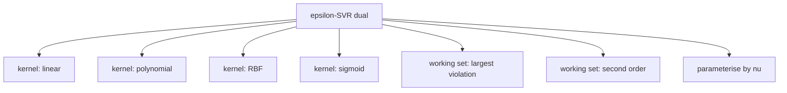

# Support vector regression — a tube, a hinge and a dual

`svr.py` · Kernels and instance · Tier 2 · 5 variants

## Intuition

Support vector regression takes the support-vector machine and turns the street
into a tube. In classification the model must put every point on the right side
of a margin. In regression there are no sides, so the model is allowed to be
wrong by up to $\epsilon$ everywhere — inside a band of half-width $\epsilon$
around the target, the loss is exactly zero:

```
      y
      │        ·        ·
      │   ────────────────  f(x) + ε
      │      ·    ·         ·
      │   ·  ──────────────  f(x)
      │        ·   ·   ·    ·
      │   ────────────────  f(x) − ε
      │  ·                     ·
      └────────────────────────── x
        free    free    a point
        (inside (on the  outside the tube
        the tube) tube)  pays |y − f| − ε
```

Outside the tube the cost is linear, not squared. That single change is what
makes the solution sparse. With a squared loss every point pulls on the fitted
curve; with an $\epsilon$-insensitive loss a point that the tube already covers
pulls on nothing, and its weight is exactly zero. The model is the handful of
points the tube cannot contain — the support vectors — and everything else
could be deleted from the training set without changing the prediction.

The second consequence is that the fit is written in terms of kernel values
between training points, so a linear model, a polynomial and an RBF model are
the same code with a different Gram matrix. The third is that the parameters
are not solved for directly: the problem is a box-constrained quadratic program
in one coefficient per training point, and the whole atom is a small solver for
that program plus the bookkeeping around it.

Two parameterisations come out of the same solver. Fix the tube $\epsilon$ and
bound the coefficients by $C$; or fix the budget $\nu$ as a fraction of points
allowed outside the tube and let the solver find $\epsilon$. The second one is
easier to reason about because $\nu$ is a number between zero and one: at
$\nu=0.5$ with $C=1$ on forty points the model uses twenty support vectors and
twenty points fall outside the tube.

## Variants

| variant | what it changes | default kernel |
|:--|:--|:--|
| `epsilon_svr` | the tube is fixed, the box is $C$ | RBF |
| `nu_svr` | the support fraction is fixed, the tube is found | RBF |
| `linear` | a straight-line model, $K(x,z)=x^{\top}z$ | linear |
| `rbf` | a bump per training point, $K=e^{-\gamma\|x-z\|^2}$ | RBF |
| `smo` | the classic largest-violation working set | RBF |



**`epsilon_svr`** is the base model: minimise the tube loss with a box bound on
the dual coefficients and a hard tube of width $\epsilon$. Everything else in
the file is a variation on it.

**`nu_svr`** replaces $C$ and $\epsilon$ with a single $\nu$ in $(0,1]$ that
bounds the fraction of margin errors from above and the fraction of support
vectors from below. The solver bisects on $\epsilon$ until the total weight
hits $C\nu$.

**`linear`** sets the kernel to the dot product. The model is then literally a
line, and the dual is a program over one direction — the Gram matrix has rank
one in one dimension.

**`rbf`** sets the kernel to a Gaussian bump centred on each support vector.
The prediction is a weighted sum of bumps, which is why it can bend.

**`smo`** keeps the model and changes only the rule that picks the pair of
coefficients to update. The default rule is second order (Fan, Chen and Lin);
this variant is the classic rule that takes the largest KKT violation. Both
stop on the same tolerance and reach the same answer.

## Derivation

### The loss

The $\epsilon$-insensitive loss is

$$
L_\epsilon(r)=
\begin{cases}
0 & |r|\le\epsilon,\\
|r|-\epsilon & |r|>\epsilon,
\end{cases}
\qquad (1)
$$

with $r=y-f(x)$. It is the hinge loss of classification with two hinges
instead of one: a dead zone in the middle and a linear penalty on each side.
Squaring it gives the Huber loss; not squaring it is what keeps the support set
finite.

### The primal

With slack variables for the two sides of the tube, the problem is

$$
\min_{w,b,\xi,\xi^*} \tfrac12\|w\|^2+C\sum_i(\xi_i+\xi_i^*)
\qquad (2)
$$

subject to

$$
y_i-w^{\top}\phi(x_i)-b\le\epsilon+\xi_i,\qquad
w^{\top}\phi(x_i)+b-y_i\le\epsilon+\xi_i^*,
\qquad \xi_i,\xi_i^*\ge0.
\qquad (3)
$$

The first constraint is the upper hinge, the second the lower one. The
regulariser $\tfrac12\|w\|^2$ is what makes the solution a combination of a few
training points rather than an interpolant, and $C$ trades it against the tube
violations.

### The dual

Introduce multipliers $\alpha_i,\alpha_i^*\ge0$ for the two constraints and
$\eta_i,\eta_i^*\ge0$ for the slack. Stationarity in $w$ gives the expansion

$$
w=\sum_i(\alpha_i-\alpha_i^*)\,\phi(x_i),
\qquad (4)
$$

stationarity in $b$ gives the balance $\sum_i(\alpha_i-\alpha_i^*)=0$, and
stationarity in the slacks gives $C=\alpha_i+\eta_i$. Substituting back leaves

$$
\min_{\alpha,\alpha^*}\ \tfrac12\delta^{\top}K\delta
-\ y^{\top}\delta+\epsilon\,\|\delta\|_1
\quad\text{s.t.}\quad \mathbf{1}^{\top}\delta=0,\ \ 0\le\alpha_i,\alpha_i^*\le C,
\qquad (5)
$$

where $\delta=\alpha-\alpha^*$ and $K_{ij}=K(x_i,x_j)$. Only the difference
$\delta$ appears, so the two multipliers are one variable with a sign: a point
outside the tube above gets $\alpha_i>0$, a point outside below gets
$\alpha_i^*>0$, and a point inside gets both zero.

The prediction is the expansion (4) evaluated at a new point:

$$
f(x)=\sum_i\delta_i\,K(x_i,x)+\bar b.
\qquad (6)
$$

### What the KKT conditions say

The box constraints and the tube give a three-way classification, and the demo
checks it point by point. With $r_i=y_i-w^{\top}\phi(x_i)$ and $\bar b$ the
intercept:

| dual coefficient | position of the point | condition |
|:--|:--|:--|
| $0<\alpha_i<C$ | on the upper edge of the tube | $r_i-\bar b=\epsilon$ |
| $0<\alpha_i^*<C$ | on the lower edge | $r_i-\bar b=-\epsilon$ |
| $\alpha_i=\alpha_i^*=0$ | strictly inside | $\lvert r_i-\bar b\rvert\le\epsilon$ |
| $\alpha_i=C$ | above the tube | $r_i-\bar b\ge\epsilon$ |
| $\alpha_i^*=C$ | below the tube | $r_i-\bar b\le-\epsilon$ |

The first two rows are the useful ones: a coefficient strictly inside the box
is a point sitting exactly on the tube edge, and it is those points that pin
the intercept. If none exist the intercept is only determined up to an
interval, and the code takes its midpoint.

### The solver

Write $\beta=(\alpha,\alpha^*)$ and stack the problem. With $s_i=+1$ for the
first block and $s_i=-1$ for the second, the constraint is $s^{\top}\beta=0$
and the objective matrix is $Q_{ij}=s_is_jK_{i\bmod n,\,j\bmod n}$, so the
program is the standard box-constrained form

$$
\min_\beta\ \tfrac12\beta^{\top}Q\beta+p^{\top}\beta
\quad\text{s.t.}\quad s^{\top}\beta=0,\ \ 0\le\beta_i\le C,
\qquad p=(\epsilon-y,\ \epsilon+y).
\qquad (7)
$$

A pair step moves two coordinates so that the equality survives. If $s_i=s_j$
the step is $\beta_i\leftarrow\beta_i-t$, $\beta_j\leftarrow\beta_j+t$; if
$s_i\ne s_j$ both move by $+t$. The exact minimiser along the direction is the
Newton step, which for the first case is

$$
t^\star=\frac{G_i-G_j}{K_{ii}+K_{jj}-2K_{ij}},
\qquad (8)
$$

and the second case has $-G_i-G_j$ in the numerator. The denominator is
$\|\phi(x_i)-\phi(x_j)\|^2$ — the same curvature the SVM uses — and it is
positive unless the two points coincide. The step is then clipped to the box,
so a pair that cannot move freely stops at whichever coordinate hits a bound
first.

The working set is what separates a usable solver from a slow one. The default
rule fixes $i$ as the most violated coordinate in the "can increase" set and
picks $j$ from the "can decrease" set by maximising the predicted decrease

$$
\text{gain}(j)=\frac{\big(\text{violation}_j\big)^2}{\|\phi_i-\phi_j\|^2},
\qquad (9)
$$

which is the exact reduction in the objective for the pair. The `smo` variant
instead picks the largest violation without dividing by the curvature. Both are
valid; on the demo's problems the second-order rule needs 1490 steps where the
classic one needs 3009, and at $\epsilon=0$ the ordering reverses.

### The intercept

For a free support vector the KKT condition is an equation, so each one gives a
candidate

$$
\bar b=r_i-\mathrm{sign}(\delta_i)\,\epsilon ,
\qquad (10)
$$

and the code averages the candidates. When every coefficient sits on the box
there is no equation and the conditions become inequalities, which define an
interval

$$
\max_{\delta_j=-C}\ (r_j+\epsilon)\ \le\ \bar b
\ \le\ \min_{\delta_i=+C}\ (r_i-\epsilon),
\qquad (11)
$$

widened by the inside points, whose condition is $|r_i-\bar b|\le\epsilon$.
The code intersects all of them and returns the midpoint. Getting this wrong is
invisible on problems that have free support vectors and shows up as a large
KKT residual on the ones that do not.

### The nu parameterisation

The $\nu$ form replaces the tube with a budget. Its dual is

$$
\min_{\delta}\ \tfrac12\delta^{\top}K\delta-y^{\top}\delta
\quad\text{s.t.}\quad \mathbf{1}^{\top}\delta=0,\ \ \|\delta\|_1\le C\nu,\ \
|\delta_i|\le C/n,
\qquad (12)
$$

and $\epsilon$ becomes the multiplier of the norm constraint. Two facts follow
directly from the budget. Every nonzero coefficient has $|\delta_i|\ge$ the
smallest positive weight, and the points outside the tube are exactly those at
the box, so

$$
\#\{\text{support vectors}\}\ \ge\ \nu n,\qquad
\#\{\text{margin errors}\}\ \le\ \nu n .
\qquad (13)
$$

The code does not solve (12) directly. Instead it solves (5) for a sequence of
$\epsilon$ and bisects, using the fact that $\|\delta(\epsilon)\|_1$ is
non-increasing in $\epsilon$: a wider tube explains more points for free, so
fewer coefficients leave zero. The measured table in the demo runs from
$\epsilon=3.17$ at $\nu=0.1$ down to $\epsilon=0.27$ at $\nu=0.8$, with 4 and
32 support vectors.

### Kernels

Nothing in the derivation above needed the features, only their inner products.
Four are provided:

$$
K(x,z)=x^{\top}z,\qquad
K(x,z)=(\gamma x^{\top}z+c_0)^d,\qquad
K(x,z)=e^{-\gamma\|x-z\|^2},\qquad
K(x,z)=\tanh(\gamma x^{\top}z+c_0).
\qquad (14)
$$

The RBF kernel is computed from the identity
$\|x-z\|^2=\|x\|^2+\|z\|^2-2x^{\top}z$, which is one matrix product and two
broadcasts rather than a loop over pairs. On the demo's sine wave the linear
kernel reaches a held-out RMSE of $0.4786$ and the RBF kernel $0.0865$, with
ten support vectors instead of thirty-eight.

## Code walkthrough

### The Gram matrix

```python
    if kind == "rbf":
        squared = (np.sum(X ** 2, axis=1)[:, None]
                   + np.sum(Z ** 2, axis=1)[None, :] - 2.0 * X @ Z.T)
        return np.exp(-gamma * np.maximum(squared, 0.0))
```

The expansion is the whole kernel. `maximum(squared, 0.0)` is not cosmetic: for
near-identical points the subtraction can produce a tiny negative number, and
`exp` of a small positive number is larger than one — a Gram entry above one is
harmless, but it breaks the identity $\mathrm{diag}(K)=1$ that the demo's
assertions rely on.

### Selecting the pair

```python
            score = -sign * gradient
            i = int(np.argmax(np.where(up, score, -np.inf)))
            head = i % rows
            gap = np.maximum(diagonal[head] + diagonal
                             - 2.0 * gram[head, index % rows], 1e-12)
            violation = score[i] - score
            candidate = low & (index != i) & (violation > self.tol)
            if not candidate.any():
                break
            if second_order:
                j = int(np.argmax(np.where(candidate, violation ** 2 / gap,
                                           -np.inf)))
            else:
                j = int(np.argmax(np.where(candidate, violation, -np.inf)))
```

`score = -sign * gradient` is the quantity whose maximum over the "up" set and
minimum over the "low" set defines a violating pair. The `index != i` term is
essential rather than defensive: a coordinate strictly inside the box belongs
to both sets, so without it the same coordinate can be chosen as both members
of the pair, the gain is zero, and the loop stops on a solution that is not
optimal. `gap` is the curvature of (8) for every candidate partner at once,
which is what makes the second-order rule a single vectorised expression.

### The step and the update

```python
            agree = sign[i] == sign[j]
            slope = gap[j]
            if agree:
                step = (gradient[i] - gradient[j]) / slope
                low_step = max(-beta[j], beta[i] - box)
                high_step = min(beta[i], box - beta[j])
            else:
                step = (-gradient[i] - gradient[j]) / slope
                low_step = max(-beta[i], -beta[j])
                high_step = min(box - beta[i], box - beta[j])
            step = float(np.clip(step, low_step, high_step))
```

Two cases, one for each way of keeping $s^{\top}\beta$ fixed. The bounds are
computed from both coordinates, so the step lands exactly on a box face when
the unconstrained Newton step would leave the feasible set. `slope = gap[j]` is
the curvature between the chosen pair — the bound of $10^{-12}$ from the
selection step is what keeps a duplicate point from dividing by zero.

```python
            if agree:
                beta[i] -= step
                beta[j] += step
                left, right = -step * sign[i], step * sign[j]
            else:
                beta[i] += step
                beta[j] += step
                left, right = step * sign[i], step * sign[j]
            delta[head] += left
            delta[tail] += right
            change = left * gram[:, head] + right * gram[:, tail]
            fitted += change
            gradient[:rows] += change
            gradient[rows:] -= change
```

`delta` is kept in update form rather than recomputed from `beta`, so the
solver never has to subtract two nearly equal numbers. The gradient update is
two rank-one columns of the Gram matrix, because a pair step only touches two
training points — that is why one iteration costs $O(n)$ and not $O(n^2)$.

### The bisection

```python
        zero = self._solve(gram, targets, box, 0.0)
        if float(np.abs(zero[0]).sum()) <= target:
            self.epsilon_ = 0.0
            return zero
        state = zero
        for _ in range(60):
            middle = 0.5 * (low + high)
            state = self._solve(gram, targets, box, middle)
            mass = float(np.abs(state[0]).sum())
            if mass > target:
                low = middle
            else:
                high = middle
            if high - low <= 1e-12:
                break
        self.epsilon_ = high
        return self._solve(gram, targets, box, high)
```

The early exit handles a $\nu$ small enough that the tube-free solution already
fits the budget — then $\epsilon=0$ is optimal and there is nothing to bisect.
The direction of the update is the monotonicity: too much weight means the tube
is too narrow, so $\epsilon$ moves up. The box is $C/n$ rather than $C$, which
is what turns the norm budget into a count in (13).

### The intercept

```python
        delta = alpha - alpha_star
        top = delta >= box - 1e-8
        bottom = delta <= -box + 1e-8
        middle = ~top & ~bottom
        lower = np.concatenate([residual[bottom] + epsilon,
                                residual[middle] - epsilon])
        upper = np.concatenate([residual[top] - epsilon,
                                residual[middle] + epsilon])
        if lower.size and upper.size:
            return 0.5 * float(lower.max() + upper.min())
```

This is (11) with the three cases of the KKT table collapsed into two arrays.
The `bottom` points give lower bounds on $\bar b$ and the `top` points upper
bounds; the `middle` points, including the free support vectors, give both.
Taking the midpoint is what keeps the residual on either side of the interval
balanced, so the reported KKT violation is half the width instead of the whole
width when the interval is not a point.

### The KKT residual

```python
        for value, error in zip(self.delta_, residual, strict=True):
            free = 1e-8 < abs(value) < scale - 1e-8
            if free:
                worst = max(worst, abs(error - (self.b_ + np.sign(value) * epsilon)))
            elif abs(value) <= 1e-8:
                worst = max(worst, max(0.0, abs(error - self.b_) - epsilon))
            elif value >= scale - 1e-8:
                worst = max(worst, max(0.0, (self.b_ + epsilon) - error))
            else:
                worst = max(worst, max(0.0, error - (self.b_ - epsilon)))
```

`error` is the residual *without* the intercept, so every condition compares
against `self.b_` shifted by $\pm\epsilon$. The four branches are the four rows
of the table, and `scale` is $C$ or $C/n$ depending on the parameterisation. A
free coefficient is checked as an equality and the others as one-sided
inequalities, which is exactly why the demo can assert $10^{-14}$ on one variant
and $10^{-9}$ on the other: the nu solver stops on a tolerance in $\epsilon$,
not in the coefficients.

## Complexity

Let $n$ be the training count, $d$ the features, and $T$ the number of pair
updates.

| operation | time | memory |
|:--|:--|:--|
| Gram matrix | $O(n^2d)$ | $O(n^2)$ |
| one pair update | $O(n)$ | $O(1)$ |
| one bisection solve | $O(Tn)$ | $O(n)$ |
| the whole nu fit | $O(Tn\log(1/\tau))$ | $O(n)$ |
| prediction on $m$ points | $O(m\,n_{\text{sv}}\,d)$ | $O(n_{\text{sv}})$ |

The Gram matrix is the dominant cost in $n$ and is computed once. Each pair
update touches two columns, so the solver is linear in $n$ per step, and the
step count is the only thing the working-set rule changes. Prediction only
touches the support vectors, which is why the sparse expansion is worth having
at serving time: the demo's RBF model uses ten of fifty points.

The bisection multiplies the solve cost by about forty: the bracket starts at
the spread of the targets and stops when it is $10^{-12}$ wide, which is
$\log_2$ of the ratio — around forty halvings. That is the price of the clean
parameterisation. A production implementation carries $\epsilon$ as a variable
in the dual instead.

## Failure modes

**A tube so wide that nothing is outside it.** With $\epsilon$ larger than the
spread of the residuals every coefficient is zero, the prediction is the mean
of the targets, and the model has no support vectors. The demo's $\epsilon=0.6$
row keeps four, which is where the boundary is. Nothing errors; the model just
stops being a model.

**A tube so narrow that everything is a support vector.** At $\epsilon=0$ every
noisy point is a margin error, all forty coefficients are nonzero, and the
"sparse" method costs as much as a dense one. That is not a bug — it is the
definition — but it is the reason $\epsilon$ is the first parameter to tune.

**Assuming a plane is enough.** On the demo's sine wave the linear kernel
reaches a held-out error of $0.4786$ while the RBF kernel reaches $0.0865$.
Both converged, both satisfy the KKT conditions, and one of them is useless.
Choosing the kernel is not part of the optimisation.

**An ill-conditioned Gram matrix.** A degree-three polynomial kernel on inputs
of magnitude three produces entries in the thousands and a condition number
above $10^{19}$; the solver then needs thousands of updates to converge and may
stop on `max_iter` with a visible KKT residual. The demo uses $\gamma=0.05$ for
that kernel, which is the kernel-scale version of feature scaling.

**Overflow in the kernel scale.** $\gamma$ too large makes the RBF matrix the
identity: every training point only sees itself, the fit interpolates the
training set and predicts zero everywhere else. $\gamma$ too small makes it
rank one, which is the linear kernel in disguise. The default $1/d$ is a
starting point, not a rule.

**A bug that only appears when no coefficient is free.** The intercept in (11)
degenerates when every support vector sits on the box. Averaging the two groups
separately rather than intersecting their constraints produces a plausible
number, a small training error and a KKT residual of order the gap between the
two bounds — here $0.17$ before the fix and $10^{-9}$ after.

**Solving a different program than the one documented.** Flipping the sign of
the tube term, or treating $\alpha$ and $\alpha^*$ as independent without the
balance constraint, still yields a convex program and still converges. The only
symptom is that the residuals of the free points are at $-\epsilon$ instead of
$+\epsilon$, which is why the demo checks the sign rather than the magnitude.

**Reading sparsity as importance.** A nonzero coefficient means the point is
outside the tube, not that it is informative. Points in a noisy region are all
outside it; the support set of an $\epsilon$-SVR is a set of *violations*, and
outliers dominate it.

**Using the training KKT residual as a generalisation estimate.** The residual
is a solver diagnostic and it is zero at the optimum of any well-posed problem,
including one that has memorised the data. The demo reports held-out RMSE
separately for exactly this reason.

## Applications

**Time-series and sensor calibration.** A tube around the fitted value is a
natural model of instrument tolerance, and the sparse expansion means the
predictor is a short list of past readings rather than a dense model.

**Robust regression.** The linear loss outside the tube bounds the influence of
a single outlier, unlike least squares; the support set tells you which points
were allowed to pull, which is often the interesting output.

**Load and demand forecasting.** SVR was a standard baseline for short-horizon
load prediction before gradient boosting, and the $\epsilon$-tube matches the
error tolerance the operator actually cares about.

**Chemometrics and spectral calibration.** Near-infrared spectra are wide and
highly collinear, and a kernel SVR on a few hundred wavelengths with a sparse
support set became the standard chemometric tool for concentration prediction.

**Financial volatility.** The asymmetric version with two different tube widths
fits the asymmetry of returns, and the budget parameterisation controls the
fraction of days the model refuses to explain.

**Surrogate models for simulation.** A small SVR trained on a design of
experiments is a cheap stand-in for a solver, and the $\epsilon$ tube keeps the
surrogate from chasing numerical noise in the simulator.

**Anomaly scoring.** The residual of a fitted SVR, thresholded, is a one-class
detector in disguise: points far outside the tube at inference are the ones the
training distribution does not cover.

**Teaching duality.** The atom is small enough to check by hand: a primal with
slacks, a dual with box constraints, a KKT table, and a solver whose every step
can be verified against strong duality. That is why it survives in courses long
after it stopped being the state of the art.

## References

- Drucker, H., Burges, C. J. C., Kaufman, L., Smola, A. & Vapnik, V. (1997).
  Support vector regression machines. *NeurIPS*. The $\epsilon$-tube and the
  dual solved in this atom.
- Vapnik, V. (1995). *The Nature of Statistical Learning Theory*. Springer. The
  $\epsilon$-insensitive loss and the support-vector principle it comes from.
- Smola, A. J. & Schölkopf, B. (2004). A tutorial on support vector regression.
  *Statistics and Computing* 14(3), 199–222. The clearest derivation of the
  primal, the dual and the $\nu$ form.
- Schölkopf, B., Smola, A. J., Williamson, R. C. & Bartlett, P. L. (2000). New
  support vector algorithms. *Neural Computation* 12(5), 1207–1245. The $\nu$
  parameterisation and the bounds in (13).
- Platt, J. C. (1999). Fast training of support vector machines using sequential
  minimal optimization. In *Advances in Kernel Methods*, MIT Press. The original
  pair update and the largest-violation working set.
- Fan, R.-E., Chen, P.-H. & Lin, C.-J. (2005). Working set selection using
  second order information for training support vector machines. *JMLR* 6,
  1889–1918. The rule in (9) and the convergence argument for it.
- Chang, C.-C. & Lin, C.-J. (2011). LIBSVM: a library for support vector
  machines. *ACM Transactions on Intelligent Systems and Technology* 2(3), 1–27.
  The reference implementation of the solver sketched here, including the
  intercept fallback.
- Smola, A. J. & Schölkopf, B. (1998). *Learning with Kernels*. MIT Press. The
  kernel table, the representer theorem and the regularisation view.
- Rifkin, R., Yeo, G. & Poggio, T. (2003). Regularized least-squares
  classification. *NATO Science Series*. The least-squares relative of this
  atom, and the argument for why the hinge is worth its cost.
