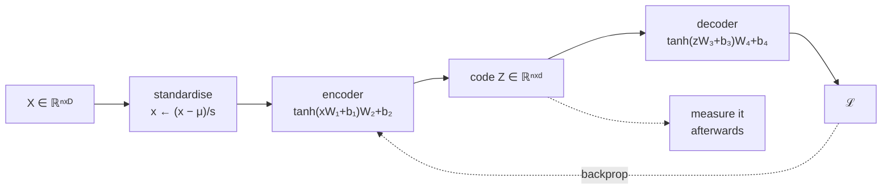

# Autoencoder embedding

`autoencoder_dr.py` · Manifolds & embeddings · Tier 2 · 4 variants

## Intuition

Every other atom in this chapter decides in advance what a good embedding
preserves — local weights, graph smoothness, geodesic distance, neighbour
probabilities. An autoencoder decides nothing. It puts a narrow layer in the
middle of a network and asks the network to reproduce its own input through it:

```
 D            h              d              h              D
 x ─────────► tanh ────────► z ──────────► tanh ────────► x̂
              W₁, b₁        W₂, b₂         W₃, b₃         W₄, b₄
              └────────── encoder ───────┘└───── decoder ─────┘
                                          │
                          ℒ = ½‖x − x̂‖²   (+ λ‖∂z/∂x‖², + β·KL)
```

If $d < D$ the network cannot copy, so it has to choose what to keep. The
cheapest thing to keep is a set of coordinates from which the input can be
rebuilt: on a plane in five dimensions, two numbers suffice, and the loss is
minimised by any two coordinates that span the plane. On a sheet folded in three
dimensions, no *linear* pair of numbers suffices — a projection has to choose
which fold to collapse — but a curved map can unroll the sheet first. That is the
entire content of the method: the map is learned, and the only pressure on it is
reconstruction.

The catch is that reconstruction does not define a geometry. If $z$ is a valid
code, so is $Az$ for any invertible $A$, provided the decoder is adjusted
accordingly: the loss is invariant to the whole general linear group. Distances
in the code space therefore mean nothing in particular, and two runs on the same
data can produce codes that differ by an arbitrary shear. The demo measures this
directly — six seeds on the same S-curve reach reconstruction errors from
$0.00132$ to $0.02278$ and distance correlations from $0.768$ to $0.901$, and
the run with the lowest error is not the run with the best geometry.

What the method does have that the graph methods lack is *amortisation*: the
encoder is a function, so a new point can be placed in $O(Dh)$ arithmetic without
re-solving anything. That is why it is the default choice when $n$ is large, when
points arrive after training, or when the embedding is a feature extractor for
something else. It is also why it is a poor choice when you need a metric.



The demo's first check is that the four variants are implemented correctly, and
it is the only assertion in the file that does not depend on data: a 6-5-2
network on 11 points, every parameter compared with central differences, worst
relative error $3.1 \times 10^{-7}$ over 4 variants × 8 tensors × 3 entries. The
rest of this document quotes measurements from the same run.

## Variants

All four fit the same architecture; they differ in one term of the loss.

| variant | extra term | what it constrains | measured cost |
|:--|:--|:--|:--|
| `ae` | none | nothing beyond reconstruction | code is arbitrary up to GL(d) |
| `denoising_ae` | input jitter, target unchanged | the map should ignore small perturbations | local overlap up, global distances down |
| `vae_embed` | $\beta\,\mathrm{KL}(q(z\mid x)\,\Vert\,p(z))$ | the code cloud should look like the prior | reconstruction |
| `contractive` | $\lambda \lVert \partial z/\partial x \rVert_F^2$ | the code should change slowly with the input | local fidelity, and the code's own scale |

**`ae`** is (3) and nothing else. On the plane it recovers $99.98\%$ of the
variance and correlates $0.99244$ with the generating coordinates; PCA on the
same data correlates $1.00000$. The network does not converge to PCA exactly —
`tanh` is not linear, so the optimum is a curved chart of the plane, not a
projection — but on a linear manifold the two agree to two decimal places, which
is the sanity check that the optimiser is doing its job.

**`denoising_ae`** corrupts the input and keeps the target. In the demo the
S-curve gets Gaussian noise of $0.10$ per coordinate; training on the noisy copy
without jitter keeps $0.634$ of each point's eight nearest neighbours and
correlates $0.817$ with the true parameters, and adding the jitter moves those to
$0.649$ and $0.788$. At twenty neighbours it is $0.739 \to 0.748$. The jitter is
a regulariser that smooths the map, which buys local neighbourhoods and pays for
them in global stretch: $-0.028$ on distance correlation for $+0.015$ on overlap.
It does not reach the clean-data ceiling of $0.759$ / $0.878$.

**`vae_embed`** splits the latent layer into $\mu$ and $\log\sigma^2$, samples
$z = \mu + \sigma \odot \varepsilon$, and pays a KL per point. The relevant
measurement is not the per-sample KL but the *aggregate* one: fit a Gaussian to
the whole code cloud and ask how far it is from $\mathcal{N}(0, I)$. On the
plane the plain code is $0.737$ nats away with standard deviation $0.304$ per
axis — the flattened shape of a uniform square. A sweep gives $\beta = 0.05$:
$0.0005$ nats at $99.775\%$ of the variance explained; $\beta = 0.2$: $0.0035$ at
$98.989\%$; $\beta = 1$: $0.0774$ at $87.779\%$. So $\beta = 0.05$ buys a code
cloud $1606\times$ closer to the prior for $0.2\%$ of the variance, and $\beta =
1$ pays another $12\%$ for a further factor of 150. Two caveats measured in the
same run: the per-sample KL at $\beta = 0.05$ is $3.78$ — the term constrains
each point's posterior, not the shape of the cloud — and the per-axis kurtosis at
$\beta = 1$ is $1.96$ against $2.20$ for the plain code and $3.00$ for a
Gaussian. Matching mean and variance is not matching the distribution.

**`contractive`** adds the squared Frobenius norm of the encoder Jacobian. At
$\lambda = 0.05$ the mean $\lVert J \rVert_F^2$ falls from $6.127$ to $0.222$, a
factor of $27.6$; but the code's scale falls from $1.93$ to $0.41$ at the same
time, and the penalty scales as the square of that, so $22.3$ of the $28$ is
amplitude the decoder could undo. The genuine flattening is $1.23\times$. The
embedding still correlates $0.909$ with the sheet — better than $0.878$ — and
keeps $0.710$ of each point's eight neighbours against $0.759$. The penalty is
not scale-invariant, and on a two-dimensional latent the optimiser takes the
scale route before it takes the flatness route.

## Derivation

### 1. The objective, and what it can and cannot identify

Write the encoder and decoder as

$$
z = \tanh(x W_1 + b_1) W_2 + b_2, \qquad
\hat{x} = \tanh(z W_3 + b_3) W_4 + b_4 \qquad (1)$$
$$
\mathcal{L}(W, b) = \frac{1}{2n} \sum_{i=1}^{n} \lVert x_i - \hat{x}_i \rVert^2 \qquad (2)$$

with $W_1 \in \mathbb{R}^{D \times h}$, $W_2 \in \mathbb{R}^{h \times d}$,
$W_3 \in \mathbb{R}^{d \times h}$, $W_4 \in \mathbb{R}^{h \times D}$. The
bottleneck is the rank of the middle: $d$ numbers must carry everything the
decoder sees.

Two facts pin down what (2) can mean. First, if both sides were linear, the
problem would have a closed form: the optimum is the projection onto the leading
$d$ principal subspace, by Eckart–Young. The `tanh` is the whole difference. It
lets the encoder bend the coordinate system, which is what an S-curve needs, and
it also means the objective is non-convex with many local minima — so the answer
is whatever the optimiser finds, not a well-defined object.

Second, the loss is invariant under any invertible change of the code. For any
$A \in \mathrm{GL}(d)$, replacing

$$
z \mapsto A z, \qquad W_3 \mapsto W_3 A^{-1}, \qquad b_3 \mapsto b_3
\qquad (3)$$

leaves $\hat{x}$ unchanged, because the tanh acts entrywise after $z W_3$ and
$(Az)(W_3 A^{-1}) = z W_3$. The same argument covers a rescaling of the latent
and a compensating rescaling of the decoder. So (2) identifies an equivalence
class of codes, not a code: any statement about distances, angles or axes in $Z$
must be preceded by an alignment step. The demo sidesteps this by using
distance-matrix correlation and neighbour overlap, which are invariant to
rotation and isotropic scale — but not to a general shear, which is why the
failure section treats it as a diagnostic rather than a proof.

### 2. Backpropagation through the two layers

Let $R = \hat{x} - x$ and $u = 1 - H^2$, the derivative of `tanh` at the hidden
activation. With the $1/n$ already inside $R$ (the loss is a mean):

$$
\frac{\partial \mathcal{L}}{\partial W_4} = G^\top \frac{R}{n}, \qquad
\frac{\partial \mathcal{L}}{\partial b_4} = \frac{1}{n}\sum_i R_i
\qquad (4)$$
$$
d_G = \frac{R}{n} W_4^\top, \qquad
d_{\text{pre}} = d_G \odot (1 - G^2), \qquad
d_Z = d_{\text{pre}} W_3^\top \qquad (5)$$
$$
\frac{\partial \mathcal{L}}{\partial W_3} = Z^\top d_{\text{pre}}, \qquad
d_H = d_Z W_2^\top, \qquad
d_A = d_H \odot u \qquad (6)$$
$$
\frac{\partial \mathcal{L}}{\partial W_1} = X_{\text{in}}^\top d_A, \qquad
\frac{\partial \mathcal{L}}{\partial b_1} = \sum_i (d_A)_i \qquad (7)$$

The two lines that a naive implementation gets wrong are the placement of $1/n$
and the use of $X_{\text{in}}$ rather than $X$ in (7). The first is a scalar and
does not change the direction, but it changes the meaning of the learning rate
and breaks every finite-difference check that assumes a mean. The second matters
only for `denoising_ae`, where the encoder saw the corrupted input and the
decoder is being asked about the clean one.

### 3. The variational branch

For `vae_embed` the latent layer produces $\mu$ and $\log\sigma^2$ and the code is

$$
z = \mu + \sigma \odot \varepsilon, \qquad
\sigma = \exp\!\left(\tfrac{1}{2}\log\sigma^2\right), \qquad
\varepsilon \sim \mathcal{N}(0, I) \qquad (8)$$
$$
\mathrm{KL}\big(q(z\mid x) \,\Vert\, \mathcal{N}(0, I)\big)
= \tfrac{1}{2}\sum_{j=1}^{d}\left(\sigma_j^2 + \mu_j^2 - 1 - \log\sigma_j^2\right)
\qquad (9)$$

Equation (9) is the closed form for two Gaussians with diagonal covariance, and
it is the reason the variant is cheap: no sampling is needed to evaluate the
regulariser. The gradients follow from the reparameterisation in (8),

$$
\frac{\partial \mathrm{KL}}{\partial \mu} = \mu, \qquad
\frac{\partial \mathrm{KL}}{\partial \log\sigma^2}
= \tfrac{1}{2}\left(\sigma^2 - 1\right), \qquad
\frac{\partial z}{\partial \log\sigma^2} = \tfrac{1}{2}\sigma \odot \varepsilon
\qquad (10)$$

so that

$$
d_\mu = d_Z + \frac{\beta}{n}\mu, \qquad
d_{\log\sigma^2} = \tfrac{1}{2} d_Z \odot \sigma \odot \varepsilon
+ \frac{\beta}{2n}\left(\sigma^2 - 1\right) \qquad (11)$$

and $d_E$ is the horizontal concatenation $[d_\mu, d_{\log\sigma^2}]$. The
$\tfrac{1}{2}\sigma \odot \varepsilon$ factor in (11) is the one line that is
easy to write as $\sigma \odot \varepsilon$; it is off by a factor of two and the
gradient check catches it.

### 4. The contractive term, in closed form

The encoder Jacobian of one point is

$$
J_i = \frac{\partial z_i}{\partial x_i}
= W_2^\top \mathrm{diag}(u_i) W_1^\top \in \mathbb{R}^{d \times D} \qquad (12)$$

and its squared Frobenius norm collapses to a quadratic form in $u_i$:

$$
\lVert J_i \rVert_F^2
= \mathrm{tr}\!\left(W_2^\top \mathrm{diag}(u_i) W_1^\top
  W_1 \mathrm{diag}(u_i) W_2\right)
= u_i^\top (A \odot B)\, u_i \qquad (13)$$
$$
A = W_1^\top W_1 \in \mathbb{R}^{h \times h}, \qquad
B = W_2 W_2^\top \in \mathbb{R}^{h \times h} \qquad (14)$$

using $\mathrm{tr}(UV) = \mathrm{tr}(VU)$ and
$\mathrm{tr}(\mathrm{diag}(u) M \mathrm{diag}(u) N) = u^\top (M \odot N^\top) u$.
That identity is what makes `contractive` cost $O(h^2)$ per epoch rather than
$O(nDh)$ per point: no Jacobian is ever formed.

The penalty $P = \lambda n^{-1}\sum_i u_i^\top C u_i$ with $C = A \odot B$ has
two gradient paths. Through $A$ and $B$, with $U = n^{-1}\sum_i u_i u_i^\top$,

$$
\frac{\partial P}{\partial A} = \lambda\,(U \odot B), \qquad
\frac{\partial P}{\partial B} = \lambda\,(U \odot A) \qquad (15)$$

and since $A = W_1^\top W_1$, $B = W_2 W_2^\top$,

$$
\frac{\partial P}{\partial W_1} = 2 W_1 \frac{\partial P}{\partial A}, \qquad
\frac{\partial P}{\partial W_2} = 2 \frac{\partial P}{\partial B} W_2
\qquad (16)$$

Through $u_i = 1 - h_i^2$,

$$
\frac{\partial P}{\partial h_i}
= -\frac{4\lambda}{n}\, h_i \odot (C u_i) \qquad (17)$$

which enters $d_H$ *before* the multiplication by $u$ in (6), not after. Drop
that path and the loss still decreases during training, so the run looks fine;
the gradient check in the demo is what notices.

### 5. Why denoising and contractive are cousins

Expand the decoder around the clean input. With corruption $\varepsilon \sim
\mathcal{N}(0, \sigma^2 I)$ and $J = \partial \hat{x}/\partial x$ the Jacobian of
the whole reconstruction map,

$$
\hat{x}(x + \varepsilon) \approx \hat{x}(x) + J \varepsilon
\quad\Longrightarrow\quad
\mathbb{E}\lVert x - \hat{x}(x+\varepsilon) \rVert^2
\approx \lVert x - \hat{x}(x) \rVert^2 + \sigma^2 \lVert J \rVert_F^2
\qquad (18)$$

so a denoising autoencoder with Gaussian noise adds a contractive penalty of
weight $\sigma^2$ — on the composite map, where (6) penalises the encoder alone.
That explains the measured pattern: both variants smooth the map, both pay for it
in global distances, and the denoising version's weight is set by the noise level
rather than by a hyperparameter. The equivalence is first-order only — at large
$\sigma$ the quadratic term in the expansion matters, and the two objectives
diverge.

### 6. Optimisation

`fit` minimises (2) with Adam, full batch, no shuffling:

$$
m \leftarrow 0.9m + 0.1g, \qquad
v \leftarrow 0.999v + 0.001g^2, \qquad
\theta \leftarrow \theta - \eta\,\frac{m/(1-0.9^t)}{\sqrt{v/(1-0.999^t)} + 10^{-8}}
\qquad (19)$$

Full batch is a deliberate choice: with a fixed seed and a fixed order, two runs
are bit-identical, and the gradient check is meaningful. It costs the stochastic
regularisation that minibatch noise provides, which is part of why the seed
spread in the failure section is as wide as it is.

## Code walkthrough

`Autoencoder.fit` is the entry point: it standardises, builds a `_Net`, and runs
the loop. The four variants differ by three scalars, not by four code paths.

```python
        noise = self.noise if self.variant == "denoising_ae" else 0.0
        cw = self.contractive_weight if self.variant == "contractive" else 0.0
        kw = self.kl_weight if self.variant == "vae_embed" else 0.0

        self.losses_ = []
        for _ in range(self.epochs):
            cache = net.forward(Xs, rng, noise)
            loss, grads = net.backward(cache, Xs, kw, cw)
            opt.step(net.p, grads)
            self.losses_.append(loss)
```

One loop, one backward pass, and the term that is switched off is multiplied by
zero inside it rather than branched around. The non-obvious line is
`losses_.append(loss)`: the recorded value is the loss *before* the update, so
`losses_[-1]` is not the loss of the returned network. The final numbers are
recomputed below the loop for exactly that reason.

Standardisation is in the fit:

```python
        self.mean_ = X.mean(axis=0)
        self.scale_ = float(np.sqrt(np.mean((X - self.mean_) ** 2))) or 1.0
        Xs = (X - self.mean_) / self.scale_
```

The `or 1.0` guards a constant column, where the scale is zero and every
subsequent division would produce `nan`. Root-mean-square rather than per-feature
standard deviation is a choice: it leaves the relative scales of the features
alone, which matters when the features are coordinates of one space. Per-feature
scaling would let a low-variance direction dominate the reconstruction loss.

The forward pass is where the input is corrupted and the sample is drawn:

```python
        Xin = X + noise * rng.standard_normal(X.shape) if noise > 0.0 else X
        H = np.tanh(Xin @ p["W1"] + p["b1"])
        E = H @ p["W2"] + p["b2"]
        mu = logvar = None
        if self.variational:
            mu, logvar = E[:, :self.d], E[:, self.d:]
            sigma = np.exp(0.5 * logvar)
            eps = rng.standard_normal(mu.shape) if eps is None else eps
            Z = mu + sigma * eps
```

`eps` is an argument with a default of `None`. Passing a fixed array is what lets
the demo hold the sample still while perturbing the weights; passing zeros is
what makes the reported embedding the mean code rather than the code of the last
random draw. The alternative — reseeding the generator inside `forward` — would
make every call depend on global state and would make the gradient check
impossible.

The decoder half of the backward pass is four lines, and the $1/n$ appears once:

```python
        d_Xhat = R / n
        g["W4"] = c["G"].T @ d_Xhat
        g["b4"] = d_Xhat.sum(axis=0)
        d_G = d_Xhat @ p["W4"].T
```

`R` is already the residual, so `d_Xhat` is the gradient of a *mean* squared
error. The bias gradient is a sum over rows because the bias is shared by all of
them; everything else in the file follows the same convention.

The variational branch carries the reparameterisation:

```python
            d_mu = d_Z + kl_weight * mu / n
            d_logvar = d_Z * 0.5 * sigma * eps + kl_weight * 0.5 * (
                sigma**2 - 1.0) / n
            d_E = np.hstack([d_mu, d_logvar])
```

The `0.5 * sigma * eps` is (11), and the `hstack` is what turns the two heads
back into one tensor for the shared `W2`. Note that `d_Z` here is the gradient
with respect to the *sampled* code, so it reaches `mu` unchanged and `logvar`
through the sample.

The contractive block is the only place where the file departs from the
textbook chain rule:

```python
            A = p["W1"].T @ p["W1"]
            B = p["W2"] @ p["W2"].T
            C = A * B
            Cu = u @ C.T
            loss += contractive_weight * float(
                np.mean(np.einsum("ij,ij->i", u, Cu)))
            U = (u.T @ u) / n
            S_A = contractive_weight * (U * B)
            S_B = contractive_weight * (U * A)
            d_H = d_H - (4.0 * contractive_weight / n) * c["H"] * Cu
            g["W1"] = c["Xin"].T @ (d_H * u) + 2.0 * p["W1"] @ S_A
            g["W2"] = g["W2"] + 2.0 * S_B @ p["W2"]
```

`A` is $W_1^\top W_1$, not $W_1 W_1^\top$: $W_1$ is $D \times h$, so the
transposed product is the $h \times h$ matrix that (13) needs, and the other
order is $D \times D$ and silently wrong in a way that only the gradient check
catches. `Cu = u @ C.T` computes $C u_i$ for every row at once, and
`np.einsum("ij,ij->i", u, Cu)` reduces it to $u_i^\top C u_i$. The last two
lines add the two paths of (16) to the ordinary backpropagated gradient, and
`d_H` has already received (17) before it is multiplied by `u`.

The decoder and encoder are exposed for points that were not in the training set:

```python
    def decode(self, Z: np.ndarray) -> np.ndarray:
        """Map codes back to input units. `Z` is `(m, n_components)`."""
        Z = np.atleast_2d(np.asarray(Z, dtype=float))
        p = self._net.p
        G = np.tanh(Z @ p["W3"] + p["b3"])
        return (G @ p["W4"] + p["b4"]) * self.scale_ + self.mean_
```

Undoing the standardisation is part of the contract: a decoded point is in the
units of the input, not in standardised units. `encode` does the inverse and
returns the mean head, which for `vae_embed` is the posterior mean rather than a
sample — the only sensible deterministic answer.

Finally, the demo checks (13) against finite differences rather than against
itself:

```python
    for j in range(Xs.shape[1]):
        step = np.zeros_like(Xs)
        step[:, j] = eps
        up = net.forward(Xs + step, np.random.default_rng(0), eps=zeros)["Z"]
        down = net.forward(Xs - step, np.random.default_rng(0), eps=zeros)["Z"]
        total += float(np.mean(np.sum(((up - down) / (2.0 * eps)) ** 2, axis=1)))
```

If this used the closed form in (13) it would only prove that the code agrees
with itself. Central differences of the actual forward pass are an independent
measurement, and the demo's contractive paragraph is the comparison of that
number across two fits.

## Complexity

Let $T$ be epochs, $n$ samples, $D$ features, $h$ hidden units, $d$ the
bottleneck. One forward pass is

$$
nDh + nhd \ \text{multiply-adds}, \qquad
\text{backward} \approx 2\times \text{forward} \qquad (20)$$

so training is $O(Tnh(D+d))$ time. Memory is the parameters alone,
$O(Dh + hd)$ — four matrices, no $n \times n$ object, no decomposition. For the
demo's plane, $n = 300$, $D = 5$, $h = 32$, $d = 2$: $3 \cdot 300 \cdot (160 + 64)
\approx 2 \times 10^5$ multiply-adds per epoch and $1.2 \times 10^8$ for a
600-epoch fit. The demo performs twenty-one fits, the widest of them on five
features, so the whole run is about $2 \times 10^9$ multiply-adds.

The contrast with the rest of the chapter is the point. LLE, Isomap, Laplacian
eigenmaps and MDS each build an $n \times n$ object and do an eigendecomposition:
$O(n^2)$ memory and $O(n^3)$ time, once. The autoencoder is linear in $n$ per
epoch and needs $T$ of them, so it is cheaper for large $n$ — but it has no
guarantee, no closed form, and four hyperparameters ($h$, $d$, $T$, $\eta$) that
the graph methods do not have. `contractive` adds $O(h^2)$ per epoch for $A$,
$B$ and $C$; that is negligible until $h$ reaches the thousands.

## Failure modes

**1. The loss is not the geometry.** Six seeds on the same sheet reach
reconstruction errors from $0.00132$ to $0.02278$ and distance correlations from
$0.768$ to $0.901$. The lowest error belongs to seed 0 ($0.00132$, $0.878$); the
best geometry belongs to seed 5 ($0.00317$, $0.901$). Nothing in the loss says
which run found the sheet, so early stopping on it stops at the wrong point.

| seed | reconstruction error | distance correlation |
|--:|--:|--:|
| 0 | 0.00132 | 0.878 |
| 1 | 0.00771 | 0.873 |
| 2 | 0.00303 | 0.768 |
| 3 | 0.00140 | 0.854 |
| 4 | 0.02278 | 0.816 |
| 5 | 0.00317 | 0.901 |

*Diagnostic:* measure the embedding, not the loss — neighbour overlap or distance
correlation against a trusted reference, and the spread across seeds. If the two
disagree, the loss is not measuring what you care about.

**2. The loss does not name the dimension, and nothing raises.** With $d \ge D$
the loss can be driven to zero by the identity and the "embedding" is the input.
With $d$ below the intrinsic dimension the folds collide, and the loss still
falls. On the two-plane, one latent axis explains $89.7\%$ of the variance — not
the $50\%$ a linear projection would give, because a curved coordinate can snake
across the square — two explain $99.98\%$ and three $99.99\%$, so the third buys
$0.01$ of a percentage point. *Diagnostic:* sweep $d$ and look for the knee,
then compare the reconstruction error to the noise floor of the data. A loss at
the floor with a wide bottleneck is an identity, not a reduction; a knee that
does not exist is a sign the bottleneck is not the constraint.

**3. The code is defined up to a linear map.** Equation (3) is not a technicality:
two runs can differ by a shear, a rotation, a reflection or an axis swap, and all
of them have the same loss. The demo avoids the issue by scoring with invariants
(distance correlation, neighbour overlap), which is also the right habit for
comparing embeddings from *different* atoms. The contractive variant adds a
second version of the same problem — its penalty shrinks the code, and $22$ of
the measured $28\times$ Jacobian drop is that shrink, not flattening.

**4. Optimisation, not statistics, decides.** Adam at a fixed learning rate,
full batch, one initialisation: a bad seed is a local minimum, and the six-seed
spread above is the size of the effect. There is no held-out criterion that
picks the seed for you. *Diagnostic:* more seeds and keep the median, not the
best-looking one; the demo prints the range rather than a single number.

## Applications

**It is the right tool when the encoder must be a function.** Recommender
systems scoring new users, anomaly detectors scoring new records, and feature
extractors feeding a downstream model all need to place a point without
re-solving an $n \times n$ eigenproblem. The autoencoder's `encode` is $O(Dh)$,
and it is the only atom in this chapter with that property besides random
projection (which is linear).

**Reconstruction error is a usable anomaly score.** Fit on normal data, score new
rows by $\lVert x - \hat{x} \rVert^2$; the `denoising_ae` variant is the usual
choice because it does not learn the identity on the training set. This is the
one place where the arbitrariness of the code does not matter: the score is in
input space, where the units are known.

**The variants have different jobs.** `vae_embed` when you need to sample or
interpolate — the KL is what makes the space between codes decodable, at the
price measured above. `contractive` when the input is noisy or adversarially
perturbed and you want the code to move slowly. `denoising_ae` when the noise
model is known and you want a regulariser with one interpretable knob.

**It is a trap when you need a metric.** If the deliverable is "distance between
two points in the embedding", use Isomap or diffusion maps, where the distances
approximate something. If the deliverable is a visualisation for a paper, the
rotation and scale of the code will be criticised, and UMAP or t-SNE come with
conventions the autoencoder does not. And with $n$ in the hundreds, the graph
methods are faster, deterministic and easier to explain.

## References

- Kramer, M. A. (1991). Nonlinear principal component analysis using
  autoassociative neural networks. *Neural Networks* 4(2), 233–243. The original
  bottleneck argument.
- Hinton, G. E. & Salakhutdinov, R. R. (2006). Reducing the dimensionality of
  data with neural networks. *Science* 313(5786), 504–507. Deep autoencoders and
  layerwise pretraining.
- Vincent, P., Larochelle, H., Bengio, Y. & Manzagol, P.-A. (2008). Extracting
  and composing robust features with denoising autoencoders. *ICML*.
- Vincent, P., Larochelle, H., Lajoie, I., Bengio, Y. & Manzagol, P.-A. (2010).
  Stacked denoising autoencoders: learning useful representations in a deep
  network with a local denoising criterion. *JMLR* 11, 3371–3408. Contains the
  score-matching reading of the denoising objective.
- Rifai, S., Vincent, P., Muller, X., Glorot, X. & Bengio, Y. (2011).
  Contractive auto-encoders: explicit invariance during feature extraction.
  *ICML*. The penalty in (13)–(17).
- Kingma, D. P. & Welling, M. (2014). Auto-encoding variational Bayes. *ICLR*.
  The reparameterisation and the KL in (8)–(11).
- Bengio, Y., Courville, A. & Vincent, P. (2013). Representation learning: a
  review and new perspectives. *IEEE TPAMI* 35(8), 1798–1828. The survey that
  separates the objectives from the architectures.
