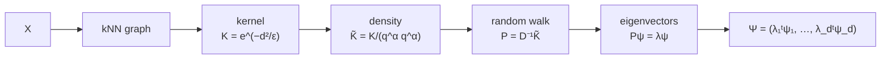

# Diffusion maps

`diffusion_maps.py` · Manifolds & embeddings · Tier 3 · 3 variants

## Intuition

Every other method in this chapter starts by deciding what "close" means. t-SNE
picks a Gaussian kernel and tunes its width per point; LLE solves for
reconstruction weights; UMAP builds a fuzzy graph and matches it. Diffusion maps
declines the question. Closeness is defined by a process, not by a formula:



A walker starts at a point and takes a step to a neighbour, chosen with weight
proportional to how close the neighbour is. After $t$ steps the walker has a
probability distribution over the whole data set, and two points are close at
scale $t$ if their distributions overlap:

```
   start at i            after 1 step           after 4 steps
   · · · · ·             · · · · ·              ▒ ▒ ▒ · ·
   · · █ · ·             · · ▓ █ ·              ▒ ▓ ▓ ▒ ·
   · · · · ·             · · █ · ·              ▒ ▒ ▒ · ·

   the row i of Pᵗ is a density; the distance between points is the
   distance between their rows
```

That definition is about the whole data set at once, which is why it is robust:
a walk does not care where an individual nearest neighbour sits, only about the
totality of routes. It is also useless as a definition until you can compute it,
and the small miracle of the method is that you can. The row of $P^t$ is a
function of the eigenvectors of $P$, so the distance between two rows is a
weighted sum of squared differences of eigenvectors — a Euclidean distance in
which the eigenvectors are the coordinates. Nothing is fitted, no stress is
minimised, and there is no learning rate. The embedding is the eigenproblem.

The picture to keep in mind is the circle, because there everything is exact.
Two hundred points evenly spaced on a ring, each joined to its two neighbours:
the transition matrix is circulant, so its eigenvalues are
$\cos(2\pi m/n)$ with multiplicity two. The fit returns $0.999507$ twice against
$\cos(2\pi/200) = 0.999507$, and $0.998027$ twice against $\cos(4\pi/200)$, to
$2 \times 10^{-16}$; the first pair of eigenvectors, scaled by their eigenvalues,
has distances that correlate $1.000000$ with the circle's own. On a ring the two
slowest modes *are* the circle, so recovering it is not an approximation.

The rest of the document is the three questions the picture raises. What does
the kernel do when the points are not evenly spread? (Section 2 of the
derivation, and the $\alpha$ experiment.) What happens when you keep two
coordinates instead of all $n - 1$? (Section 5, and the truncation
measurements.) And when is the walk the wrong tool? (The S-curve, at the end.)

## Variants

All three variants use the same graph, the same eigenvectors and the same
eigenvalues. They differ in one line: the gain $g(\lambda)$ applied to each
coordinate. Since the eigenvectors are fixed, the variants cannot disagree about
*which* directions exist — only about how much each one is stretched.

| variant | gain $g(\lambda)$ | what it keeps | overlap @10 | dist. corr. |
|:--|:--|:--|--:|--:|
| `diffusion_map` | $\lambda^t$ | the walk at one time | **0.461** | 0.836 |
| `multiscale` | $\lambda^t\,\frac{1-\lambda^L}{1-\lambda}$ | a window of times | **0.461** | 0.844 |
| `diffusion_potential` | $\frac{\lambda^t}{1-\lambda}$ | all future times | 0.438 | **0.967** |

Four hundred points of an S-curve, $k = 10$, two components, $\alpha = 1$; PCA's
own two components score 0.413 and 0.872 on the same measures. Every filter
keeps more neighbours than PCA. The potential also beats PCA on distances; the
plain map is slightly behind, which is the first honest sign that this is not a
method for unfolding a folded sheet.

The reason the potential wins is visible in the gains themselves, and it is the
most useful single fact about the variants. With two components the map's gains
are $\lambda_1$ and $\lambda_2$ — on this data $0.99785$ and $0.99096$, which
differ by 0.7%. The map, at $t = 1$, applies almost **no** relative
weighting: it keeps whichever two directions the graph offers and takes them at
face value. The potential divides by $1 - \lambda$, which for $\lambda$ near one
is a large number, and the ratio between the two kept modes becomes $4.2$. That
tilt is what turns a locally accurate embedding into a globally accurate one,
and it is the same thing as running the walk longer, because
$g(\lambda) \propto \lambda^t$ tilts by $(\lambda_1/\lambda_2)^t$. The demo
measures the equivalence:

| $t$ | 1 | 2 | 5 | 10 | 25 |
|:--|--:|--:|--:|--:|--:|
| distance corr. | 0.836 | 0.839 | 0.845 | 0.856 | 0.885 |

The `multiscale` window is between the two: with $L = 8$ and $\lambda$ close to
one, $\sum_{s=t}^{t+L-1}\lambda^s$ is nearly $L\lambda^t$, and the exact ratio
$g(\lambda_1)/g(\lambda_2)$ is 1.03, which moves the distance correlation from
0.836 to 0.844. A window of times is a gentle weight; the potential is a strong
one. The map at $t = 25$ is the cleanest demonstration that tilt is the whole
mechanism: it tilts by 1.19 and reaches 0.885, and because distance correlation
is invariant to a global scale, that 0.049 gain is *only* the ratio between the
two modes — the two-coordinate shape of a diffusion map at $t \ge 1$ is the same
shape, stretched.

Two hyperparameters matter more than the variant and are not variants at all,
because they change the graph rather than the filter. `n_neighbors` sets the
resolution — at $k = 10$ the S-curve gives 0.461 and 0.836, at $k = 5$ it gives
0.547 and 0.710, at $k = 40$ it gives 0.395 and 0.847. Smaller $k$ keeps
neighbourhoods and loses distances; larger $k$ smooths the graph until every
coordinate is a global mode. And `alpha` decides whether the sampling density is
treated as noise (1) or signal (0): the next section measures what that means.

## Derivation

### 1. The graph

Points become vertices. Edges are the $k$ nearest neighbours, symmetrised, with
weight a Gaussian in the distance:

$$
K_{ij} = \exp\!\Big(-\frac{\lVert \mathbf{x}_i - \mathbf{x}_j \rVert^2}{\varepsilon}\Big)
\quad \text{for } j \in \mathrm{NN}(i), \qquad K_{ij} = 0 \text{ otherwise}
\qquad (1)$$

Three knobs are hiding in this line. $k$ is the resolution: how many points a
step can reach. $\varepsilon$ is the temperature: how quickly the weight decays
with distance. And the *shape* of the neighbourhood is the third: an $\varepsilon$
ball would let a dense region have more edges than a sparse one, while $k$ fixed
gives every point the same number and puts the density into the weights instead.
The default here is $\varepsilon$ = the mean squared distance to the $k$-th
neighbour, which makes the kernel scale-free. Because the graph is already
kNN, $\varepsilon$ cannot add or remove an edge — it only reweights the $k$ that
exist, and a change of $\varepsilon$ therefore looks like a change of $k$:
dividing it by ten gives overlap 0.552 and distance correlation 0.823 on the
S-curve, multiplying it by ten gives 0.469 and 0.840, against 0.461 and 0.836 at
the default. What $\varepsilon$ does move decisively is $\lambda_1$, from
0.99989 at $\varepsilon/10$ to 0.99719 at $10\varepsilon$: it is the walk's
clock, and the number that changes when you turn it is the diffusion time you
would otherwise have to set.

### 2. The density, and $\alpha$

Let $q_i$ be the row sum of the kernel — an estimate of the local density,
because it counts how many points the kernel can see and how brightly:

$$
q_i = \sum_j K_{ij}
\qquad (2)$$

$q$ is not a nuisance parameter to be divided out of a distance formula; it is
the measure the walk samples. The α-normalisation rescales the kernel by the
density before the walk is built:

$$
\tilde{K}_{ij} = \frac{K_{ij}}{q_i^{\alpha}\, q_j^{\alpha}}
\qquad (3)$$

and then the walk and its stationary distribution follow:

$$
d_i = \sum_j \tilde{K}_{ij}, \qquad
P = D^{-1}\tilde{K}, \qquad
\pi_i = \frac{d_i}{\sum_j d_j}
\qquad (4)$$

$P$ is row-stochastic by construction, and it is *reversible*: $\tilde K$ is
symmetric, so $\pi_i P_{ij} = \pi_j P_{ji}$. That one fact is what makes
everything after it work — a reversible chain is similar to a symmetric matrix,
so its spectrum is real, its eigenvectors can be taken orthogonal, and the
diffusion distance will turn out to be Euclidean.

Why divide by $q^\alpha$. The sampling density enters twice: once through the
spacing of the points and once through the measure the walk sees. In the
continuum limit $\varepsilon \to 0$ the generator of $P$ is
$\tfrac{1}{2}\varepsilon \Delta + \varepsilon(1-\alpha)\nabla \log p \cdot \nabla$
to leading order — for $\alpha = 1$ the drift term vanishes and the operator is
the Laplace–Beltrami operator of the manifold itself, independent of how the
points were sampled; for $\alpha = 0$ it is a diffusion with a drift toward high
density. The demo does not need the continuum limit to see it. Six hundred points
on a circle, sampled with a density that rises with the angle, and every pair of
points exactly $0.4$ radians apart. How far apart does the embedding place two
points at a fixed arc length?

| $\alpha$ | 0 | ½ | 1 |
|:--|--:|--:|--:|
| dense pair ÷ sparse pair | 1.54 | 1.24 | **0.97** |

At $\alpha = 1$ the ratio is one: the walk has stopped caring where the points
happen to be, and the diffusion distance is arc length. At $\alpha = 0$ the same
arc length is worth 1.54 times as much in the dense half of the circle. Which is
right depends on the question. If the density is an artefact of how the data was
collected, $\alpha = 1$ is the default and the one used above. If the density
*is* the signal — a sample that concentrates where something interesting happens
— then $\alpha = 0$ keeps it, and the geometry will show it.

### 3. The walk and its spectrum

$$
P\psi_l = \lambda_l \psi_l, \qquad
1 = \lambda_0 > \lambda_1 \ge \lambda_2 \ge \dots \ge \lambda_{n-1} \ge -1
\qquad (5)$$

The largest eigenvalue is one, with the constant vector as its eigenvector: every
row of $P$ sums to one, so a constant function is unchanged. Its multiplicity is
the number of connected components of the graph — one eigenvector for each
component's indicator — and this is worth knowing because a disconnected graph
silently produces a meaningless embedding: the unit eigenvalue is repeated twice,
both indicators are constant on their own component, and the "distance" between
the components is a comparison of two distributions that can never meet. The
implementation skips the whole unit eigenspace rather than only its first vector,
which is the difference between a coordinate that means something and one that
encodes "which clump am I in".

Everything below the unit eigenvalue is geometry. The eigenvectors are taken
orthonormal in the stationary inner product, $\langle \psi_l, \psi_m\rangle_\pi = \delta_{lm}$;
in matrix terms $\psi_l = D^{-1/2} v_l$ where $v_l$ is an eigenvector of the
symmetric matrix $D^{-1/2}\tilde K D^{-1/2}$, which is how they are computed.

### 4. Diffusion distance

Two points are close if their $t$-step distributions are close. Distributions
live in $\mathbb{R}^n$, but not with the Euclidean metric — a difference of
$10^{-3}$ in a coordinate with stationary mass $10^{-6}$ means something
different from the same difference where the mass is $10^{-1}$. Weight by the
stationary distribution:

$$
D_t(i,j)^2 = \sum_k \frac{\big(p_t(i,k) - p_t(j,k)\big)^2}{\pi_k}
\qquad (6)$$

This is a metric on the rows of $P^t$ and therefore on the points. It is
symmetric, it vanishes only when the two rows agree, and it obeys the triangle
inequality because it is a norm. What it is *not*, yet, is anything you can plot:
it is an $n \times n$ matrix and computing it looks like it needs $P^t$.

The spectral identity removes the matrix. Reversibility gives the left
eigenvectors for free — if $P\psi_l = \lambda_l \psi_l$ then
$\pi^\top P = \pi^\top$ and the left eigenvector for $\lambda_l$ is
$\pi \odot \psi_l$ — so the $(i,k)$ entry of $P^t$ is

$$
p_t(i,k) = \sum_l \lambda_l^{t}\, \psi_l(i)\, \pi_k\, \psi_l(k)
\qquad (7)$$

Substituting (7) into (6) and using orthonormality collapses the double sum:

$$
D_t(i,j)^2
= \sum_k \pi_k \Big(\sum_l \lambda_l^{t}\big(\psi_l(i) - \psi_l(j)\big)\psi_l(k)\Big)^2
= \sum_l \lambda_l^{2t}\big(\psi_l(i) - \psi_l(j)\big)^2
\qquad (8)$$

because $\sum_k \pi_k \psi_l(k)\psi_m(k) = \delta_{lm}$ kills every cross term.
So the diffusion distance is the Euclidean distance between the rows of

$$
\Psi_t = \big(\lambda_1^t \psi_1, \lambda_2^t \psi_2, \dots, \lambda_{n-1}^t \psi_{n-1}\big)
\qquad (9)$$

and that is the whole method. It is exact — the demo compares (6) computed by
matrix power against (8) summed over all $59$ modes for a random cloud in four
dimensions, at $t = 1, 2, 3, 7$, and the worst relative error is
$2.7 \times 10^{-9}$, which is the square root of a difference of nearly equal
numbers and not an approximation in the algebra.

### 5. Truncation is the method

Nobody plots $n - 1$ coordinates. Keep the first $d$ and you have

$$
\Psi_t^{(d)} = \big(\lambda_1^t \psi_1, \dots, \lambda_d^t \psi_d\big),
\qquad
\big\lVert \Psi_t^{(d)}(i) - \Psi_t^{(d)}(j)\big\rVert^2
= \sum_{l \le d} \lambda_l^{2t}\big(\psi_l(i) - \psi_l(j)\big)^2
\qquad (10)$$

The dropped terms are the tail of an exact identity:

$$
D_t(i,j)^2 - \big\lVert \Psi_t^{(d)}(i) - \Psi_t^{(d)}(j)\big\rVert^2
= \sum_{l > d} \lambda_l^{2t}\big(\psi_l(i) - \psi_l(j)\big)^2
\qquad (11)$$

Each dropped term carries $\lambda_l^{2t}$, so what decides whether $d$
coordinates are enough is one number, the largest gain left out,
$\rho_d = \max_{l > d}|\lambda_l|$: the tail is at most $\rho_d^{2t}$ times its
unweighted size, and for a graph with a non-negative spectrum — every graph that
is not nearly bipartite — $\rho_d = \lambda_{d+1}$. This is the assumption the
method makes and almost never states: a spectral gap. If
$\lambda_{d+1} \ll \lambda_d$, the tail dies as $t$ grows and $d$ coordinates
become the distance. If the spectrum decays slowly, there is no $t$ at which a
handful of coordinates carries it.

Measured on 60 random points in four dimensions, where the spectrum has no
particular reason to gap:

| components $d$ | 1 | 2 | 5 |
|:--|--:|--:|--:|
| relative error in the distance matrix, $t=1$ | 76% | 63% | 43% |
| relative error, $t=2$ | — | — | 23% |

Two coordinates are a *long* way from the distance at $t = 1$. That is not a
defect of the implementation; it is the approximation the plot makes. It is also
why the diffusion time and the number of components are not independent choices:
longer walks need fewer coordinates, and every extra coordinate buys time.

### 6. The variants as filters

Keeping the whole sum but weighting each term in time is a one-line change, and
the three variants are the three obvious weightings. In each case the embedding
is $\psi_l \mapsto g(\lambda_l)\psi_l$, so the squared distance between two
points is $\sum_l g(\lambda_l)^2(\psi_l(i)-\psi_l(j))^2$ — a distance, just not a
diffusion distance at a single time.

$$
g_{\text{map}}(\lambda) = \lambda^t
\qquad (12)$$

$$
g_{\text{potential}}(\lambda) = \frac{\lambda^t}{1-\lambda}
\qquad (13)$$

$$
g_{\text{multiscale}}(\lambda) = \lambda^t\,\frac{1-\lambda^{L}}{1-\lambda}
= \sum_{s=t}^{t+L-1} \lambda^{s}
\qquad (14)$$

Equation (13) is a geometric series: it is the sum of the walk at every time
from $t$ onward, and in matrix form it is the resolvent
$\sum_{s \ge t} P^s = P^t (I - P)^{-1}$ restricted to the non-constant modes —
the Green's function of the walk, finite precisely because the walk mixes and
$\lambda < 1$. Equation (14) is the same series with the tail cut off at $L$
terms: a band-pass filter rather than a low-pass one. The name "potential" for
(13) comes from the diffusion-maps literature on metastability, where the
resolvent is used to describe which states the walk can leave and which it
cannot; PHATE's potential is a different function of the same spectrum
($-\log$ of a powered operator), and it has its own atom.

The distinction that matters numerically is the one in the Variants section:
(12) at $t = 1$ reweights nothing, (13) reweights by $1/(1-\lambda)$ which is a
factor of 4.2 between the two kept modes of the S-curve, and (14) sits in
between with a factor of 1.018 at $L = 8$. A filter that does not tilt is a
filter that cannot trade local accuracy for global structure.

## Code walkthrough

### 1. Distances without a subtraction

```python
def _pairwise(A: np.ndarray, B: np.ndarray | None = None) -> np.ndarray:
    B = A if B is None else B
    sa = np.einsum("ij,ij->i", A, A)
    sb = np.einsum("ij,ij->i", B, B)
    return np.sqrt(np.maximum(sa[:, None] + sb[None, :] - 2.0 * (A @ B.T), 0.0))
```

The identity $\lVert a-b \rVert^2 = \lVert a\rVert^2 + \lVert b\rVert^2 - 2a\cdot b$
turns $n^2$ distances into one matrix product and two vectors. The clamp at zero
is not decoration: for near-duplicate rows the right-hand side can come out at
$-10^{-16}$, and the square root of that is `nan`, which then propagates into
every eigenvector.

### 2. The graph

```python
def _knn_graph(distances: np.ndarray, k: int) -> np.ndarray:
    """Union of the `k`-nearest-neighbour relation, as a boolean matrix."""
    n = distances.shape[0]
    D = distances.copy()
    np.fill_diagonal(D, np.inf)
    idx = np.argpartition(D, k, axis=1)[:, :k]
    mask = np.zeros((n, n), dtype=bool)
    mask[np.repeat(np.arange(n), k), idx.ravel()] = True
    return mask | mask.T
```

`argpartition` is the $O(n^2)$ way to get the $k$ smallest of each row — no sort,
no index array, and since we only need the mask, the partition's arbitrary order
inside the first $k$ is irrelevant. `np.repeat(np.arange(n), k)` builds the row
indices and `idx.ravel()` the columns, so one fancy-index assignment sets all
$nk$ entries at once. The last line is the symmetrisation `mask | mask.T`: the
$k$-nearest-neighbour relation is not symmetric, and a graph with one-way edges
would give a transition matrix whose stationary distribution is not what the
derivation assumes. The union makes $A \to B$ an edge whenever either direction
was, and the kernel weights then come from the distance, so the extra edges are
the ones the other endpoint thought were close.

### 3. Kernel, density, walk

```python
        K = np.where(graph, np.exp(-distances ** 2 / epsilon), 0.0)
        q = K.sum(axis=1)
        if np.any(q <= 0.0):
            raise ValueError("some row of the kernel is zero — epsilon too small "
                             "for the distances it has to cover, or a vertex with "
                             "no neighbours")
        self.kernel_ = K / (q[:, None] ** self.alpha * q[None, :] ** self.alpha)
```

`np.where(graph, ..., 0.0)` applies the kernel only to edges; without it every
pair of points would get a small weight and the graph would be complete. The
outer product `q[:, None] ** alpha * q[None, :] ** alpha` is $q_i^\alpha q_j^\alpha$
in one expression, which is (3). The check on `q` catches the one case the shape
of this code cannot: `exp(-d²/ε)` underflows to exactly zero when
$d^2/\varepsilon > 745$, and then a row can be all zeros even though it has
neighbours — the graph exists, the kernel does not.

```python
        degree = self.kernel_.sum(axis=1)
        self.transition_ = self.kernel_ / degree[:, None]
        self.stationary_ = degree / degree.sum()
```

Three lines: the degree $d_i$, the row-normalised walk $P = D^{-1}\tilde K$, and
the stationary distribution $\pi = d / \sum d$ of (4). No iteration, no
normalisation loop — the walk is a matrix.

### 4. The symmetric twin

```python
        symmetric = (self.kernel_ / np.sqrt(degree)[:, None]
                     / np.sqrt(degree)[None, :])
        mu, vecs = np.linalg.eigh(symmetric)
        order = np.argsort(mu)[::-1]
        mu = mu[order]
        vecs = vecs[:, order]
```

$P$ is not symmetric, but it is similar to $D^{-1/2}\tilde K D^{-1/2}$, which is,
so `eigh` is both faster and more accurate than `eig` and returns real
eigenvalues in ascending order. `np.argsort(mu)[::-1]` reverses that: the caller
wants $\lambda_0$ first because everything downstream drops the front of the
list rather than the back. Note that dividing by `sqrt(degree)` twice — once on
each axis — is a symmetric diagonal rescaling, not a row normalisation; the row
normalisation already happened in `transition_`, and this second, different
rescaling exists only to expose the spectrum.

```python
        # Deterministic sign: the largest-magnitude entry of each vector is positive.
        signs = np.sign(vecs[np.argmax(np.abs(vecs), axis=0), np.arange(n)])
        vecs = vecs * np.where(signs == 0.0, 1.0, signs)[None, :]
```

An eigenvector is only defined up to sign, and `eigh` is free to return either
one — which would make "the embedding" depend on the LAPACK build. Flipping each
column so that its largest entry is positive fixes the representative without
changing the span. The `np.where` guards `np.sign(0.0) = 0.0`: a zero in that
slot would multiply the whole column by zero. It cannot happen for a normalised
eigenvector, whose largest entry is at least $1/\sqrt n$ in magnitude, but a
silently zeroed coordinate is a much worse outcome than an unused branch.

### 5. Right eigenvectors, properly scaled

```python
        normaliser = np.sqrt(degree / degree.sum())
        self.right_vectors_ = vecs / normaliser[:, None]
```

This is $\psi_l = D^{-1/2}v_l$ up to the constant $\sqrt{Z}$, and the constant is
harmless. What matters is the *diagonal*, because it is what makes
$\langle\psi_l, \psi_m\rangle_\pi = \delta_{lm}$ hold: with $v$ orthonormal in
the Euclidean sense and $\psi = D^{-1/2}v$,

$$
\sum_k \pi_k \psi_l(k)\psi_m(k)
= \frac{1}{Z}\sum_k d_k \frac{v_l(k)v_m(k)}{d_k}
= \frac{1}{Z}\,\delta_{lm}
\qquad (15)$$

and $Z$ cancels once the distances are taken. Get this factor wrong and the
diffusion distance is still a distance — it is just not the one in (6), and the
identity that the whole method rests on stops holding. It is the single most
common way to reimplement this method incorrectly.

```python
        self.multiplicity_ = int(np.sum(mu > 1.0 - 1e-10))
        first = self.multiplicity_
```

The unit eigenvalue is repeated once per connected component, and all of those
eigenvectors are constant on their own component: functions the walk cannot
change. They are skipped together rather than one at a time, because the
eigensolver returns an arbitrary orthonormal basis of that subspace — dropping
"the first" can drop half of one component's indicator and keep half of
another's, which is how a disconnected graph produces a coordinate that is
nothing but a cluster label.

### 6. The filter

```python
    lam = np.clip(eigenvalues, 0.0, 1.0 - 1e-12)
    if variant == "diffusion_map":
        gain = lam ** t
    elif variant == "diffusion_potential":
        gain = lam ** t / (1.0 - lam)
    elif variant == "multiscale":
        gain = lam ** t * (1.0 - lam ** n_scales) / (1.0 - lam)
    else:
        raise ValueError(f"unknown variant {variant!r}")
    return vectors * gain[None, :]
```

Equations (12), (13) and (14), and nothing else: the variants are three
arithmetic expressions on one array. The clip does two jobs. It caps
$\lambda$ just below one, because $1 - \lambda$ is a denominator and an
eigenvalue of exactly $1$ (a disconnected graph, or a rounding error) would
produce an infinite gain. And it floors $\lambda$ at zero, which discards
negative eigenvalues — a bipartite graph has $\lambda = -1$ and an eigenvector
that alternates sign across the two halves, and that coordinate is usually noise
for an embedding even though it is real structure for the spectrum. The `else`
is unreachable from the public class, which validates the variant in
`__init__`; it exists so that the helper is safe on its own.

### 7. The distance, from the spectrum

```python
    def distance_matrix(self, t: int) -> np.ndarray:
        """Equation (6) at time `t`, computed from the spectral expansion (7)."""
        coords = self.right_vectors_ * (self.eigenvalues_ ** t)[None, :]
        sq = np.einsum("ij,ij->i", coords, coords)
        d2 = np.maximum(sq[:, None] + sq[None, :] - 2.0 * (coords @ coords.T), 0.0)
        return np.sqrt(d2)
```

This is (8) computed as a distance: scale every eigenvector by $\lambda_l^t$,
then take Euclidean distances between the rows of the scaled matrix. Every mode
is included, including the constant one, and that is deliberate — a constant
eigenvector contributes $\lambda_0^{2t}(\psi_0(i)-\psi_0(j))^2 = 0$ to every
pair, so including it costs one column and removes the special case. The
`np.maximum(..., 0.0)` is the same cancellation guard as in `_pairwise`; with
$n - 1$ coordinates the sum of squares and the cross term are both large and
nearly equal, and the difference can land slightly below zero.

### 8. Measuring the truncation

```python
def _truncation_error(fitted: DiffusionMaps, t: int, n_components: int) -> float:
    """Relative Frobenius error of the distance matrix cut at `n_components`."""
    index = fitted.multiplicity_ + np.arange(n_components)
    coords = fitted.right_vectors_[:, index] * fitted.eigenvalues_[index] ** t
    sq = np.einsum("ij,ij->i", coords, coords)
    squared = np.maximum(sq[:, None] + sq[None, :] - 2.0 * (coords @ coords.T), 0.0)
    full = fitted.distance_matrix(t)
    return float(np.linalg.norm(np.sqrt(squared) - full) / np.linalg.norm(full))
```

The same three lines as `distance_matrix`, with the spectrum cut at
`n_components` and starting after the unit eigenspace — which is exactly the
embedding's own coordinates, so the number returned is the error of the picture
you would actually plot, not of a different truncation. Frobenius norm over the
whole matrix rather than a maximum: an embedding is wrong on average, and a
single bad pair is not what decides whether it is usable.

## Complexity

For $n$ points in $m$ ambient dimensions, $k$ neighbours, $d$ embedding
dimensions and $t$ diffusion steps:

| stage | time | memory |
|:--|:--|:--|
| pairwise distances | $O(n^2 m)$ | $O(n^2)$ |
| neighbour mask | $O(n^2)$ | $O(n^2)$ |
| kernel and walk | $O(n^2)$ | $O(n^2)$ |
| dense eigendecomposition | $O(n^3)$ | $O(n^2)$ |
| embedding | $O(nd)$ | $O(nd)$ |
| full diffusion distance matrix | $O(n^3)$ | $O(n^2)$ |

The mask is a dense boolean matrix here, which is $n^2$ bytes before anything
else; a real implementation stores the $k$ indices per row and never materialises
it. The cubic term is the whole story for time, and it is the term a real
implementation does not pay: a sparse eigensolver asks for $d + 1$ eigenvectors
of a matrix with $nk$ non-zeros and runs in roughly $O(nk\,d)$ per iteration,
which is why the published diffusion-map pipelines handle $10^5$ cells and this
file does not. The last row is a second cubic — summing $\lambda_l^{2t}$ over
every pair is inherently $O(n^3)$ — though its constant is a single BLAS call,
which at $n = 3200$ costs 0.2 s against the eigensolver's 4 s. Measured on the
S-curve, $k = 10$, two components, best of three:

| $n$ | 200 | 400 | 800 | 1600 | 3200 |
|:--|--:|--:|--:|--:|--:|
| fit time | 0.004 s | 0.014 s | 0.067 s | 0.400 s | 4.14 s |

The ratios for a doubling of $n$ are 3.5, 4.8, 6.0 and 10.4: the cubic is
approached from below, hidden behind fixed costs at the small end and amplified
by cache misses at the large one. The memory column is what bites first — at
$n = 10^5$ the distance matrix alone is 80 GB, before any eigenvector exists.

## Failure modes

### A slowly decaying spectrum

The truncation error is the tail in (11), weighted by $\lambda_l^{2t}$, and
diffusion spectra decay slowly: on 60 random points in four dimensions the first
two components leave 63% relative error in the distance matrix at $t = 1$ and the
first five leave 43%, so two coordinates at short times are not a picture of the
data — they are two smoothed functions of it. The failure is not subtle and it
has a shape: the error at fixed $d$ falls like $\rho_d^{2t}$, so a spectrum
without a gap means there is no small $t$ at which the picture is right and no
small $d$ at which a long walk is cheap. If a diffusion map at $t = 1$ looks like
a smear of the data, the fix is to raise $t$ and watch $\lambda_1^t$ — not to
add a third coordinate.

### Density, and the wrong $\alpha$

The $\alpha = 0$ / $\alpha = 1$ table is a factor of 1.6 in relative distances
between two halves of the same circle. If the sampling is biased and the bias is
not wanted, $\alpha = 1$ is the answer and a large enough $k$ to make the graph
insensitive to local gaps. If the bias is real — cells that are numerous because
the population is numerous — $\alpha = 0$ keeps it and $\alpha = 1$ erases it.
The failure is not picking the wrong one in the abstract; it is not knowing which
question is being asked.

### A disconnected graph

Five points and five points a hundred units apart, one neighbour each: nothing
raises, because every vertex has an edge. But the walk has two components, so
$\lambda = 1$ has multiplicity two, and the two eigenvectors are the indicators
of the components. The implementation skips the whole unit eigenspace, so the
embedding does not contain a cluster label — but what remains is still wrong in a
deeper way: the distance between two components is the distance between two
distributions that each stay on their own side, so where the clumps sit relative
to one another is arbitrary. Check that $\lambda_2 < 1$ before believing any
picture, and raise $k$ when it is not.

### Too many neighbours

$k$ is the resolution and it trades the two columns of the Variants table against
each other. On the S-curve:

| $k$ | 5 | 10 | 20 | 40 |
|:--|--:|--:|--:|--:|
| overlap @10 | **0.547** | 0.461 | 0.419 | 0.395 |
| distance corr. | 0.710 | 0.836 | 0.844 | 0.847 |

Small $k$ keeps each point's own neighbourhood and loses the distances; large $k$
smooths everything into a few global modes. The default 10 is a compromise, not
an optimum, and the curve is flat enough between 10 and 20 that the choice rarely
matters relative to $\alpha$.

### Folded sheets

The S-curve is the case this method does not solve. On the same 400 points, with
two coordinates:

| method | overlap @10 | distance corr. |
|:--|--:|--:|
| t-SNE, perplexity 30 | **0.874** | 0.980 |
| Isomap, 10 neighbours | 0.862 | **0.999** |
| UMAP, 10 neighbours | 0.808 | 0.711 |
| diffusion map, $t = 1$ | 0.461 | 0.836 |
| diffusion potential | 0.438 | 0.967 |
| PCA | 0.413 | 0.872 |

Every diffusion-map filter beats PCA on neighbours (0.44–0.46 against 0.41) and
the potential beats it on distances (0.967 against 0.872), and that is the
ceiling. The gap to t-SNE and Isomap is not a tuning problem. A diffusion
distance is a smoothed function of the graph: it reports the distances a
smoothing operator can see, and two sheets that the graph connects are close by
that measure no matter which filter is applied. Isomap builds geodesics along the
graph, which is a long-range operation the walk does not have; t-SNE adds an
explicit repulsion between everything that is not a neighbour, which is a
long-range force the walk does not have either. Diffusion geometry is for
continuous, densely sampled manifolds — a trajectory, a time course, a family of
images under a smooth parameter — not for unrolling a fold.

### Underflow and degenerate scales

`exp(-d²/ε)` is exactly zero in double precision once $d^2/\varepsilon > 745$.
With a global $\varepsilon$ and a data set that spans several orders of magnitude
in distance, the far points can end up with a row of zeros and the graph splits
without any warning from the shape of the input. The implementation raises on a
zero row, but the message is a symptom: the fix is a larger $\varepsilon$, not a
different kernel.

## Applications

- **Single-cell transcriptomes.** The largest user base, and the one the
  method's density invariance was made for: an scRNA-seq experiment samples
  cells, not tissue, and the density is an artefact of the dissociation. The
  diffusion operator is the backbone of diffusion pseudotime (DPT) and of
  PHATE, whose log-potential is a variant of the same spectrum.
- **Trajectories and time courses.** The spiral measurement — one coordinate
  recovering the arc parameter at a distance correlation of 0.964 where PCA
  reaches 0.314 — is the generic case for data that lies along a curve. The
  first eigenvector is an arc length, the second a harmonic along it, and the
  walk gives both without being told the dimension.
- **Molecular dynamics and metastability.** States that the walk can leave are
  not states it mixes between: the small eigenvalues identify the slow
  directions of a simulation, and the corresponding eigenvectors are the
  reaction coordinates. This is the diffusion-map reading of a Markov state
  model.
- **Graph and network embedding.** Nothing in the construction needs the points
  to be Euclidean — the kernel is the only place where a metric appears. Feed it
  an affinity matrix and the same spectrum gives a diffusion geometry of a
  network.
- **Semi-supervised learning.** Label propagation is diffusion of a label
  vector on exactly this graph, with $P^t$ as the propagation operator. The
  diffusion distance is a measure of how far a label has to travel, which is
  why it works better than a nearest-neighbour vote on elongated classes.

## References

- R. R. Coifman and S. Lafon, *Diffusion maps*, Applied and Computational
  Harmonic Analysis 21(1):5–30 (2006). The kernel, the $\alpha$ normalisation,
  the diffusion distance and the spectral embedding, in the form used here.
- R. R. Coifman, S. Lafon, A. B. Lee, M. Maggioni, B. Nadler, F. Warner and
  S. W. Zucker, *Geometric diffusions as a tool for harmonic analysis and
  structure definition of data*, PNAS 102(21):7426–7431 (2005). The multiscale
  picture, and the first experiments on images and graphs.
- S. Lafon and A. B. Lee, *Diffusion maps and coarse-graining: a unified
  framework for dimensionality reduction, graph partitioning and data set
  parameterization*, IEEE TPAMI 28(9):1393–1407 (2006). The diffusion distance
  as an approximation of geodesic distance, and the sampling-density analysis.
- B. Nadler, S. Lafon, R. R. Coifman and I. G. Kevrekidis, *Diffusion maps,
  spectral clustering and eigenfunctions of Fokker–Planck operators*, NeurIPS
  (2005). The continuum limit: which differential operator the walk converges
  to, which is where the $\alpha$ argument comes from.
- R. R. Coifman and M. J. Hirn, *Diffusion maps for changing data*, Applied and
  Computational Harmonic Analysis 36(1):89–116 (2014). The anisotropic and
  multiscale extensions, and the operator-theoretic view of the resolvent.
- K. R. Moon, D. van Dijk, Z. Wang, S. Gigante, D. B. Burkhardt, W. S.
  Chen, K. Yim, A. van den Elzen, M. J. Hirn, R. R. Coifman, N. B. Ivanova,
  G. Wolf and S. Krishnaswamy, *Visualizing structure and transitions in
  high-dimensional biological data*, Nature Biotechnology 37:1482–1492 (2019).
  PHATE, the descendant that replaces the linear potential with a log-potential.
- L. Haghverdi, M. Büttner and F. J. Theis, *Diffusion pseudotime robustly
  reconstructs lineage branching*, Nature Methods 13:845–848 (2016). The
  single-cell use of the same operator, with its own choice of $t$.
- U. von Luxburg, *A tutorial on spectral clustering*, Statistics and Computing
  17(4):395–416 (2007). The normalised Laplacian connection: $I - P$ is a
  random-walk Laplacian, and the same eigenvectors that embed here partition
  there.
- M. Belkin and P. Niyogi, *Laplacian eigenmaps for dimensionality reduction and
  data representation*, Neural Computation 15(6):1373–1396 (2003). The sibling
  atom: the same graph, the same spectrum, a different normalisation and no
  diffusion time.
