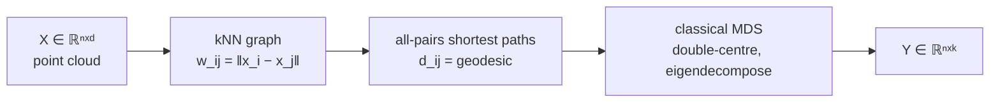

# Isomap

`isomap.py` · Manifolds & embeddings · Tier 1 · 4 variants

## Intuition

A swiss roll is the standard picture of why Euclidean distance is the wrong
question.

```
        ┌──────────────────────────────┐
       ╱   ·  ·        ·   ·            ╲      two points on neighbouring turns
      │  ·      ·   ·        ·     ·     │     are close in R³  (a)
      │ ·    ·        ·   ·       ·      │     and far along the sheet (b)
       ╲  ·   ·    ·       ·   ·        ╱
        └──────────────────────────────┘
             a: ‖x_i − x_j‖₃ small
             b: length of the path on the sheet large
```

Every method in this chapter is a different answer to "close in what?" This one
answers: close **along the data**. Build a graph whose edges are the distances
between nearby points, and replace every distance by the length of the shortest
path through that graph.

That is the whole algorithm, and it is two lines:

1. connect each point to its $k$ nearest neighbours, weighting edges by Euclidean
   distance;
2. run classical MDS on the resulting **geodesic** distance matrix.

The effect is large because the graph cannot leave the surface. On the roll, the
shortest path between two points on adjacent turns has to walk out to the end of
the sheet and back, which is exactly what the true distance along the surface
does. The demo measures it: 600 points on a swiss roll, which is *exactly*
isometric to a flat rectangle, are recovered at distance correlation $0.9996$ by
Isomap and $0.2930$ by classical MDS on the ambient distances.



The price is a knife edge. The graph only knows about edges between points it
connected, so an edge that jumps between turns — a **short-circuit** — makes every
geodesic that crosses it too short, and no amount of downstream linear algebra
recovers. The demo's $k = 14$ gives $0.9999$ and $k = 16$ gives $0.7433$ on the
same data. Isomap is the clearest case in machine learning of a method whose
hyper-parameter is not a regularisation strength but a topological condition.

## Variants

| Variant | Distances used | What changes | Cost |
|:--|:--|:--|:--|
| `isomap` | all pairs, exact | the reference | $n$ shortest-path runs |
| `landmark` | to $m$ landmarks | embed landmarks, triangulate the rest | $m$ runs, $m \ll n$ |
| `conformal` | rescaled geodesics | divide by a local scale from the sampling density | one extra pass, no extra runs |
| `sparse` | all pairs, completed | exact rows from $m$ sources, min-plus closure | $m$ runs + $mn^2$ |

**`isomap`** is the 2000 paper: kNN graph, all-pairs shortest paths, classical
MDS. The demo uses a vectorised Floyd–Warshall, which is $O(n^3)$ but has no
Python loop over sources; the alternative is $n$ Dijkstra runs, which is what the
sparse graph actually wants and what the other two variants use.

**`landmark`** (de Silva & Tenenbaum 2003) attacks the $O(n^3)$ directly. Pick
$m$ landmarks, compute geodesics *from those only*, embed the $m \times m$ landmark
submatrix, and place every other point by least-squares triangulation from its
distances to the landmarks. The demo runs 70 shortest-path searches instead of
700, and the embedding is indistinguishable: correlation with the truth $0.9997$
against $0.9997$, agreement between the two embeddings $0.99997$. It is also the
variant whose inference cost is bounded by $m$: placing one new point needs its
distances to the landmarks, not to every sample.

**`conformal`** (C-Isomap, same paper) is for data whose metric differs from the
one you want by a smooth local scale factor — a *conformal* distortion, which is
what you get when a manifold is stretched unevenly or sampled through a map that
magnifies some regions more than others. Estimate the local scale from the mean
kNN radius, divide each geodesic by $\sqrt{\lambda_i\lambda_j}$, and re-embed. On
the demo — a disk pushed onto the sphere by stereographic projection, which is
exactly conformal — raw Isomap reaches $0.8152$ and the corrected one $0.9289$.
The same estimator, given a *density gradient* on flat data, takes $0.9992$ down
to $0.1880$. The method cannot tell the two apart, and that is the honest summary
of it.

**`sparse`** computes exact geodesics from a subset of source nodes and fills the
rest by $D_{ij} \approx \min_l (D_{il} + D_{lj})$ over the sources. Every term is
a walk through a source, so the completion is an upper bound on the true geodesic;
the demo's mean error falls from $0.6124$ to $0.0123$ as the source fraction goes
from 5% to 40%. It is the right variant when you already have distances from a
few nodes — a sensor network with a few anchors, say — and want the rest.

## Derivation

### 1. The graph and the geodesic

Let $G$ be the graph with vertex set the samples and an edge $(i,j)$ whenever $j$
is among the $k$ nearest neighbours of $i$ (or the reverse — the union, so that
the graph is undirected):

$$w_{ij} \;=\; \lVert x_i - x_j \rVert, \qquad (i,j)\in E. \qquad (1)$$

The graph distance is the length of the shortest path,

$$d_{ij} \;=\; \min_{\gamma:\, i\to j}\ \sum_{(a,b)\in\gamma} w_{ab}, \qquad (2)$$

and because every graph path is a curve in the ambient space, $d_{ij} \ge
d_{\mathcal{M}}(i,j)$: the graph distance is always an over-estimate of the
geodesic on the manifold, and it is a *lower* bound on the ambient distance only
in the sense that it is the shortest such curve through the data.

### 2. Why the graph distance is the right one

If the data are dense on a manifold and the edges are short enough that none of
them cuts across a fold, the shortest path in $G$ converges to the geodesic on
$\mathcal{M}$ as $n\to\infty$. The precise statement (Bernstein, de Silva,
Langford & Tenenbaum 2000) is that the graph distance converges uniformly when the
kNN radius is bounded by the manifold's *reach* — its minimum radius of curvature
and its minimum separation between distinct sheets — divided by a constant.

That is the whole theory, and it is a statement about geometry, not about
algorithms. It also tells you exactly how Isomap fails: when the kNN radius
exceeds the local reach, an edge connects two sheets, and every distance that
crosses that edge is shortened.

### 3. How big can $k$ be?

Make the failure condition quantitative. For $n$ points uniform on a surface of
area $A$, the expected number of points within radius $r$ is $\pi r^2 n/A$, so
the kNN radius is

$$r_k \;\approx\; \sqrt{\frac{kA}{\pi n}}. \qquad (3)$$

The roll has sheets separated by $2\pi$ in radius, so an edge can jump a turn once
$r_k$ reaches about $\pi$ from the middle of a sheet — and solving (3) for that,

$$k^{*} \;\approx\; \frac{\pi^3 n}{A}. \qquad (4)$$

The demo's sheet has $A \approx 89.4 \times 12 = 1072$ and $n = 600$, giving
$k^* \approx 17.3$. The measurement: $k = 14$ scores $0.9999$ and $k = 16$ scores
$0.7433$, one step below the estimate. Equation (4) is an approximation to a
phase transition, not a theorem, but it gets the order of magnitude and the
scaling right: more samples means a *larger* safe $k$, since $k^*$ grows linearly
with $n$.

### 4. The MDS step

Given $d$, the embedding is the classical MDS solution of `mds`:

$$Y \;=\; \arg\min_{Y}\ \sum_{i<j}\big(\lVert y_i - y_j\rVert - d_{ij}\big)^2,
\qquad (5)$$

solved in closed form by double-centring the squared distances,

$$B \;=\; -\tfrac12\, J\, d^{(2)} J, \qquad B = V\Lambda V^{\mathsf T},
\qquad Y = V_k \Lambda_k^{1/2}, \qquad (6)$$

with $J = I - \tfrac1n \mathbf{1}\mathbf{1}^{\mathsf T}$. Equation (6) minimises
*strain*, not the stress of (5); they agree when $d$ is Euclidean, which is what
the graph approximation is trying to make it. Nothing in this step is Isomap's
contribution — the whole method is the choice of $d$.

### 5. Landmarks and triangulation

Write $\ell_1,\dots,\ell_m$ for the landmarks and $D_{li}$ for the geodesic
distance from landmark $l$ to point $i$. The landmark submatrix $D[\ell,\ell]$ is
an $m\times m$ distance matrix, so (6) embeds the landmarks. For any other point,
expand the squared distance to landmark $l$,

$$\lVert y_i - y_{\ell}\rVert^2 \;=\; D_{\ell i}^2
\;\;\Longrightarrow\;\; \lVert y_i\rVert^2 - 2\,y_{\ell}^{\mathsf T}y_i
+ \lVert y_{\ell}\rVert^2 = D_{\ell i}^2. \qquad (7)$$

Subtract the equation for landmark $\ell_1$ and the quadratic term cancels,
leaving a **linear** system in $y_i$:

$$2\,(y_{\ell} - y_{\ell_1})^{\mathsf T} y_i
\;=\; D_{\ell_1 i}^2 - D_{\ell i}^2 + \lVert y_{\ell}\rVert^2
- \lVert y_{\ell_1}\rVert^2. \qquad (8)$$

That is $k$ unknowns and $m-1$ equations per point, solved by least squares. When
$d$ is exactly Euclidean and $m \ge k+1$, (8) recovers $y_i$ exactly — which is
why the demo's 12 landmarks already give $0.9996$: the residual error is not the
number of landmarks, it is the error in the geodesics themselves.

### 6. Conformal distortion

A conformal map multiplies the metric by a smooth positive function,

$$\tilde g_{ij}(x) \;=\; \lambda^2(x)\, g_{ij}(x), \qquad (9)$$

so distances *near* $x$ are $\lambda(x)$ times what they should be. C-Isomap's
correction is the symmetric one,

$$d'_{ij} \;=\; \frac{d_{ij}}{\sqrt{\lambda_i \lambda_j}}, \qquad (10)$$

which is exact infinitesimally and a first-order approximation along a finite
path: the true geodesic accumulates $\lambda$ continuously, while (10) only looks
at the endpoints. The constant in $\lambda$ does not matter, because (6) is
scale-equivariant: $Y(c\,d) = c\,Y(d)$.

The factor has to be estimated from the data, and the estimate is where the
assumption enters. If the sample is uniform with respect to the *undistorted*
metric, the number of points in a small region is proportional to the true area,
so the local spacing in the distorted space is $\lambda$ times the spacing in the
true one. Hence

$$\hat\lambda_i \;\propto\; \frac{1}{k}\sum_{j\in N_k(i)}
\lVert x_i - x_j\rVert, \qquad (11)$$

the mean radius of a $k$-neighbourhood. The demo's estimator tracks the true
factor at correlation $0.9433$ on the sphere data — and interprets a density
gradient on flat data as a factor that is not there, which is failure mode 3.

### 7. Sparse completion

Let $S$ be the set of source nodes whose distance rows were computed. Define

$$\hat D_{ij} \;=\; \min_{l\in S}\big(D_{il} + D_{lj}\big). \qquad (12)$$

Each term in the minimum is the length of a walk $i\to l\to j$, so
$\hat D_{ij} \ge d_{ij}$ by the triangle inequality, with equality when $l=i$ or
$l=j$; and a path through several sources never beats the best single one, again
by the triangle inequality, so (12) is already the shortest-path metric of the
source-hub graph. It is a metric, it agrees with $d$ on every pair that touches a
source, and its error on the rest is the detour through the nearest useful hub.

### 8. What is identified

As with every distance-based embedding, only the distances are data:

$$Y \;\mapsto\; YQ + \mathbf{1}t^{\mathsf T}, \qquad Q^{\mathsf T}Q = I,
\qquad (13)$$

so the demo compares distance matrices, distance correlations and
neighbourhoods — never coordinates. This is not a technicality. A plot of an
Isomap embedding is a picture of a metric, and which way it is rotated is not a
property of the data.

## Code walkthrough

`Isomap(n_components=2, *, variant="isomap", n_neighbors=10, n_landmarks=None,
seed=0)` with `fit(X)`, `fit_transform(X)`, and the attributes `embedding_`
`(n, n_components)`, `distances_` (the matrix the embedding fits), `stress_`,
`landmarks_` and `scales_`. `X` is a `(samples, features)` point cloud: unlike
`MDS`, Isomap needs the points, because the graph is built from them.

### 1. The graph, symmetrised by union

```python
    rows = np.repeat(np.arange(n), k)
    cols = idx.ravel()
    W = np.full((n, n), np.inf)
    np.fill_diagonal(W, 0.0)
    np.minimum.at(W, (rows, cols), D[rows, cols])
    np.minimum.at(W, (cols, rows), D[rows, cols])
```

(1). Both directions are written because the kNN relation is not symmetric: $j$
can be among $i$'s neighbours while $i$ is not among $j$'s. Taking the union
rather than the intersection is what keeps the graph connected on the boundary of
a sample, where a one-sided rule leaves points with no outgoing edge at all. The
`minimum.at` is needed rather than plain fancy assignment because the same
$(i,j)$ can be reached twice; it takes the smaller weight, which is the one the
edge should have.

### 2. All-pairs shortest paths without a source loop

```python
    D = W.copy()
    for k in range(D.shape[0]):
        np.minimum(D, D[:, k][:, None] + D[k][None, :], out=D)
    return D
```

(2), by Floyd–Warshall. Each iteration asks one question: "is going through $k$
shorter than what I have?" — and doing it for every $k$ is the dynamic program.
The whole thing is three lines because the inner loop is a rank-1 update of an
$n\times n$ matrix, and `out=D` keeps it to one allocation per pass. `inf` is the
right initial value rather than a large number: it makes "no edge" arithmetically
inert and lets the final matrix be tested for connectivity directly.

### 3. The sparse alternative

```python
    dist = np.full(n, np.inf)
    dist[source] = 0.0
    heap = [(0.0, source)]
    while heap:
        d, i = heapq.heappop(heap)
        if d > dist[i]:
            continue                       # stale heap entry, already improved
        for j, w in adj[i]:
            candidate = d + w
            if candidate < dist[j]:
                dist[j] = candidate
                heapq.heappush(heap, (candidate, j))
    return dist
```

The same distances from one source, in $O(E\log n)$ instead of $O(n^2)$ per
source. The `if d > dist[i]: continue` is not an optimisation — a lazy heap
contains one entry per successful relaxation, so most entries are stale, and
without the check the algorithm is still correct but re-expands nodes many times.
This is the routine the landmark and sparse variants call, and the reason a
neighbourhood of 70 landmarks costs 70 searches rather than a full $O(n^3)$.

### 4. The embedding step

```python
    n = D.shape[0]
    J = np.eye(n) - np.full((n, n), 1.0 / n)
    B = -0.5 * J @ (D ** 2) @ J
    evals, evecs = np.linalg.eigh(B)
    order = np.argsort(evals)[::-1][:n_components]
    return evecs[:, order] * np.sqrt(np.maximum(evals[order], 0.0))
```

(6), and the three places it can go silently wrong are all visible: `eigh` returns
ascending eigenvalues, so the `[::-1]` is load-bearing; a graph geodesic matrix is
only approximately Euclidean, so $B$ has negative eigenvalues and the clamp is a
projection onto the nearest positive semidefinite matrix rather than an error; and
`D ** 2` on a matrix that still contains `inf` (a disconnected graph) produces
`nan` two lines later, which is why connectivity is checked before this is
reached.

### 5. Landmarks: distances to a few, geometry for all

```python
        land = self._farthest_point(_pairwise(X), m)
        adj = _adjacency(W)
        D_land = np.stack([_dijkstra(adj, int(s), n) for s in land])   # (m, n)
        Y = np.empty((n, self.n_components))
        Y[land] = _classical(D_land[:, land], self.n_components)
        rest = np.setdiff1d(np.arange(n), land, assume_unique=False)
        Y[rest] = _triangulate(D_land[:, rest], Y[land])
```

The whole variant in six lines: choose, search, embed the square submatrix,
triangulate. Farthest-point sampling is deterministic — there is no seed here —
which matters because a random landmark set would make every reported number a
random variable, and the demo's job is to report a measurement.

### 6. The triangulation, which is just linear algebra

```python
    base = np.sum(Y[1:] ** 2, axis=1) - float(np.sum(Y[0] ** 2))
    rows = 2.0 * (Y[1:] - Y[0])                              # (m − 1, k)
    rhs = D[0][None, :] ** 2 - D[1:] ** 2 + base[:, None]    # (m − 1, points)
    coef, *_ = np.linalg.lstsq(rows, rhs, rcond=None)
    return coef.T
```

(7)–(8), for all points at once. The $(m-1)\times k$ matrix `rows` is the same for
every point, so one `lstsq` with a matrix of right-hand sides solves the whole
batch. Subtracting landmark 0 rather than solving the quadratic system is what
makes it linear; the cost is that landmark 0's position is taken as exact, which
is fine because it came from the same MDS solve as the others.

### 7. The conformal scale

```python
        idx = _knn(X, min(self.n_neighbors, n - 1))
        radius = _pairwise(X)[np.arange(n)[:, None], idx].mean(axis=1)
        smoothed = radius[idx].mean(axis=1)
        self.scales_ = smoothed / max(float(np.exp(np.mean(np.log(smoothed)))), EPS)
```

(11). The second line is the estimator and the third is a one-hop average over the
same graph. That average is not cosmetic: a single neighbourhood's mean radius has
a standard error of order $1/\sqrt{k}$ under Poisson sampling, and the first
version of this file used it unsmoothed and measured $0.8832$ where the smoothed
one measures $0.9289$ on the same data. Normalising by the geometric mean only
fixes the arbitrary scale; it has no effect on the result, since (6) is
scale-equivariant, and it is there so `scales_` can be read as a relative factor.

```python
        scaled = D / np.sqrt(self.scales_[:, None] * self.scales_[None, :])
        self.embedding_ = _classical(scaled, self.n_components)
```

(10). `distances_` is set to `scaled`, not to `D`: the embedding fits the rescaled
matrix, and a `stress_` computed against the raw one would be reporting the wrong
residual.

### 8. The sparse closure

```python
        rows = np.stack([_dijkstra(adj, int(s), n) for s in sources])  # (m, n)

        D = np.full((n, n), np.inf)
        for row in rows:
            np.minimum(D, row[:, None] + row[None, :], out=D)
        np.fill_diagonal(D, 0.0)
```

(12). Starting from `inf` rather than from zeros is the bug this file shipped
first: a min against an all-zero matrix returns zeros, the embedding is the
embedding of the zero matrix, and the failure looks like a `nan` correlation three
functions away. The diagonal is overwritten afterwards because $D_{ii}$ would
otherwise be $2\min_l D_{il}$, the distance to the nearest source doubled, which
is a small positive number where the metric requires zero.

### 9. The check that turns a crash into a sentence

```python
        if _n_components(W) > 1:
            raise ValueError(
                f"the {self.n_neighbors}-neighbour graph is disconnected; "
                "increase n_neighbors or sample more densely"
            )
```

A disconnected graph is not an edge case to be patched with `nan_to_num`. Each
component would be embedded in its own arbitrary position, and the resulting
picture would look like a successful embedding with a mysterious cluster
structure. The demo hits this at $k=6$ on the roll, and the message says what to
do about it.

## Complexity

$n$ samples, $d$ input dimensions, $k$ neighbours, $m$ landmarks or sources,
$E \approx nk$ edges.

| Operation | Time | Memory | Note |
|:--|:--|:--|:--|
| pairwise distances | $O(n^2d)$ | $O(n^2)$ | Gram identity, no $(n,n,d)$ array |
| kNN | $O(n^2\log n)$ | $O(n^2)$ | full argsort; a tree would be $O(n\log n)$ |
| Floyd–Warshall | $O(n^3)$ | $O(n^2)$ | vectorised, one pass per node |
| Dijkstra, all sources | $O(nE\log n)$ | $O(n)$ per source | the sparse graph's natural cost |
| Dijkstra, $m$ sources | $O(mE\log n)$ | $O(n)$ per source | `landmark`, `sparse` |
| min-plus closure | $O(mn^2)$ | $O(n^2)$ | one rank-1 min per source |
| classical MDS | $O(n^3)$ | $O(n^2)$ | one symmetric eigendecomposition |
| triangulation | $O\big(mk(n-m) + mk^2\big)$ | $O(mn)$ | one batched `lstsq` |
| full demo | — | — | 14 fits, 3.0 s |

The two $O(n^3)$ rows decide the design. Floyd–Warshall and the eigendecomposition
are the same order, so `isomap` is an $O(n^3)$ method end to end and stops being
practical somewhere around several thousand points. `landmark` removes both: $m$
Dijkstra runs are $O(mE\log n)$ and the landmark eigendecomposition is $O(m^3)$,
leaving the triangulation, which is linear in $n$. That is the variant to use at
scale, and it is what every production Isomap does.

Memory is $O(n^2)$ throughout, and it is the real wall. A geodesic matrix for
$10^5$ points is 80 GB; the graph itself is $O(nk)$ and sparse, so the honest
large-scale version never materialises the matrix and does the MDS step by
stochastic descent on sampled pairs.

## Failure modes

**1. A short-circuit, which is a topological failure and not a tuning problem.**
The measurement is not subtle: $k=14$ gives $0.9999$, $k=16$ gives $0.7433$,
$k=32$ gives $0.1760$, and the maximum graph distance falls from $91.5$ to $37.8$
as edges open between turns. Nothing downstream can detect this — the matrix is a
valid distance matrix and the embedding is a valid embedding of the wrong metric.
Use (4) to place $k$ below the predicted transition, and plot the geodesic
distances against the ambient ones as a check: a straight line that falls below
$y = x$ is a shortcut.

**2. A disconnected graph.** At $k=6$ on the same roll the graph is in pieces and
the code raises. The tempting fix — filling the missing distances with a large
number — embeds each component independently and produces a picture with a
made-up layout between them. Increase $k$, or increase the sample, or accept that
the data are not one manifold.

**3. Conformal correction on data that is not conformally distorted.** The demo
takes the flat plane, where the metric is Euclidean and nothing needs correcting,
samples it with density $\propto 1/r$, and the estimator reads the gradient as a
scale factor: correlation falls from $0.9992$ to $0.1880$. "The metric is
stretched here" and "there are more points here" are the same observation, and
the method has no way to prefer one. C-Isomap is safe when the sampling is
uniform by design and the distortion is real.

**4. The estimate is noisy at small $k$.** A single neighbourhood radius has
standard error $\sim 1/\sqrt{k}$ under Poisson sampling; at $k=10$ that is a 30%
error per point, which is why (11) is smoothed over one hop. Below $k \approx 5$
the correction is dominated by that noise, and the demo's own numbers improved
from $0.8832$ to $0.9289$ when the smoothing was added — a reminder that an
estimator with the right expectation can still be worse than doing nothing.

**5. Landmark errors are geodesic errors, not triangulation errors.** With 12
landmarks the demo still scores $0.9996$: (8) is exact given exact distances, and
$k+1$ of them suffice. So the landmark count is a *cost* knob, not an accuracy
knob — spending more landmarks buys you a better-conditioned triangulation and
nothing else. What does hurt is choosing landmarks badly, which is why they are
spread by farthest-point sampling rather than drawn at random.

**6. Sparse completion is biased upward, and unevenly.** The mean gap is positive
by construction — every completion is a detour — but the *maximum* gap is what
matters: $20.2$ at 5% of sources against a mean of $0.61$. A handful of pairs are
badly over-estimated, and in an embedding those are the pairs that decide the
large-scale layout. More sources is the only fix; the closure cannot invent
information.

**7. Noise creates edges that are not geodesics.** A point jittered off the
surface is connected to its jittered neighbours, and the path through the noise
is shorter than the path along the manifold. Isomap assumes noise-free samples on
a smooth manifold; on real data the usual repair is to denoise first or to use a
robust graph (mutual kNN, or a threshold on edge length relative to the local
scale).

**8. There is no out-of-sample transform.** `fit` embeds the training points and
nothing else. A new point needs its distances to the graph, which means inserting
it, recomputing shortest paths, and re-solving — not a projection. The landmark
variant is the exception in principle — distances to the landmarks plus (8) place
a new point directly — though this implementation does not expose a `transform`,
because a new point still has to be attached to the graph before its distances to
the landmarks exist.

**9. The intrinsic dimension is an assumption, not an output.** `n_components` is
chosen by you; Isomap does not estimate it, and asking for one dimension fewer
than the manifold has produces a plot with no warning and a stress that looks
acceptable. Compare the stress against `n_components + 1` the way the `mds` demo
does.

## Applications

- **Manifold learning and visualisation.** The original use: recovering the
  intrinsic coordinates of a data set that lies on a curved surface — robot joint
  angles from images of an arm, pose from pixel vectors, a low-dimensional
  parameterisation of a family of shapes.
- **Embedding a graph's metric.** Any graph with edge lengths has an Isomap
  embedding, and it is one of the standard layouts for a network whose edges are
  real distances (road networks, mesh parameterisation) rather than affinities.
  This is the same computation as Kamada–Kawai, which is SMACOF on graph
  geodesics.
- **Sensor and network localisation.** Landmark Isomap is exactly the structure
  of the problem: distances from a few anchors, positions for everything else,
  triangulated linearly. The distances can be hops or time-of-flight.
- **Feature construction before a supervised model.** The embedding coordinates
  are a compact, geometry-aware representation, and `landmark` makes the transform
  available for new points.
- **Sanity check on other embeddings.** Because Isomap fits only the geodesic
  distances, its stress is a direct measure of how far a manifold is from flat. A
  high stress on data you believe is low-dimensional is information.
- **Conformally distorted data.** C-Isomap was built for exactly one situation:
  you know the sampling is uniform in the metric you want and the measured space
  is a conformal image of it. Under that assumption it is the only method in this
  chapter that corrects the distortion explicitly.

Where it is a trap: choosing $k$ by the look of the plot; applying the conformal
variant to data whose density varies for any other reason; using Isomap on data
with more than one connected component; trusting an embedding whose graph
diameter collapsed; and expecting Isomap to denoise, which it does not.

## References

- **Tenenbaum, de Silva & Langford (2000),** *A global geometric framework for
  nonlinear dimensionality reduction* — Isomap, the swiss-roll experiment, and
  the argument that geodesic distance is the right invariant.
- **de Silva & Tenenbaum (2003),** *Global versus local methods in nonlinear
  dimensionality reduction* — landmark Isomap and C-Isomap, the two variants that
  make the method practical and that supply equations (8) and (10).
- **Bernstein, de Silva, Langford & Tenenbaum (2000),** *Graph approximations to
  geodesics on embedded manifolds* — the convergence theorem behind §2, and the
  reach condition that (4) makes concrete.
- **Balasubramanian & Schwartz (2002),** *The Isomap algorithm and topological
  stability* — the short-circuit failure, with examples of graphs that are dense
  and still wrong.
- **Donoho & Grimes (2003),** *Hessian eigenmaps: locally linear embedding
  techniques for high-dimensional data* — the analysis of when the graph Laplacian
  methods recover a manifold, and the geometric conditions Isomap shares.
- **Dijkstra (1959),** *A note on two problems in connexion with graphs* — the
  shortest-path routine the landmark and sparse variants run.
- **Floyd (1962),** *Algorithm 97: shortest path* — the all-pairs dynamic program
  of §4, in the form the vectorised code uses.
- **Zwick (2001),** *Exact and approximate distances in graphs — a survey* — the
  min-plus closure and its error bounds, which is the theory behind the `sparse`
  variant.
- **Cayton (2005),** *Algorithms for manifold learning* — the survey that puts
  Isomap, LLE and Laplacian eigenmaps in one framework and states their sampling
  assumptions side by side.
- **Lee & Verleysen (2007),** *Nonlinear Dimensionality Reduction* — the
  book-length treatment, including the practical advice on choosing $k$ and on
  when a geodesic distance is not meaningful.
- **Goldberg, Zhu, Singh, Xu & Nowak (2008),** *Multi-manifold semi-supervised
  learning* — what goes wrong when the data are several manifolds rather than one,
  which is the disconnected-graph failure in its natural habitat.
