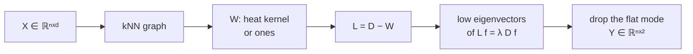

# Laplacian eigenmaps

`laplacian_eigenmaps.py` · Manifolds & embeddings · Tier 2 · 3 variants

## Intuition

Locally linear embedding spends its first half deciding what the graph is: it
solves a reconstruction problem per neighbourhood and gets a weight matrix. This
method refuses that half. The graph is given — you or your nearest-neighbour rule
built it — and the only question left is what to put on the vertices. The answer
is a coordinate that changes as little as possible across every edge:

```
        x₁ ·──0.9──· x₂ ·──0.4──· x₃

        f = (0.0, 0.1, 0.2)   fᵀLf = ½[0.9·0.1² + 0.4·0.1²] = 0.0065   smooth
        f = (0.0, 0.9, 0.1)   fᵀLf = ½[0.9·0.9² + 0.4·0.8²] = 0.4925   rough
```

Both assignments are perfectly legal coordinates on three points. The first is
a slow ramp; the second jumps across an edge that the graph says is close. The
method takes the second kind of assignment away from you, because on a proximity
graph a coordinate that jumps across an edge is a coordinate that ignores the
data's own notion of nearness.



What makes this an *embedding* rather than a smoothing filter is that the
smoothness cost is a quadratic form, so its minimisers are eigenvectors, and the
eigenvectors come in a hierarchy: the flattest non-constant function, then the
next flattest orthogonal to it, and so on. That hierarchy is a Fourier basis of
the graph. For a circle it is exactly the classical Fourier basis, which is the
one case where the whole calculation has a closed form — and the demo checks it.
200 points uniformly spaced on a circle, $k = 2$, so the graph is a cycle and
every degree is exactly 2. The generalized eigenvalues are
$1 - \cos(2\pi j/n)$, each with multiplicity two; the six returned ones match that
formula to $3 \times 10^{-16}$,
the gap inside each degenerate pair is $4 \times 10^{-16}$, and the embedding
correlates $1.0000$ with $(\cos\theta, \sin\theta)$.

On data that is not a circle, the same eigenproblem is an approximation to the
Laplace–Beltrami operator of the surface the points were sampled from — the
continuum limit in section 7 — which is the sense in which the method "recovers
the manifold". It is also the sense in which it cannot: what it really recovers is
the spectrum of *the graph you built*, and a graph that cuts the sheet has a
different spectrum.

The demo's first measurement is that the algebra is exact where it can be. 200
points on a random plane in three dimensions, $k = 10$, the unweighted graph: the
constant vector is in the kernel to $0$, with eigenvalue $2 \times 10^{-16}$; the
two returned coordinates satisfy the generalized problem to $9 \times 10^{-16}$
and are $D$-orthonormal to $10^{-15}$; and their Dirichlet quotients
$f^\top L f / f^\top D f$ equal their eigenvalues, $0.019623$ and $0.027960$, to
every digit printed. The energy identity is not a property the embedding happens
to have — it is the objective.

## Variants

Three ways to write the same eigenproblem, and the demo measures how much of the
difference is real.

| variant | graph | operator | overlap @8 | @40 | distance corr. |
|:--|:--|:--|--:|--:|--:|
| `standard` | unweighted | $L = D - W$, generalized problem | 0.455 | 0.749 | 0.834 |
| `normalized` | heat kernel | $I - D^{-1/2}WD^{-1/2}$ | 0.510 | 0.755 | 0.837 |
| `diffusion_link` | heat kernel | $P = D^{-1}W$, decay $\mu_k^s$ | 0.510 | 0.755 | 0.839 |
| — | PCA baseline | — | 0.525 | 0.761 | 0.860 |

300 points on an S-curve, $k = 10$, heat scale at its default. `standard` is the
textbook Belkin–Niyogi formulation with the combinatorial Laplacian and an
unweighted graph. `normalized` changes two things at once — a heat kernel instead
of ones, and the symmetric normalization instead of the generalized problem — and
the second of those changes nothing mathematically: $L f = \lambda D f$ with
$f = D^{-1/2}v$ is exactly the symmetric problem in $v$. So the entire gap between
the first two rows is the kernel, and it is small: the second eigenvalue moves from
$0.0032$ to $0.0022$, the neighbour overlap from $0.455$ to $0.510$, the distance
correlation from $0.834$ to $0.837$.

That is not an accident of this dataset. As the bandwidth grows,
$\exp(-d^2/t) \to 1$ and the heat graph becomes the unweighted graph: at $25\times$
the default scale, $\lambda_2$ settles at $0.0032$ and matches `standard` to three
digits. `standard` is the $t \to \infty$ limit of `normalized`, which is why the
two cannot disagree much on well-sampled data, and why the choice between them is
mostly about conditioning and about the one scale you are willing to set.

`diffusion_link` is a different kind of variant. It computes the *same* eigenvectors
of the *same* matrix and then multiplies coordinate $k$ by $\mu_k^s$ with
$\mu_k = 1 - \lambda_k$. At $s = 1$ that is a per-axis factor of
$0.9978$ and $0.9918$ — the two layouts agree to machine precision up to that
rescaling, and the demo asserts it. The variant is only interesting for $s > 1$,
where the high modes are damped geometrically and the layout becomes a coarser,
more global view of the same graph. That is the diffusion-map construction, and
the scaling is the whole of it.

The fourth line is the honest comparison for this kind of data: the leading two
principal components keep $0.525$ at eight neighbours and correlate $0.860$. On a
smooth sheet the graph buys essentially nothing over a rotation, and the numbers
say so. Where it buys a great deal is when the low modes are close to indicators
— separated clusters — which is the spectral-clustering case in the applications.

## Derivation

### 1. The graph, and its Laplacian

Given $X = (x_1, \dots, x_n)$ and $k$, the graph is the symmetric $k$-nearest
neighbour graph with heat-kernel weights,

$$
W_{ij} = \exp\left(-\frac{\lVert x_i - x_j \rVert^2}{t}\right)
\quad \text{if } j \in \mathrm{kNN}(i) \text{ or } i \in \mathrm{kNN}(j),
\qquad W_{ij} = 0 \text{ otherwise} \qquad (1)$$
$$
D = \mathrm{diag}(d_1, \dots, d_n), \qquad d_i = \sum_j W_{ij},
\qquad L = D - W \qquad (2)$$

Two details in (1) are decisions rather than notation. The symmetrisation takes the
**union** — an edge survives if either endpoint chose it — so every vertex keeps
its own $k$ neighbours and the result is connected at least as often as the mutual
version. The bandwidth $t$ has units of squared distance; the default is the mean
squared distance to the $k$-th neighbour, which makes it scale with the data.
Neither choice is forced, and both change the answer.

### 2. The Dirichlet form

For any vector $f \in \mathbb{R}^n$ assigned to the vertices,

$$
f^\top L f = f^\top D f - f^\top W f
= \sum_i d_i f_i^2 - \sum_{i,j} W_{ij} f_i f_j
= \tfrac{1}{2}\sum_{i,j} W_{ij}\,(f_i - f_j)^2 \qquad (3)$$

using $d_i = \sum_j W_{ij}$ and the symmetry of $W$. Every term is non-negative, so
$L$ is positive semidefinite and $f^\top L f$ is a sum of squared differences
weighted by edge strength — an energy, in the physicist's sense. A small value
means $f$ is nearly constant across every strong edge. Equivalently, $L f$ is the
vector of "how much above your neighbours' average you are", weighted by degree;
$f$ is smooth exactly when that vector is small.

### 3. From energy to eigenvectors

The flat function $\mathbf{1}$ has zero energy and so does the zero vector, so a
pure minimisation is meaningless. Fix the scale in the metric that the energy
respects, the degree:

$$
f = \arg\min_{g^\top D g = 1} g^\top L g
\qquad \Longleftrightarrow \qquad
L f = \lambda D f \qquad (4)$$

The constraint is $f^\top D f = 1$ rather than $\lVert f \rVert = 1$ because $D$ is
the natural inner product of this problem: it is the inner product in which $L$ is
self-adjoint, and it weights a vertex by how many edges it has. Using it is what
makes the answer independent of duplicating a densely connected region of the
graph. The stationary condition comes from the Lagrangian
$g^\top L g - \lambda (g^\top D g - 1)$, whose gradient is
$2Lg - 2\lambda Dg$.

Minimising (4) returns the flat mode, which is useless. The useful coordinates are
the next $d$ eigenfunctions, and they are obtained by minimising the same quotient
subject to being orthogonal, in the $D$ inner product, to the modes already chosen
— which is exactly what taking the next $d$ eigenvalues of (4) does.

### 4. The flat mode, and how many of them there are

Because every row of $L$ sums to zero, $L\mathbf{1} = 0$:

$$
L\,\mathbf{1} = (D - W)\mathbf{1} = D\mathbf{1} - D\mathbf{1} = 0 \qquad (5)$$

so $\lambda_1 = 0$ with eigenvector $\mathbf{1}$, on any graph. This is the
direction that (4) cannot see, and it is dropped for the same reason as in LLE:
a cost built from differences is blind to an additive constant. Its multiplicity
is the number of connected components, which turns the spectrum into a
connectivity test — failure mode 1.

### 5. The symmetric form

(4) is a generalized problem, and there is no generalized `eigh` in numpy. The
substitution $f = D^{-1/2}v$ removes $D$ from both sides:

$$
L f = \lambda D f
\;\Longleftrightarrow\;
\left(I - D^{-1/2} W D^{-1/2}\right) v = \lambda v
\;\Longleftrightarrow\;
L_{\mathrm{sym}}\, v = \lambda v \qquad (6)$$

and the embedding is recovered as $Y = D^{-1/2} V$, one column per retained
eigenvalue. $L_{\mathrm{sym}}$ is symmetric, so one `eigh` solves it, the
eigenvalues are real and the eigenvectors orthonormal in the ordinary sense. The
round trip costs a diagonal scaling and buys the entire numerical stability of the
implementation: the matrix being decomposed has norm at most 2, whatever the
units of the data.

### 6. The same thing as a Markov chain

Divide $L f = \lambda D f$ by $D$ and rearrange:

$$
P = D^{-1} W, \qquad P f = (1 - \lambda) f = \mu f \qquad (7)$$

$P$ is row-stochastic — it is the transition matrix of a random walk that steps
from $i$ to a neighbour with probability proportional to that edge's weight — so
its eigenvalues lie in $[-1, 1]$ and $\mu_1 = 1$. One step of the walk smooths a
function by $P$; $s$ steps smooth it by $P^s$, which has the same eigenvectors and
eigenvalues $\mu_k^s$. Written out,

$$
P^s = \sum_k \mu_k^s\, \psi_k \phi_k^\top,
\qquad \psi_k = D^{-1/2} v_k, \qquad Y_k = \mu_k^s \psi_k \qquad (8)$$
$$
\lVert Y(i) - Y(j) \rVert^2 = \sum_k \mu_k^{2s}\,\bigl(\psi_k(i) - \psi_k(j)\bigr)^2
= D_s(i,j)^2 \qquad (9)$$

so the $s$-step embedding is a distance — the diffusion distance, the
random-walk analogue of geodesic distance and the quantity diffusion maps are
named after. The truncation to $d$ coordinates is what makes it an embedding
rather than a table.

### 7. What the spectrum converges to

The reason this is a manifold method and not just a graph method: with points
sampled from an $m$-dimensional manifold and a Gaussian kernel of bandwidth $t$,

$$
\frac{1}{n\,t^{m/2+2}}\,L \;\longrightarrow\; c\,\Delta_{\mathcal{M}}
\qquad \text{as } n \to \infty,\; t \to 0,\; \frac{n t^{m/2+2}}{\log n} \to \infty
\qquad (10)$$

in the sense that the operator applied to a smooth function converges to a
multiple of its Laplace–Beltrami operator, so the low eigenvectors converge to its
low eigenfunctions. The constant $c$ and the power of $t$ come from the Taylor
expansion of the kernel and are not worth memorising; the content is that the
eigenvalue ordering is the ordering of the surface's own vibration modes. That is
also why $t$ must shrink as $n$ grows — with a fixed kernel the limit is a
different operator — and why the flat mode of the graph is the constant function
of the manifold.

## Code walkthrough

### 1. The graph

```python
    np.fill_diagonal(D, np.inf)
    idx = np.argpartition(D, k, axis=1)[:, :k]
    dist = np.take_along_axis(D, idx, axis=1)
    order = np.argsort(dist, axis=1)
```

`argpartition` finds the $k$ smallest entries of each row without ordering the
rest, and the `argsort` then orders only those $k$, so `distances_[:, 0]` is the
nearest neighbour. The diagonal is set to `inf` first, which is the entire
mechanism that stops a point from being its own neighbour; the dense distance
matrix is what makes this affordable and what makes the method $O(n^2)$ in memory.

### 2. Scattering the edges

```python
    rows = np.repeat(np.arange(n), k)
    vals = (np.ones(rows.size) if heat is None
            else np.exp(-dist.ravel() ** 2 / heat))
    W[rows, idx.ravel()] = vals
    W = np.maximum(W, W.T)
```

`W[rows, idx.ravel()]` is a single fancy-index assignment that writes all $nk$
edges at once — no Python loop over vertices anywhere in the graph construction.
Then `np.maximum(W, W.T)` symmetrises by union: an edge that only one endpoint
chose appears with that endpoint's weight, and an edge both chose appears once with
the same weight either way. The alternative, `np.minimum`, keeps only mutual
neighbours; it bounds the degree in both directions and disconnects more easily.

### 3. The bandwidth default

```python
        heat = None if self.variant == "standard" else self.t
        if heat is None and self.variant != "standard":
            heat = float(np.mean(dist[:, -1] ** 2))
```

The default is the mean squared distance to the $k$-th neighbour: the scale at
which the graph is a graph and not a set of isolated points. It is a mean rather
than a minimum so that a handful of very close pairs cannot set the scale, and a
mean rather than a maximum so that one outlier cannot either. `standard` passes
`None` through to the scatter and gets ones, which is the $t \to \infty$ limit of
the heat kernel from the variants section.

### 4. One `eigh`

```python
        S = inv[:, None] * W * inv[None, :]
        mu, vecs = np.linalg.eigh(S)
        order = np.argsort(mu)[::-1]
        mu = mu[order]
        vecs = vecs[:, order]
```

This is (6) and (7) at once: `S` is $D^{-1/2}WD^{-1/2}$, whose eigenvalues are
$\mu = 1 - \lambda$, so sorting $\mu$ descending is sorting the Laplacian ascending
and the flat mode comes first. `eigh` returns ascending order, hence the reversal
and the explicit `argsort` — the reversal alone would be enough for `eigh`, but the
sort is written out because the rest of the class treats `mu` as an ordered
spectrum.

```python
        keep = slice(1, 1 + self.n_components)
        coords = vecs[:, keep] * inv[:, None]
        if self.variant == "diffusion_link":
            coords = coords * (mu[keep] ** self.n_steps)[None, :]
```

The slice is the drop-the-flat-mode rule of section 4, `inv[:, None]` is the
$D^{-1/2}$ of (6), and the last two lines are the entire difference between
`normalized` and `diffusion_link`. Note what is *not* here: no rescaling to unit
variance, no whitening, no sign convention. The generalized problem fixes the
scale through $f^\top D f = 1$, and leaving it alone is what makes the coordinates
comparable between two fits on the same graph.

### 5. The one guard

```python
        deg = W.sum(axis=1)
        if np.any(deg <= 0.0):
            raise ValueError("every vertex needs at least one neighbour")
```

A vertex with no edges has degree zero, so $D^{-1/2}$ is infinite and the whole
matrix is not a matrix. This happens when `n_neighbors` is small relative to the
spread of the data and a point is isolated, and it is worth failing loudly rather
than producing `nan` downstream. The test is against exactly zero rather than a
tolerance: the heat kernel is allowed to produce weights of $10^{-80}$ (the
bandwidth demo does), and a $10^{-12}$ threshold would refuse a graph that is
perfectly well defined.

## Complexity

| stage | work | implementation |
|:--|:--|:--|
| distances | $O(n^2 d)$ | one Gram matrix, `sqrt` of the clipped complement |
| neighbours | $O(n^2)$ | `argpartition` per row |
| graph | $O(nk)$ | one fancy-index scatter, `np.maximum` |
| normalization | $O(n^2)$ | two diagonal scalings of a dense matrix |
| eigenproblem | $O(n^3)$ time, $O(n^2)$ memory | dense `eigh` |

Measured on the S-curve with `normalized` and $k = 10$, one fit:

| $n$ | 250 | 500 | 1000 | 2000 | 4000 |
|:--|--:|--:|--:|--:|--:|
| time | 0.006 s | 0.023 s | 0.110 s | 0.681 s | 8.99 s |

At $n = 2000$ the breakdown is $0.026$ s for the distances, $0.030$ s for the
neighbours, $0.010$ s to assemble $W$, $0.007$ s to normalize, and $0.618$ s for
`eigh` — 91% of the run in the eigen-solver. Doubling from 1000 to 2000 costs
$6.2\times$ and doubling again $13.2\times$, the signature of a dense cubic with a
memory hierarchy on top.

The comparison that matters is with LLE at the same size: $0.735$ s against
$0.681$ s at $n = 2000$, and $9.38$ s against $8.99$ s at $n = 4000$. Almost all
of that difference is the per-neighbourhood solve LLE needs and this method does
not; both then pay the same cubic. A production implementation replaces `eigh`
with a shift-invert Lanczos solver for the few smallest eigenvectors of a sparse
$L$, which is $O(nk)$ per iteration and never forms the dense matrix at all. This
file pays $O(n^3)$ to stay inside numpy, and the dense matrix is also what makes
the full spectrum available to inspect — which is the diagnostic the failure
modes depend on.

## Failure modes

### 1. A graph that does not connect

Two clouds of 100 points twelve units apart, $k = 8$: every neighbourhood lies
inside one cloud, the Laplacian is block diagonal, and it has **2** eigenvalues at
zero — one per component. The first coordinate is the indicator of the two clouds,
constant within each to $9 \times 10^{-17}$. The method has produced a perfect
embedding of a graph that cannot see across the gap, and the objective agrees that
it is perfect, because it is.

Worse, the spectrum is the *only* thing that reports it. On the 300-point S-curve,
$k = 4$ tears the graph along the fold, $\lambda_2$ is exactly $0$, and both of the
usual quality scores **improve**: $0.621$ at eight neighbours and $0.879$ distance
correlation, against $0.510$ and $0.837$ at $k = 10$. The indicator of the two
halves happens to be close to the sign of the sheet's own first parameter, so the
collapse is rewarded by the metric that was supposed to catch it. Count the
eigenvalues below tolerance and compare with the number of components before
believing any score.

### 2. A bandwidth that underflows

The heat kernel is exponential in $-d^2/t$, so a small $t$ does not merely
down-weight distant pairs, it annihilates them. At $0.02\times$ the default scale
on the S-curve the surviving weights span $2 \times 10^{-80}$ to $0.96$ and
**seven** eigenvalues sit at $10^{-10}$ or below where the graph wants one. The
layout is the indicator of seven near-isolated clumps: overlap at eight neighbours
still reads $0.624$, but distance correlation collapses to $0.318$. Local
neighbours survive a clumped layout; global structure does not.

The safe direction is the other one. Large $t$ flattens the kernel to ones, the
graph becomes unweighted, and $\lambda_2$ converges to the `standard` value. A
bandwidth that is too large costs resolution, not correctness — but note that it
also loses the kernel's density adaptation entirely, and that a fixed `t` is not
scale-free: it has units, so the same number on data in different units is a
different graph.

### 3. Degenerate eigenvalues, and the gauge that remains

On the cycle the eigenvalues arrive in exact pairs, and the eigenvectors inside a
pair are only determined up to a rotation: any orthonormal basis of the
two-dimensional eigenspace is equally valid. The gap measured on the demo's circle
is $4 \times 10^{-16}$, so which rotation you get is a property of LAPACK, not of
the data.

This is a much smaller gauge group than LLE's. There the eigenproblem fixed only a
subspace and the coordinates were related by an arbitrary invertible matrix; here
the problem fixes the coordinates up to an orthogonal rotation *within each
degenerate eigenspace*, and up to a sign. Distance-based comparisons are invariant
under both; coordinate-by-coordinate comparisons are not, and on symmetric data
they are meaningless. If you need stable coordinates, fix a sign convention and
rotate each degenerate block by a deterministic rule — or accept that the layout is
an object with a symmetry.

### 4. $k$ is a graph decision, and more is not safer

On the S-curve at $k = 4, 6, 8, 10, 15, 20, 30, 50$ the eight-neighbour overlap is
$0.621$, $0.599$, $0.547$, $0.510$, $0.465$, $0.443$, $0.435$, $0.388$ and the
distance correlation $0.879$, $0.834$, $0.822$, $0.837$, $0.843$, $0.841$, $0.835$,
$0.817$. Both curves are flat and then fall; neither has an interior optimum worth
finding. And the best row in the table is the disconnected one. There is no
cross-validation-style answer here — $k$ is the resolution at which you have
declared two points to be related, and the honest move is to report it and check
the spectrum.

### 5. No out-of-sample extension

The eigenvectors are defined on vertices. A new point has no row in $L$ and
therefore no coordinate, and neither `fit` nor `transform` will invent one. The
usual patches are Nyström extension (interpolate the eigenvectors to the new point
from its neighbours) or a regression from $X$ to $Y$; both are approximations that
the method itself does not contain. If new data arrives continuously, this is the
wrong atom and a parametric method is the right one.

### 6. Sampling density is not geometry

If the sample is denser in one region than another, the unnormalized Laplacian's
low modes can describe the sampling rather than the surface: a region with more
points has larger degrees, and the generalized problem weights it more heavily.
This is the standard argument for the normalized Laplacians, whose eigenvectors are
invariant to a non-uniform density in the limit, and it is a reason to prefer
`normalized` over `standard` on data that is not uniformly sampled. Neither is a
complete correction — the fully density-corrected form is the $lpha$-normalisation
used in diffusion maps, which is outside this file. What is *not* a
density correction is the heat kernel itself: changing $t$ changes the kernel's
absolute scale, which is a different axis of sensitivity (failure mode 2).

## Applications

- **Spectral clustering.** Ng, Jordan and Weiss build exactly the normalized
  embedding of this file, normalize each row to unit length, and run $k$-means on
  the result. The reason it works is the one the intuition section describes: for
  well-separated clusters the low modes are close to indicator functions, and
  $k$-means on indicators is trivial. `07-clustering/spectral_clustering.py` ships
  this embedding as its `ng_jordan_weiss` variant, with the clustering attached.
- **Semi-supervised learning.** Clamp the labels on a few vertices and extend them
  by the minimiser of $f^\top L f$ subject to the clamped values — a harmonic
  function on the graph, solved by the same linear system the eigenproblem comes
  from. Zhu, Ghahramani and Lafferty's label propagation is this method with the
  labels kept in the boundary condition.
- **Manifold learning of images.** Belkin and Niyogi's own demonstration: a set of
  photographs of one object, embedded by the graph spectrum, with the low
  coordinates tracking pose. The advantage over PCA there is the same as here —
  the graph respects nearness in image space, which need not be linear.
- **Shape and mesh analysis.** On a triangulated surface, the Laplace–Beltrami
  eigenfunctions computed from the mesh are the same objects, and their low
  eigenvalues are used as shape descriptors and for correspondence between meshes.
  The circle demo is the one-dimensional case where the answer is a Fourier basis.
- **Graph drawing and relational data.** When the input is a graph rather than
  points, this is one of the few methods that applies unchanged: build $W$ from the
  adjacency and take the spectrum. Force-directed layouts and spectral layouts are
  the two standard answers, and this is the second.
- **As an ancestor.** Diffusion maps, PHATE and the Laplacian eigenmaps inside
  spectral clustering are all this eigenproblem with a different operator or a
  different scaling. The `diffusion_link` variant is the one-line version of that
  step; `diffusion_maps` and `phate` later in this chapter take the rest.

## References

- Belkin, M. and Niyogi, P. (2003). Laplacian eigenmaps for dimensionality
  reduction and data representation. *Neural Computation* 15(6), 1373–1396.
- Ng, A. Y., Jordan, M. I. and Weiss, Y. (2002). On spectral clustering: analysis
  and an algorithm. *NeurIPS 2001*, 849–856.
- Coifman, R. R. and Lafon, S. (2006). Diffusion maps. *Applied and Computational
  Harmonic Analysis* 21(1), 5–30.
- Nadler, B., Lafon, S., Coifman, R. R. and Kevrekidis, I. G. (2006). Diffusion
  maps, spectral clustering and reaction coordinates of dynamical systems.
  *Applied and Computational Harmonic Analysis* 21(1), 113–127.
- Zhu, X., Ghahramani, Z. and Lafferty, J. (2003). Semi-supervised learning using
  Gaussian fields and harmonic functions. *ICML 2003*, 912–919.
- von Luxburg, U. (2007). A tutorial on spectral clustering. *Statistics and
  Computing* 17(4), 395–416. — the density-sensitivity of the unnormalized
  Laplacian, and the normalization taxonomy.
- Chung, F. R. K. (1997). *Spectral Graph Theory*. AMS. — the spectrum of the cycle,
  the multiplicity of zero, and the Cheeger inequalities behind failure mode 1.
