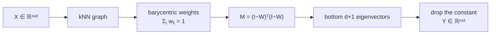

# Locally linear embedding

`lle.py` · Manifolds & embeddings · Tier 2 · 4 variants

## Intuition

Isomap estimates a distance and then embeds it. LLE refuses the first step. Its
premise is that a distance is the wrong local object to measure from a sample: it
needs a metric, it is dominated by wherever the sampling happens to be dense, and
on a curved sheet the straight-line distance between two nearby points is exactly
the quantity the curvature corrupts. What survives at the scale of a
neighbourhood is weaker and more useful — *where the point sits inside its
neighbourhood*, as the coefficients of the affine combination that reproduces it.

```
       neighbourhood in the data               the same weights in the layout

              x₂                                     y₂
               ·  0.30                                ·  0.30
                \                                      \
                 \                                      \
        x₁ ·──────· xᵢ ·──── x₃            y₁ ·──────· yᵢ ·──── y₃
            0.50         0.20                   0.50         0.20

        xᵢ = 0.50 x₁ + 0.30 x₂ + 0.20 x₃      minimise ‖yᵢ − Σⱼ wᵢⱼ yⱼ‖²
```

The figure is the whole method. On the left the coefficients are found by least
squares in the data; on the right the layout is asked to make the same
coefficients hold. Nothing in the second half refers to a distance except the
distances between neighbours, which were used once and then discarded.

The weights have one property that matters more than the rest: they are
*invariant under similarities*. Rotate the neighbourhood, translate it, scale it
uniformly, and the coefficients do not move — measured to $3 \times 10^{-14}$ on
a plane. They describe the shape of a neighbourhood relative to itself, not its
size or its position. The embedding inherits that indifference, and that is where
both the method's reputation and its failure modes come from: what it recovers
is a *subspace*, not a set of coordinates, so any comparison in a fixed
coordinate frame is partly measuring a choice the eigen-solver made on its own.



The demo's first measurement is that the algebra is exact where it should be. 200
points on a random plane in three dimensions, $k = 10$: every row of weights is a
barycentre to $4 \times 10^{-16}$, the objective equals the sum of the two chosen
eigenvalues to twelve digits, and the layout correlates $0.99707$ with the
plane's own coordinates while keeping $0.974$ of each point's eight nearest
neighbours. Rotating the input and mapping it through $7x + 3$ leave every weight
and every neighbourhood unchanged.

The second measurement is that exact reconstruction weights say nothing about the
metric of the layout. Hand the method the answer — the S-curve's own two
coordinates, a rectangle — and it returns that rectangle up to a linear map: the
raw correlation with the input is $0.7425$, and after one least-squares affine
map it is $0.9956$, or $0.9997$ at $k = 15$. The map has a singular-value ratio
of $4.75$: the layout is the rectangle squashed on one axis, and essentially all
of the loss is the squash.

## Variants

The four variants are three answers to the same defect plus one that moves the
graph instead. The defect: with $k$ neighbours and $D$ input dimensions the local
Gram matrix has rank at most $D$, and the weights are pinned down by the
constraint only while $k \le D + 1$. Past that they form a
$(k - D - 1)$-dimensional affine family, the solver returns one member, and the
eigenproblem then amplifies that arbitrary choice. `modified` keeps the whole
family, `hessian` abandons weights and fits a quadratic, `supervised` changes
which points are neighbours at all.

On the 300-point S-curve at $k = 10$:

| variant | what it penalises | overlap @8 | @40 | distance corr. |
|:--|:--|--:|--:|--:|
| `standard` | reconstruction error with one chosen weight vector | 0.521 | 0.742 | 0.828 |
| `modified` | the same error over the whole weight family | 0.571 | 0.592 | 0.757 |
| `hessian` | curvature of the coordinate, weights discarded | 0.577 | 0.596 | 0.760 |
| `supervised` | identical objective, class-weighted neighbour search | — | — | — |

`modified` and `hessian` both buy local overlap and pay for it in the middle range
and in the distances: at forty neighbours they score $0.592$ and $0.596$ against
$0.742$, and they correlate $0.757$ and $0.760$ against $0.828$. That is not a
tuning accident but the design — both replace a global constraint with a local
one, and overlap at eight neighbours is the quantity they were built to protect.

`supervised` is the other kind of variant. It multiplies cross-class distances by
$1 + \lambda$ before the neighbour search and leaves the objective untouched. On
two interleaved spiral arms the unweighted graph spends $0.337$ of its edges
across the arms; at $\lambda = 2$ the cross-arm rate is $0.001$ and the purity of
each point's eight layout neighbours rises from $0.728$ to $0.935$. At
$\lambda = 5$ it is $1.000$, which is also what a method that was no longer
looking at the geometry would score.

## Derivation

### 1. The local problem

For one point $i$ with neighbourhood $\mathcal{N}_i$ of size $k$:

$$
w_i = \arg\min_{w} \Big\lVert x_i - \sum_{j \in \mathcal{N}_i} w_j x_j \Big\rVert^2
\quad \text{subject to} \quad \sum_j w_j = 1 \qquad (1)$$

Write $Z$ for the $k \times D$ matrix whose row $a$ is $x_{j_a} - x_i$, and
$G = ZZ^\top$. The Lagrangian is $\lVert Z^\top w\rVert^2 + \lambda(\mathbf{1}^\top w - 1)$,
and stationarity gives $Gw = \lambda\mathbf{1}$. The multiplier is fixed by the
constraint rather than by the data, so the solution is the direction of
$G^{-1}\mathbf{1}$:

$$
w = \frac{G^{-1}\mathbf{1}}{\mathbf{1}^\top G^{-1}\mathbf{1}} \qquad (2)$$

Translation invariance is already in the constraint, not in the centring: the
weights see only differences. The code centres explicitly anyway so that the Gram
matrix stays as well conditioned as the data allows.

### 2. Rank, ridge, and why the exact answer is the wrong one

$G = ZZ^\top$ with $Z$ of shape $k \times D$, so $\mathrm{rank}(G) \le D < k$ for
every interesting neighbourhood: $G$ is singular and `solve` raises. At
$k = D + 1$ the constraint still pins down one minimiser, but past that the
minimisers form a $(k - D - 1)$-dimensional affine family. The implementation
regularises with

$$
G \leftarrow G + \tau\,\mathrm{tr}(G)\,I \qquad (3)$$

Scaling by $\mathrm{tr}(G)$ makes $\tau$ dimensionless, so it means the same thing
in any units. As $\tau \to \infty$, $G^{-1} \to I/(\tau\mathrm{tr}G)$ and
$w \to \mathbf{1}/k$, the neighbourhood mean; as $\tau \to 0$ we get the exact
barycentric weights. The ridge is therefore not a numerical nuisance bolted onto
a correct formula but a knob that interpolates between "average the neighbours"
and "reproduce the point exactly", and the useful setting is in between. The demo
walks the whole interval on the S-curve at $k = 10$:

| $\tau$ | 1e-9 | 1e-6 | 1e-4 | 1e-3 | 1e-2 | 1e-1 |
|:--|--:|--:|--:|--:|--:|--:|
| objective | 4e-16 | 6e-13 | 4e-9 | 3.4e-7 | 1e-5 | 6e-5 |
| distance corr. | 0.222 | 0.392 | 0.706 | 0.828 | 0.835 | 0.821 |
| eight-neighbour overlap | 0.407 | 0.495 | 0.498 | 0.521 | 0.510 | 0.481 |

At $\tau = 10^{-9}$ the weights reconstruct every point to machine precision —
the objective the method is written to minimise is essentially zero — and the
correlation with the truth is $0.222$, worse than a linear projection. At
$\tau = 10^{-3}$ the objective is $3.4 \times 10^{-7}$, nine orders of magnitude
larger by the method's own measure, and the correlation is $0.828$. The reason is
in (2): an exactly reconstructed neighbourhood can only be reconstructed by
weights that cancel, which means coefficients of large magnitude with both signs
— and those are precisely the coefficients whose arbitrary component the
eigenproblem magnifies. `reg=0.0` does not fail gracefully; it raises
`LinAlgError: Singular matrix` on the first neighbourhood with $k > D$.

### 3. The global problem

Given the $n \times n$ matrix $W$ with $W_{ij} = w_{ij}$ for
$j \in \mathcal{N}_i$ and zero elsewhere, the layout minimises the same
reconstruction error at every point:

$$
\mathcal{E}(Y) = \sum_i \Big\lVert y_i - \sum_j W_{ij} y_j \Big\rVert^2
= \mathrm{tr}\left(Y^\top M Y\right), \qquad
M = (I - W)^\top (I - W) \qquad (4)$$

and the trivial solution $Y = 0$ is removed by the normalisation

$$
Y = \arg\min_{Y^\top Y = I} \mathrm{tr}\left(Y^\top M Y\right) \qquad (5)$$

The constraint says the columns are orthonormal and nothing else in the problem
mentions scale. That is the point: (5) selects a *subspace* of $\mathbb{R}^n$ —
the span of the $d$ eigenvectors with the smallest eigenvalues — and the
coordinates are any orthonormal basis of it.

$M$ is symmetric positive semidefinite by construction, $n \times n$, and built
from $W$ alone. No distance between non-neighbours ever enters it, which is why
the method is cheap in graph terms and fragile in metric terms.

### 4. The direction the constraint leaves free

Every row of $W$ sums to one, so $(I - W)\mathbf{1} = 0$ and therefore
$M\mathbf{1} = 0$: the constant vector is an eigenvector with eigenvalue zero,
and its eigenvalue carries no information. The code drops the bottom eigenvector
and keeps the next $d$. This is not a normalisation added for tidiness — it is
the direction the constraint set leaves unconstrained, because a cost built from
differences cannot see an additive constant.

Exactly one direction sits at machine zero — the constant. On the S-curve the
next eigenvalue is $2.2 \times 10^{-9}$ against $3.4 \times 10^{-7}$ for the one
after it, so the first coordinate is very nearly free as well and the objective,
$3.4 \times 10^{-7}$, is almost entirely the price of the folded direction. On a
disconnected graph there is one exactly-free direction *per component*, and the
layout collapses; see failure mode 2.

### 5. What the eigenproblem identifies, and what it does not

Two invariances are at work, and separating them is the whole difficulty of
reading a LLE result.

*The weights are similarity-invariant.* For $x \mapsto sRx + b$ with $R$
orthogonal, the residual $Z^\top w$ is multiplied by $sR$, so the minimiser is
unchanged: rotation and $7x + 3$ move no weight by more than $3 \times 10^{-14}$.
A non-uniform linear map does change them, because it changes which direction of
a neighbourhood is worth cancelling.

*The embedding is basis-free.* Since (5) depends on $Y$ only through
$\mathrm{span}(Y)$, the answer is a $d$-dimensional subspace $S$ of
$\mathbb{R}^n$. If $T$ is another coordinate matrix with columns in $S$ — the
manifold's "true" parameters, when those happen to be linear in the embedding —
then $Y = TA$ for some invertible $d \times d$ matrix $A$, and $A$ need not be
orthogonal. Orthonormality is a normalisation the true coordinates do not share.

The practical rule that follows: a raw score mixes how well the subspace was
identified with which gauge the eigen-solver happened to return. Distance
correlation survives a near-similarity; eight-neighbour overlap survives nothing,
since a shear changes which points are nearest. The demo measures the difference
on data where the answer is known.

| aspect of the rectangle | 1 | 2 | 4 | 8 | 16 | 32 |
|:--|--:|--:|--:|--:|--:|--:|
| raw distance corr. | 0.9988 | 0.8729 | 0.7655 | 0.7270 | 0.7677 | 0.8416 |
| after one affine map | 0.9992 | 0.9953 | 0.9992 | 0.9994 | 0.9998 | 0.9999 |
| singular-value ratio of that map | 1.04 | 2.08 | 4.16 | 9.28 | 69.77 | 672.43 |
| raw overlap @8 | 0.979 | 0.761 | 0.580 | 0.510 | 0.440 | 0.630 |

Uniform rectangles of 300 points, $k = 10$. The layout is the rectangle to four
decimal places once a single $2 \times 2$ map is undone, at every aspect, and the
map's condition number tracks the aspect until the layout becomes effectively
one-dimensional and the ratio explodes. Everything the raw column lost is that
map — which the method never claimed to fix.

The same correction on the S-curve is the cautionary case. It takes the
correlation from $0.828$ to $0.986$ and the eight-neighbour overlap from $0.521$
*down* to $0.395$, and both numbers are telling the truth. The sheet's own
coordinates span $9.4$ by $2.0$, so pairwise distances — and therefore the
correlation — are dominated by the long axis. The recovered map has a
singular-value ratio of $21$, it fixes that long axis to $2.5\%$ of its range and
leaves the short one at a correlation of $0.23$ and an amplitude of $0.55$ where
the truth has $2.0$. The aligned layout is a strip $9.5$ long and $0.55$ wide, in
which neighbours can be ordered along essentially one dimension, so overlap
collapses. Choosing the gauge that maximises a global distance statistic is not
the same as choosing the gauge the method left you, and the two can differ by
more than either differs from the truth.

### 6. Modified LLE: keep the whole family

With $k > D + 1$ the optimal weights of (1) form an affine set of dimension
$k - D - 1$. MLLE makes the embedding satisfy *every* member of that set instead
of one arbitrary member. Let $V_i$ be the $k \times s_i$ matrix of the $s_i$
smallest-eigenvalue directions of the local SVD basis $U_i$. A regularised single
weight vector is still needed as an anchor — the same vector (3) produces, only
written in the SVD basis:

$$
w^{\mathrm{reg}}_i = U_i\,\mathrm{diag}\left(\frac{1}{\lambda_{i,r} + \tau\sum_s \lambda_{i,s}}\right)U_i^\top\mathbf{1},
\quad \text{renormalised so } \mathbf{1}^\top w^{\mathrm{reg}}_i = 1 \qquad (6)$$

The number of directions to keep is read off the spectrum rather than fixed. With
$\eta$ the median, over all points, of the ratio of the tail eigenvalues to the
leading $d$,

$$
\eta = \mathrm{median}_i \frac{\sum_{r > d}\lambda_{i,r}}{\sum_{r \le d}\lambda_{i,r}} \qquad (7)$$

$s_i$ is the smallest number of trailing directions for which the eigenvalues being
discarded together are at least $\eta$ times those being kept. The trailing
$k - D$ directions of $U_i$ have zero eigenvalues, so $s_i \ge k - D$ by
construction, and $\eta$ decides only how far past the kernel the family reaches:
on the S-curve at $k = 10$ it stops at $7 = k - D$ for half the points and takes
one genuinely nonzero direction for the other half. No parameter has to be tuned
per dataset, which is the point of using a median.

Each member is then rotated so that it is a genuine barycentre. The rotation is a
Householder reflection off the all-ones direction, followed by an admixture of
the anchor:

$$
W_i = V_i - 2\,(V_i h_i)\,h_i^\top + (1 - \alpha_i)\,w^{\mathrm{reg}}_i\mathbf{1}^\top,
\qquad \alpha_i = \frac{\lVert V_i^\top\mathbf{1}\rVert}{\sqrt{s_i}} \qquad (8)$$

with $h_i = (\alpha_i\mathbf{1} - V_i^\top\mathbf{1})/\lVert\cdot\rVert$, so that
every column of $W_i$ sums to one. The alignment matrix then takes a full block
per point, placed at rows and columns $(i, \mathcal{N}_i)$:

$$
M \leftarrow M + \begin{bmatrix} s_i & -\mathbf{1}^\top W_i \\ -W_i\mathbf{1} & W_iW_i^\top \end{bmatrix} \qquad (9)$$

This is what the `np.ix_` line and the three scalar updates in the code do, one
$s_i$-dimensional family at a time. The extra cost is a full SVD per
neighbourhood instead of a $k \times k$ solve; the gain is that the arbitrary
member of the family is never chosen.

### 7. Hessian LLE

Hessian LLE removes the weights from the problem. In each neighbourhood it builds
the design matrix of a local quadratic — a constant, the $d$ tangent coordinates,
and their $d(d+1)/2$ products — and orthonormalises it:

$$
Q_i = \mathrm{qr}\big[\,\mathbf{1},\; U_{i,1..d},\; \{U_{i,a}U_{i,b}\}_{a \le b}\,\big]
\qquad (10)$$

The first $d + 1$ columns of $Q_i$ span the constants and the linear functions —
the coordinates whose local quadratic fit is exactly zero. The remaining
$d(d+1)/2$ columns are the part of the quadratic monomials orthogonal to them, so
a vector in their span is a coordinate that is *pure curvature* in that
neighbourhood. A weight vector built from them,

$$
w_i = \frac{Q_i[:, d+1:]}{\mathbf{1}^\top Q_i[:, d+1:]} \qquad (11)$$

measures the curvature of the coordinate at $i$, and the embedding minimises
$\sum_i w_i w_i^\top$. Linear coordinates have zero Hessian, so they sit in the
null space and are exactly what the eigen-solver returns — which is why the
method can separate a manifold from its own tangent space where standard LLE
cannot.

The design matrix has $p = 1 + d + d(d+1)/2$ columns, so $k \ge p$ is a hard
requirement: six neighbours for two components, and the code raises rather than
silently producing a degenerate $Q$. On the S-curve at $k = 10$ this buys
$0.577$ eight-neighbour overlap against $0.521$ for `standard`.

### 8. Supervised LLE

The last variant does not touch the algebra at all. It scales the distance matrix
before the neighbour search, so that cross-class points have to be much closer
before they compete for a slot:

$$
D_{ij} \leftarrow D_{ij}\left(1 + \lambda\,[\,y_i \ne y_j\,]\right) \qquad (12)$$

The objective, the alignment matrix and the eigenproblem are unchanged, and the
labels appear nowhere else. This is the same trick as dropping a graph edge, done
smoothly: it is a graph construction, not a supervised loss.

## Code walkthrough

### 1. The graph

```python
    idx = np.argpartition(D, k, axis=1)[:, :k]
    dk = np.take_along_axis(D, idx, axis=1)
    order = np.argsort(dk, axis=1)
    return (np.take_along_axis(dk, order, axis=1),
            np.take_along_axis(idx, order, axis=1))
```

`argpartition` finds the $k$ smallest in a row without sorting the other $n - k$,
which is the whole reason a dense distance matrix is affordable here. The
`argsort` afterwards puts only those $k$ in order, so `distances_[:, 0]` is the
nearest neighbour distance and `weights_[:, 0]` is its coefficient. The caller
has already set the diagonal to `inf`; that is what stops a point from being its
own neighbour.

### 2. The weights

```python
    for i in range(n):
        Z = X[idx[i]] - X[i]
        G = Z @ Z.T
        trace = float(np.trace(G))
        G.flat[::k + 1] += reg * (trace if trace > EPS else 1.0)
        w = np.linalg.solve(G, ones)
        W[i] = w / w.sum()
```

Line by line this is (1)–(3): centre, form the Gram matrix, add $\tau\mathrm{tr}(G)$
to the diagonal through a strided view, solve $Gw = \mathbf{1}$, normalise. The
final division is the constraint, and it is also why the weights cannot drift:
`w.sum()` is positive because $G$ is positive definite after the ridge, so the
row sums are exactly one up to rounding — measured at $4 \times 10^{-16}$.

The `trace if trace > EPS else 1.0` guard covers a neighbourhood of identical
points, where the local scale is undefined; without it the ridge would be zero
and the solve would fail rather than return the uniform weights the mean
solution implies.

### 3. The alignment matrix

```python
    n = idx.shape[0]
    full = np.zeros((n, n))
    np.put_along_axis(full, idx, W, axis=1)
    A = np.eye(n) - full
    return A.T @ A
```

`put_along_axis` scatters the $k$ coefficients of each row into an $n \times n$
matrix, so `full` is $W$ with its rows padded by zeros. Then (4) is one matrix
product. The comment on the function says it: the whole embedding problem is the
Gram matrix of $I - W$.

This is also the asymptotically expensive line. $W$ has only $nk$ non-zeros, but
`A` is the dense $n \times n$ matrix $I - W$, so `A.T @ A` costs $O(n^3)$ — the
same order as the eigendecomposition that follows. The two block-assembled
variants never form this product, which is why they are *faster* than `standard`
at $n = 4000$ despite doing more arithmetic per point.

### 4. MLLE's anchor vector

```python
    scale = np.maximum(evals.sum(axis=1), EPS) * reg
    tmp = np.einsum("nji,nj->ni", U, np.ones((n, k)))
    tmp[:, :nev] /= evals + scale[:, None]
    tmp[:, nev:] /= scale[:, None]
    w_reg = np.einsum("nij,nj->ni", U, tmp)
    w_reg /= w_reg.sum(axis=1, keepdims=True)
```

Equation (6) with the einsums written out: `Uᵀ1` for every point at once, divide
each singular value by its regularised self, rotate back, renormalise. This is
the *same* vector `_barycentric` computes, just in a basis where the ridge is a
division instead of a solve — the two code paths agree to machine precision, and
only one of them is used per variant.

The `nev = min(D, k)` split matters: `svd(..., full_matrices=True)` returns $k$
left singular vectors but only `nev` singular values, and the remaining columns of
$U$ span the exact kernel of $Z$. For those the ridge is the only term, hence
`tmp[:, nev:] /= scale[:, None]` rather than an addition.

### 5. Choosing the family size

```python
    lead = np.maximum(evals[:, :d].sum(axis=1), EPS)
    rho = evals[:, d:].sum(axis=1) / lead
    eta = float(np.median(rho))
    cum = np.cumsum(evals, axis=1)
    ratio = cum[:, -1:] / np.maximum(cum[:, :-1], EPS) - 1.0
    s = np.array([np.searchsorted(ratio[i, ::-1], eta) for i in range(n)])
    s = np.maximum(s + k - nev, 1)
```

`rho` is the per-point version of (7)'s ratio, and `eta` is its median. `ratio`
is the same quantity for every prefix length, so `cum[:, -1:] / cum[:, :-1] - 1`
is $(\sum_{r>j}\lambda_r)/(\sum_{r\le j}\lambda_r)$ for each $j$. The array is
decreasing in $j$, so `[::-1]` makes it ascending and `searchsorted` returns the
smallest $s$ that reaches $\eta$; $\eta$ being a median makes the rule
scale-free. The `+ k - nev` converts "how many tail eigenvalues" into "how many
columns from the right of $U$", and the clip at one keeps at least the smallest
direction.

### 6. One MLLE block

```python
        Vi = U[i][:, k - si:]
        alpha = float(np.linalg.norm(Vi.sum(axis=0)) / np.sqrt(si))
        h = alpha - Vi.T @ np.ones(k)
        norm = float(np.linalg.norm(h))
        h = h / norm if norm > tol else np.zeros(si)
        Wi = Vi - 2.0 * np.outer(Vi @ h, h) + (1.0 - alpha) * w_reg[i][:, None]
```

(8) directly. `alpha` is the projection of the all-ones direction onto the
family, so `Vi - 2(V_i h)hᵀ` is the reflection that makes each column sum to
$\alpha$ instead of whatever it summed to; the anchor term supplies the rest,
$1 - \alpha$. When $h$ is numerically zero — the family already orthonormal to
the ones direction — the reflection is skipped, and the `np.zeros(si)` is the
only branch in the whole variant.

### 7. The block assembly

```python
        nb = idx[i]
        M[np.ix_(nb, nb)] += Wi @ Wi.T
        rows = Wi.sum(axis=1)
        M[i, nb] -= rows
        M[nb, i] -= rows
        M[i, i] += si
```

(9), written as four sparse updates instead of one dense block: the $s_i \times
s_i$ quadratic form goes into the neighbourhood square with `np.ix_`, the two
cross terms subtract the row sums, and the corner gets $s_i$. Nothing outside
those $k + 1$ indices is touched, which is why MLLE's assembly stays $O(nk^2)$
even though its matrix is dense in the output.

### 8. Hessian design and residual

```python
        Y = np.empty((k, p))
        Y[:, 0] = 1.0
        Y[:, 1:1 + d] = U[:, :d]
        col = 1 + d
        for a in range(d):
            Y[:, col:col + d - a] = U[:, a:a + 1] * U[:, a:d]
            col += d - a
        Q, _ = np.linalg.qr(Y)
```

The inner loop writes the upper triangle of the products $U_aU_b$ in row-major
order — $d$ columns, then $d-1$, and so on — so (10)'s column count is exactly
`p` and the matrix is $(k \times p)$. `qr` then gives an orthonormal basis of the
column space; the columns beyond $d+1$ are the ones that a zero-Hessian function
does not need.

```python
        w = Q[:, d + 1:]
        s = w.sum(axis=0)
        s[np.abs(s) < tol] = 1.0
        w = w / s
        nb = idx[i]
        M[np.ix_(nb, nb)] += w @ w.T
```

(11) and the assembly. The rescaling by the column sums is what makes the
residual a weight vector at all: any vector in the orthogonal complement
represents the same curvature, and dividing by its sum picks the one that is a
barycentre — without it the eigenproblem would be solved on a basis rather than
on the quantity it is meant to measure. The `tol` guard covers a column whose
sum is zero, where the normalisation would divide by it.

### 9. The eigenproblem, and the dispatch

```python
    vals, vecs = np.linalg.eigh(M)
    order = np.argsort(vals)
    return vecs[:, order][:, 1:1 + d], vals[order]
```

`eigh` on a symmetric matrix returns ascending eigenvalues already, but the sort
is explicit because the caller reads `eigenvalues_` to compute the objective and
to count null directions. `1:1 + d` is the drop-the-constant rule of section 4 in
one slice. The full spectrum is kept: it is what makes failure mode 2 visible
after the fact, and what the demo asserts on.

```python
        if self.variant == "hessian":
            M = _alignment_hessian(X, idx, d, self.hessian_tol)
        elif self.variant == "modified":
            M = _alignment_modified(X, idx, d, self.reg, self.modified_tol)
        else:
            M = _alignment_standard(_barycentric(X, idx, self.reg), idx)
```

Three different matrices, one eigenproblem. `standard` and `supervised` share the
barycentric path — `supervised` differs only in the distance matrix that produced
`idx` — so the dispatch is exhaustive without a fourth branch.

### 10. The supervised graph

```python
            labels = np.asarray(y)
            same = labels[:, None] == labels[None, :]
            D = D * np.where(same, 1.0, 1.0 + self.class_weight)
```

(12), vectorised. Note the order: the scaling happens *before* the diagonal is
set to `inf` and before the neighbours are chosen, so the graph is rebuilt from
the weighted distances rather than filtered afterwards. That is what makes it a
different graph and not a post-hoc edge deletion.

## Complexity

| stage | work | implementation |
|:--|:--|:--|
| distances | $O(n^2D)$ | one Gram matrix, `sqrt` of the clipped complement |
| neighbours | $O(n^2)$ | `argpartition` per row |
| weights | $O(nk^3)$ | one $k \times k$ solve per point |
| $M$ | $O(n^3)$ | dense scatter, `A.T @ A`; the block variants are $O(nk^2)$ |
| eigenproblem | $O(n^3)$ time, $O(n^2)$ memory | dense `eigh` |

Measured on the S-curve, one fit, $k = 10$:

| $n$ | 250 | 500 | 1000 | 2000 | 4000 |
|:--|--:|--:|--:|--:|--:|
| `standard` | 0.015 s | 0.031 s | 0.132 s | 0.735 s | 9.38 s |

At $n = 2000$ the breakdown is $0.050$ s for the distances and neighbours,
$0.018$ s for the weights, $0.036$ s to assemble $M$, and $0.632$ s for `eigh` —
86% of the run in the eigen-solver, which is the $O(n^3)$ term making itself
known. Doubling from 1000 to 2000 costs $5.6\times$; doubling again costs
$12.8\times$, as the $n \times n$ matrix stops fitting in cache.

This is the honest bill of the method: everything except the alignment product and
the final eigenproblem is linear in $n$ given a fixed $k$, and those two are
dense-cubic. A production implementation replaces the last line with a Lanczos
solver for the few smallest eigenvectors — the same algorithm at a different
complexity class — and keeps the graph sparse; here the dense version is what
makes the code forty lines and the spectrum available for inspection. `modified`
and `hessian` cost 8.17 s and 8.29 s at $n = 4000$, faster than `standard`'s
9.38 s because they assemble $M$ blockwise and never form the dense $I - W$.

## Failure modes

### 1. Minimising the objective is not the goal

The ridge table in section 2 is the cleanest statement: at
$\tau = 10^{-9}$ the objective is $4 \times 10^{-16}$, and the embedding is worse
than PCA. The objective is minimised by the weights that reconstruct exactly, and
those weights cancel. Any implementation that treats exact reconstruction as
correctness — or that reports the reconstruction residual as a quality measure —
is measuring the wrong sign of the right quantity. `reg = 0` does not even get an
answer: `LinAlgError: Singular matrix`.

### 2. A disconnected graph collapses the layout

```python
    nullity = int(np.sum(np.abs(wide.eigenvalues_) < 1e-10))
```

The demo fits two clouds of 100 points twelve units apart at $k = 8$. Every
neighbourhood lies inside one cloud, so $M$ is block diagonal and has **2**
eigenvalues at zero — one per component. The two eigenvectors returned span the
two indicator vectors: the first coordinate takes one value per cloud and varies
within neither to $3 \times 10^{-11}$, and the second is constant across the first
cloud to $0$, so that whole cloud collapses onto a single point. At $k = 3$ the
same data splits into **6** independently solvable patches, the first coordinate
is exactly zero for half the points, and the objective is zero — the method
reports success. The full spectrum is the only warning: count the eigenvalues
below tolerance and compare with one per component.

The fix is not a bigger $k$ in general, since a gap that no $k$ bridges is a
statement about the data. It is to check connectivity, and to fall back on the
component-wise solution or on a method that does not need a connected graph.

### 3. $k$ is a discrete decision with a discontinuous effect

On a 250-point swiss roll the eight-neighbour overlap is $0.615$ at $k = 6$,
$0.480$ at $k = 8$, $0.476$ at $k = 10$, $0.538$ at $k = 12$ and $0.431$ at
$k = 15$; the distance correlation follows the same non-monotone shape,
$0.813$, $0.655$, $0.425$, $0.463$, $0.372$. This is not a curve but a sequence
of graphs, some of which are much better than their neighbours, and the best of
them is at the smallest $k$ tried.

More points do not remove the problem. On the roll at $k = 10$, going from 250 to
500 to 1000 points moves the distance correlation $0.425 \to 0.757 \to 0.844$
while the eight-neighbour overlap goes $0.476 \to 0.591 \to 0.537$. What improves
is the global map, which is the quantity the objective constrains; the local
metric does not converge at all.

### 4. The variants are not uniformly better

`modified` is the textbook fix for the arbitrary weight vector, and on the roll it
is worse than `standard` on both counts: $0.385$ eight-neighbour overlap and
$0.236$ distance correlation, against $0.476$ and $0.425$. `hessian` buys the
overlap ($0.539$) and loses the distances ($0.265$). On the S-curve both are
ahead on overlap. A variant that stabilises a near-degenerate family can amplify
a badly chosen $s_i$ when the local spectra are noisy, and there is no guarantee
to lean on: pick the variant on data that resembles the target, and read the
spectrum before trusting the result.

### 5. Reading the gauge as quality

The aspect table in section 5 is the measurement; the trap is using any single
number. Neighbour overlap at a fixed radius is not invariant under the linear maps
the method leaves free, so it understates the fit on anisotropic data by $0.3$ or
more (aspect 8: raw $0.510$, the true distances recovered to $0.9994$ after one
map). It can also overstate: the S-curve correction reaches $0.986$ while the
short axis of the sheet is only $0.23$ correlated, so a global statistic and a
local one can disagree about the same layout in opposite directions. A pipeline
that compares LLE against PCA or t-SNE on either number alone is comparing a gauge
to an objective. Report distance correlation before and after an affine
alignment, report overlap before and after, and say which gauge you are quoting.

### 6. Supervised weighting can destroy the geometry

Labels are a prior, and a prior that is wrong or uninformative is damage. On the
S-curve, whose labels are four bands of the parameter $t$ and therefore already
run along one axis of the answer, $\lambda = 3$ leaves purity at $0.838$ against
$0.919$ for the unweighted graph and drops eight-neighbour overlap from $0.521$ to
$0.320$. On the spiral, where the labels cut across the geometry, the same knob
takes purity from $0.728$ to $0.935$, and at $\lambda = 5$ to $1.000$. The variant
is only as good as the assumption that class boundaries and manifold boundaries
coincide.

### 7. The Hessian variant has a hard floor

`k >= 1 + d + d(d+1)/2` — six neighbours for two components, 12 for three. Below
it the design (10) has more columns than rows, `qr` can return only $k - d - 1$
directions where the curvature needs $d(d+1)/2$, and the code raises rather than
silently measuring a truncated curvature. A 5-nearest-neighbour graph is a
perfectly ordinary choice for standard LLE and is not available here at all; a
three-component embedding needs $k \ge 12$ whatever the data says.

## Applications

- **Face and expression images.** The original Roweis–Saul demonstration: 64×64
  photographs of one face, embedded to two dimensions that track pose and
  expression. The method's indifference to scale is a virtue there, since the
  lighting varies and the geometry should not.
- **Spectral initialisation and graph drawing.** Because the output is a
  subspace, it can be used as an initialisation for methods that do care about
  the metric, and as a graph-drawing layout when only adjacency matters.
- **Local outlier scores.** The per-point residual $\lVert x_i - \sum_j w_{ij}
  x_j\rVert$ is a curvature-free measure of how badly a point fits its own
  neighbourhood, and it needs no distributional assumption about the rest of the
  data.
- **Sensor and manifold localisation.** The weights are unchanged by global
  similarity, so embedding a set of local distance measurements recovers the
  configuration up to rotation and scale — which is exactly the gauge freedom a
  localisation problem has.
- **Feature extraction before a supervised model,** in the era before
  representation learning made it redundant. It remains a useful baseline
  precisely because it fits nothing: no iterations, no learning rate, no random
  seed.
- **As an ancestor.** Laplacian eigenmaps, the next atom in this chapter, is the
  same eigenproblem with $M = L$ (the graph Laplacian) instead of
  $(I - W)^\top(I - W)$; LLE is the version where the matrix is chosen locally
  and optimally rather than from a fixed kernel.

## References

- Roweis, S. T. and Saul, L. K. (2000). Nonlinear dimensionality reduction by
  locally linear embedding. *Science* 290(5500), 2323–2326.
- Saul, L. K. and Roweis, S. T. (2003). Think globally, fit locally: unsupervised
  learning of low dimensional manifolds. *Journal of Machine Learning Research*
  4, 119–155. — MLLE, and the derivation of the weight family.
- Donoho, D. L. and Grimes, C. (2003). Hessian eigenmaps: locally linear
  embedding techniques for high-dimensional data. *PNAS* 100(10), 5591–5596.
- Kouropteva, O., Okun, O. and Pietikäinen, M. (2002). Supervised locally linear
  embedding algorithm. *ICANN 2002*, 333–338.
- Belkin, M. and Niyogi, P. (2003). Laplacian eigenmaps for dimensionality
  reduction and data representation. *Neural Computation* 15(6), 1373–1396.
- de Silva, V. and Tenenbaum, J. B. (2003). Global versus local methods in
  nonlinear dimensionality reduction. *NeurIPS 2002*, 705–712. — the comparison
  that motivates section 5.
- van der Maaten, L., Postma, E. and van den Herik, H. (2009). Dimensionality
  reduction: a comparative review. *Journal of Machine Learning Research* 10,
  66–71. — where the $k$ sensitivity and the metric claims are catalogued.
