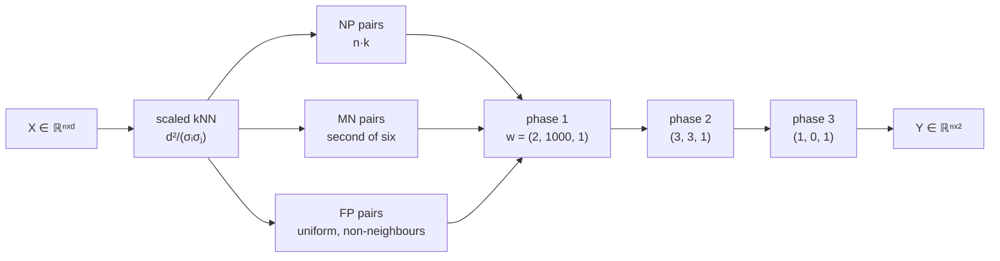

# PaCMAP

`pacmap.py` · Manifolds & embeddings · Tier 2 · 4 variants

## Intuition

Every neighbour-embedding method is an argument about which pairs of points the
layout is allowed to care about. t-SNE cares about the k-nearest graph; UMAP
cares about the same graph and about every other pair, through a sampled
complement. PaCMAP says the argument is the other way round: the graph is too
narrow to carry global structure, and "every non-edge" is too coarse to carry
anything. It splits the pairs into three sets and gives each one its own weight
*and its own weight at each moment of the run*.

```
        neighbour ring        mid-near ring         further pairs
        k ≈ 10, d ≈ 0.44      1/3 quantile, 1.54    uniform, 2.18
          ·  ·  ·                 ·                     ·
        ·  ·█·  ·  ·          ·       ·          ·            ·
          ·  ·  ·                 ·                     ·
        ·         ·           ·        ·        ·                  ·

        attractive,           attractive,           repulsive,
        saturates at 3        ~ a spring           short-ranged
```

The three rings are what the demo measures: on a 250-point swiss roll the mean
pair distance inside each set is $0.44$, $1.54$ and $2.18$, against $2.12$ for a
pair drawn at random. Only the first is a neighbourhood; only the third is
global; the middle one is the scale that neither t-SNE nor UMAP ever samples.

The schedule is the part that people skip. The weights are not a fixed triple
with a large number in it — they are a curriculum:

$$
(w_{\mathrm{NP}}, w_{\mathrm{MN}}, w_{\mathrm{FP}})
= (2,\;1000 \to 3,\;1) \;\to\; (3,\;3,\;1) \;\to\; (1,\;0,\;1)
\qquad (1)$$

Phase one puts a weight of a thousand on the mid-near pairs, so the layout
arranges *regions* before it arranges points. Phase two brings the neighbour
weight up and lets the mid-near pairs keep the regions apart while the neighbour
term fixes local placement. Phase three drops the mid-near term to zero and
leaves the neighbour and further pairs at equal weight, which is where the
finest structure is set — at the cost of the distances.

That trade is measurable at every step of the demo's run:

| step | phase | $w$ | std (mean of axes) | overlap @8 | overlap @40 | distance corr. |
|--:|:--:|:--|--:|--:|--:|--:|
| 0 | 1 | (2, 1000, 1) | 1.01 | 0.458 | 0.620 | 0.090 |
| 49 | 1 | (2, 511, 1) | 1.60 | 0.607 | 0.760 | 0.302 |
| 99 | 1 | (2, 12.97, 1) | 2.73 | 0.719 | 0.827 | 0.407 |
| 199 | 2 | (3, 3, 1) | 3.67 | 0.718 | 0.861 | 0.910 |
| 449 | 3 | (1, 0, 1) | 7.54 | 0.773 | 0.852 | 0.799 |

Read the columns. Phase one builds the mid range: forty-neighbour overlap goes
from $0.620$ to $0.827$ while the distances are still wrong. Phase two is the
one that fixes distances: correlation $0.407 \to 0.910$ with local overlap
flat. Phase three buys $0.055$ of eight-neighbour overlap for $0.111$ of
distance correlation. The last phase is a refinement that is paid for.



The result against the chapter's other methods, on the same roll and the same
truth:

| method | overlap @8 | overlap @40 | distance corr. |
|:--|--:|--:|--:|
| PCA (2 components) | 0.489 | — | 0.280 |
| t-SNE (perplexity 30) | **0.857** | 0.769 | 0.335 |
| UMAP ($k = 15$) | 0.833 | 0.834 | 0.534 |
| Isomap | — | — | **0.9996** |
| PaCMAP (default) | 0.773 | **0.852** | 0.799 |
| PaCMAP, `fp_ratio=1.0` | 0.719 | 0.849 | **0.969** |

PaCMAP is not the best at the finest scale — t-SNE wins that and UMAP is close.
It is the best of the three at the middle scale and, by a wide margin, at
distances; and unlike every other method in the table its global fidelity is a
knob, not a consequence of the hyperparameter you happened to pick.

## Variants

| Variant | The pair sets | What changes | Cost per step |
|:--|:--|:--|:--|
| `pacmap` | NP, MN, uniform FP | the reference | $n k (1 + m + f)$ pairs |
| `knn_graph` | NP, uniform FP | no mid-near pairs | $n k (1 + f)$ |
| `localmap` | NP, MN, two-hop FP in the last phase | local computation confined to phase 3 | same as `pacmap` |
| `supervised` | same-class NP, class-crossing FP | labels decide which pairs exist | $n k (1 + m + f)$ |

**`pacmap`** is (1) at the defaults: $k = 10$, `mn_ratio` $= 0.5$, `fp_ratio`
$= 2.0$, $450$ steps. At $n = 250$ that is $2500$ neighbour pairs, $1250$
mid-near pairs and $5000$ further pairs — $8750$ terms per step, and the loss
falls from $2205$ at the first checkpoint to $530.5$ at the end.

**`knn_graph`** removes the mid-near pairs and nothing else, so it is the
measurement of what they were carrying. Eight-neighbour overlap barely moves,
$0.773 \to 0.760$, while forty-neighbour overlap falls $0.852 \to 0.786$ and
distance correlation collapses $0.799 \to 0.484$ on $14\%$ fewer pairs. The
mid-near term is not a refinement; it is the only term that sees the middle of
the distance range.

**`localmap`** follows the published LocalMAP (Wang, Sun, Huang & Rudin 2025),
which keeps PaCMAP's first two phases and, in the final phase, resamples the
further pairs to be *local* so that nearby clusters are pushed apart. Here the
local set is the two-hop ring — the graph's own notion of proximal — and the
swap is confined to the last phase, as the paper confines it. It does what it
says: eight-neighbour overlap rises $0.773 \to 0.784$, while forty-neighbour
overlap falls $0.852 \to 0.791$ and the distance correlation $0.799 \to 0.629$.
Start the same swap at step 0 and the layout never forms: $0.624$ at eight
neighbours, $0.457$ at forty. Local computations have to arrive after the
global arrangement, not instead of it.

**`supervised`** lets the labels decide which pairs exist: neighbour pairs are
kept only within a class, and further pairs are drawn across classes. On five
touching eight-dimensional Gaussians the fraction of each point's eight layout
neighbours that share its label goes from $0.340$ to $0.970$, from
$3997$ cross-class further pairs against $4000$ unlabelled ones. A point with
no same-class neighbour in its own ring keeps its nearest neighbour, so no point
is left with repulsion only.

## Derivation

Write the data as $X = (x_1, \dots, x_n) \subset \mathbb{R}^d$, the layout as
$Y = (y_1, \dots, y_n) \subset \mathbb{R}^2$, and $d_{ij} = \lVert x_i - x_j \rVert$.
Set $k$ neighbours, $m = \mathtt{mn\_ratio}$, $f = \mathtt{fp\_ratio}$.

### 1. Three sets of pairs

The three sets are indexed by the same pair array with an integer kind:

$$
\mathcal{N} = \{(i, j) : j \in \mathrm{kNN}_i\}, \qquad
\mathcal{M} = \{(i, j) : j \sim \mathrm{MN}_i\}, \qquad
\mathcal{F} = \{(i, j) : j \sim \mathrm{Unif}(\text{non-neighbours})\} \qquad (2)$$

with $|\mathcal{N}| = nk$, $|\mathcal{M}| = nmk$ and $|\mathcal{F}| = nfk$ before
rejections. At the defaults those are $2500$, $1250$ and $5000$.

Two of the three are not the obvious construction, and both of the surprises are
the method.

### 2. Neighbours on scaled distances

A k-nearest-neighbour graph measures everything in the units of the densest
region it touches: a point in a sparse region has large distances to *all* of
its neighbours, so it loses its slots to points in a dense region that happen to
be Euclidean-close. PaCMAP selects on

$$
s_{ij} = \frac{d_{ij}^2}{\sigma_i \sigma_j},
\qquad
\sigma_i = \frac{1}{3}\left(d_{i,(4)} + d_{i,(5)} + d_{i,(6)}\right)
\qquad (3)$$

where $d_{i,(r)}$ is the $r$-th smallest distance from $i$. The scale is read
off the ring just outside the neighbourhood, so it describes the region rather
than the point, and dividing by *both* endpoints' scales takes density out of
the comparison: a pair straddling a dense and a sparse region has one large
$\sigma$, and its scaled distance is smaller than its raw one.

The measured effect is an equalisation rather than a preference. On two
Gaussians whose spreads differ by a factor of five and which overlap in space,
raw selection sends $0.161$ of the sparse region's neighbour slots across and
$0.076$ of the dense region's; scaled selection sends $0.124$ and $0.095$. The
sparse region stops being annexed by its dense neighbour.

The selected pairs are still *scored* on the raw distance, because the layout is
a statement about distances and not about $s_{ij}$. The scaled quantity only
decides who is allowed into the graph.

### 3. Mid-near pairs are an order statistic

A mid-near pair is the second closest of six uniformly drawn points. One slot,
one draw:

$$
j \sim \text{second smallest of } \{u_1, \dots, u_6\},
\qquad u_r \sim \mathrm{Unif}(\{1, \dots, n\} \setminus \{i\})
\qquad (4)$$

Why this gives the middle of the distance range, and why it must be done per
slot, is an order-statistic argument. If the six draws are treated as samples
from the empirical distance distribution $F_i$, the $r$-th order statistic sits
near the $r/7$ quantile, so the second of six sits near the $2/7 \approx 0.29$
quantile. On the demo's roll that is a mean distance of $1.54$, between the
neighbour ring's $0.44$ and a random pair's $2.12$.

The mistake the construction guards against is to draw six once and take the
second *through sixth* as the five partners. Those five are the $2/7$ through
$6/7$ quantiles, whose mean is at or above the median: measured, that variant
puts the mid-near set at $2.30$, no nearer than a random pair at $2.12$, and the
"mid-near" set stops being mid. Independence is the whole content of the term.

### 4. Further pairs

The third set is uniform over the complement of the neighbour set, drawn with
bounded rejection (five rounds; whatever is still invalid is dropped).

This is the structural difference from UMAP and t-SNE, which sample negatives
*per edge* from the complement of that edge's neighbourhood. Per-edge negatives
are biased towards the neighbourhood boundary — they are the points most likely
to be confused with a neighbour — and they say nothing about which regions are
far apart. A uniform draw says: these two points are not neighbours, and their
layout distance should reflect how far apart they are in the input. The demo
measures the consequence: distance correlation $0.799$ against UMAP's $0.534$
and t-SNE's $0.335$.

### 5. The objective

With $\tilde d_{ij} = 1 + \lVert y_i - y_j \rVert^2 \ge 1$,

$$
L = w_{\mathrm{NP}} \sum_{(i,j) \in \mathcal{N}} \frac{\tilde d_{ij}}{10 + \tilde d_{ij}}
  + w_{\mathrm{MN}} \sum_{(i,j) \in \mathcal{M}} \frac{\tilde d_{ij}}{10^4 + \tilde d_{ij}}
  + w_{\mathrm{FP}} \sum_{(i,j) \in \mathcal{F}} \frac{1}{1 + \tilde d_{ij}}
\qquad (5)$$

The two attractive terms are saturating; the repulsive one is a bounded
potential. The constants are not arbitrary — each sets the length at which that
term stops mattering.

### 6. Three lengths: 3, 100, and a range that ends immediately

Write $r = \lVert y_i - y_j \rVert$, so $\tilde d = 1 + r^2$.

*Neighbour term.* $\tilde d/(10 + \tilde d)$ is at half of its supremum when
$\tilde d = 10$, i.e. $r = 3$, and the force it exerts on the two points is
$20w_{\mathrm{NP}}\, r/(11 + r^2)^2$: it peaks at $r = \sqrt{11/3} \approx 1.9$
and then falls as $r^{-3}$, so a doubling of distance divides it by eight. The
neighbour spring pulls hard across two or three layout units and has essentially
no opinion beyond that, which is what lets clusters sit at any separation the
other terms choose.

*Mid-near term.* For $r^2 \ll 10^4$ the potential is $\tfrac{1}{10^4} r^2$ past
a constant, a harmonic spring with a *linear* restoring force, and its force
$2\cdot10^4 w_{\mathrm{MN}}\, r/(10^4 + r^2)^2$ does not peak until
$r \approx 58$. This is the only term whose reach covers the whole layout, and
it is why removing the mid-near pairs costs distance correlation and not local
overlap.

*Further term.* $1/(1+\tilde d)$ is a bounded potential, and its force
$2w_{\mathrm{FP}}\, r/(2 + r^2)^2$ behaves as $2w_{\mathrm{FP}}/r^3$ — the same
exponent as the neighbour term, and at $r = 1$ about $1.6$ times its strength —
but with no plateau. It is short-ranged: a further pair only does anything once
the layout has already brought the two points close. That is
what makes it a repulsion between *regions* rather than a pressure on the whole
plane, and it is also why a further pair that is genuinely near in the input
(which is what `localmap` samples) fights the neighbour term instead of
complementing it.

### 7. The gradient

Differentiate (5) with respect to $y_i$. Each term is a scalar $\phi(\tilde d)$
times $\partial \tilde d/\partial y_i = 2(y_i - y_j)$:

$$
\frac{\partial L}{\partial y_i}
= \sum_{j} c_{ij} \, (y_i - y_j),
\qquad
c_{ij} =
\begin{cases}
\dfrac{20\, w_{\mathrm{NP}}}{(10 + \tilde d_{ij})^2} & (i,j) \in \mathcal{N} \\[2mm]
\dfrac{2\cdot10^4\, w_{\mathrm{MN}}}{(10^4 + \tilde d_{ij})^2} & (i,j) \in \mathcal{M} \\[2mm]
-\dfrac{2\, w_{\mathrm{FP}}}{(1 + \tilde d_{ij})^2} & (i,j) \in \mathcal{F}
\end{cases}
\qquad (6)$$

Because of the $1+$ in $\tilde d$, all three denominators are at least $11^2$,
$(10^4+1)^2$ and $4$ even at coincidence: no clamp and no epsilon is needed
anywhere, and the largest coefficient any pair can have is $w_{\mathrm{FP}}/2$.
Six centred differences of (5) against (6) agree to $6.4 \times 10^{-10}$
relative.

The sum is assembled with two `bincount` calls, one for the head of each pair
and one for the tail, which is why the code never forms an $n \times n$ gradient.

### 8. Adam, with the correction folded into the step

Adam keeps an exponential moving average of the gradient and of its square and
scales the step by the ratio. The bias correction for the zero-initialised
averages can be kept on the learning rate:

$$
y \leftarrow y - \eta \,
\frac{\sqrt{1 - \beta_2^{\,t+1}}}{1 - \beta_1^{\,t+1}}
\cdot \frac{m_t}{\sqrt{v_t} + 10^{-7}}
\qquad (7)$$

with $m_t = (1-\beta_1)\sum \beta_1^{t-s} g_s$ and similarly for $v_t$. Folding
it this way saves two arrays and matches the reference implementation, and it
matters at the start: at $t = 0$ the factor is
$\sqrt{0.001}/0.1 = 0.316$, so the first steps are a third the size of the
asymptotic ones.

### 9. The schedule

$$
(w_{\mathrm{NP}}, w_{\mathrm{MN}}, w_{\mathrm{FP}})(t) =
\begin{cases}
\left(2,\; 1000 - \dfrac{997\, t}{100},\; 1\right) & t < 100 \\[2mm]
(3,\; 3,\; 1) & 100 \le t < 200 \\[2mm]
(1,\; 0,\; 1) & t \ge 200
\end{cases}
\qquad (8)$$

The decay is linear, not exponential, on purpose: the first phase should spend
most of its budget near the large weight, which is where the regional
arrangement is set. At $t = 49$ the mid-near weight is $511$; at $t = 99$ it is
$12.97$.

What the phases do is a measurement, not a claim — see the table in the
intuition. In one sentence: phase one fixes the middle, phase two fixes the
distances, phase three fixes the finest neighbourhoods and charges for both.

### 10. Initialisation

The layout starts at the leading two principal components scaled by $0.01$.
That scale is smaller than a single Adam step, so the initialisation contributes
*direction* and not shape: after one step the correlation with the rectangle is
$0.090$, not the $0.280$ the projection itself has.

It follows that the run does not depend on where it starts. Phase-three weights
alone, from initial scales of $0.01$, $1$ and $10$, converge to the same shape
— eight-neighbour overlap $0.755$, $0.768$, $0.749$ after $750$ steps — but the
layout then drifts out to about fifteen units of standard deviation on each
axis whatever the starting scale was, which is the next point.

### 11. What is identified

The objective is invariant to translation and to rotation and reflection of the
layout, as any distance-based loss is. It is *not* invariant to scale in the
sense of having a preferred one: all three terms are functions of
$\tilde d = 1 + r^2$, and at large $r$ the attractive coefficients fall as
$r^{-4}$ while the repulsive ones do too. Their ratio is fixed, so the layout
has a shape but no scale, and the optimiser drifts outward as long as it runs —
the demo's full run ends at a standard deviation of $7.54$, and the same weights
run for $750$ steps reach $15$.

This is not a bug to be fixed with a normalisation step at the end; it is what
"the embedding is defined up to similarity" means in practice. It does mean
that two runs with different iteration budgets should be compared on shape
(overlap, correlation) and never on coordinates or on the loss.

### 12. Supervised pairs

`supervised` changes the sets, not the weights. A neighbour pair is kept only if
the two labels agree; a further pair is drawn only if they disagree:

$$
\mathcal{N}^{\text{sup}} = \{(i,j) \in \mathcal{N} : \ell_i = \ell_j\},
\qquad
\mathcal{F}^{\text{sup}} = \{(i,j) \in \mathcal{F} : \ell_i \ne \ell_j\}
\qquad (9)$$

The geometry still decides *which* points are eligible — a cross-class pair has
to be among the uniform draw — and the labels decide which eligible pairs
survive. A point whose whole neighbourhood is cross-class would otherwise have
no attractive term at all, so it keeps its single nearest neighbour. That
fallback is not decoration: without it, such a point has only repulsion acting
on it and drifts until the repulsion balances, which is where supervised
embeddings get their stray points.

## Code walkthrough

`PaCMAP(n_components=2, *, variant="pacmap", n_neighbors=10, mn_ratio=0.5,
fp_ratio=2.0, n_iters=(100, 100, 250), learning_rate=1.0, seed=0)` with
`fit(X, y=None)` and `fit_transform(X, y=None)`. Attributes: `embedding_`,
`pairs_`, `local_pairs_`, `neighbour_distances_`, `loss_`, `history_`,
`weights_`.

### 1. Neighbours at the region's scale

```python
    n = D.shape[0]
    k_ext = int(min(k + extra, n - 1))
    dk, idx = _knn(D, k_ext)
    sigma = np.maximum(dk[:, 3:6].mean(axis=1), EPS)
    scaled = dk * dk / sigma[:, None] / sigma[idx]
    order = np.argsort(scaled, axis=1)[:, :k]
    return (np.take_along_axis(dk, order, axis=1),
            np.take_along_axis(idx, order, axis=1))
```

(3), for all points at once. The candidate set is $k + 20$ wide so that a point
can be selected on scaled distance even if it was not among the raw $k$; the
bracket `dk[:, 3:6]` is the fourth through sixth raw neighbour, read before any
reordering. The returned distances are raw and are what the rest of the code
scores; only the *selection* uses `scaled`.

### 2. Mid-near: the second of six

```python
    n = D.shape[0]
    out = np.empty((n, n_mn), dtype=np.int64)
    for i in range(n):
        for slot in range(n_mn):
            chosen = rng.choice(n - 1, size=6, replace=False)
            chosen = chosen + (chosen >= i)          # skip the point itself
            out[i, slot] = chosen[np.argsort(D[i, chosen])[1]]
    return out
```

(4). `chosen + (chosen >= i)` maps a uniform index in $[0, n-2]$ to $[0, n-1]$
while skipping $i$ — the standard trick for sampling without replacement around
one excluded value. The `[1]` is the second nearest; the loop over slots is what
makes the five partners independent draws instead of five order statistics of
one draw.

### 3. Further pairs, with bounded rejection

```python
    n_fp = int(min(n_fp, n - 1))
    pool = rng.integers(0, n, size=(n, n_fp))
    bad = pool == np.arange(n)[:, None]
    bad |= (pool[:, :, None] == neighbours[:, None, :]).any(axis=2)
```

The first draw, then the mask. Each of the four following rounds replaces the
bad slots with a fresh uniform draw and recomputes the mask; the surviving mask
is returned with the pool, and the caller drops the rest. A `while` loop here
would be the one place the demo could hang, and its termination would depend on
data, so it is bounded and the loss is measured rather than assumed. At the
defaults on the roll nothing is dropped; from the two-hop set, which is finite,
$1020$ of $5000$ slots are.

### 4. Two-hop pairs

```python
    hood = [set(row.tolist()) for row in neighbours]
    pool = np.zeros((n, n_fp), dtype=np.int64)
    keep = np.zeros((n, n_fp), dtype=bool)
    for i in range(n):
        two: set[int] = set()
        for j in hood[i]:
            two |= hood[j]
        two.discard(i)
        two -= hood[i]
```

The local set of `localmap`. Set unions over the k-neighbourhood give the
two-hop ring in $O(nk^2)$ with no distance computation; subtracting `hood[i]`
leaves only non-adjacent pairs, which is what a further pair has to be. The
`if not two: continue` in the loop below is the reason the pair count is a
measured quantity — a point in a degenerate sample can have an empty two-hop
set.

### 5. The schedule

```python
    p1, p2, _ = phases
    if t < p1:
        frac = t / p1
        return 2.0, (1.0 - frac) * 1000.0 + frac * 3.0, 1.0
    if t < p1 + p2:
        return 3.0, 3.0, 1.0
    return 1.0, 0.0, 1.0
```

(8), in pair-kind order — and the order is the point. The three floats are
indexed by `NP`, `MN`, `FP` at the call site, so returning them in any other
order silently gives the neighbour pairs the mid-near weight. That bug costs
$0.773 \to 0.255$ in eight-neighbour overlap; see failure mode 1.

### 6. The objective

```python
    d = Y[heads] - Y[tails]
    d2 = 1.0 + np.einsum("ij,ij->i", d, d)
    total = 0.0
    for kind, denom in ((NP, 10.0), (MN, 10000.0)):
        mask = kinds == kind
        if mask.any():
            total += weights[kind] * float((d2[mask] / (denom + d2[mask])).sum())
    mask = kinds == FP
    if mask.any():
        total += weights[FP] * float((1.0 / (1.0 + d2[mask])).sum())
    return total
```

(5), written so that the finite-difference check compares against the objective
and not against a surrogate. Note the asymmetry in the denominators: the two
attractive terms put `denom` with `d2`, and the repulsive one puts `1.0` with
`d2` because its denominator in (5) is $1 + \tilde d$ and $\tilde d$ already
carries its own one. Writing `1.0 / d2` there is failure mode 2.

### 7. The gradient

```python
    coef = np.empty_like(d2)
    for kind, denom, sign in ((NP, 10.0, 1.0), (MN, 10000.0, 1.0),
                              (FP, 1.0, -1.0)):
        mask = kinds == kind
        if mask.any():
            coef[mask] = sign * weights[kind] * 2.0 * denom / (denom + d2[mask]) ** 2
    g = coef[:, None] * d
    grad = np.empty_like(Y)
    for j in range(Y.shape[1]):
        grad[:, j] = (np.bincount(heads, weights=g[:, j], minlength=Y.shape[0])
                      - np.bincount(tails, weights=g[:, j], minlength=Y.shape[0]))
```

(6). `coef` is the scalar per pair, `g = coef * d` is the contribution to the
head, and the two `bincount` calls scatter it with opposite signs at the two
ends. One loop per output coordinate, so three coordinates would make the
gradient three passes rather than one matrix — the cost is out of the pair
count, not out of the loop.

### 8. Adam

```python
    m += (1.0 - beta1) * (grad - m)
    v += (1.0 - beta2) * (grad * grad - v)
    rate = lr * np.sqrt(1.0 - beta2 ** (step + 1)) / (1.0 - beta1 ** (step + 1))
    Y -= rate * m / (np.sqrt(v) + 1e-7)
```

(7). `m` and `v` are buffers owned by the caller, so the fit loop allocates them
once. The `step + 1` is the $t+1$ of the bias correction; with `step` starting
at zero, the first update uses $\sqrt{1-\beta_2}/(1-\beta_1)$.

### 9. Initialisation

```python
    Xc = X - X.mean(axis=0)
    U, S, _ = np.linalg.svd(Xc, full_matrices=False)
    take = min(n_components, U.shape[1])
    out = np.zeros((X.shape[0], n_components))
    out[:, :take] = U[:, :take] * S[:take]
    return 0.01 * out
```

The leading principal components with their variances folded in — the usual
projection — and then the $0.01$. A full `svd` is affordable here and is the
honest way to write a two-component projection; a production implementation
would use the same randomised or Lanczos solver it uses for the neighbours.

### 10. The pair assembly

```python
        base = (np.concatenate(heads + [head_fp]),
                np.concatenate(tails + [tail_fp]),
                np.concatenate(kinds + [np.full(head_fp.size, FP)]))

        local = None
        if self.variant == "localmap":
            pool2, keep2 = _sample_second_order(idx, n_fp, rng)
            head2 = np.repeat(np.arange(n)[:, None], n_fp, axis=1)[keep2]
            tail2 = pool2[keep2]
            local = (np.concatenate(heads + [head2]),
                     np.concatenate(tails + [tail2]),
                     np.concatenate(kinds + [np.full(head2.size, FP)]))
```

The two triples differ only in their further pairs, so `localmap` costs one extra
set of indices and no extra work per step: the loop swaps the triple it is
pointing at. `heads` at this point already holds the neighbour and mid-near
blocks, which is why both triples concatenate the same prefix — the first two
phases are literally the same run.

### 11. The loop

```python
        for step in range(total):
            if local is not None and step == switch:
                heads, tails, kinds = local
            weights = _weights(step, self.n_iters)
            grad = _pair_gradient(heads, tails, kinds, Y, weights)
            _adam(Y, grad, m, v, self.learning_rate, step)
            if step in checkpoints:
                self.history_.append(_pair_loss(heads, tails, kinds, Y, weights))
                self.weights_.append((step, *weights))
```

`switch` is $p_1 + p_2$: the last phase starts where the first two end, which is
where LocalMAP puts its local computation. The history is recorded at six
checkpoints — the loss is recomputed, not accumulated, so the number is the
objective at the layout that produced it, and the checkpoints are the only
pairs of (loss, weights) that are comparable with each other.

## Complexity

$n$ samples, $d$ dimensions, $k$ neighbours, $m = \mathtt{mn\_ratio}$,
$f = \mathtt{fp\_ratio}$, $T$ steps, $P = nk(1 + m + f)$ pairs.

| Operation | Time | Memory | Note |
|:--|:--|:--|:--|
| pairwise distances | $O(n^2 d)$ | $O(n^2)$ | Gram identity |
| raw kNN, $k+20$ wide | $O(n^2)$ | $O(n^2)$ | `argpartition` per row |
| scaled selection | $O(n (k+20) \log(k+20))$ | $O(n(k+20))$ | one sort per row |
| mid-near draws | $O(n^2 m)$ | $O(nm)$ | `choice` without replacement is $O(n)$ |
| further pairs | $O(5 n f k)$ | $O(nfk)$ | one draw plus four retries |
| two-hop pairs | $O(nk^2)$ | $O(nk)$ | set unions, no distances |
| PCA init | $O(n d \min(n, d))$ | $O(nd)$ | one dense `svd` |
| one step | $O(P)$ | $O(n)$ | $8750$ terms at the defaults |
| full run | $O(TP)$ | $O(n)$ | $450 \times 8750 \approx 3.9 \times 10^6$ terms |
| full demo | — | — | 8 fits, 1.3 s |

The $O(n^2)$ rows are the fixed cost and the reason this is a visualisation
method: at $10^5$ points the distance matrix is the whole budget. Production
PaCMAP uses an approximate kNN index and never forms it, which turns the pipeline
into $O(n k)$ per step plus the index build. The mid-near draw is the one part
that does not survive that change cheaply — it needs distances to random points,
which is why the reference implementation samples the mid-near set once and
keeps it, and why `localmap`'s two-hop set is attractive: it needs no distances
at all.

`fp_ratio` is the only knob that buys more terms per step rather than a
different graph: every further pair is a term in every step, so raising it from
$2.0$ to $3.0$ adds $2500$ terms per step and measurably loses — distance
correlation $0.799 \to 0.776$ (see failure mode 6).

## Failure modes

**1. Returning the weights in the wrong order.** `_weights` returns a triple
that callers index by pair kind, `NP = 0`, `MN = 1`, `FP = 2`. Returning
$(w_{\mathrm{MN}}, w_{\mathrm{NP}}, w_{\mathrm{FP}})$ — which is the order the
phases were originally written in — gives the neighbour pairs weight $1000$ in
phase one and weight $0$ in phase three. Measured, eight-neighbour overlap falls
from $0.773$ to $0.255$, forty-neighbour from $0.852$ to $0.461$, and the
distance correlation from $0.799$ to $0.320$. Nothing raises, the loss still
falls, and the plot still looks like a swiss roll — it is simply a worse one.
Assert on the phase values, not on the loss.

**2. Dropping the $+1$ in the repulsive term.** In (5) the denominator is
$1 + \tilde d$, and $\tilde d$ already carries a $+1$, so the code needs
`1.0 / (1.0 + d2)`. Writing `1.0 / d2` produces a loss whose analytic gradient
is off by a factor of about three for that term: on one probe the analytic
gradient is $-0.191$ where the centred difference says $-0.590$. The layout
barely notices, because the sign and the shape are right and Adam rescales per
coordinate; the finite-difference check notices immediately, which is why the
demo runs one against the objective rather than against a remembered gradient.
After the fix the two agree to $6.4 \times 10^{-10}$.

**3. Taking five partners from one draw of six.** Taking the second through
sixth order statistics of a single draw puts the mid-near set at a mean distance
of $2.30$ — no nearer than a random pair at $2.12$, and beyond the further pairs'
$2.18$. The layout hardly notices ($0.764$/$0.843$/$0.801$ against
$0.773$/$0.852$/$0.799$), because at weight $1000$ the term is carrying mostly
its weight and not its scale. The pair distances are what tell you the
construction is wrong, which is why the demo asserts them: $0.44 < 1.54 < 2.18$
with each in its own range.

**4. Applying the local pairs from the first step.** `localmap`'s two-hop set is
the right local set and the wrong early set. Swapped in at step 0 it gives
$0.624$ at eight neighbours and $0.457$ at forty, against $0.784$ and $0.791$
when confined to the last phase. The reason is in §6: the further term is a
short-ranged repulsion, so a pair that is genuinely near in the input is
pushed apart, and before phase two has set the global arrangement every pair is
near something. The published method stages it; the staging is not a detail.

**5. Reading the loss across variants, or across runs.** `localmap` reports
$915.9$ against `pacmap`'s $530.5$, and the numbers are not comparable: they are
sums over different pair sets with different counts. Within one run the loss is
an honest objective value; across runs it is a different function. The same
applies to two runs of the same variant with different iteration budgets, which
end at different scales — see §11. Compare overlap and correlation.

**6. Raising `k` or `fp_ratio` because more must be better.** More neighbours is
a wider graph and a *different* graph, and more further pairs is more
short-ranged pressure. Measured, $k = 20$ keeps $0.703$ at eight neighbours and
correlates $0.434$, against $0.773$ and $0.799$ at $k = 10$; `fp_ratio` $= 3.0$
correlates $0.776$ against $0.799$. The sweep is not monotone in either
direction ($k = 8$ reaches $0.807$ and $k = 15$ correlates $0.983$), because each
value changes the sampled pair set as well as the neighbourhood, and a single
roll is a single draw. Pick the neighbourhood size from the structure you want
to see, then report the trade rather than a winner.

## Applications

**Single-cell transcriptomics.** PaCMAP's own evaluation is dominated by
single-cell RNA-seq, where the questions are "which cells are the same type" and
"how do the types relate", and where t-SNE's cluster separation and UMAP's speed
had been the trade. The measured column that matters there is the middle one:
mid-range overlap is what keeps a trajectory — a cell differentiating through
intermediate states — visible instead of collapsing it into two islands.

**Image atlases and dataset exploration.** The same argument on MNIST,
Fashion-MNIST and activation spaces: a layout that keeps $0.85$ of each point's
forty nearest neighbours is a layout you can zoom into, because the region you
zoom into is the region the input says belongs together.

**When the distances matter.** The `fp_ratio` dial is the practical feature: at
the default the layout is a good map, and at `fp_ratio=1.0` it is a map that
correlates $0.969$ with the true isometry — not Isomap's $0.9996$, but with
local structure intact. For any downstream use that reads distances rather than
adjacency, that is the configuration to try, and the cost is a measurable one
($0.719$ at eight neighbours instead of $0.773$).

**Separating adjacent clusters.** LocalMAP's target: two clusters that touch,
where a global method smooths the boundary and a purely local one leaves them
merged for a different reason. The recipe is PaCMAP for two phases and a local
pair set for the third, which is what `localmap` implements.

**What it is not for.** The output is not a metric embedding: distances are
ordinal at best, densities are not preserved (every region gets the area its
pairs demand, not the area its sampling had), and the scale is arbitrary. For
reconstruction, denoising or as features for a supervised model, an
autoencoder or a diffusion map is the right tool.

## References

1. Wang, Y., Huang, H., Rudin, C. & Shaposhnik, Y. (2021). *Understanding How
   Dimension Reduction Tools Work: An Empirical Approach to Deciphering t-SNE,
   UMAP, TriMAP, and PaCMAP for Data Visualization.* JMLR 22(201), 1–73.
   The three-pair construction, the $10$/$10^4$/$1$ denominators and the
   three-phase schedule.
2. Wang, Y., Sun, Y., Huang, H. & Rudin, C. (2025). *Dimension Reduction with
   Locally Adjusted Graphs.* AAAI 39 (arXiv:2412.15426). LocalMAP: the local
   further pairs and the dynamic neighbour weights, applied in the final phase.
3. McInnes, L., Healy, J. & Melville, J. (2018). *UMAP: Uniform Manifold
   Approximation and Projection for Dimension Reduction.* arXiv:1802.03426.
   The fuzzy graph and cross entropy this chapter implements as `umap`.
4. van der Maaten, L. & Hinton, G. (2008). *Visualizing Data using t-SNE.* JMLR
   9, 2579–2605. The perplexity and the Student-$t$ kernel.
5. Tenenbaum, J., de Silva, V. & Langford, J. (2000). *A Global Geometric
   Framework for Nonlinear Dimensionality Reduction.* Science 290, 2319–2323.
   Isomap, the $0.9996$ in the comparison table.
6. Kobak, D. & Berens, P. (2019). *The Art of Using t-SNE for Single-cell
   Transcriptomics.* Nature Communications 10, 5416. The failure modes of
   neighbour embeddings that motivate the mid-range term.
7. Reference implementation: `YingfanWang/PaCMAP`, file
   `source/pacmap/pacmap.py` — the source of the loss, the weight schedule and
   the folded Adam correction used here.
