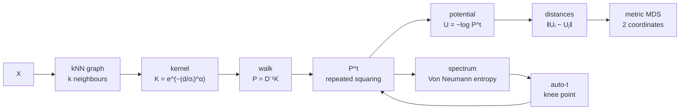

# PHATE

`phate.py` · Manifolds & embeddings · Tier 3 · 3 variants

## Intuition

The atom next door ends with a distance that saturates. A diffusion distance is
the L2 gap between two rows of $P^t$, weighted by the stationary distribution,
and rows of a Markov operator are probability vectors: their entries are small,
they decay geometrically with $t$, and the difference between "very unlikely"
and "impossible" is smaller than the difference between "likely" and "fairly
likely". Two points at opposite ends of a data set end up at a distance that is
mostly a statement about how many modes the walk has, not about where the points
are.

PHATE measures in the exponent instead. Given the diffused operator, define

$$
U = -\log P^t
$$

and use the ordinary Euclidean distance between rows of $U$. The logarithm is
not a smoothing trick; it changes what a distance *means*. Probabilities are
compared multiplicatively, and the log turns a ratio into a difference:

```
   probability     1e-1        1e-3        1e-6        1e-9
   −log p          2.30        6.91       13.82       20.72

   each factor of 1000 is 6.91, wherever it happens on the scale, so the
   small end of the row is stretched until it can compete with the large end
```

That single change is what makes the far field usable. A diffusion distance
between two branches that the walk separates is dominated by the leading modes
and stops growing; a potential distance keeps the whole row in play, so a pair
of rows that differ *anywhere* differ in the potential, and the difference does
not shrink to nothing as $t$ grows. Multiplying $P^t$ by a constant — which is
most of what a longer walk does to a well-mixed operator — is an additive shift
in $U$, and distances ignore additive shifts. That is the sense in which the
picture is robust to $t$ where a diffusion map is not.

The full pipeline, with the three design decisions that separate it from the
atoms around it:



1. **The bandwidth is per point.** $\sigma_i$ is the distance from $i$ to its
   $k$-th neighbour, so $d_{ij}/\sigma_i$ is a distance in units of local
   spacing. The kernel is then density-free by construction, which is the job
   diffusion maps gives to its $\alpha$ normalisation — and it does it without
   an exponent to tune. On the folded sheet below, the kernel exponent itself
   turns out to be inert (0.002 of correlation between $\alpha = 2$ and
   $\alpha = 40$); the bandwidth is the parameter that matters.
2. **The distance is in the exponent.** Section 3 of the derivation shows the
   exact sense in which this stops the far field from collapsing.
3. **The embedding is MDS, not the eigenvectors.** The potential distance is
   not a spectral distance, so there is no reason to believe its eigenvectors
   are its coordinates. Metric MDS on the $n \times n$ distance matrix is the
   published choice, and the variant `potential` shows that it is optional —
   classical MDS gets you most of the way — while `kernel_phate` shows that the
   potential is not.

The measured summary on the folded sheet the chapter uses throughout: PHATE
keeps 0.516 of each point's ten nearest neighbours and correlates 0.770 with the
sheet's own coordinates; the diffusion kernel on the same graph keeps 0.561 and
correlates 0.702; PCA keeps 0.413 and correlates 0.872. The potential buys
global geometry at the price of a little local fidelity, and the trade is
controlled by one number, the exponent in the transform.

## Variants

The three variants are not three algorithms. They are three points in a
two-dimensional design space — the potential exponent and the embedder — chosen
so that each differs from `phate` in exactly one decision.

| variant | potential | embedder | overlap @10 | dist. corr. | stress |
|:--|:--|:--|--:|--:|--:|
| `phate` | $-\log P^t$ | metric MDS | 0.516 | 0.770 | 0.126 |
| `potential` | $-\log P^t$ | classical MDS | 0.502 | 0.783 | 0 |
| `kernel_phate` | none ($\gamma = -1$) | kernel PCA | **0.561** | 0.702 | 0 |

Four hundred points of an S-curve, $k = 5$, $t$ chosen automatically in all
three rows. PCA on the same data scores 0.413 and 0.872. The three rows agree on
the thing that matters — the potential is the source of the global structure —
and disagree on the small print: classical MDS is a *little* better at
distances than metric MDS here, because the potential distance matrix is nearly
Euclidean and stress minimisation then has nothing left to fix. `kernel_phate`
is the honest control. It skips the log entirely, and it keeps the most
neighbours (0.561) and the least global geometry (0.702).

The exponent that separates them is a one-parameter family, and because
`potential_transform` is public the whole family can be measured without adding
variants. The published family is the Box–Cox transform of the operator,

$$
\phi_\gamma(x) = \frac{x^{c}}{c}, \qquad c = \frac{1-\gamma}{2},
\qquad \phi_1(x) = \log x
\qquad (1)$$

with only the distances between rows of $\phi_\gamma(P^t)$ ever used. Sweeping
$\gamma$ on the same sheet at $t = 14$, embedding each by classical MDS:

| $\gamma$ | −1 | −0.5 | 0 | 0.5 | 1 |
|:--|--:|--:|--:|--:|--:|
| potential dist. vs sheet | 0.334 | 0.485 | 0.615 | 0.731 | **0.807** |
| overlap @10 | **0.575** | 0.568 | 0.541 | 0.547 | 0.502 |
| embedding vs sheet | 0.699 | 0.702 | 0.694 | 0.722 | **0.783** |

Monotone in one direction and monotone in the other: as $\gamma$ rises the
geometry gets better and the neighbourhoods get slightly worse. That is the
whole parameter, and it is why the reference implementation exposes `gamma`
between $-1$ and $1$ rather than exposing one potential.

## Derivation

### 1. The graph, with a bandwidth in local units

Edges are the $k$ nearest neighbours, symmetrised. The weight on an edge is

$$
K_{ij} = \exp\!\Big(-\Big(\frac{\lVert \mathbf{x}_i - \mathbf{x}_j \rVert}{\sigma_i}\Big)^{\!\alpha}\Big),
\qquad \sigma_i = \text{distance from } i \text{ to its } k\text{-th neighbour}
\qquad (2)$$

with the kernel symmetrised by taking the larger of $K_{ij}$ and $K_{ji}$. The
scale $\sigma_i$ is what makes the exponent dimensionless, and the exponent is
what makes the kernel a kernel: $\alpha = 2$ is a Gaussian, and $\alpha = 40$ —
the reference default — is within a percent of a hard indicator, because
$0.9^{40} = 0.015$ and $1.1^{40} = 45$.

Two things follow, and only the first is obvious. First, a dense region gets a
narrow kernel and a sparse region a wide one, so $d/\sigma_i$ measures distance
in units of "how far apart points here usually are" and the graph stops encoding
sampling density. That is the same invariance diffusion maps obtains by dividing
by $q^\alpha$, obtained without an exponent to choose — which is why PHATE
dropped its old `alpha_decay` parameter in favour of this kernel.

Second, $\alpha$ barely matters. On the folded sheet, $\alpha = 2$, $10$ and
$40$ give potential-distance correlations of 0.807, 0.806 and 0.807. The reason
is visible in the code: every weight in a neighbourhood is between
$e^{-1} = 0.37$ and $1$, so the row-normalised walk is nearly the unweighted
graph regardless of $\alpha$. What $\alpha$ does change is the *size* of the
neighbourhood, and that is `n_neighbors`.

### 2. The walk

With $d_i = \sum_j K_{ij}$,

$$
P = D^{-1}K, \qquad \pi_i = \frac{d_i}{\sum_j d_j}
\qquad (3)$$

exactly as in diffusion maps: row-stochastic, reversible with respect to $\pi$,
and similar to the symmetric matrix $D^{-1/2} K D^{-1/2}$, so its spectrum is
real and can be computed with `eigh`. Nothing about the potential needs the
eigenvectors, and the variant that does not use them never touches the spectrum
for anything except choosing $t$.

The diffusion operator at time $t$ is the $t$-th power. It is computed by
repeated squaring rather than from the spectrum, because the potential needs
every entry of $P^t$ to full precision: a spectral reconstruction has absolute
error around $10^{-16}$, and entries whose true size is $10^{-14}$ would be
reconstructed as noise — which the logarithm then amplifies.

### 3. Why a diffusion distance saturates

Write the spectral expansion of the diffusion distance:

$$
D_t(i,j)^2 = \sum_{l \ge 1} \lambda_l^{2t}\big(\psi_l(i) - \psi_l(j)\big)^2
\qquad (4)$$

Every term is weighted by $\lambda_l^{2t}$, and the weights fall geometrically.
Whatever the data says about the difference between two far-apart points, that
information lives in the modes with $\lambda_l$ well below the leading one, and
those terms are exactly the ones that die as $t$ grows. The distance does not
grow to reflect a large separation; it shrinks, uniformly. Measured with the
kernel variant on the sheet, the correlation between the embedding's distances
and the truth is 0.697 at $t = 1$, 0.701 at $t = 10$ and 0.717 at $t = 50$ — a
ceiling, not a trend, because the leading two modes are all that is left.

### 4. The potential

Define the potential matrix and the potential distance by

$$
U = -\log P^t, \qquad D_P(i,j) = \big\lVert U_i - U_j \big\rVert_2
\qquad (5)$$

$D_P$ is a genuine metric: it is the Euclidean distance between two rows of a
real matrix, so symmetry, definiteness and the triangle inequality come free.
The demo checks all $512{,}000$ triangle inequalities of an 80-point example and
finds a worst excess of exactly zero.

The mechanism is that $-\log$ is a *monotone concave* map applied entrywise. Two
rows of $P^t$ that differ by a factor of $10^3$ in one coordinate differ by
$\log 10^3 = 6.9$ in the potential regardless of whether the entries are
$10^{-1}$ and $10^{-4}$ or $10^{-6}$ and $10^{-9}$. A diffusion distance is
dominated by the large entries, where a factor of $10^3$ is a large *absolute*
difference; a potential distance is dominated by the ratios, which are the same
everywhere. Since the entries of $P^t$ are the walk's transition probabilities,
the potential distance asks "how much more likely is the walk from $i$ to reach
$k$ than from $j$" and answers in nats.

Its growth with $t$ is the opposite of (3). Measured on the sheet, the
correlation between the potential distance and the truth is

| $t$ | 1 | 2 | 5 | 10 | 25 | 50 |
|:--|--:|--:|--:|--:|--:|--:|
| potential distances | 0.123 | 0.261 | 0.566 | 0.764 | 0.848 | **0.894** |
| PHATE embedding | 0.279 | 0.477 | 0.580 | 0.737 | 0.836 | **0.889** |
| kernel embedding | 0.697 | 0.697 | 0.698 | 0.701 | 0.707 | 0.717 |

Short walks are local, so the potential is local too and the picture is a
smear; long walks let every entry of the row contribute, and the geometry keeps
improving. The kernel starts better and finishes worse, which is the correct
summary of the difference: at $t = 1$ the diffusion distance already sees the
local structure, and it never sees anything else.

### 5. The Box–Cox family

The log is the endpoint of a family, and it is worth knowing what the rest of it
does. Because only distances between rows are used, the transform is defined up
to an affine change, so the natural family is the Box–Cox transform without its
constant:

$$
\phi_\gamma(x) = \frac{x^{c}}{c}, \quad c = \frac{1-\gamma}{2};
\qquad
\lim_{c \to 0} \frac{x^c - 1}{c} = \log x
\qquad (6)$$

The two are the same up to the additive $1/c$, which distances ignore. The
endpoints are the interesting part: $\gamma = -1$ gives $c = 1$ and recovers the
operator itself, whose row distances are diffusion distances; $\gamma = 1$ gives
the log potential; $\gamma = 0$ gives $2\sqrt{P^t}$, the square-root potential
the reference still accepts as `potential_method="sqrt"`. Equation (6) is the
reason the whole family is one line of code rather than three — and the reason
`phate` and `kernel_phate` share a graph.

The demo verifies the limit numerically: with $c = 10^{-6}$, $(x^c-1)/c$ differs
from $\log x$ by at most $1.7 \times 10^{-5}$ over the entries of a random
$P^t$, which is first order in $c$ as the expansion predicts.

### 6. Choosing $t$ from the spectrum

The diffusion time is a scale, and the method wants the smallest one that has
explored enough to be global. The published rule is the knee of the Von Neumann
entropy of the diffused operator, and it has a property that makes it cheap:
treating $\rho_t = P^t / \mathrm{tr}(P^t)$ as a density matrix, its
eigenvalues are $\lambda_l^t / \sum_m \lambda_m^t$, so

$$
H(t) = -\sum_l p_l(t) \log p_l(t), \qquad
p_l(t) = \frac{|\lambda_l|^t}{\sum_m |\lambda_m|^t}
\qquad (7)$$

depends on the spectrum alone. No matrix powers are needed to compute the curve;
one eigendecomposition gives it for every $t$ up to `t_max`. (The absolute value
is there because a kNN-masked kernel has negative eigenvalues, and a density
matrix does not.)

$H(0) = \log n$ exactly, and $H(t) \to 0$ as one mode survives. The demo checks
the first to $10^{-12}$ and checks the curve against twenty matrix powers of $P$
computed independently, to $6.8 \times 10^{-15}$.

The knee is found by rescaling $H(t)$ onto the unit square, drawing the chord
from the first point to the last, and taking the point farthest below it — the
Kneedle rule. The published implementation fits two least-squares lines and
minimises absolute error; on the sheet the two rules agree, and on the
reference's own example curve, $\exp(-t/10)$ over twenty points, both return
$t = 8$ of 20.

### 7. Embedding the potential distances

The potential distance is not a spectral distance, so it has no eigenvectors to
plot. Metric MDS finds coordinates $X$ minimising the normalised stress

$$
\mathrm{stress}(X) = \sqrt{\frac{\sum_{i<j}\big(D_P(i,j) - d_{ij}(X)\big)^2}{\sum_{i<j} D_P(i,j)^2}}
\qquad (8)$$

by iterating the Guttman transform

$$
X \leftarrow \frac{1}{n} B(X) X, \qquad
B_{ij} = -\frac{D_P(i,j)}{d_{ij}}, \qquad
B_{ii} = \sum_{j \ne i} \frac{D_P(i,j)}{d_{ij}}
\qquad (9)$$

Each step is the exact solution of the weighted least-squares problem with the
distances held fixed, so the stress decreases monotonically and there is no
learning rate, no momentum and no epoch count to tune — only an initial
configuration, taken from classical MDS, which double-centres the squared
distances and keeps the top eigenpairs:

$$
B = -\tfrac{1}{2} J D_P^2 J, \qquad J = I - \tfrac{1}{n}\mathbf{1}\mathbf{1}^\top
\qquad (10)$$

On a genuinely Euclidean $D_P$ this is exact: the demo embeds 30 random 3-D
points and recovers their distances to $4.7 \times 10^{-9}$ relative. On a
non-Euclidean $D_P$ it is the closest Euclidean distance matrix in Frobenius
norm, which is why it is a good starting point rather than a solution.

### 8. Where the kernel variant lands

`kernel_phate` skips the potential, so it must embed a kernel rather than a
metric, and kernel PCA is the spectral way to do that: for a kernel $K_t = P^t$
the coordinates are the eigenvectors scaled by the square roots of the
eigenvalues. With $\psi_l = D^{-1/2}v_l$ the right eigenvectors and gains
$\lambda_l^{t/2}$,

$$
\big\lVert \psi_l \lambda_l^{t/2} \big\rVert^2_{\text{diff}}
= \sum_l \lambda_l^{t}\big(\psi_l(i)-\psi_l(j)\big)^2
= D_{t/2}(i,j)^2
\qquad (11)$$

so kernel PCA on the diffusion kernel at time $t$ is a diffusion map at time
$t/2$ — the factor of two is the difference between a kernel, which is squared,
and a distance, which is not. The demo confirms it directly: the kernel variant
at $t = 8$ reproduces the definition of the diffusion distance at $t = 4$, with
the $1/\pi$ weights and all, to $5 \times 10^{-4}$. The residual is not
rounding: a kNN-masked kernel is not positive semidefinite, and kernel PCA
requires one, so the negative eigenvalues are clipped. On that example they
carry $4 \times 10^{-3}$ of the spectral mass at $t = 8$, which is exactly the
size of the gap.

That is also why the variant is worth having. It is the $\gamma = -1$ endpoint
of the family in (1), it needs no MDS, and it is measurably the worst of the
three at global geometry — which is the empirical case for the logarithm.

## Code walkthrough

### 1. The adaptive kernel

```python
    scaled = distances / sigma[:, None]
    kernel = np.where(graph, np.exp(-(scaled ** decay)), 0.0)
    return np.maximum(kernel, kernel.T)
```

Three operations. `sigma[:, None]` broadcasts the per-row bandwidth over the
columns, so `scaled[i, j]` is the distance from `i` to `j` in units of `i`'s own
spacing — the whole point of (2), and the reason no global $\varepsilon$ appears
anywhere in the class. `np.where(graph, ..., 0.0)` restricts the kernel to the
$k$-nearest-neighbour edges; without it the expression is a full Gaussian
kernel and the "graph" is a fiction. The last line symmetrises by maximum, not
by averaging: the weights on the two directions of an edge were computed with
two different bandwidths, and the larger one is the one consistent with "either
endpoint thought this pair was close". Averaging would *shrink* an edge that one
endpoint considered important, which is the wrong direction for a graph.

### 2. The potential, and the floor

```python
    if gamma == 1.0:
        return -np.log(np.maximum(power, 1e-12))
    c = (1.0 - gamma) / 2.0
    return power ** c / c
```

Equation (5), with the log special-cased because it is the limit and not a
member. The `np.maximum` is the one place where a numerical choice leaks into
the geometry. `P^t` can contain exact zeros — a sparse walk at small $t$, or
entries that underflow after enough squaring — and `-log 0` is infinite. The
floor is what turns "impossible" into "very unlikely", and it sets the scale of
the far field: two points whose rows are disjoint at time $t$ are $24.7$ apart in
every coordinate they cannot reach, which is the plateau that makes the far
field finite and puts a ceiling on how much a single pair can differ.

The `else` branch is the rest of the family in one line, and its two constants
are worth reading: `c = 1` at $\gamma = -1$ returns `power` unchanged, and
`c = 0.5` at $\gamma = 0$ returns `2 * sqrt(power)`, which the demo asserts
bit-for-bit.

### 3. The entropy, in log space

```python
    log_weights = t[:, None] * np.log(lam)[None, :]
    log_weights = log_weights - log_weights.max(axis=1, keepdims=True)
    weights = np.exp(log_weights)
    prob = np.maximum(weights / weights.sum(axis=1, keepdims=True), 1e-300)
    return t, -np.sum(prob * np.log(prob), axis=1)
```

Equation (7), computed the only way that survives `t_max = 100`. A direct
`lam ** t / (lam ** t).sum()` underflows at large $t$: at $t = 99$ with
$\lambda = 0.99$ every weight in a row is $0.37$, fine, but with a spectrum that
starts at $0.9$ they are all $10^{-5}$, and one that starts at $0.5$ gives
$10^{-30}$ — and then the ratio is $0/0$, which is `nan`, which silently
poisons the knee and therefore the embedding. Subtracting the row maximum first
makes the largest weight exactly one, so the row always normalises. The
`1e-300` on the next line does the same job for the log: `p * log p` with `p`
underflowed is `0 * -inf`.

### 4. The knee

```python
    xn = (x - x[0]) / span_x
    yn = (y - y[0]) / span_y
    chord = yn[0] + (yn[-1] - yn[0]) * xn
    # A curve below the chord has a knee; a convex curve does not, and then the
    # largest distance is the answer all the same.
    return float(x[int(np.argmax(np.abs(yn - chord)))])
```

Four lines of arithmetic and a comment: rescale both axes to the unit square,
draw the straight line between the endpoints, and return the abscissa of the
point farthest from it. The
rescaling is not cosmetic — without it the answer depends on whether $t$ is
counted in steps or in hundreds of steps — and the absolute value is what makes
the same code work for a curve that lies above its chord as well as below. For
the entropy curve, which is decreasing and convex, the farthest point is where
the decay stops accelerating, which is the scale at which the walk has stopped
finding new modes.

### 5. Classical MDS

```python
    centring = np.eye(n) - 1.0 / n
    gram = -0.5 * centring @ (distances ** 2) @ centring
    values, vectors = np.linalg.eigh(gram)
    order = np.argsort(values)[::-1][:n_components]
    kept = np.maximum(values[order], 0.0)
    return vectors[:, order] * np.sqrt(kept)[None, :]
```

Equation (10), and the reason it is worth writing out: for a Euclidean distance
matrix, $B$ is the Gram matrix of the centred points, so its eigenpairs *are*
the coordinates — this is a two-line proof that classical MDS is exact, and the
demo's $4.7 \times 10^{-9}$ is the numerical confirmation. For a non-Euclidean
$D$, $B$ has negative eigenvalues, and they are where the "closest Euclidean"
part of the claim lives: `np.maximum(..., 0.0)` discards the directions that
cannot be realised in $n_\text{components}$ dimensions rather than taking the
square root of a negative number.

### 6. The Guttman step, damped

```python
        ratio = distances / np.maximum(_pairwise(X), 1e-9)
        transform = -ratio
        np.fill_diagonal(transform, ratio.sum(axis=1))
        step = (transform @ X) / n - X
        alpha = 1.0
        for _ in range(20):
            trial = X + alpha * step
            new_stress = _stress(distances, trial, scale)
            if new_stress < stress:
                break
            alpha *= 0.5
```

Equation (9) in the first four lines, and the rest is the guard that makes it
usable. `ratio` is $D_{ij}/d_{ij}$; negating it and putting the row sums on the
diagonal produces $B$ in (9) without ever forming a diagonal matrix — the row
sum *is* $B_{ii}$. Subtracting `X` turns the transform into a step, so the loop
below can measure it.

The backtracking exists because the Guttman step is only a *descent direction*.
When two embedded points land on top of each other, $D_{ij}/d_{ij}$ is enormous,
the step is enormous, and the undamped iteration throws the configuration across
the plane and back — the classic way a SMACOF implementation diverges on a
non-Euclidean target. Halving the step until the stress actually falls
guarantees a monotone sequence, and since the initial configuration is
classical MDS, the result is never worse than the spectral answer. The demo
reaches a normalised stress of 0.126 on the sheet; the variant `potential` skips
the loop and reports zero by definition.

### 7. The graph and its bandwidths

```python
        graph = _knn_graph(self.distances_, self.n_neighbors)
        self.sigma_ = np.sort(np.where(graph, self.distances_, np.inf), axis=1)[
            :, self.n_neighbors - 1]
        if np.any(self.sigma_ <= 0.0):
            raise ValueError("duplicate points: some point has zero distance to "
                             "its k-th neighbour, so its kernel is a delta")
```

`np.where(graph, distances, inf)` followed by a sort takes the $k$-th smallest
*distances to graph neighbours* — not the $k$-th smallest distance overall,
which after symmetrisation would be the wrong neighbour for points that gained
edges from the other direction. Reading column $k-1$ rather than $k$ is the
off-by-one of the whole file: a point's own distance to itself is not in the
masked matrix, so the $k$-th neighbour is the $(k-1)$-th smallest entry.

The check catches the one degeneracy that the kernel cannot survive. A duplicate
point has $\sigma_i = 0$, and then `scaled` is a division by zero: the kernel
becomes a delta on that row, the walk leaves the point immediately, and the
eigenvectors are dominated by a direction that is an artefact of the duplicate.
It is much better to refuse than to hand back a plot.

### 8. The walk, and the two embeddings

```python
        degree = self.kernel_.sum(axis=1)
        self.transition_ = self.kernel_ / degree[:, None]
        self.stationary_ = degree / degree.sum()
```

Equation (3), unchanged from the atom next door. Then the branch that makes the
variants:

```python
            gains = np.maximum(self.eigenvalues_, 0.0) ** (self.t_ / 2.0)
            coords = (self.eigenvectors_ / np.sqrt(degree)[:, None]) * gains[None, :]
```

This is (11). `eigenvectors_ / sqrt(degree)` is $D^{-1/2}v$, the right
eigenvector of the walk, and the gain is the square root of $\lambda^t$ because
kernel PCA coordinates are square roots. `np.maximum(..., 0.0)` is the clip
discussed above: a fractional power of a negative eigenvalue is `nan`, and this
kernel — a masked Gaussian — always has negative eigenvalues.

```python
            self.potential_ = potential_transform(power, gamma=1.0)
            self.potential_distances_ = _pairwise(self.potential_)
            start = classical_mds(self.potential_distances_, self.n_components)
```

The published path, in three lines: the transform, the $n \times n$ distance
matrix, the spectral starting point. `phate` then refines `start` with SMACOF
and `potential` returns it. Note what is *not* here — no eigenvectors, no
normalisation, no `first` index to skip. The potential distance is a distance
between rows of an $n \times n$ matrix, and every row includes the constant mode
like every other, because the log does not care about the spectral
decomposition at all.

## Complexity

For $n$ points in $m$ dimensions, $k$ neighbours, $t$ diffusion steps and $d$
output dimensions:

| stage | time | memory |
|:--|:--|:--|
| pairwise distances | $O(n^2 m)$ | $O(n^2)$ |
| neighbour mask and bandwidths | $O(n^2)$ | $O(n^2)$ |
| kernel and walk | $O(n^2)$ | $O(n^2)$ |
| spectrum | $O(n^3)$ | $O(n^2)$ |
| $P^t$ by repeated squaring | $O(n^3 \log t)$ | $O(n^2)$ |
| potential distances | $O(n^3)$ | $O(n^2)$ |
| metric MDS | $O(n^2 d)$ per iteration | $O(n^2)$ |

Two cubics, and neither is inherent. The spectrum is only needed to choose $t$
with `t="auto"`; with a fixed $t$ the class never calls `eigh`, and the variant
`kernel_phate` is the only one whose coordinates come from eigenvectors. The
$P^t$ cost is a user choice too: when $t$ is a few steps, repeated squaring is
cheaper than the cubic, and a sparse implementation of the walk would make it
$O(nk \log t)$ — which is how the published version handles $10^5$ cells. The
potential distance matrix is the real wall: $n = 10^5$ would need 80 GB for that
matrix alone, whatever the arithmetic. Measured on the sheet, $k = 5$,
`t="auto"`, best of two:

| $n$ | 200 | 400 | 800 | 1600 |
|:--|--:|--:|--:|--:|
| fit time | 0.011 s | 0.041 s | 0.193 s | 1.08 s |

Ratios of 3.7, 4.7 and 5.6 for a doubling of $n$: the cubic is approached from
below, as it always is when fixed costs and cache behaviour compete with the
asymptote.

## Failure modes

### A folded sheet, and the ceiling of a monotone filter

The S-curve is the chapter's standard hard case, and PHATE does not solve it.
Four hundred points of the sheet, $k = 5$ where the method takes one, two
coordinates, sorted by neighbourhood fidelity:

| method | overlap @10 | distance corr. |
|:--|--:|--:|
| t-SNE, perplexity 30 | **0.874** | **0.980** |
| UMAP, 5 neighbours | 0.685 | 0.586 |
| Isomap, 5 neighbours | 0.547 | 0.930 |
| diffusion map, $k = 5$ | 0.547 | 0.710 |
| PHATE, auto-t = 14 | 0.516 | 0.770 |
| PCA | 0.413 | 0.872 |

Read the last two columns as a trade. PHATE loses 0.031 of overlap to the
diffusion map next door and buys 0.060 of distance correlation for it — the log
is doing exactly what it was introduced to do, and nothing more. Against the
methods that are not functions of the graph's spectrum it loses both columns:
t-SNE and Isomap are not refinements of the walk. The reason is structural: the potential is a
monotone transform of the *same* operator, so it cannot create an ordering the
graph does not have. t-SNE adds repulsion between non-neighbours, which is a
force the walk does not contain; Isomap builds geodesics, which is a long-range
operation the walk does not contain. A monotone filter of a graph can only
choose which of the graph's scales to show.

### Too little diffusion, and the auto-$t$ rule

At $t = 1$ the potential distance correlates 0.123 with the sheet, and the
embedding looks like a smear. Nothing is wrong with the code — $P^1$ is the
graph, its rows are one-hop neighbourhoods, and the log of a sparse row is
mostly the floor. The method needs the walk to have explored before its rows
mean anything global, which is why `t="auto"` exists and why it picked 14 here.

The rule's weakness is that the knee of $H(t)$ is a property of the spectrum,
and a spectrum with many modes near one — the sheet has 0.9996, 0.9968, 0.995,
… — decays slowly and pushes the knee late. On this data late is fine (the
potential at $t = 25$ scores 0.848). On data where the interesting scale is
*shorter* than the knee, the rule will over-smooth, and the honest procedure is
to look at the embedding at a few $t$ and check that the picture is stable —
which it is: the rank correlation between the potential distances at $t = 10$
and $t = 50$ is 0.852, and the embedding's score moves by 0.152 across that
window.

### A disconnected graph

Two clumps of five points a hundred units apart, two neighbours each, $t = 3$:
nothing raises. The unit eigenvalue has multiplicity two, the walk never crosses,
and every cross-clump entry of $P^3$ underflows to the floor. The consequences
are worth stating exactly, because they look like a result: nothing inside a
clump is more than 1.4 from anything else in it, all twenty-five pairs across the
clumps sit between 81.7 and 82.2, and the gap is set by the floor of the log.
MDS will place the two clumps a sensible distance apart and the plot will look
like a finding about the relationship between two populations. The diagnostic is
`eigenvalues_[1]`: if it is one, the graph is disconnected and no picture of the
relative placement of the components means anything.

### Duplicates and near-duplicates

A duplicated point has $\sigma_i = 0$ and the constructor's check raises. A
*nearly* duplicated point is worse, because it passes: $\sigma_i$ is tiny, the
row of the kernel is a spike, and the point's potential row is dominated by one
entry. That is not wrong in the mathematics — the point really is a spike — but
it is a large leverage point in the MDS, and one duplicate pair can bend the
layout. Deduplicate before fitting, or accept that the two copies will sit on
top of each other.

### The floor, and how far the far field can reach

The $10^{-12}$ in `potential_transform` is a choice, and it is the one parameter
the doc has not argued for. Entries below it are indistinguishable, so every
pair of points whose rows are disjoint at time $t$ is at the same potential
distance — the plateau in the classified-clumps example above. A smaller floor
(like the reference's $10^{-7}$ on a row-stochastic operator) moves the plateau
down and keeps more of the tail in play; a larger one compresses the far field
sooner. It does not change the local structure, which is why the method is not
sensitive to it in the regime where it works, and it does change whether two
disconnected components look far apart or merely separate.

### Choosing the exponent instead of the bandwidth

Since $\alpha$ is inert (0.002 of correlation between 2 and 40) and
`n_neighbors` is not, tuning $\alpha$ is a way to spend an afternoon learning
nothing. The neighbourhood size is the resolution of the graph:

| $k$ | 3 | 5 | 10 | 20 |
|:--|--:|--:|--:|--:|
| overlap @10 | **0.596** | 0.516 | 0.402 | 0.402 |
| distance corr. | 0.657 | 0.770 | 0.944 | **0.972** |

Small $k$ keeps neighbourhoods and loses distances; large $k$ keeps distances
and blurs the plot into a few global modes. The default 5 is the reference's
choice for single-cell data, where the local structure is the point; for a
continuous manifold with a million points, 20 is not unreasonable.

## Applications

- **Single-cell developmental trajectories.** The motivating use. A
  differentiation experiment is a tree of cell states with a small number of
  branches, and the picture you want shows the branches joined at their
  progenitors rather than as separate islands. The potential makes the branches
  comparable in distance to the trunk, which a diffusion distance does not.
- **Any Markov chain.** Nothing in (5) needs the matrix to have come from
  points. Given a transition matrix over states — a random walk on a graph, a
  Markov state model of a protein, a user-flow model — the potential distance is
  a metric on states, computed with one matrix power and one log.
- **Choosing a scale from the spectrum.** The Von Neumann entropy rule in (7) is
  the cheapest part of the method to reuse: any diffusion time in any method
  downstream of a graph can be chosen by the knee of $H(t)$ without running the
  embedding at each candidate.
- **Manifold learning for downstream models.** A two- or three-coordinate PHATE
  embedding is a feature map that preserves branching, and it is used as an
  input to clustering and trajectory inference where t-SNE's clumping would
  destroy the topology. It is deterministic given the data, unlike t-SNE.
- **Denoising and imputation.** The same operator powers MAGIC, which replaces
  each cell's expression with its diffused value — a different downstream use of
  $P^t$, and a reminder that the operation is a general smoothing of functions
  on the graph.

## References

- K. R. Moon, D. van Dijk, Z. Wang, S. Gigante, D. B. Burkhardt, W. S. Chen,
  K. Yim, A. van den Elzen, M. J. Hirn, R. R. Coifman, N. B. Ivanova, G. Wolf
  and S. Krishnaswamy, *Visualizing structure and transitions in
  high-dimensional biological data*, Nature Biotechnology 37:1482–1492 (2019).
  The method, the potential, the entropy rule and the biology.
- K. R. Moon, J. S. Stanley, D. Burkhardt, D. van Dijk, G. Wolf and
  S. Krishnaswamy, *Manifold learning-based methods for analyzing single-cell
  RNA-sequencing data*, Current Opinion in Systems Biology 7:36–46 (2018). The
  comparison with t-SNE, diffusion maps and Isomap that motivates the potential.
- R. R. Coifman and S. Lafon, *Diffusion maps*, Applied and Computational
  Harmonic Analysis 21(1):5–30 (2006). The operator, the stationary measure and
  the diffusion distance that (4) writes out.
- R. R. Coifman and M. J. Hirn, *Diffusion maps for changing data*, Applied and
  Computational Harmonic Analysis 36(1):89–116 (2014). The multiscale and
  anisotropic analysis of the same operator, including the resolvent that the
  `diffusion_potential` variant of the neighbouring atom uses.
- D. van Dijk, R. Sharma, J. Nainys, K. Yim, P. Kathail, A. J. Carr, C. Burdziak,
  K. R. Moon, C. L. Chaffer, D. Pattabiraman, B. Bierie, L. Mazutis, G. Wolf,
  S. Krishnaswamy and D. Pe'er, *Recovering gene interactions from single-cell
  data using data diffusion*, Cell 174(3):716–729 (2018). MAGIC, the same
  operator used to denoise rather than to embed.
- L. Haghverdi, M. Büttner and F. J. Theis, *Diffusion pseudotime robustly
  reconstructs lineage branching*, Nature Methods 13:845–848 (2016). The
  branching-trajectory problem in the form PHATE was designed to draw.
- I. Borg and P. J. F. Groenen, *Modern Multidimensional Scaling: Theory and
  Applications*, 2nd edition, Springer (2005). Stress, the Guttman transform and
  the classical solution, i.e. equations (8)–(10).
- V. Satopaa, J. Albrecht, D. Irwin and B. Raghavan, *Finding a "kneedle" in a
  haystack: detecting knee points in system behavior*, ICDCS (2011). The knee
  rule used for `t="auto"`.
- J. B. Tenenbaum, V. de Silva and J. C. Langford, *A global geometric framework
  for nonlinear dimensionality reduction*, Science 290(5500):2319–2323 (2000).
  Isomap, the comparison that shows what a long-range operation buys and a
  monotone filter does not.
- L. van der Maaten and G. Hinton, *Visualizing data using t-SNE*, Journal of
  Machine Learning Research 9:2579–2605 (2008). The repulsion term that no
  function of one graph's spectrum can reproduce.
