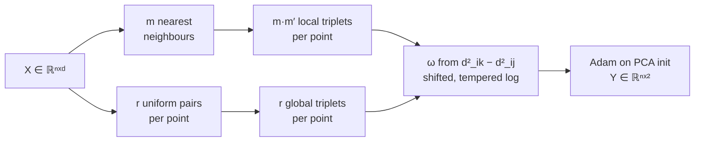

# TriMap

`trimap.py` · Manifolds & embeddings · Tier 3 · 3 variants

## Intuition

t-SNE and UMAP ask the embedding to reproduce *similarities*. TriMap asks it to
reproduce an *ordering*. The difference sounds small and is not, because a
similarity carries a magnitude and an ordering does not:

```
      x:  0 ──────── 1 ──────────────────── 4

      triplet (i, j, k) = (0, 1, 4)      "0 is closer to 1 than to 4"

      ideal  y = (0, 1, 4)   ω = 6   ℓ = 0.632
      wrong  y = (0, 4, 1)   ω = 6   ℓ = 5.368
```

Both embeddings place the three points at exactly the same distances. Only the
labelling differs, and only one of them respects the claim in the data. A method
that matched distance matrices would have to decide how far apart to put these
three points; a method that matches orderings does not, which is exactly the
freedom that keeps the shape of a manifold when it cannot keep its scale.

The second half of the idea is where the triplets come from, and it is where
TriMap differs from the triplet-embedding literature. In t-STE the triplets are
given by people ("I think A is more similar to B than to C"). Here they are
sampled from the data, locally and globally:



Every point `i` contributes `m·m′` triplets whose near point `j` is one of its
`m` nearest neighbours and whose far point `k` is drawn uniformly from
*everything farther from `i` than `j` is*; plus `r` triplets where both `j` and
`k` are drawn uniformly from the whole data set and then ordered by distance.
The default budget is 51 triplets per point — twelve neighbours, four draws
each, three random pairs — so 15 300 for 300 points. The cost per iteration is
linear in that count and therefore linear in `n`.

What the two kinds buy, measured on the S-curve in the demo:

| method | neighbourhood overlap @10 | @40 | distance corr. | global score |
|:--|--:|--:|--:|--:|
| TriMap (51 triplets/point) | 0.774 | 0.813 | 0.895 | 0.638 |
| t-SNE, perplexity 30 | **0.865** | **0.867** | **0.987** | 0.257 |
| UMAP, 10 neighbours | 0.803 | 0.771 | 0.705 | 0.097 |
| PCA, two components | 0.539 | 0.761 | 0.860 | **1.000** |

300 points on a sheet folded twice in three dimensions. Local accuracy is
nearest-neighbour overlap with the sheet's own parameters; global accuracy is
the paper's score, $1$ for PCA by construction. Both baselines are this
chapter's own t-SNE and UMAP, so the comparison is like for like rather than
against another library's defaults: t-SNE wins the neighbourhoods and comes last
but one globally, UMAP gives up both, and TriMap keeps three quarters of the
neighbourhoods *and* two thirds of the global structure. Written as a trade:
$+0.235$ overlap over PCA for $-0.362$ global score, while t-SNE takes
$+0.326$ overlap for $-0.743$.

That is the whole method. The rest of this document is the details of the
weights, the gradient, and the ways the trade can go wrong.

## Variants

| variant | near point `j` | far point `k` | triplets | overlap @10 | 1-NN accuracy | global score |
|:--|:--|:--|--:|--:|--:|--:|
| `trimap` | one of `m` NN | uniform, farther than `j` | 15 300 | 0.774 | 91.7% | 0.638 |
| `supervised` | same class | another class | 14 400 | — | **100.0%** | 0.407 |
| `knn` | one of `m` NN | inside the 2-hop ring | 14 400 | 0.553 | 67.0% | 0.002 |

The overlap and global-score columns are the S-curve; the accuracy column is
five overlapping Gaussian clusters in eight dimensions, where the accuracy is
one-nearest-neighbour voting in the embedding. Every number is printed by the
demo.

`trimap` is the paper's method: local triplets fix each neighbourhood, uniform
pairs fix where the neighbourhoods sit relative to each other. `supervised`
replaces the sampler, not the loss: `j` is drawn from the same label and `k`
from a different one, at the same budget of $m\cdot m'$ triplets per point. It
does exactly what it is asked — perfect cluster separation — and pays for it in
global score, because a triplet that says "same class" says nothing about where
the class belongs. `knn` is the controlled ablation: both `j` and `k` are
restricted to the two-hop neighbourhood $\bigcup_{j \in \mathrm{NN}(i)}
\mathrm{NN}(j)$, so every triplet is a ranking *within* one neighbourhood. It
keeps the fewest neighbours of all and its global score is zero to three
decimals — a crumpled embedding — and the demo proves the optimiser is not at
fault by scoring the good embedding on the `knn` variant's own triplets
(11 649 against the crumple's 7 806). The objective prefers the crumple. The
global pairs are not a refinement of the local ones; they are the only thing
carrying global information.

A fourth knob deserves its own row in a table like this, because it is the one
that trades the two columns against each other. Growing the neighbourhood:

| `n_neighbors` (m) | triplets | overlap @10 | distance corr. | global score |
|--:|--:|--:|--:|--:|
| 6 | 8 100 | 0.780 | 0.797 | 0.614 |
| 12 | 15 300 | 0.774 | 0.895 | 0.638 |
| 24 | 29 700 | 0.712 | 0.963 | 0.478 |
| 48 | 58 500 | 0.704 | 0.982 | 0.297 |

Larger `m` makes every triplet more *local* in relative terms — the far point is
compared against a slightly less near point — so the embedding optimises
distance correlation and loses the global score. The default is not a sweet spot
for every dataset; it is the paper's choice after exactly this experiment on
MNIST.

## Derivation

### 1. Similarity and loss

Let $d_{ij} = \lVert \mathbf{y}_i - \mathbf{y}_j \rVert$ in the embedding and
use the Student-t similarity that t-SNE also uses:

$$
s(\mathbf{y}_i, \mathbf{y}_j) = \frac{1}{1 + \lVert \mathbf{y}_i - \mathbf{y}_j \rVert^2}
\qquad (1)$$

The loss for a triplet is the weighted probability that the order is *wrong*:

$$
\ell_{ijk} = \omega_{ijk}\,\frac{s(\mathbf{y}_i, \mathbf{y}_k)}{s(\mathbf{y}_i, \mathbf{y}_j) + s(\mathbf{y}_i, \mathbf{y}_k)}
\qquad (2)$$

Substituting $a = s_{ij} = (1+d_{ij}^2)^{-1}$ and $b = s_{ik} = (1+d_{ik}^2)^{-1}$,
the fraction is $b/(a+b)$, which is one minus a two-way softmax over the logits
$\log a$ and $\log b$:

$$
\ell_{ijk} = \omega_{ijk}\Big(1 - \frac{a}{a+b}\Big),
\qquad
\frac{a}{a+b} = \frac{1 + d_{ik}^2}{2 + d_{ij}^2 + d_{ik}^2}
\qquad (3)$$

Equation (3) is worth reading twice, because it explains both what the method
can and cannot do. At zero scale, $d_{ij}^2 = d_{ik}^2 = 0$ and the probability
is $1/2$: a collapsed embedding is indifferent to every triplet. Along a ray
$\mathbf{y} \mapsto s\mathbf{y}$ with $s \to \infty$ the probability tends to
$d_{ik}^2/(d_{ij}^2 + d_{ik}^2)$, so only the *ratio* of squared distances
survives. In between, for a correctly ordered triplet ($d_{ij} < d_{ik}$) the
loss is monotonically decreasing in $s$: inflating the embedding always helps,
and nothing in the objective pulls back. The failure-modes section measures the
consequence.

### 2. Weights

A triplet is not a yes/no fact. "0 is closer to 1 than to 4" is a weaker claim
than "0 is closer to 1 than to 40", and the weight says so:

$$
\tilde{\omega}_{ijk} = d_{ik}^2 - d_{ij}^2 \ge 0,
\qquad
d_{ij}^2 = \frac{\lVert \mathbf{x}_i - \mathbf{x}_j \rVert^2}{\sigma_i \sigma_j}
\qquad (4)$$

The scaling is Zelnik-Manor and Perona's self-tuning factor, with

$$
\sigma_i = \frac{1}{3}\sum_{r=4}^{6} d\big(\mathbf{x}_i, \mathbf{x}_{(r)}\big)
\qquad (5)$$

the mean distance to the 4th, 5th and 6th nearest neighbours — far enough out to
ignore duplicates, near enough to describe the local density. Its effect is
measured: on 250 points packed in a ball of radius 0.05 plus 50 points spread
over radius 3, $\sigma_i$ ranges over a factor of 372, and replacing it by the
global mean drops the dense cluster's share of the total weight from 79% to 56%
and the effective sample size from 11 731 of 15 300 to 2 720. Without the
normalisation a handful of triplets in the sparse tail carry the gradient.

Raw weights still span two orders of magnitude, so they are shifted and passed
through a tempered logarithm:

$$
\omega_{ijk} = \log_t\!\big(1 + \tilde{\omega}_{ijk} - \omega_{\min}\big),
\qquad
\log_t(u) = \frac{u^{1-t} - 1}{1-t}
\qquad (6)$$

with $t = 1/2$, where $\log_{1/2}(u) = 2(\sqrt{u} - 1)$ is exactly concave in
$\tilde{\omega}$. Concavity is the point: a squared distance difference grows
quadratically, its square root grows linearly, and the heaviest triplets stop
dominating. Measured on the S-curve, the top-to-median weight ratio falls from
7.6 to 3.0, the effective sample size rises from 8 953 to 12 376 of 15 300, and
the heaviest tenth of the constraints carries 20% of the weight instead of 29%.
The plain logarithm ($t = 1$) is flatter still — 95% effective sample size — and
the paper's $t = 1/2$ sits deliberately between the raw weights and full
flattening.

### 3. The gradient

Write $\mathbf{u} = \mathbf{y}_i - \mathbf{y}_j$ and
$\mathbf{v} = \mathbf{y}_i - \mathbf{y}_k$, so that $a = (1+\mathbf{u}\cdot\mathbf{u})^{-1}$
and $b = (1+\mathbf{v}\cdot\mathbf{v})^{-1}$. From $a'(\mathbf{u}) = -2a^2\mathbf{u}$
and $b'(\mathbf{v}) = -2b^2\mathbf{v}$,

$$
\frac{\partial \ell}{\partial a} = -\frac{\omega b}{(a+b)^2},
\qquad
\frac{\partial \ell}{\partial b} = \frac{\omega a}{(a+b)^2}
\qquad (7)$$

and the chain rule gives three forces, one per role:

$$
\frac{\partial \ell}{\partial \mathbf{y}_i}
= \frac{2\omega ab}{(a+b)^2}\,(a\,\mathbf{u} - b\,\mathbf{v}),
\qquad
\frac{\partial \ell}{\partial \mathbf{y}_j}
= -\frac{2\omega a^2 b}{(a+b)^2}\,\mathbf{u},
\qquad
\frac{\partial \ell}{\partial \mathbf{y}_k}
= \frac{2\omega a b^2}{(a+b)^2}\,\mathbf{v}
\qquad (8)$$

The three sum to zero identically:

$$
\frac{\partial \ell}{\partial \mathbf{y}_i} +
\frac{\partial \ell}{\partial \mathbf{y}_j} +
\frac{\partial \ell}{\partial \mathbf{y}_k} = \mathbf{0}
\qquad (9)$$

because the loss depends only on the two difference vectors. Equation (9) is not
a curiosity: it is translation invariance, and it means the gradient scatter has
the same structure as a graph Laplacian — every triplet pushes and pulls three
vertices with zero net force. The demo checks (8) against central differences to
$1.1 \times 10^{-9}$ and (9) to $6 \times 10^{-17}$, and it checks the direction
that matters: with $\omega = 6$ the correctly ordered line $0, 1, 4$ costs
0.6316 and the swapped one costs 5.3684. The same line inflated four-fold costs
0.3723, sixteen-fold 0.3542, monotonically toward the limit
$6/17 = 0.3529$ of equation (3) — the loss has nothing to say about scale, and
the demo asserts the monotonicity rather than describing it.

### 4. The sampling budget

Each of the `m` neighbours contributes `m′` far points, and each point adds `r`
uniform pairs, so

$$
|\mathcal{T}| = (m\,m' + r)\,n = (12\cdot4 + 3)\,n = 51\,n
\qquad (10)$$
The gradient is a sum of $|\mathcal{T}|$ vector terms scattered onto $n$ rows,
which is $O(|\mathcal{T}| d)$ per iteration — linear in $n$ for fixed
hyperparameters. Nothing in the optimisation is quadratic; only the neighbour
search and, in this implementation, the distance matrix are.

### 5. The global score

The paper needs a number for "kept the global structure", and defines it against
PCA. With $\mathbf{X} \in \mathbb{R}^{n \times m}$ centred and
$\mathbf{Y} \in \mathbb{R}^{n \times d}$ centred, the best *linear* reconstruction
of the data from the embedding is

$$
\mathcal{E}(\mathbf{Y} \mid \mathbf{X}) = \min_{\mathbf{A}} \lVert \mathbf{X} - \mathbf{Y}\mathbf{A}^{\top} \rVert_F^2,
\qquad
\mathbf{A}^{*} = \mathbf{X}^{\top}\mathbf{Y}\,(\mathbf{Y}^{\top}\mathbf{Y})^{-1}
\qquad (11)$$

which is ordinary least squares applied to every feature at once. PCA minimises
the same quantity over all rank-$d$ embeddings, so its residual $\mathcal{E}_{\text{PCA}}$
is the floor, and the score is a ratio in log space:

$$
\mathrm{GS}(\mathbf{Y} \mid \mathbf{X})
= \exp\!\Big(-\frac{\mathcal{E}(\mathbf{Y} \mid \mathbf{X}) - \mathcal{E}_{\text{PCA}}}{\mathcal{E}_{\text{PCA}}}\Big) \in [0, 1]
\qquad (12)$$

PCA scores 1, an embedding twice as bad scores $e^{-1} \approx 0.37$, and the
score treats rotations and scalings of $\mathbf{Y}$ as free because $\mathbf{A}^{*}$
absorbs them. That is the right invariance for a *global* measure and a warning
about its limits: it assumes a linear map can connect the two spaces, so it
under-rewards embeddings that unfold a manifold PCA cannot.

### 6. Optimisation

The paper initialises at scaled PCA and runs 400 full-batch steps with
momentum and delta-bar-delta. This implementation keeps the initialisation —

$$
\mathbf{Y}_0 = \frac{\mathbf{U}_{:,:d}\,\mathbf{S}_{:d}}{\mathrm{rms}(\mathbf{Y})},
\qquad (13)$$

the top principal components rescaled to unit root-mean-square — and swaps the
optimiser for Adam, which needs no gain heuristic:

$$
\mathbf{Y} \leftarrow \mathbf{Y} - \eta\,
\frac{\hat{\mathbf{m}}_t}{\sqrt{\hat{\mathbf{v}}_t} + \epsilon}
\qquad (14)$$

The initialisation is not cosmetic, but it is not required either: the paper
reports that random initialisation also works, and contrasts this with t-SNE,
which "does not converge well with any initial solution other than small random
initialization around the origin". What PCA buys is speed and a head start on the
global layout — at the PCA start 3.1% of the sampled triplets are violated, so
the optimiser only has to fix those orderings rather than discover the layout
from a ball of noise. After 400 steps 1.8% are still violated.

## Code walkthrough

### 1. Distances without a subtraction

```python
def _pairwise(A: np.ndarray, B: np.ndarray | None = None) -> np.ndarray:
    B = A if B is None else B
    sa = np.einsum("ij,ij->i", A, A)
    sb = np.einsum("ij,ij->i", B, B)
    return np.sqrt(np.maximum(sa[:, None] + sb[None, :] - 2.0 * (A @ B.T), 0.0))
```

The identity $\lVert a-b \rVert^2 = \lVert a \rVert^2 + \lVert b \rVert^2 - 2a\cdot b$
turns the pairwise distances into one matrix product plus two vectors, which is
what BLAS is good at. The `np.maximum(..., 0.0)` is not defensive padding: for
near-duplicate rows the identity can return a tiny negative number, and a
square root of that is `nan` that spreads through every downstream sum.

### 2. The self-tuning scale

```python
    scale = D[np.arange(D.shape[0])[:, None], neighbours[:, 3:6]].mean(axis=1)
    return np.maximum(scale, 1e-10)
```

`neighbours[:, 3:6]` is the 4th to 6th nearest neighbour — Python's zero-based
slice of the paper's 4-to-6 — and the fancy index picks, for every row, that
row's own three distances. One expression, no loop, and it is (5). The floor
at $10^{-10}$ is what stops a dataset with exact duplicates from producing a
zero scale and a division by zero two lines later.

### 3. Three samplers in one loop

```python
        for j in neighbours[i]:
            candidates = (ring[i] if variant == "knn"
                          else np.flatnonzero(D[i] > D[i, j]))
            if candidates.size == 0:
                continue
            k = candidates[rng.integers(candidates.size, size=n_triplets)]
```

`np.flatnonzero(D[i] > D[i, j])` is the literal definition of the far set: every
point strictly farther from `i` than `j` is. Drawing `n_triplets` of them with
replacement is the paper's m′. The `knn` variant swaps that candidate set for
the two-hop ring, computed once per row outside the loop, and that single
substitution is the entire difference between a working method and the crumpled
one in the Variants table. Note that `j` is iterated in neighbour order, so the
draw is not uniform over pairs — the near neighbours are always represented,
which is deliberate: a uniform draw over the same set would give a very
different weight distribution.

### 4. The global pairs

```python
            for _ in range(n_random):
                j, k = rng.choice(n, size=2, replace=False)
                if D[i, k] < D[i, j]:
                    j, k = k, j
```

Two indices without replacement, then one comparison to put the nearer one in
the `j` slot. `replace=False` matters: with replacement the two indices could
coincide, the triplet would be `(i, j, j)` and its weight exactly zero, wasting
a slot. The swap is what makes the pair a triplet at all — the ordering comes
from the distances, not from the sampling order.

### 5. Shift and compress

```python
    weights = np.concatenate(w_parts)
    weights = weights - weights.min()
    weights = _tempered_log(1.0 + weights, 0.5)
    return triplets, weights
```

Two lines implement (6), and their order is the whole specification. The shift
makes the minimum weight exactly zero, which keeps every weight non-negative —
a negative weight would mean "this ordering is wrong", and that is what the loss
is for. The `1.0 +` inside the logarithm is what makes the smallest weight zero
rather than $-\infty$. The tempered log then compresses: at $t = 1/2$ it is
$2(\sqrt{u}-1)$, so a weight that was 16 becomes 6 and one that was 1 becomes
0.83 — the ratio 16:1 becomes 6:0.83.

### 6. The tempered logarithm

```python
    if abs(t - 1.0) < 1e-6:
        return np.log(x)
    return (np.power(x, 1.0 - t) - 1.0) / (1.0 - t)
```

The branch is the $t \to 1$ limit, and it needs the epsilon because the
expression is $0/0$ there: L'Hôpital gives $\log x$. Writing the limit as a
branch instead of computing it symbolically is the standard numerical answer, and
the tolerance is $10^{-6}$ so that a caller passing $t = 1 + 10^{-9}$ gets the
stable form. For $t = 1/2$ the `np.power` is a square root, which is why the
weights land on the scale of a distance difference rather than its square.

### 7. Loss and gradient in one pass

```python
    a = 1.0 / (1.0 + np.einsum("ij,ij->i", yi - yj, yi - yj))
    b = 1.0 / (1.0 + np.einsum("ij,ij->i", yi - yk, yi - yk))
    loss = float(np.sum(weights * b / (a + b)))
```

`yi - yj` is an `(T, d)` array of difference vectors and `einsum("ij,ij->i", ...)`
takes their row-wise squared norms, so $a$ and $b$ are `(T,)` — no loop over
triplets anywhere. `b / (a + b)` is (2) and the sum is the objective of the
paper. The gradients reuse the same quantities:

```python
    denom = (a + b) ** 2
    coef = 2.0 * weights * a * b / denom
    g_i = coef[:, None] * (a[:, None] * (yi - yj) - b[:, None] * (yi - yk))
    g_j = -2.0 * (weights * a * a * b / denom)[:, None] * (yi - yj)
    g_k = 2.0 * (weights * a * b * b / denom)[:, None] * (yi - yk)
```

These are (8) term by term, with `coef` the common factor
$2\omega ab/(a+b)^2$. Since all three are computed from the same `(T,)` arrays,
one pass over the triplets produces the whole gradient; the cost is set by the
memory for three `(T, d)` arrays, not by arithmetic.

### 8. Scattering with duplicates

```python
    grad = np.zeros_like(Y)
    np.add.at(grad, i, g_i)
    np.add.at(grad, j, g_j)
    np.add.at(grad, k, g_k)
    return loss, grad / len(triplets)
```

`np.add.at` is the unbuffered scatter-add, and it is required here rather than
plain fancy indexing: one point appears in hundreds of triplets, and
`grad[i] += g_i` with repeated indices would keep only the last write. It is
also the slowest line in the whole method, because it runs in Python-level loops
inside NumPy — which is the reason the reference implementation uses Numba. The
division by the triplet count makes the gradient an average rather than a sum;
Adam is invariant to that constant, so it only affects the size of the epsilon.

### 9. PCA initialisation

```python
        centred = X - X.mean(axis=0)
        left, spectrum, _ = np.linalg.svd(centred, full_matrices=False)
        Y = left[:, :self.n_components] * spectrum[:self.n_components]
        Y = Y / np.sqrt(np.mean(np.einsum("ij,ij->i", Y, Y)))
```

The first three lines are PCA written as an SVD of the centred data — no
covariance matrix, no eigendecomposition, better conditioning — and the fourth is
(13): divide by the root-mean-square radius so the initial embedding has unit
scale regardless of the data's units. That normalisation is the only thing
anchoring the scale at all, and the optimiser is free to undo it within a few
steps.

### 10. Adam, four lines

```python
            first = 0.9 * first + 0.1 * grad
            second = 0.999 * second + 0.001 * grad * grad
            m_hat = first / (1.0 - 0.9**step)
            v_hat = second / (1.0 - 0.999**step)
            Y = Y - self.learning_rate * m_hat / (np.sqrt(v_hat) + 1e-8)
```

The bias correction uses `step` starting at 1, which is the only fiddly part of
Adam: at `step = 1`, `1 - 0.9**1 = 0.1` exactly cancels the `0.1` in the
accumulator, so the first step is a normalised gradient step of length
`learning_rate`. The gradient itself is divided by the triplet count, so
`learning_rate` is per-triplet-mean and comparable across dataset sizes — the
demo's 0.1 gives an embedding of radius 9.4 on the S-curve.

## Complexity

With $n$ points, $d$ embedding dimensions, $m$ neighbours, and
$T = (mm' + r)n$ triplets:

| stage | time | memory |
|:--|:--|:--|
| pairwise distances, this implementation | $O(n^2 d)$ | $O(n^2)$ |
| neighbour selection (`argsort` of each row) | $O(n^2 \log n)$ | $O(nm)$ |
| triplet sampling | $O(T)$ | $O(T)$ |
| one gradient step | $O(Td)$ | $O(Td + nd)$ |
| 400 steps | $O(Tdn)$ | — |

Measured on the S-curve, per iteration and end to end:

| n | triplets | per iteration | 400 iterations |
|--:|--:|--:|--:|
| 100 | 5 100 | 0.96 ms | 0.38 s |
| 300 | 15 300 | 2.79 ms | 1.12 s |
| 600 | 30 600 | 5.59 ms | 2.24 s |
| 1200 | 61 200 | 11.46 ms | 4.58 s |

Both columns scale linearly in `n` to within the noise of a laptop, which is the
claim worth checking: the optimisation is linear because the triplet budget is
proportional to `n`, not to $n^2$, and the gradient never touches a pair that
was not sampled. The quadratic part is entirely in the two rows this
implementation cannot avoid. The paper's version uses an approximate
nearest-neighbour index (Annoy, then PyNNDescent) so that neither the distance
matrix nor the full sort exists, with memory $O(nm + T)$; that is what carries
it to the 11 million points in the HIGGS benchmark. Here, `n = 1200` already
allocates a 11.5 MB distance matrix, and `n = 100 000` would need 80 GB — the
method scales, the file does not.

## Failure modes

### The local-only objective prefers the wrong embedding

This is the one worth internalising. Restrict `k` to the two-hop ring and the
loss still decreases nicely — 14 400 triplets, loss falling every iteration —
while the embedding crumples: overlap 0.553 against 0.774, distance correlation
0.055 against 0.895, global score 0.002 against 0.638. It is not a bug and not a
bad local minimum. Scored on its *own* triplets the crumple is strictly better
than the good embedding (7 806 against 11 649), because every triplet it was
given is a claim about relative order *inside* a neighbourhood, and squashing
neighbourhoods flat satisfies all of them. Any triplet method is only as global
as its far points.

### The loss has no scale anchor

The derivation showed that for a correctly ordered triplet the loss decreases
monotonically with the embedding's overall scale, and 98% of triplets are
correctly ordered at convergence. Nothing in (2) counteracts it, so the radius
is set by the learning rate and the iteration count rather than by the data:

| learning rate | final radius | overlap @10 | global score |
|--:|--:|--:|--:|
| 0.02 | 4.72 | 0.731 | 0.561 |
| 0.05 | 7.04 | 0.762 | 0.521 |
| 0.10 | 9.40 | 0.774 | 0.638 |
| 0.20 | 12.61 | 0.783 | 0.651 |
| 0.50 | 18.29 | 0.788 | 0.583 |

Read the last row as the failure: the neighbourhoods get *better* (0.788 is the
best in the table) while the global score falls, because the far points are being
pushed to a scale where equation (3) has saturated and the loss is nearly
indifferent to them. The default 0.1 is not tuned to this dataset; it is a
middle value that keeps the radius near the PCA initialisation's.

### The model is a sample

Two fits with different seeds produce different triplets, different losses and
embeddings that are not comparable without alignment. On the S-curve the global
score ranges from 0.476 (seed 2) to 0.669 (seed 3) at otherwise identical
settings, and the seed with the *lowest* loss (seed 0, 6 926) is not the seed
with the best geometry. The loss is a mean over sampled constraints; the global
score is a property of the data. Optimising the first does not guarantee the
second, and the gap between them is sampling variance that no number of
iterations removes.

### Neighbour count and degeneracies

`m` must be at least 6, because the self-tuning scale reads the 4th to 6th
neighbours; the constructor raises rather than silently using a different
scale. `m` must also be smaller than `n`, and a dataset of 6 points or fewer
cannot be embedded at all. Pushing `m` up is the other way to lose the global
structure — 48 neighbours gives a global score of 0.297 against 0.638 — for the
reason in the Variants section: every triplet becomes local.

### The global score is a linear measure

Equation (12) assumes a linear map rebuilds `X` from `Y`. On data with strong
non-linear structure the score is small for *every* method, including good
embeddings, and the paper says so in its appendix. The score also cannot see a
single displaced outlier: one point moving to the wrong cluster changes the
residual by $O(1)$ in a sum of $n$ terms. Use it to compare methods on the same
data, not as an absolute quality claim, and pair it with a neighbourhood measure
as the demo does.

## Applications

- **Single-cell transcriptomes.** The motivating use case: atlases of 50 000 to
  a million cells, where the question is not only "which cells are similar" but
  "where does this cluster sit relative to the others". The Tabula Muris
  benchmark in the paper is exactly this, and TriMap's advantage there is
  preserving the outlier populations that t-SNE folds into the main mass.
- **Large image and text embeddings.** MNIST, Fashion-MNIST, CIFAR feature
  layers, TF-IDF of 360 000 song lyrics. The linear-in-`n` iteration cost and the
  approximate-neighbour search are what make the million-point end of that list
  possible.
- **Diagnosing a representation.** The paper's CIFAR experiment embeds the first
  two fully-connected layers of a trained network and reads the class hierarchy
  off the picture: animal versus vehicle at the top, then deer/horse and cat/dog
  inside. A method that only preserved neighbourhoods would show ten blobs and
  no hierarchy; the hierarchy is the global placement, which is the thing being
  measured.
- **Semi-supervised embedding.** The `supervised` variant is the cheap version of
  this: when labels exist for some points, use them to choose triplets. It
  sharpens clusters at the cost of global geometry, which is the right trade when
  the plot is being used to check a classifier rather than to explore.
- **Ordinal data.** The loss (2) is the same one t-STE uses for human triplet
  judgements. TriMap's contribution is the sampler and the weights, not the
  loss, so it can be pointed at any source of "A is more like B than C" —
  similarity judgements, click logs, ranked retrieval results.

## References

- E. Amid and M. K. Warmuth, *TriMap: Large-scale Dimensionality Reduction Using
  Triplets*, arXiv:1910.00204 (2019, revised 2022). The source for the loss,
  the weight scheme, the global score and every benchmark quoted above.
- The reference implementation, `eamid/trimap` on GitHub, and the JAX rewrite at
  `google/trimap`. Both were read for this file: the gradient in
  `trimap_grad`, the violation counter, and the `n_inliers × n_outliers` sampling
  budget come from there.
- L. van der Maaten and G. Hinton, *Visualizing Data using t-SNE*, JMLR 9 (2008).
  The Student-t similarity in (1), and the local-accuracy opponent in the
  Variants table.
- L. McInnes, J. Healy and J. Melville, *UMAP: Uniform Manifold Approximation
  and Projection*, arXiv:1802.03426 (2018). The other opponent, and the source of
  the fuzzy-set view of neighbourhoods that TriMap deliberately does not take.
- L. Zelnik-Manor and P. Perona, *Self-Tuning Spectral Clustering*, NeurIPS
  (2005). The $\sigma_i$ of equation (5).
- J. Naudts, *Deformed exponentials and logarithms in generalized
  thermostatistics*, Physica A 316 (2002). The tempered logarithm of (6).
- L. van der Maaten and K. Weinberger, *Stochastic Triplet Embedding*, MLSP
  (2012). The triplet loss as a likelihood, and the reason TriMap's sampler is
  the interesting part.
- J. Tang, J. Liu, M. Zhang and Q. Mei, *LargeVis*, WWW (2016). The
  neighbour-graph-first pipeline that TriMap's neighbour search shares.
