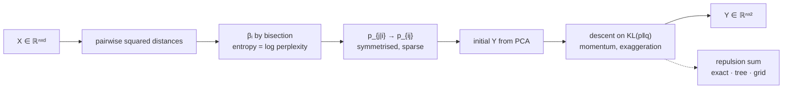

# t-SNE

`tsne.py` · Manifolds & embeddings · Tier 1 · 5 variants

## Intuition

t-SNE is the answer to one question: what should a two-dimensional picture of
high-dimensional data preserve?

Not distances. A neighbourhood of 30 points around a sample in 500 dimensions
cannot be drawn as 30 points at their original distances — the volume that fits
30 neighbours in 500 dimensions has a radius that maps to a circle far larger
than the canvas. Preserving distances is impossible; the interesting content,
which points are near which, is not.

```
   high-dimensional neighbourhood              the layout
        ·  ·                                    ·   ·
     ·   x   ·         →                   ·    x    ·
        ·  ·                                    ·   ·
   radius r, 30 points                    radius r', 30 points
   (distances 0.7 … 3.1)                  (whatever fits)
```

So the method throws the distances away and keeps the **probabilities**. Each
point gets a Gaussian around it, with the width chosen so that the Gaussian holds
a fixed number of neighbours — that is the perplexity. The pair probabilities
$p_{ij}$ say how likely $i$ and $j$ are to be neighbours. The layout is then
scored by how well its own pair probabilities $q_{ij}$ match them, and the
matching is done by gradient descent on a KL divergence.

What $q$ is matters as much as what $p$ is. In the layout, the affinities are
a Student-$t$ kernel $(1 + \lVert y_i - y_j \rVert^2)^{-1}$, whose tail is heavy
enough that a point can push a moderately distant cluster away without dragging
its own neighbours along. That choice is the *t* in t-SNE, and it is the fix for
the crowding problem: in two dimensions the available area grows too slowly to
hold a high-dimensional neighbourhood, and a Gaussian $q$ would rather collapse
everything than leave a neighbour out.



The demo measures both halves of the claim on 250 points from a swiss roll, which
is exactly isometric to a flat rectangle. The leading two principal components
keep $0.489$ of each point's eight true nearest neighbours; t-SNE keeps $0.857$.
And its distance correlation with the rectangle the roll unrolls to is $0.335$,
where Isomap — in this same chapter — reaches $0.9996$. It keeps what it was
asked to keep, and nothing else.

## Variants

| Variant | The repulsion sum | What changes | Cost per iteration |
|:--|:--|:--|:--|
| `exact` | all $n^2$ pairs | the reference | one $n \times n$ product |
| `barnes_hut` | quadtree cells | $\theta$ trades accuracy for terms | $O(n\log n)$ terms |
| `fft` | convolution on a grid | `grid_size` sets resolution | $O(G^2\log G)$, any $n$ |
| `multiscale` | exact | averages the input affinities over perplexities | one extra affinity pass |
| `parametric` | exact, then distilled | a network replaces the $n$ free points | training only |

**`exact`** is the 2008 paper as published: every pair contributes to every
force, and the cost is quadratic in the samples. At 250 points this is not a
problem — a fit of 600 iterations takes about $0.2$ s, and the dense kernel is
already in cache, so one matrix product against it beats gathering the $nk$
nonzeros. It is the reference every approximation is measured against, and it is
what `multiscale` and `parametric` run internally.

**`barnes_hut`** (van der Maaten 2013) groups distant points into quadtree cells
and uses one term per cell. A cell is accepted when its side is below $\theta$
times the distance to the query point; the error in the force is then
$O(\theta^2)$ relative. The demo measures it on a fixed layout: $\theta = 0$
reproduces the exact force to $1.0 \times 10^{-14}$, and the normaliser to
$5.8 \times 10^{-16}$ — the traversal carries no bookkeeping error at all.
$\theta = 0.25$ gives $0.013$ force error at $25814$ terms, $\theta = 0.5$ gives
$0.052$ at $13343$, and $\theta = 1.0$ gives $0.210$ at $5882$, against $62250$
pairs. The term count is the point: $0.214$ of the pairs at 250 points, and
$0.341$, $0.140$, $0.049$ at $n = 200, 800, 3200$. That is an asymptotic win and
not a constant-factor one — this numpy traversal is *slower* than one BLAS matrix
product until a few thousand points, which is why the demo's $\theta = 0.5$ fit
costs more than the exact fit it is compared to.

**`fft`** (Linderman et al. 2019, FIt-SNE) turns the same sum into a convolution.
Deposit the points on a grid, convolve with the kernel and its two first moments,
read the field back — the convolution is evaluated by FFT at every lag at once,
so the cost depends on the grid and not on the sample size. The demo holds one
layout fixed and sweeps the grid: relative force error $0.2594$ at $32^2$,
$0.0752$ at $64^2$, $0.0213$ at $128^2$, $0.0051$ at $256^2$. Each doubling buys
a factor of four, which is the bilinear deposit's second order.

**`multiscale`** (the multi-scale extension in the FIt-SNE paper) changes the
*input* rather than the sum: average the conditional affinities over several
perplexities, so one run carries coarse and fine neighbourhoods at once. On the
roll it scores $0.840$/$0.761$ at eight and forty neighbours against the single
perplexity $30$'s $0.857$/$0.769$ — $98.7\%$ and $99.0\%$ of the best scale in
the mixture, without knowing which scale that is. It is a hedge, not an
improvement.

**`parametric`** replaces the $n$ free coordinates with a function of the input.
Fit the exact layout as a teacher, then regress it through a small network; new
points are placed by evaluating the network. The demo's network reproduces the
training layout at $0.988$ eight-neighbour overlap and puts $0.900$ of the
held-out points nearest their own cluster. The baseline it has to beat is duller
and better: a 10-neighbour average of the fitted coordinates scores $1.000$ on
the same held-out points. On a curved sheet both drop — $0.428$ for the network
against $0.477$ for the neighbour average — and the ordering does not change.

## Derivation

Write the input as $X = (x_1, \dots, x_n) \subset \mathbb{R}^d$ and the layout as
$Y = (y_1, \dots, y_n) \subset \mathbb{R}^2$.

### 1. A Gaussian neighbourhood per point

Each point gets its own bandwidth $\sigma_i$, and the *conditional* affinity of
$j$ to $i$ is

$$
p_{j|i} \;=\; \frac{\exp\!\left(-\lVert x_i - x_j \rVert^2 / 2\sigma_i^2\right)}
{\sum_{k \neq i} \exp\!\left(-\lVert x_i - x_k \rVert^2 / 2\sigma_i^2\right)},
\qquad p_{i|i} = 0. \qquad (1)$$

A single bandwidth for all points would be wrong on data of uneven density:
in a dense region the Gaussian would hold hundreds of neighbours, in a sparse one
it would hold none, and the layout would be dominated by the dense region.
Per-point bandwidths make the neighbourhood size a constant.

### 2. Perplexity as an entropy target

The natural measure of "how many neighbours the Gaussian holds" is its entropy,

$$
H(P_i) \;=\; -\sum_j p_{j|i} \log p_{j|i}, \qquad (2)$$

and t-SNE fixes it at $\log \kappa$ for a parameter $\kappa$, the perplexity:

$$
\mathrm{Perp}(P_i) \;=\; 2^{H(P_i)} \;=\; \kappa. \qquad (3)$$

So a perplexity of 30 means the conditional distribution has the entropy of a
uniform distribution over 30 points. The width is not a distance — it adapts to
the local density, which is the whole point.

### 3. Solving for the bandwidth

Let $\beta_i = 1/2\sigma_i^2$ and $d_{ij} = \lVert x_i - x_j\rVert^2$. The
entropy is monotone *decreasing* in $\beta_i$ — a narrower Gaussian is more
peaked, so its entropy is smaller — which makes one-dimensional root finding
enough. In the form the code uses, with $Z_i(\beta) = \sum_{j \neq i} e^{-\beta d_{ij}}$,

$$
H_i(\beta) \;=\; \log Z_i(\beta) + \beta\,\frac{\sum_{j \neq i} d_{ij} e^{-\beta d_{ij}}}{Z_i(\beta)}, \qquad (4)$$

and bisection on $\beta$ drives $H_i$ to $\log \kappa$. Every point's bracket is
independent, so the whole search is a vector of 64 iterations over the matrix
rather than $n$ scalar searches. Sixty-four steps is far more than needed; the
demo's first assertion is that the resulting conditional rows sum to one, and the
iteration reaches machine precision in about thirty.

Two numerical details, each of which produced a wrong answer first. `exp(-inf)`
is zero and harmless, but `inf * 0` is `nan` — so the diagonal must be *zero*
distance before the exponential, not infinite distance. And the distances are
shifted per row so the nearest neighbour sits at zero: `exp(-β d)` underflows for
any reasonable $\beta$ on unnormalised data, and the shift leaves $Z_i$ and $H_i$
unchanged because it cancels between the numerator and the normaliser.

### 4. Symmetrisation and sparsity

The joint distribution is the symmetrised conditional,

$$
p_{ij} \;=\; \frac{p_{j|i} + p_{i|j}}{2n}, \qquad (5)$$

which sums to one over ordered pairs. The $1/2n$ is not cosmetic: it puts $P$ and
$Q$ on the same total mass, without which the KL below is minimised by shrinking
the layout.

The matrix is *almost* empty. At perplexity 30 a row has about 30 terms that
matter, and the remaining 220 are smaller by hundreds of orders of magnitude. The
code truncates each row to its $3\kappa$ largest terms and renormalises. This is
not an approximation at the level of the objective; it is what makes the
attraction sum $O(n\kappa)$ instead of $O(n^2)$, and it is measurably better than
the alternative. Flooring every entry of the dense matrix at $10^{-12}$ — the
obvious way to keep $\log q$ finite — makes the matrix dense again, and a
400-point fit then takes $6.0$ s instead of $0.6$ s. The floor belongs on the
support: $p_{ij}$ is raised to $10^{-12}$ only where it was already positive.

### 5. The layout kernel

In the layout the affinities are

$$
q_{ij} \;=\; \frac{(1 + \lVert y_i - y_j \rVert^2)^{-1}}{\sum_{k \neq l}(1 + \lVert y_k - y_l \rVert^2)^{-1}}, \qquad (6)$$

a Student-$t$ with one degree of freedom. The tail matters. Suppose a point is
surrounded by 30 neighbours that the map cannot fit at their true relative
distances; with a Gaussian $q$ the cheapest way to raise $q$ for the 29 near ones
is to pull *all* of them in, which collapses the cluster to a point. The heavy
tail makes a moderately distant point cheap to leave out, so the arrangement that
minimises the divergence is a spread-out cluster with its neighbourhood intact.
This is the formal version of the crowding argument in the introduction.

### 6. The objective

$$
\mathrm{KL}(P \,\|\, Q) \;=\; \sum_{i \neq j} p_{ij} \log \frac{p_{ij}}{q_{ij}}
\;=\; \sum_{i \neq j} p_{ij} \log p_{ij} - \sum_{i \neq j} p_{ij} \log q_{ij}. \qquad (7)$$

The first term does not depend on $Y$, so minimising the KL is maximising
$\sum p_{ij} \log q_{ij}$. The KL is asymmetric on purpose: a small $p_{ij}$ with
a large $q_{ij}$ costs almost nothing, but a large $p_{ij}$ with a small $q_{ij}$
costs a lot. Nearby points in the input are *pulled* together; distant points are
only weakly pushed apart. That is the local/global asymmetry of the method in one
line.

### 7. The gradient

With $w_{ij} = (1 + \lVert y_i - y_j\rVert^2)^{-1}$ and
$Z = \sum_{k \neq l} w_{kl}$, the derivative of (7) with respect to $y_i$ is

$$
\frac{\partial \mathrm{KL}}{\partial y_i}
\;=\; 4 \sum_j (p_{ij} - q_{ij})\, w_{ij}\, (y_i - y_j). \qquad (8)$$

That form is correct and is not the form the code computes, because it needs $q$
— a full matrix — every iteration. Expanding $q = w/Z$ splits it into two sums
that the approximations can each evaluate without the matrix:

$$
\frac{\partial \mathrm{KL}}{\partial y_i}
\;=\; 4\left[ \underbrace{\sum_j p_{ij} w_{ij} (y_i - y_j)}_{A_i}
\;-\; \frac{1}{Z}\underbrace{\sum_j w_{ij}^2 (y_i - y_j)}_{F_i} \right]. \qquad (9)$$

$A_i$ is a product against the sparse $P$ — $O(n\kappa)$. $F_i$ and $Z$ are the
repulsion, and they are what the three variants approximate. The descent step is
$-\partial \mathrm{KL}/\partial y_i$, so the return value is $-4(A - F/Z)$.

Two facts about (9) are load-bearing and both were wrong in the first version of
this file.

$Z$ is a sum over **ordered** pairs, $\sum_{k \neq l}$, matching $P$, which sums
to one over ordered pairs. The unordered sum $\tfrac{1}{2}\sum w$ is half of it,
and using it doubles the repulsion. A doubled repulsion pushes the layout past
the scale where the kernel has any structure: the run expands, the forces
balance at a huge scale, everything freezes, and the eight-neighbour overlap
reads $0.43$ where it should read $0.86$.

The $1/Z$ sits on the repulsion term alone. Moving it onto both terms is a
globally rescaled gradient — the same direction, invisible in the mathematics,
and fatal in the code, because the learning rate and the momentum schedule are
fixed numbers rather than derived quantities. The demo checks (9) against a
central difference of (7), and that check is the only reason either bug was
found.

### 8. The optimiser

Three schedule details, none of which is in the objective:

* **Early exaggeration.** For the first quarter of the run, $p_{ij}$ is
  multiplied by 12. This multiplies the attraction, so each point pulls its
  neighbours into a tight clump and the clumps find their large-scale arrangement
  while the repulsion is weak. Releasing the factor then spreads each clump to
  its final size. Without it the layout converges to a single blurry blob on
  many datasets.
* **Momentum.** $0.5$ rising to $0.8$ at the same moment. A layout that is still
  repositioning clusters should not carry that velocity into the fine phase.
* **Learning rate.** $n/12/4$ with a floor of 50 — the scheme from the
  scikit-learn implementation, which is chosen so the step size scales with
  the number of terms in the gradient rather than with the data's units.

The classic per-parameter gains rule from the original paper is *not* used, and
the reason is worth recording. Gains compare the sign of the update with the sign
of the previous update, scale by $1.2$ or $0.8$, and need a guard against
runaway growth. The version that compares against the *displacement* — which
looks equivalent — collapses every gain to its floor and freezes the layout. The
version that compares against the previous *gradient* works. Without a guard at
all, a doubling of the same direction every iteration reaches $1.9 \times 10^{10}$
and sends the layout to a scale of $10^9$.

The initial layout is the leading two principal components, scaled to unit
deviation. It is a convenience and not a load-bearing choice, which is easy to
get wrong: with (9) right, a unit-scale random start, a $10^{-4}$ random start
and the principal components all reach the same place (eight-neighbour overlap
$0.841$, $0.837$, $0.857$). Initialisation only *looked* decisive while the
normalisation was wrong, because a wrong objective has a different equilibrium
scale and the run then spends its exaggeration phase travelling to it.

### 9. Barnes–Hut

For the repulsion, a cell containing a cloud of points at centre $c$ and total
mass $m$ acts as one body at $c$, provided the query point is far enough away:

$$
\frac{2h}{r} \;<\; \theta, \qquad (10)$$

where $h$ is the cell's half-width and $r$ the distance from the query point to
its centre. The neglected multipoles are the cell's internal spread, so the error
is second order in the ratio: $O(\theta^2)$ relative. Two guards are needed
beyond (10): a cell containing the query point is never accepted (it stands in
for a cloud that includes the query, and its self-interaction would be counted),
and a leaf is accepted only when it is not the query point itself.

The tree is built by sorting points into quadrants level by level. Points that
are equal to the last bit of a float would split forever, so a node at the depth
cap becomes one body at its points' mean — the right answer, since those points
are indistinguishable to every other point.

### 10. FFT

Write the repulsion as a sum over a density. If $\rho(c)$ is the number of
points deposited in cell $c$, then at cell $c$ the field is

$$
\phi_c \;=\; \sum_{c'} \rho_{c'}\, k(c - c'),
\qquad k(\delta) \;=\; \frac{1}{1 + \lVert \delta \rVert^2}, \qquad (11)$$

and the two force components use $k^2 \delta_x$ and $k^2 \delta_y$ as kernels.
A convolution of this shape is one multiplication in Fourier space, and the FFT
evaluates it at all lags for the price of a transform of the grid,

$$
\phi \;=\; \mathcal{F}^{-1}\!\left( \mathcal{F}(\rho)\, \mathcal{F}(k) \right). \qquad (12)$$

Three implementation facts. The kernel must be `ifftshift`ed so that zero lag
sits at index zero, or the field is rotated by half a grid. The transform is
padded to $2G - 1$ so the linear convolution is not aliased into a circular one.
And each point's own contribution must be removed: it is $\approx 1$ at zero
distance but the deposit spreads it over four cells, so the correct subtraction
is the analytically computed bilinear interpolation of $k$ at the point's own
sub-cell offsets, not a flat $-1$. The flat version leaves a bias of order
$1/(1+r^2)$ that does not shrink as the grid is refined.

The accuracy is governed by how many cells fit inside one kernel width, and the
kernel's unit length is the layout's own scale. t-SNE's layout grows with $n$
(the early phase spreads the points to make room), so a *fixed* grid becomes
relatively coarser on larger data. The cost is bounded by the grid; the accuracy
is not.

### 11. Multiscale

Average the conditional distributions before symmetrising:

$$
p_{j|i} \;=\; \frac{1}{|\mathcal{K}|} \sum_{\kappa \in \mathcal{K}} p^{(\kappa)}_{j|i}. \qquad (13)$$

The mixture is itself a valid conditional distribution — an average of
distributions is one — so the rest of the algorithm is unchanged. Averaging in
probability space rather than concatenating neighbourhoods is what keeps the
perplexity meaningful; averaging the *distances* instead would not correspond to
any kernel.

### 12. Parametric

Replace $y_i$ by $f_\theta(x_i)$ with

$$
f_\theta(x) \;=\; W_2 \tanh(W_1 x + b_1) + b_2, \qquad (14)$$

fit $f_\theta(x_i) \approx y_i^{\text{teacher}}$ by least squares and then Adam.
The teacher is the exact layout; the network's job is to be a smooth function
that passes near it. This is distillation, not dimensionality reduction, and the
KL the class reports afterwards is the *teacher's* layout measured against $P$ —
which is the honest description. Fine-tuning the network directly on the KL,
which is the obvious alternative, collapses it: Adam's step is scale-blind, and
a KL gradient through a net is large in the wrong direction long before it is
useful.

### 13. What is identified

$Y$ is identified up to rotation, reflection and translation — the objective
depends only on pairwise distances in the layout. Scale is fixed by the kernel's
unit length, weakly: the KL does determine a preferred scale, since shrinking
raises all $q$ and growing lowers them, but the optimum is flat and the
exaggeration phase picks the starting scale for the search. Nothing else is
identified. Cluster shapes, relative cluster areas, and the distances between
clusters are artefacts of the optimisation, not properties of the data.

## Code walkthrough

`TSNE(n_components=2, *, variant="exact", perplexity=30.0, n_iter=1000,
learning_rate=None, exaggeration=12.0, theta=0.5, grid_size=128,
perplexities=(10.0, 30.0), hidden=64, seed=0)` with `fit(X)`,
`fit_transform(X)`, and `transform(X_new)` for `parametric` only. Attributes:
`embedding_`, `kl_initial_`, `kl_divergence_`, `history_`, `interactions_`
(repulsion terms in the last iteration), and `teacher_` for `parametric`.

`X` is a `(samples, features)` point cloud; unlike `MDS` the method needs the
points, because the affinities are built from them.

### 1. Bisection for the bandwidth

```python
    target = np.log(perplexity)
    beta = 1.0 / np.median(off, axis=1)
    lo = np.zeros(n)
    hi = np.full(n, np.inf)
    for _ in range(n_iter):
        P = np.exp(-beta[:, None] * d2)
        P[eye] = 0.0
        s = P.sum(axis=1)
        entropy = np.log(s) + beta * (d2 * P).sum(axis=1) / s
        too_flat = entropy > target                  # needs a larger beta
        lo = np.where(too_flat, beta, lo)
        hi = np.where(too_flat, hi, beta)
        beta = np.where(np.isfinite(hi), 0.5 * (lo + hi),
                        np.minimum(2.0 * beta, 1e6))
```

(4), for all points at once. The bracket is stored as two vectors, `lo` and `hi`,
and each point's update reads only its own entries — so the search is 64
iterations of matrix work rather than $n$ independent scalar loops. Points whose
upper bracket is still infinite are still doubling; the rest have switched to
bisection. `beta = 2 * beta` is the exponential search that gets a finite upper
bracket in the first place.

### 2. Symmetrisation and truncation

```python
    idx = np.argpartition(-P, k, axis=1)[:, :k]
    keep = np.zeros_like(P)
    np.put_along_axis(keep, idx, 1.0, axis=1)
    P = P * keep
    P = P / P.sum(axis=1, keepdims=True)
    J = (P + P.T) / (2.0 * n)
    np.fill_diagonal(J, 0.0)
    support = J > 0.0
    J[support] = np.maximum(J[support], 1e-12)    # floor the KL's log q
    return J / J.sum()
```

(5), preceded by the truncation to $3\kappa$ terms per row. `argpartition` finds
the threshold in $O(n)$ per row; the mask and the renormalisation keep each
conditional row a distribution, so the symmetrisation still produces a joint one.
The floor is applied only on the support — `J > 0` — and the final division
undoes the mass the floor added.

### 3. The exact repulsion, in three matrix products

```python
    d2 = np.maximum(sq[:, None] + sq[None, :] - 2.0 * Y @ Y.T, 0.0)
    np.fill_diagonal(d2, np.inf)                     # (1 + inf)^-1 = 0, exactly
    w = 1.0 / (1.0 + d2)
    w2 = w * w
    phi = w2.sum(axis=1)
    f = np.stack([Y[:, 0] * phi - w2 @ Y[:, 0],
                  Y[:, 1] * phi - w2 @ Y[:, 1]], axis=1)
    return f, float(w.sum()), w, n * (n - 1)
```

$F_i = \sum_j w_{ij}^2 (y_i - y_j)$ is $y_i \sum_j w_{ij}^2$ minus
$\sum_j w_{ij}^2 y_j$: a row sum and a matrix product, no broadcast of the
$(n,n,2)$ difference. The diagonal is set to infinite distance rather than zero
so that $(1 + d^2)^{-1}$ is exactly zero there — the self-term drops out without
a mask. The returned `w` is handed back to the gradient rather than recomputed,
which is why the exact path costs one kernel and not two.

### 4. The gradient

```python
    if w is not None:
        pw = P * w * exaggeration
        attraction = np.stack([Y[:, 0] * pw.sum(axis=1) - pw @ Y[:, 0],
                               Y[:, 1] * pw.sum(axis=1) - pw @ Y[:, 1]], axis=1)
    else:
        diff = Y[rows] - Y[cols]
        pair_w = 1.0 / (1.0 + np.einsum("ij,ij->i", diff, diff))
        pw = vals * pair_w * exaggeration
        total = np.bincount(rows, weights=pw, minlength=n)
        ax = np.bincount(rows, weights=pw * Y[cols, 0], minlength=n)
        ay = np.bincount(rows, weights=pw * Y[cols, 1], minlength=n)
        attraction = np.stack([Y[:, 0] * total - ax,
                               Y[:, 1] * total - ay], axis=1)
    return -4.0 * (attraction - f / max(z, EPS))
```

Two paths, same formula. When the repulsion already built the dense kernel, the
attraction is one product against `P * w`; when it did not (Barnes–Hut, FFT), the
attraction is gathered over the $nk$ nonzeros with a `bincount`, which is
$O(n\kappa)$ and does not materialise the dense matrix. `exaggeration` multiplies
the attraction only — applying it to both terms would rescale the gradient rather
than reweight the objective. The final `-4(A - F/Z)` is the descent direction.

### 5. The quadtree, one level at a time

```python
            idx = order[start:stop]
            cx, cy = com[node]
            h = half[node] * 0.5
            quad = (Y[idx, 0] > cx).astype(np.int64) * 2 + (Y[idx, 1] > cy)
            perm = np.argsort(quad, kind="stable")
            order[start:stop] = idx[perm]
            cuts = np.searchsorted(quad[perm], np.arange(5))
```

Each node's points are a contiguous slice of one `order` array, so the level is
handled by sorting the slice by quadrant number and splitting it at four
`searchsorted` positions. The bits are assigned $2 \cdot [x > c_x] + [y > c_y]$,
consistent with the child offsets in the next lines. The cost of one level is one
`argsort` over the points in that level; the obvious implementation,
`np.flatnonzero(assign == node)` per node, scans all $n$ points once per node and
turns the "sub-quadratic" method into an $O(n^2)$ one.

The first version of this function also had the two quadrant bits swapped between
the comparison and the child's centre, which builds a tree whose cells do not
contain their points. It is invisible at $\theta = 0$ — leaves are still leaves —
and only shows up as a force error that does not shrink with $\theta$.

### 6. The acceptance test

```python
    while pi.size:
        dx = Y[pi, 0] - com[pc, 0]
        dy = Y[pi, 1] - com[pc, 1]
        r2 = dx * dx + dy * dy
        single = leaf[pc] >= 0
        accept = single | (2.0 * half[pc] / np.sqrt(np.maximum(r2, EPS)) < theta)
        inside = ~single & (np.abs(dx) <= half[pc]) & (np.abs(dy) <= half[pc])
        accept = accept & ~(single & (leaf[pc] == pi)) & ~inside
```

(10), evaluated for every live (query, node) pair at once. `pi` and `pc` are the
parallel arrays of query indices and current nodes; accepted pairs are folded
into `f` and `Z` with `bincount`, rejected pairs are expanded to their four
children and pushed into the next round. The traversal is a level-order walk of
the tree for all $n$ queries simultaneously, which is why there is no Python loop
over points.

`inside` is the guard that a cell containing the query point is never accepted;
the `leaf[pc] == pi` term is the self-interaction. Both are needed: the first
catches interior nodes, the second catches the leaf that holds the query itself.

### 7. The FFT kernel and padding

```python
    size = 2 * grid_size - 1
    lag = np.arange(-(grid_size - 1), grid_size)
    dx = lag[:, None] * h
    dy = lag[None, :] * h
    k0 = 1.0 / (1.0 + dx * dx + dy * dy)
    kernel = np.fft.ifftshift(
        np.stack([k0, k0 * k0 * dx, k0 * k0 * dy]), axes=(1, 2))
    spectrum = np.fft.rfft2(charge, s=(size, size))
    field = np.fft.irfft2(
        spectrum[None, :, :] * np.fft.rfft2(kernel, s=(size, size)),
        s=(size, size))
    field = field[:, :grid_size, :grid_size]
```

(11)–(12) for three kernels in one transform. `ifftshift` moves the zero lag from
the centre of the `lag` grid to index zero, which is what `rfft2` assumes.
`size = 2G - 1` is the exact linear convolution length: anything smaller wraps
the far field around into the near field. The three kernels travel as a stacked
axis so one `rfft2` call handles them. The crop back to `grid_size` drops the
half of the padded domain that cannot contain a source.

### 8. Removing the self-term

```python
    for di, dj, weight in taps:
        ox = (di - fu) * h
        oy = (dj - fv) * h
        k = 1.0 / (1.0 + ox * ox + oy * oy)
        own_phi += weight * k
        own_x += weight * k * k * ox
        own_y += weight * k * k * oy
    phi = phi - own_phi
    return (np.stack([fx - own_x, fy - own_y], axis=1), float(phi.sum()),
            None, grid_size * grid_size)
```

The point contributed to four cells with weights `taps`, and the field it reads
back is the *interpolated* sum of those four cells' convolutions. Its own
contribution is therefore the same four cells convolved with the kernel and
interpolated back — evaluated here in closed form, with `ox, oy` the offset from
the point to each tap in world units. Subtracting a flat $1$ instead leaves a
bias of order the deposit's spread, which does not vanish as the grid is refined;
this is the difference between the $0.005$ error at $256^2$ and no convergence at
all.

### 9. The parametric readout

```python
        A = np.tanh(Xs @ self.W1.T + self.b1)
        self.W2 = np.linalg.lstsq(A, Y, rcond=None)[0].T
        self.b2 = Y.mean(axis=0)
        params = [self.W1, self.b1, self.W2, self.b2]
        m = [np.zeros_like(p) for p in params]
        v = [np.zeros_like(p) for p in params]
        for step in range(steps):
            A = np.tanh(Xs @ self.W1.T + self.b1)
            residual = 2.0 * (A @ self.W2.T + self.b2 - Y) / n
            dA = (residual @ self.W2) * (1.0 - A * A)
            grads = [dA.T @ Xs, dA.sum(axis=0), residual.T @ A,
                     residual.sum(axis=0)]
```

The readout is solved, not trained: with `W1` random, `tanh(W1 x)` is already a
rich feature map, and the best linear function of it is one `lstsq`. Adam then
moves the features themselves, with the gradient of the last layer obtained by
backpropagating the residual. `1 - A * A` is the tanh derivative; the `2/n`
is the derivative of the mean squared error. The whole fit is deterministic for
a given `seed`, since the only random draw is the initial `W1`.

### 10. The loop

```python
        lr = (self.learning_rate if self.learning_rate is not None
              else max(n / self.exaggeration / 4.0, 50.0))
        release = max(1, self.n_iter // 4)
        update = np.zeros_like(Y)
        sample = max(1, self.n_iter // 10)
        self.history_ = [_kl_divergence(P, Y)]
        for it in range(self.n_iter):
            f, z, w, self.interactions_ = self._repulsion(Y)
            g = _gradient(P, rows, cols, vals, Y, f, z, w,
                          self.exaggeration if it < release else 1.0)
            update = (0.5 if it < release else 0.8) * update + lr * g
            Y = Y + update
            if (it + 1) % sample == 0:
                self.history_.append(_kl_divergence(P, Y))
```

The whole optimiser. `release` is the single moment where exaggeration drops and
momentum rises — they are coupled in the classic schedule and separating them
makes the layout worse. The KL is sampled ten times through the run for
`history_`, and computed once more at the end for `kl_divergence_`, which is the
value measured against the *final* embedding rather than the last sample.

## Complexity

$n$ samples, $d$ input dimensions, $\kappa$ perplexity, $T$ iterations, $G$ grid
size, $h$ hidden width.

| Operation | Time | Memory | Note |
|:--|:--|:--|:--|
| pairwise distances | $O(n^2d)$ | $O(n^2)$ | Gram identity, no $(n,n,d)$ array |
| bandwidth search | $O(n^2 \cdot 64)$ | $O(n^2)$ | vectorised bisection, fixed 64 steps |
| symmetrise + truncate | $O(n^2 + n\kappa)$ | $O(n^2)$ | `argpartition` per row |
| exact attraction | $O(n\kappa + n^2)$ | $O(n^2)$ | product against the dense kernel |
| exact repulsion | $O(n^2)$ | $O(n^2)$ | three matrix products |
| Barnes–Hut repulsion | $O(n\log n)$ terms | $O(n)$ | $\theta$-dependent constant |
| quadtree build | $O(n\log n)$ | $O(n)$ | one `argsort` per level |
| FFT repulsion | $O(G^2\log G)$ | $O(G^2)$ | independent of $n$ |
| multiscale affinity | $O(|\mathcal{K}| n^2)$ | $O(n^2)$ | one $\beta$ search per scale |
| parametric readout | $O(nh^2 + h^3)$ | $O(nh)$ | one `lstsq` plus Adam |
| full demo | — | — | 12 fits, 5.5 s |

The first three rows are the fixed cost, quadratic in $n$, and they are why t-SNE
is a visualisation method and not a preprocessing step: a million points needs
$10^{12}$ distance entries before the optimiser runs. The usual answer is not a
faster kernel but a sample — fit on a subset and place the rest with
`transform`, or with an out-of-sample extension.

The repulsion rows are the ones the variants change. `exact` is $O(n^2)$ per
iteration; `barnes_hut` has $O(n\log n)$ *expected* terms but a Python-level
constant that makes it slower than one BLAS product below a few thousand points
— measured term counts are $0.341$, $0.140$ and $0.049$ of all pairs at
$n = 200, 800, 3200$, so the crossover is where $n\log n \cdot c_{\text{tree}}$
falls below $n^2 \cdot c_{\text{BLAS}}$. `fft` is the one that is genuinely
independent of the data size, at the price of a fixed resolution.

Memory is $O(n^2)$ for the exact variants and for the affinities, and that — not
time — is the binding constraint. Barnes–Hut still needs the full $P$ matrix for
the attraction in this implementation (the truncation keeps it sparse in
principle but not in storage), which is the paper's own compromise.

## Failure modes

**1. Double-counting the repulsion.** The normaliser in (9) is
$\sum_{i \neq j} w_{ij}$ over ordered pairs. Using the symmetric-half
$\tfrac{1}{2}\sum w$ halves $Z$, doubles the effective repulsion, and changes the
answer qualitatively: the layout expands to a scale where the kernel is flat, the
gradient vanishes, and the eight-neighbour overlap on the demo's roll reads
$0.43$ instead of $0.86$. Diagnosis is by finite differences against (7) —
a normalisation error is a constant factor and is invisible in a plot of the KL.
This is the most common way to write t-SNE from the paper and get a wrong
picture.

**2. A rescaled gradient.** Putting $1/Z$ on both terms of (9), or folding a
factor into the learning rate, is mathematically harmless and practically not,
because the step size, the momentum and the exaggeration factor are all tuned
numbers. A gradient that is off by a constant drifts: the layout finds a
different equilibrium scale, and the exaggeration phase spends its iterations
travelling instead of arranging. The symptom is a layout that looks like a
correct t-SNE plot at the wrong zoom, with every cluster the same shape.

**3. A quadtree that is not a partition.** Swapped quadrant bits, a leaf centred
on its cell rather than on its point, or a cell accepted when it contains the
query — each breaks the $\theta \to 0$ limit, where the approximation must be
exact. The demo's first assertion is that limit: force error $1.0\times10^{-14}$
and normaliser error $5.8\times10^{-16}$ at $\theta = 0$. Any bookkeeping error
shows up there, and only there — at $\theta = 0.5$ it is buried under the
$5\%$ approximation.

**4. An inefficient tree build.** The obvious build scans all $n$ points for
every node. That is $O(n^2)$ bookkeeping inside a method advertised as
$O(n\log n)$, and it made this implementation's Barnes–Hut slower than its exact
solver at every size tested. The fix is structural: keep the points in one
contiguous `order` array with per-node slices, so a level costs one sort of the
level.

**5. A dense "sparse" matrix.** Flooring every entry of $P$ at $10^{-12}$ keeps
$\log q$ finite and makes the attraction $O(n^2)$. Measured: a 400-point fit
takes $6.0$ s instead of $0.6$ s. The floor belongs on the support only.

**6. Gains that deadlock.** The original paper's per-parameter gains need a
correct sign comparison. Comparing the update's sign against the *displacement*
rather than the *gradient* collapses every gain to its floor: the update becomes
tiny, the displacement has the same sign as the update by construction, the gain
never recovers, and the layout freezes. No error, no warning, a picture of the
initialisation.

**7. Perplexity larger than the sample.** The entropy target $\log \kappa$ is
unreachable when $\kappa \geq n - 1$, because the maximum entropy of $n-1$
nonzero entries is $\log(n-1)$. The bisection then runs its upper bracket to
infinity and the exponential underflows to a uniform row. The class raises
instead, because a uniform row silently turns t-SNE into a different algorithm.

**8. Reading distances off the plot.** The demo's layout of a swiss roll has
distance correlation $0.335$ with the rectangle the roll is isometric to, where
Isomap has $0.9996$. Cluster gaps, cluster areas and the global arrangement are
artefacts of the optimisation. What survives is neighbourhood membership —
$0.857$ of the eight nearest neighbours at perplexity 30 — and the *order* of
cluster separations (correlation $0.947$ on six Gaussians), which is why the
method is a good exploratory tool and a poor feature extractor.

**9. Perplexity read as a smoothing parameter.** It is not: $5$ gives
$0.772$ eight-neighbour overlap and $80$ gives $0.751$, while $30$ gives
$0.857$. Both ends lose, for different reasons — too small and the affinities
are dominated by noise in the nearest few points, so the layout fragments; too
large and every point's neighbourhood overlaps every other's, so the local
structure is averaged away. The demo's $k=40$ column shows the same shape
($0.430$, $0.769$, $0.254$). Values between 5 and 50 cover almost every
published use.

**10. Trusting `transform` as if it were the layout.** The parametric variant is
a regression onto the teacher's coordinates, so it inherits the teacher's
artefacts and adds a smoothness assumption. On the demo's clusters the network
scores $0.900$ against a 10-neighbour average's $1.000$; on a curved sheet both
fall to $0.428$ and $0.477$. A parametric map is worth having when new points
must be placed cheaply, and it is always worse than the fit it distils.

**11. A fixed grid on growing data.** The FFT variant's error is set by how many
cells fit in one kernel width, and the layout's scale grows with $n$. A grid that
gives $0.005$ error at 250 points is coarse at 25,000 — the same $G$ resolves a
smaller fraction of the picture. Scale the grid with the data, or measure the
error against the exact force on a subsample.

## Applications

- **Exploratory single-cell genomics.** The canonical use: tens of thousands of
  cells, each a vector of thousands of gene counts, embedded to find cell types
  and trajectories. The parametric and FFT variants exist largely because of this
  data — it is where $n$ is large enough that the exact kernel is too slow and
  where new cells arrive continuously.
- **Embedding spaces and model diagnostics.** Comparing representations from two
  models by embedding a shared sample in both and looking at which structures
  survive. The neighbourhood-overlap measure in the demo is the quantitative
  version: it says what fraction of a point's true neighbours the map keeps.
- **Text and document maps.** Perplexity 30–50 on TF-IDF or sentence embeddings
  is the standard "map of the corpus" picture. The colour-by-metadata view is
  the point; the distances are not.
- **Image collections.** Nearest-neighbour galleries from a t-SNE layout are a
  standard dataset-audit tool: duplicated images, label errors and near-duplicate
  classes all show up as tight clumps.
- **Feature-space sanity checks before clustering.** If k-means on the embedding
  finds the same clusters as k-means on the original features, the structure is
  real; if not, the embedding has invented it.
- **Teaching nonlinearity.** The method is the standard demonstration that
  "close" is a choice: the demo's swiss roll keeps its neighbourhoods and loses
  its rectangle, and both facts are visible in one picture.

Not for: distance-based downstream tasks (the distances are not preserved),
metric learning (the layout is not a metric space embedding), or anything where
cluster sizes matter. UMAP, in this chapter, has the same failure and a better
global-arrangement story.

## References

- **van der Maaten & Hinton (2008),** *Visualizing data using t-SNE* — the
  paper, with the Student-$t$ kernel, the crowding argument, the gains heuristic
  and the original experiments.
- **Hinton & Roweis (2002),** *Stochastic neighbor embedding* — the predecessor,
  with a Gaussian layout kernel and the asymmetric objective t-SNE inherits.
- **van der Maaten (2013),** *Barnes–Hut-SNE* — the quadtree approximation, the
  $\theta$ criterion and the $O(\theta^2)$ error analysis of §9.
- **van der Maaten (2014),** *Accelerating t-SNE using tree-based algorithms* —
  the same idea applied to the attraction, plus the practical advice on
  perplexity and exaggeration that §8 follows.
- **Linderman, Rachh, Hoskins, Steinerberger & Kluger (2019),** *Fast
  interpolation-based t-SNE for improved visualization of single-cell RNA-seq
  data* — FIt-SNE: the FFT convolution of §10, the interpolation scheme, and the
  multi-scale extension in §11.
- **Kobak & Berens (2019),** *The art of using t-SNE for single-cell
  transcriptomics* — the practical guide: perplexity ranges, exaggeration,
  what to colour by, and the neighbourhood-preservation measure the demo uses.
- **Wattenberg, Viégas & Johnson (2016),** *How to use t-SNE effectively* —
  the explanation for readers who will use it rather than implement it, and the
  source of the "cluster sizes mean nothing" warning.
- **Maaten & Hinton (2012),** *Visualizing non-metric similarities in multiple
  maps* — what happens when the input is a similarity rather than a distance,
  and why the conditional affinities still make sense.
- **Arora, Hu & Kothari (2018),** *An analysis of the t-SNE algorithm for data
  visualization* — the first provable guarantees: what t-SNE recovers under a
  mixture model, and why the early exaggeration phase is not incidental to them.
- **Böhm, Berens & Kobak (2022),** *Attraction-repulsion spectrum in neighbor
  embeddings* — the modern account of what the two terms do separately, and why
  UMAP and t-SNE sit at different points on the same axis.
- **Cai & Ma (2022),** *Theoretical foundations of t-SNE for visualizing
  high-dimensional single-cell data* — the follow-up analysis for the
  high-dimensional, low-sample regime the method is actually used in.
