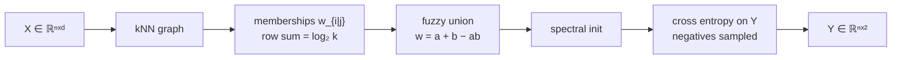

# UMAP

`umap.py` · Manifolds & embeddings · Tier 1 · 5 variants

## Intuition

t-SNE in this chapter answers "which points are neighbours?" with a probability
and then scores a layout with a KL divergence. UMAP asks the same question and
then scores the layout with **cross entropy**, which is the one substantive
difference between the two methods.

The KL of t-SNE is one-sided. If a pair is an edge in the graph and the layout
puts the points far apart, the KL is large; if the layout invents an edge the
graph does not have, the KL is nearly free. That is why t-SNE plots look like
archipelagos: clusters are tight and the space between them is whatever the
optimiser happened to leave. Cross entropy charges for both mistakes. A spurious
edge costs, a missing edge costs, and the balance is what makes UMAP's layouts
hold their global arrangement better — and what makes its mid-range
neighbourhoods survive, which is measurable: on the demo's swiss roll UMAP keeps
$0.834$ of each point's forty nearest neighbours where t-SNE keeps $0.769$.

The other half is the **fuzzy graph**. A k-nearest-neighbour graph is a hard
object: an edge exists or it does not. UMAP gives every edge a membership in
$[0, 1]$ and normalises each point's row so that it carries a fixed amount of
mass, which makes the graph a *fuzzy simplicial set* — a simplicial complex whose
simplices have memberships instead of existence.

```
   kNN graph, hard                    fuzzy graph, memberships
   ·───·                                  1.00
   │  ╱                               ╱        ╲ 0.42
   ·─·   ·                          0.83   0.07
```

That construction is what makes the method density-agnostic in the input and
density-destroying in the output. Every point's row carries $\log_2 k$ of mass,
so a dense region and a sparse region are described by the *same* amount of
graph, and the layout allocates them the same area. That is a feature for
visualisation and a bug for anything that cares about density — which is what the
`densmap` variant exists to fix.



The demo measures the claim and the bill. On 250 points from a swiss roll — a
surface that is *exactly* isometric to a flat rectangle — the layout keeps
$0.833$ of each point's eight true neighbours, against $0.489$ for the leading
two principal components. Its distance correlation with the rectangle is
$0.534$, so it is a neighbour map and not a ruler, and it is a better ruler than
t-SNE's $0.335$ without being a good one: Isomap, in this same chapter, reaches
$0.9996$.

## Variants

| Variant | The objective | What changes | Cost per epoch |
|:--|:--|:--|:--|
| `umap` | (4), complement sampled | the reference | $O(nk\cdot r)$ terms |
| `fuzzy_simplicial` | (4), complement enumerated | exact gradient, dense | $O(n^2)$ |
| `supervised` | (4) with label targets | weights become agreements | $O(nk\cdot r)$ |
| `densmap` | (4) plus a radius term | local density survives | $O(n^2)$ for the radii |
| `parametric` | (4), then distilled | a network replaces the free points | training only |

**`umap`** is the published optimiser: positives from the graph, negatives
sampled uniformly per edge, per-coordinate gradient clipped to $\pm 4$, learning
rate decaying linearly to zero. The demo's fit reaches cross entropy $528$ from
$1905$ in $500$ epochs.

**`fuzzy_simplicial`** is the same objective with no sampling — every pair, once
per iteration, as one product with the coefficient matrix. The demo validates
the two implementations against each other: the matrix form and the per-pair
form agree to $8.8 \times 10^{-12}$, six finite-difference probes against the
objective agree to $4.4 \times 10^{-7}$, and the two solvers reach $531$ and
$528$ with layouts that share $0.891$ of their eight-neighbourhoods. The price
is exact: $31125$ pairs per iteration against $13122$ sampled terms per epoch,
and the ratio grows with $n$ because the graph stays at $O(nk)$.

**`supervised`** replaces each edge's fuzzy weight with the label agreement: 1
within a class, 0 across. The kNN support still comes from the geometry, so the
weights are "these points are eligible to be neighbours, and here is whether
they should be". The demo uses five 8-dimensional Gaussian clusters whose
centres are $1.5$ apart and whose standard deviation is $1.1$ — close enough
that the plain graph mixes them — and the purity of the eight layout neighbours
goes from $0.386$ to $1.000$. Nothing about the geometry changes; only the
target the cross entropy is measured against.

**`densmap`** (Narayan, Berger & Menon 2021) adds a term on the *radius* of each
point's neighbourhood, so that regions the input sampling made dense stay dense.
The demo's curve has its parameter drawn from a Beta distribution, and the
correlation between log input radius and log embedding radius goes from $0.054$
to $0.786$ at a cross-entropy cost of $362 \to 412$. The term here is a 1-D
optimal transport of the radii rather than the published regression — see §11,
where the regression is measured failing.

**`parametric`** replaces the $n$ free coordinates with a function of the input.
Fit the ordinary layout as a teacher, then regress it through a small network;
new points are placed by evaluating the network. The demo's teacher separates
its six clusters at $0.922$, the network reproduces it on training points at
$0.955$ eight-neighbour overlap, and the held-out points land in the right
cluster $0.767$ of the time against the $0.967$ of a 10-neighbour average of the
fitted coordinates. Distillation works; `transform` is not a substitute for
refitting.

## Derivation

Write the input as $X = (x_1, \dots, x_n) \subset \mathbb{R}^d$ and the layout as
$Y = (y_1, \dots, y_n) \subset \mathbb{R}^2$, and let $d_{ij} = \lVert x_i - x_j \rVert$.

### 1. A fuzzy neighbourhood per point

For each point, take its $k$ nearest neighbours and give the $j$-th one the
membership

$$
w_{j|i} \;=\; \exp\!\left(-\frac{d_{ij} - \rho_i}{\sigma_i}\right), \qquad (1)$$

where $\rho_i$ is the distance to $i$'s nearest neighbour and $\sigma_i$ is chosen
so that the row sums to a fixed amount:

$$
\sum_{j \in \mathrm{kNN}(i)} w_{j|i} \;=\; \log_2 k. \qquad (2)$$

Subtracting $\rho_i$ is not cosmetic. It makes the nearest neighbour's
membership *exactly* 1, so every point is connected to the graph with full
strength and no point can be isolated by a bandwidth choice. It also makes the
exponent non-positive for every term, so the exponential cannot overflow.

The target $\log_2 k$ is the fuzzy analogue of t-SNE's perplexity: it fixes how
much neighbourhood a point is allowed to have, regardless of how dense the
sampling is around it. In a dense region $\sigma_i$ comes out small, in a sparse
region large, and both rows carry the same mass.

### 2. Solving for the bandwidth

The mass is monotone decreasing in $\sigma_i$ — wider kernel, more spread, more
mass — so a one-dimensional search suffices:

$$
M_i(\sigma) \;=\; \sum_{j} \exp\!\left(-\frac{d_{ij} - \rho_i}{\sigma}\right),
\qquad M_i(\sigma) \downarrow 1 \text{ as } \sigma \to 0,\quad
M_i(\sigma) \uparrow k \text{ as } \sigma \to \infty. \qquad (3)$$

Bisection on $\sigma$ with a doubling search for the upper bracket. In the code
all $n$ searches run at once: the bracket is two vectors, and each iteration is
one exponential and one sum over the $n \times k$ neighbour block. Sixty-four
iterations take the row sums to $\log_2 k$ to machine precision, which the demo
asserts.

### 3. The fuzzy union

The directed memberships $w_{j|i}$ are not symmetric: $j$ can be among $i$'s
neighbours while $i$ is not among $j$'s. The undirected graph is their fuzzy
union,

$$
w_{ij} \;=\; w_{j|i} + w_{i|j} - w_{j|i}\, w_{i|j}, \qquad (4)$$

which is the probabilistic t-conorm "i or j is a neighbour". It is not the
average: if either direction is certain, the union is certain, so a one-sided
edge survives at full strength. That is what keeps the graph from developing
direction-dependent holes at the edge of a sample.

### 4. The layout kernel

The layout's membership for a pair is

$$
q_{ij} \;=\; \left(1 + a\, \lVert y_i - y_j \rVert^{2b}\right)^{-1}, \qquad (5)$$

with $a, b$ fitted so that (5) matches a target curve: membership 1 up to
`min_dist`, then $\exp(-(r - \mathrm{min\_dist})/\mathrm{spread})$. Two
parameters for a curve with one knee is enough because the fitted function is
itself a two-parameter family; for the default `(0.1, 1.0)` the fit gives
$a = 1.5770$, $b = 0.8951$, matching the constants in the reference
implementation to four digits, and the demo checks them.

`min_dist` is the smallest distance the layout is willing to give two
neighbours. It is the knob between "clusters are dots" and "clusters are
blobs", and it is *not* a metric parameter: changing it changes how much room
the optimiser may leave between points that the graph says are neighbours.

### 5. Cross entropy

The objective is

$$
\mathcal{L} \;=\; \sum_{i<j} \left[ w_{ij} \log \frac{w_{ij}}{q_{ij}}
+ (1 - w_{ij}) \log \frac{1 - w_{ij}}{1 - q_{ij}} \right]. \qquad (6)$$

Both terms matter. The first pulls edges together; the second pushes non-edges
apart, and it is the term t-SNE's KL does not have. For an edge with
$w_{ij} = 0.42$, the first term is satisfied by a short layout distance and the
second is satisfied by a long one — the pair's equilibrium distance is where the
two balance, which is exactly how a membership strength becomes a length. That
is why the graph's weights, not just its edges, carry information.

The constants are dropped in the optimiser: $\sum w \log w$ and
$\sum (1-w)\log(1-w)$ do not depend on $Y$. What is left is

$$
\min_Y \; -\sum_{i<j} w_{ij} \log q_{ij} - \sum_{i<j} (1 - w_{ij}) \log(1 - q_{ij}), \qquad (7)$$

which is the form the demo's finite-difference check differentiates.

### 6. The gradient

Differentiate (7) with respect to $y_i$. For a pair at squared distance
$d^2 = \lVert y_i - y_j \rVert^2$ with $A = a (d^2)^b$,

$$
\frac{\partial}{\partial d^2}\left(-w \log q\right) = \frac{w a b (d^2)^{b-1}}{1 + A},
\qquad
\frac{\partial}{\partial d^2}\left(-(1-w)\log(1-q)\right) = -\frac{(1-w)b}{d^2 (1 + A)}, \qquad (8)$$

and $\partial d^2/\partial y_i = 2(y_i - y_j)$, so the *force* — the direction to
move $y_i$ in a descent step — is

$$
F_{ij} \;=\; \left[-\frac{2 w a b (d^2)^{b-1}}{1 + A} + \frac{2(1-w)b}{d^2(1+A)}\right](y_i - y_j). \qquad (9)$$

The first coefficient is negative and points from $i$ towards $j$; the second is
positive and pushes away. A weak edge with $w = 0.3$ has a small pull and a large
push, so it is only satisfied at a distance where the two balance — the
equilibrium length in §5, now as an explicit force balance.

### 7. Negative sampling

The second sum in (7) runs over $n(n-1)/2$ pairs, of which only $O(nk)$ have
$w > 0$. Enumerating it is what `fuzzy_simplicial` does; `umap` samples it,
drawing `negative_rate` uniform indices per edge and rejecting draws that hit
either endpoint. The estimator is unbiased for the complement's sum, and its
variance is what the learning-rate decay is there to absorb.

### 8. The optimiser

Three practices, none of them in the objective:

* **Spectral initialisation.** The leading eigenvectors of the normalised
  affinity $D^{-1/2} W D^{-1/2}$ are the low-frequency modes of the graph, and
  starting there is both cheap and deterministic. Each eigenvector's sign is
  fixed by making its largest absolute entry positive, because $\pm v$ are
  equally valid and a LAPACK build may return either.
* **Per-chunk updates.** Edges are visited in random order and applied in
  chunks of 64. Summing a whole epoch and applying it once makes a point with
  17 incident edges move by 17 times a single edge's step; the demo's first
  version did that and the layout left its initial standard deviation of 10 for
  87 in one epoch, where the kernel is flat and the run freezes at an
  eight-neighbour overlap of $0.22$.
* **Clipping and decay.** Each per-coordinate force is clipped to $\pm 4$ and
  the learning rate falls linearly to zero. The clip is the only regularisation;
  the decay is what makes a fixed epoch budget converge rather than oscillate.

### 9. Supervised targets

With labels $c_i$, replace the membership in (6) by

$$
w_{ij} \;=\; \mathbb{1}[c_i = c_j] \cdot \mathbb{1}[(i,j) \in E], \qquad (10)$$

where $E$ is the kNN support. Positives are same-class edges; the complement is
everything else, sampled as before. The geometry of $X$ now only decides which
pairs are *eligible*; the objective decides where they go. That is why the
result is a picture of the labels rather than of the data, and why the demo's
purity reaches $1.000$ while the layout's distances stop meaning anything.

### 10. Density preservation

UMAP's membership normalisation (2) is exactly what makes the layout
density-blind, so preserving density needs a second term. DensMAP's is built on
the mean radius of each point's $k$-neighbourhood,

$$
r_i \;=\; \frac{1}{k}\sum_{j \in \mathrm{kNN}(i)} \lVert y_i - y_j \rVert, \qquad (11)$$

and asks that the $r_i$ keep the relative order and spacing they have in the
input. The published form regresses $\log r_i$ on the input's log radius and
penalises the residual. That objective has a degenerate optimum: the regression
is free to choose slope zero, and then flattening every radius drives the
penalty to zero. Measured, the correlation goes from $-0.14$ to $-0.01$ while
the cross entropy rises — uniform density, not preserved density, and the layout
gets worse.

What is implemented is the 1-D optimal transport of the same idea: sort the
embedding's log radii and give point $i$ the radius at its input rank,

$$
t_i \;=\; \left(\mathrm{sort}(\log r)\right)_{\mathrm{rank}(\log r_i^{\text{in}})},
\qquad
\mathcal{L}_{\text{dens}} \;=\; \lambda \sum_i \left(\log r_i - t_i\right)^2. \qquad (12)$$

The multiset of radii is then driven to the input's multiset up to a monotone
transform, which is what "the relative densities are preserved" means, and no
flat solution satisfies it. Its gradient is (11) differentiated through the
radius, with the sign that *shrinks* a radius that is too large — a sign the
first version of this file had backwards, which is why the demo's early attempt
at a strong weight gave a correlation of $-0.64$.

### 11. Parametric

Replace $y_i$ by $f_\theta(x_i)$ with a one-hidden-layer network

$$
f_\theta(x) \;=\; W_2 \tanh(W_1 x + b_1) + b_2, \qquad (13)$$

fit to the teacher's coordinates by least squares and then Adam. The demo's
result is the honest one: reproduction $0.955$ on training points, $0.767$
purity on held-out points against the neighbour average's $0.967$. A layout is
not a smooth function of $x$; a network that is smooth can memorise the
training layout and still be a poor interpolator, and adding capacity moves the
two numbers in opposite directions.

### 12. What is identified

$Y$ is identified up to rotation, reflection and translation, and the scale is
fixed only weakly by `min_dist`. Cluster areas and inter-cluster distances are
artefacts of the optimiser and the initialisation, not properties of the data —
the same caveat as t-SNE, with a different constant. The graph's weights are
identified up to the choice of $k$, which changes what "neighbour" means.

## Code walkthrough

`UMAP(n_components=2, *, variant="umap", n_neighbors=15, min_dist=0.1,
spread=1.0, n_epochs=200, learning_rate=1.0, negative_rate=5,
dens_lambda=10.0, hidden=64, seed=0)` with `fit(X, y=None)`,
`fit_transform(X, y=None)` and `transform(X_new)` for `parametric` only.
Attributes: `embedding_`, `graph_`, `a_`, `b_`, `ce_`, `history_`, and
`teacher_` for `parametric`.

### 1. The bandwidth search

```python
    sigma = np.ones(n)
    lo = np.zeros(n)
    hi = np.full(n, np.inf)
    for _ in range(64):
        mass = np.exp(-diff / np.maximum(sigma[:, None], EPS)).sum(axis=1)
        too_wide = mass > target                    # needs a smaller sigma
        hi = np.where(too_wide, sigma, hi)
        lo = np.where(too_wide, lo, sigma)
        sigma = np.where(np.isfinite(hi), 0.5 * (lo + hi), 2.0 * sigma)
    return np.exp(-diff / np.maximum(sigma[:, None], EPS))
```

(3), for all points at once. `diff` is `dk - rho[:, None]`, already sorted in
each row, and `target` is $\log_2 k$. The bracket per point is two scalars in
two vectors; a point that has not yet found a finite upper bound doubles, and
the rest bisect. The returned block is (1); the caller scatters it into a
matrix by neighbour index.

### 2. The graph, and its union

```python
    dk, idx = _knn(D, n_neighbors)
    memberships = _smooth_knn(dk)
    A = np.zeros_like(D)
    np.put_along_axis(A, idx, memberships, axis=1)
    return A + A.T - A * A.T
```

(4), one line. `A` is the directed membership matrix; the union is its sum minus
the product, which is the t-conorm. `put_along_axis` writes each row's sorted
memberships at the neighbour indices returned by `_knn`, and the `D` the caller
passes has an infinite diagonal, so no point is its own neighbour.

### 3. Fitting the kernel

```python
    p = np.log(np.array([1.5, 0.9]))
    for _ in range(64):
        r = residual(p)
        J = np.empty((x.size, 2))
        for j in range(2):
            step = np.zeros(2)
            step[j] = 1e-6
            J[:, j] = (residual(p + step) - r) / 1e-6
        move = np.linalg.lstsq(J, r, rcond=None)[0]
        p = np.clip(p - np.clip(move, -0.5, 0.5), [-4.0, -3.0], [4.0, 3.0])
```

Gauss–Newton on $\log a, \log b$, so positivity is automatic. The step is
clipped to half a log-unit and the parameters are clamped: without that, a
Newton step from a bad start makes $x^{2b}$ overflow and the least-squares solve
fails outright. The starting point `(1.5, 0.9)` is a warm start near the answer
for the usual `min_dist`; from a point further away the iteration still converges
but needs more of the 64 steps, and from the wrong sign it walks into the clamp.

### 4. The objective

```python
    pos = w > 0.0
    neg = w < 1.0
    total = 0.0
    if pos.any():
        total += float((w[pos] * np.log(w[pos] / q[pos])).sum())
    if neg.any():
        total += float(((1.0 - w[neg])
                        * np.log((1.0 - w[neg]) / (1.0 - q[neg]))).sum())
    return total
```

(6), evaluated densely over the upper triangle. The two masks are the limits
that keep the logs finite: a pair with $w = 0$ contributes only the second term
and a pair with $w = 1$ only the first, so neither needs a $0 \log 0$. `q` is
clipped away from both 0 and 1 first, because a pair of coincident layout points
has $q = 1$ exactly and would otherwise return an infinity that a caller cannot
recover a gradient from.

### 5. The per-pair gradient

```python
    d = Y[rows] - Y[cols]
    d2 = np.einsum("ij,ij->i", d, d)
    denom = 1.0 + a * np.maximum(d2, 0.0) ** b
    safe = np.maximum(d2, 1e-12)
    pull = -2.0 * w * a * b * safe ** (b - 1.0) / denom
    push = 2.0 * (1.0 - w) * b / (safe * denom)
    g = (pull + push)[:, None] * d
    return g if clip is None else np.clip(g, -clip, clip)
```

(9), for a batch of pairs. `safe` guards $d^{2(b-1)}$ at coincidence, where
$b < 1$ makes the attraction's derivative infinite; `clip` is the optimiser's
$\pm 4$ and is `None` in the demo's gradient check, which is what lets the
check reproduce the objective's derivative exactly.

### 6. The dense gradient

```python
    C = (W * (-2.0 * a * b * safe ** (b - 1.0) / denom)
         + (1.0 - W) * (2.0 * b / (safe * denom)))
    np.fill_diagonal(C, 0.0)
    return np.clip(Y * C.sum(axis=1)[:, None] - C @ Y, -4.0, 4.0)
```

(9) for all pairs, as a matrix product: $F_i = \sum_j c_{ij}(y_i - y_j)$ is
$y_i \sum_j c_{ij} - (C Y)_i$. The diagonal is zeroed because $c_{ii}$ would be
the repulsion of a point from itself, which is infinite at zero distance. This
is the whole of `fuzzy_simplicial` — one product per iteration, quadratic, and
the reference the sampled variant is checked against.

### 7. Spectral initialisation

```python
    d = np.maximum(W.sum(axis=1), EPS)
    dinv = 1.0 / np.sqrt(d)
    M = dinv[:, None] * W * dinv[None, :]
    vals, vecs = np.linalg.eigh(M)
    order = np.argsort(vals)[::-1]
    take = order[1:n_components + 1]        # drop the constant eigenvector
    V = vecs[:, take]
    signs = np.sign(V[np.argmax(np.abs(V), axis=0), np.arange(V.shape[1])])
    V = V * np.where(signs == 0.0, 1.0, signs)
    scale = float(np.abs(V).max())
    return V / max(scale, EPS) * 10.0
```

The normalised affinity, its leading eigenvectors, and a sign convention. The
`order[1:]` is the part that was wrong first: `eigh` returns eigenvalues
ascending, so the *last* column is the constant eigenvector and taking
`range(1, ...)` selects the highest-frequency modes — noise. Starting there
gave a layout whose standard deviation was $0.9$ instead of $10$, most points
piled at the origin, and an eight-neighbour overlap of $0.22$; the fix moved the
same demo to $0.83$. Scale to a maximum absolute coordinate of 10, which is the
reference implementation's convention.

### 8. The density term

```python
    log_r = np.log(np.maximum(radius, EPS))
    target = np.sort(log_r)[ranks]
    c = -weight * (log_r - target) / (np.maximum(radius, EPS) * k)
    step = Y[:, None, :] - Y[idx]
    unit = step / np.maximum(near, EPS)[:, :, None]
    g = c[:, None, None] * unit
    force = np.zeros_like(Y)
    np.add.at(force, np.repeat(np.arange(Y.shape[0]), k), g.reshape(-1, 2))
    np.add.at(force, idx.ravel(), -g.reshape(-1, 2))
    return force
```

(12). `ranks` is the input radius rank of each point, computed once; `target` is
the embedding radius that currently sits at that rank. The minus sign is the
difference between a gradient and its negative: with `+`, a point whose radius
is too large is pushed further out and the demo's correlation went to $-0.64$.
The scatter adds each point's contribution to the radius of its own
neighbourhood and subtracts it from each neighbour's, because $r_i$ depends on
every $y_j$ in $i$'s neighbourhood.

### 9. The sampled loop

```python
        for epoch in range(self.n_epochs):
            lr = self.learning_rate * (1.0 - epoch / self.n_epochs)
            order = rng.permutation(rows.size)
            for start in range(0, rows.size, chunk):
                take = order[start:start + chunk]
                r, c, wt = rows[take], cols[take], w[take]
                neg = rng.integers(0, n, size=(r.size, self.negative_rate))
                neg = np.where(neg == r[:, None], (neg + 1) % n, neg)
                neg = np.where(neg == c[:, None], (neg + 1) % n, neg)
                heads = np.concatenate([r, np.repeat(r, self.negative_rate)])
                tails = np.concatenate([c, neg.ravel()])
                weights = np.concatenate(
                    [wt, np.zeros(r.size * self.negative_rate)])
                g = _pair_gradients(heads, tails, weights, Y, self.a_, self.b_)
                _apply(Y, heads, g, lr)
                _apply(Y, tails, -g, lr)
```

The optimiser. Each chunk holds its positives and their sampled negatives in one
pair list — `weights` is the fuzzy weight for a positive and zero for a
negative, which is all the difference (9) needs. `_apply` scatters with
`bincount`, so a point that appears twice in a chunk gets both contributions;
fancy assignment would silently keep only the last. The learning rate decays
across the outer loop, and `chunk = 64` is the sequential coupling that keeps
one epoch from moving a point by the sum of all its forces.

### 10. The parametric readout

```python
        self.mu = X.mean(axis=0)
        self.sd = X.std(axis=0) + EPS
        Xs = (X - self.mu) / self.sd
        n = X.shape[0]
        A = np.tanh(Xs @ self.W1.T + self.b1)
        self.b2 = Y.mean(axis=0)
        self.W2 = np.linalg.lstsq(A, Y - self.b2, rcond=None)[0].T
```

(13), with the readout solved rather than trained. `W1` is random and fixed, so
`tanh(W1 x)` is a fixed feature map and the best linear function of it is one
`lstsq`; Adam then moves the features themselves. Centring `Y` before the solve
is what makes the intercept meaningful — fitting `Y` directly and adding the
mean afterwards overshoots, which is a real mistake the first version made.

## Complexity

$n$ samples, $d$ input dimensions, $k$ neighbours, $r$ negatives per edge, $T$
epochs, $E \approx nk$ edges.

| Operation | Time | Memory | Note |
|:--|:--|:--|:--|
| pairwise distances | $O(n^2d)$ | $O(n^2)$ | Gram identity |
| kNN | $O(n^2\log k)$ | $O(n^2)$ | `argpartition` per row |
| bandwidth search | $O(64\,nk)$ | $O(nk)$ | vectorised bisection |
| fuzzy union | $O(n^2)$ | $O(n^2)$ | one masked update |
| spectral init | $O(n^3)$ | $O(n^2)$ | dense `eigh`; a Lanczos solver is $O(n^2)$ |
| sampled epoch | $O(E(1+r))$ | $O(n)$ | one chunk at a time |
| dense iteration | $O(n^2)$ | $O(n^2)$ | two matrix products |
| density term | $O(nk)$ after $O(n^2)$ radii | $O(n^2)$ | radii recomputed each epoch |
| parametric readout | $O(nh^2 + h^3)$ | $O(nh)$ | one `lstsq` plus Adam |
| full demo | — | — | 10 fits, 11.1 s |

The $O(n^2)$ rows are the fixed cost and the reason UMAP, like t-SNE, is a
visualisation method. The spectral initialisation is the one that surprises
people: a dense eigendecomposition is cubic, and at $10^5$ points it is the
bottleneck even though the optimiser is linear per epoch. Production
implementations use a sparse Lanczos solver on the graph, which is what makes
the whole pipeline near-linear.

`fuzzy_simplicial` is the honest statement of the objective: $O(n^2)$ per
iteration, no sampling variance, and the demo measures $2.4$ times more terms
per pass at $n = 250$ than the sampled variant. The ratio grows with $n$,
because the graph's support stays at $O(nk)$ while the complement does not.

## Failure modes

**1. Treating the target as an average instead of a log.** The row sum in (2) is
$\log_2 k$, not $k$. Setting it to $k$ makes every membership larger — at
$k = 15$ the graph's total weight goes from $1463$ to $4374$ — so the cross
entropy's first term dominates, the layout contracts to a standard deviation of
$3$ where the correct run keeps $10$, and the eight-neighbour overlap falls from
$0.833$ to $0.693$ with the cross entropy *rising* from $528$ to $3261$. The
optimiser cannot satisfy the inflated weights at any layout, so it settles for a
tight picture with the wrong neighbourhoods in it.

**2. Summing a whole epoch's forces.** The per-edge update is a step; the sum of
an epoch's per-edge steps is not. Doing it in one batch moved the demo's layout
from a standard deviation of 10 to 87 in a single epoch, past the scale where the
kernel has structure, and the run then froze at an eight-neighbour overlap of
$0.22$. The chunks in §9 exist because of this measurement, and the fact that a
larger chunk (512 edges) reproduces the same failure is the demonstration that
it is about coupling, not about vectorisation.

**3. A spectral initialisation that selects noise.** `eigh` returns ascending
eigenvalues, so the constant eigenvector is the *last* column. Taking the first
$k$ after index 1 selects the highest-frequency modes, piles most points near
the origin, and costs $0.6$ of eight-neighbour overlap — with no error and no
warning, just a bad picture.

**4. A regression with a flat optimum.** The published density term's best
slope can be zero, and then uniform density satisfies it. Measured here, the
correlation between input and embedding local radius went from $-0.14$ to
$-0.01$ at the cost of a worse cross entropy, which looks like a working
regulariser and is not one. The rank-matching form in §10 has no such solution.

**5. A sign error in the density gradient.** In the first version the force
grew the radius that was already too large. At a strong weight the layout
inverted: the correlation was $-0.64$ rather than $+0.8$. A regulariser that
makes its own metric worse is always a sign error, never a tuning problem.

**6. A floor that is not in the objective.** The reference implementation's
$1/(0.001 + d^2)$ in the repulsion is a regularisation, not the derivative of
the cross entropy. It is fine for the optimiser and it breaks any gradient check
at the $5\%$ level — which is how it was found here: the finite-difference check
disagreed by $0.4\%$ of the force's scale on every entry until the floor was
removed and replaced by a guard at $10^{-12}$.

**7. Supervised mode read as an embedding.** The demo's purity reaches $1.000$
by construction: the objective is built from the labels, so the layout is a
picture of them. Using it for anything beyond classification triage — cluster
sizes, distances, "how separate are these classes really" — reads information
into the picture that the optimiser put there.

**8. `min_dist` read as a metric property.** It controls how tightly the layout
packs neighbours, not how faithful it is. Lower is not better: it makes clusters
dots and the space between them arbitrary, which is fine for a picture and wrong
for any downstream distance.

**9. Trusting `transform`.** The demo's network reproduces its teacher at
$0.955$ on the training points and places $0.767$ of held-out points correctly,
against $0.967$ for a 10-neighbour average. Adding capacity raises the first and
lowers the second. A parametric variant is for placing many new points cheaply,
not for a better map.

**10. Reading density off the default layout.** Membership normalisation (2) is
designed to make the layout density-blind, so the area a cluster gets says
nothing about how many points are in it. `densmap` is the fix and it is partial:
the demo moves the radius correlation from $0.054$ to $0.786$, not to 1.

## Applications

- **Single-cell genomics.** The second canonical use after t-SNE, and now the
  default in several pipelines: the graph is built on a PCA of the expression
  matrix, `n_neighbors` around 15, and the layout is used to look at cell types
  and trajectories. The `densmap` variant is used when the question is about
  population sizes rather than cluster identity.
- **Feature-space audit before modelling.** The supervised variant is a quick
  way to ask whether a label is learnable from a representation at all: if the
  supervised layout cannot separate the classes, no downstream classifier will.
- **Topic and document maps.** `n_neighbors` in the tens and `min_dist` around
  $0.1$ gives the standard "map of the corpus" picture, with the same caveat as
  t-SNE about distances.
- **Embedding quality comparisons.** Because the cross entropy charges for
  spurious edges, UMAP layouts are a better instrument than t-SNE for "does
  this representation preserve mid-range structure" — the demo's $0.834$ against
  $0.769$ at forty neighbours is the measurement.
- **Interactive exploration at scale.** The sampled optimiser is linear per
  epoch and the graph is $O(nk)$, which is why UMAP is the method most often
  used on million-point datasets where t-SNE needs the FFT or Barnes–Hut
  machinery in the sibling atom.
- **Density-aware embeddings.** `densmap` is used where cluster *size* is a
  biological or physical signal — cell population frequency, cluster mass in a
  particle detector — and where the default layout's density blindness would
  silently destroy it.

Not for: distance-based downstream tasks, cluster-size estimation without the
density term, or any pipeline where the layout must be a deterministic function
of new data (`transform` is an approximation, and the ordinary variants have no
transform at all).

## References

- **McInnes, Healy & Melville (2018),** *UMAP: Uniform Manifold Approximation
  and Projection for dimension reduction* — the paper: fuzzy simplicial sets,
  the membership construction of (1)–(4), the cross entropy of (6), and the
  negative-sampling optimiser.
- **McInnes, Healy, Saul & Großberger (2018),** *UMAP: Uniform Manifold
  Approximation and Projection* — the software paper, with the implementation
  details and the parameter advice that §9 follows.
- **Narayan, Berger & Menon (2021),** *DensMAP: Improved local density
  preservation in UMAP embeddings* — the radius term, the variance
  regularisation, and the experiments that show UMAP's density blindness.
- **Sainburg, McInnes & Gentner (2021),** *Parametric UMAP embeddings for
  representation learning* — the parametric variant, and the argument that a
  parametric map is a representation-learning method rather than a faster
  optimiser.
- **Damrich & Hamprecht (2021),** *On UMAP's true loss function* — the
  derivation showing that UMAP's sampler does not optimise exactly the stated
  cross entropy, and what the effective objective is. §7's sampling caveat is
  this paper's subject.
- **Böhm, Berens & Kobak (2022),** *Attraction-repulsion spectrum in neighbor
  embeddings* — where UMAP sits relative to t-SNE on the attraction/repulsion
  axis, and why the two-sided charge changes the global arrangement.
- **Kobak & Linderman (2021),** *Initialization is critical for preserving
  global data structure in both t-SNE and UMAP* — the experiment that made
  spectral and PCA initialisation standard, and the source of the practice in
  §8.
- **Coenen & Pearce (2019),** *Understanding UMAP* — the interactive
  explanation of the fuzzy graph and the cross entropy, and the best account of
  why `min_dist` behaves the way it does.
- **Wang, Huang, Rudin & Shaposhnik (2021),** *Understanding how dimension
  reduction algorithms work via data gradients* — the analysis of what each
  method preserves and what its gradients respond to.
- **Trofimov, Cherniavskii & Dylov (2023),** *Learning topology-preserving
  projections with UMAP* — the topological reading of the fuzzy graph, and the
  cases where the simplicial-set construction is what makes or breaks the
  embedding.
- **Healy & McInnes (2024),** *Uniform Manifold Approximation and Projection for
  dimension reduction* (review) — the current statement of the method, its
  guarantees and its open problems.
