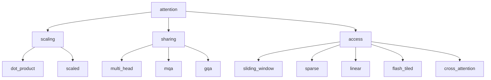

# Attention — one softmax, ten ways to choose what it looks at

`attention.py` · Sequences · Tier 1 · 10 variants

## Intuition

Attention is a weighted average whose weights come from the data. A query vector
is compared with every key by a dot product, the scores are passed through a
softmax so they are positive and sum to one, and the result mixes the values.
There is no recurrence and no convolution: every output position is computed
from the whole input in one matrix multiplication.

```
        queries Q                keys K                     values V

   q_0  ─┐            k_0 ─┐                          v_0 ─┐
   q_1  ─┼─ Q K^T ─▶ scores ─▶ softmax ─▶ weights ─▶  v_1 ─┼─▶ output
   q_2  ─┘            k_1 ─┘                          v_2 ─┘
```

What makes the family interesting is that the definition is almost empty. Every
variant answers one of three questions. *How sharp is the comparison?* The raw
dot product grows with the width of the vectors, and dividing by the square root
of that width keeps the softmax away from its saturated tails. *How many
independent comparisons?* One head learns one relation; several heads, with
their own projections, learn several at once. Multi-query and grouped-query
attention give up some of that independence to shrink the cache a decoder has to
carry. *What may a query see?* A sliding window makes attention local, sparse
attention adds a few global columns, linear attention replaces the softmax with
a kernel so the cost is linear in the length, and flash attention computes the
same softmax one key tile at a time so the score matrix is never materialised.

The demos are mostly proofs of equality, because most of these variants are
rearrangements of the same sum and the interesting question is whether the
rearrangement is exact. Tiling reproduces the dense result to $2.2\times10^{-16}$
while its largest score buffer is $23\%$ of the dense one. The three
key-sharing schemes agree to $4.4\times10^{-16}$; multi-query attention keeps
$160$ of the $256$ parameters and a quarter of the cache. Linear attention is
bit-for-bit the same as the explicit two-step product, and costs $0.13$ of the
quadratic work at length $512$ and $0.008$ at $8192$. Every analytic gradient,
including the projected variants, matches central differences to
$1.3\times10^{-7}$. An untrained induction head recovers the next symbol at
$7$ of $7$ positions.

## Variants

| variant | scaling | heads | mask | cost in the length |
|:--|:--|:--|:--|:--|
| `dot_product` | none | one | full | $O(T^2 d)$ |
| `scaled` | $1/\sqrt{d}$ | one | full | $O(T^2 d)$ |
| `multi_head` | $1/\sqrt{d_h}$ | $H$ independent | full | $O(T^2 d)$ |
| `mqa` | $1/\sqrt{d_h}$ | $H$ queries, one key/value | full | $O(T^2 d)$ |
| `gqa` | $1/\sqrt{d_h}$ | $H$ queries, $G$ key/value | full | $O(T^2 d)$ |
| `sliding_window` | $1/\sqrt{d}$ | one | band | $O(T w d)$ |
| `linear` | kernel | one | full or prefix | $O(T d D_v)$ |
| `sparse` | $1/\sqrt{d}$ | one | band plus globals | $O(T (w+g) d)$ |
| `flash_tiled` | $1/\sqrt{d}$ | one | full or band | $O(T^2 d)$, $O(T \tau)$ memory |
| `cross_attention` | $1/\sqrt{d_h}$ | $H$ independent | full | $O(T_q T_k d)$ |



**`dot_product`** is the oldest form: score the query against every key with an
unscaled inner product. It is correct and cheap, and it is what Bahdanau's
additive score was competing with.

**`scaled`** divides by $\sqrt{d}$. In the next section the variance of a random
dot product is shown to be $d$, so the division holds the logits at unit scale
and keeps the softmax gradient alive.

**`multi_head`** projects the input into $H$ query, key and value spaces, runs
attention in each, and concatenates the results through an output matrix. Each
head has width $d/H$, so the total cost is unchanged.

**`mqa`** keeps one key head and one value head for all query heads. The queries
are still independent, but they compete for the same keys; the cache shrinks by
a factor of $H$, which is what matters when decoding one token at a time.

**`gqa`** divides the query heads into $G$ groups, each with its own key and
value head. $G=H$ recovers multi-head attention and $G=1$ recovers multi-query
attention, so it is a single dial between quality and cache size.

**`sliding_window`** allows a query to read only keys within $w$ positions of it.
The cost becomes linear in the length, at the price of never seeing anything
further than $w$ steps away.

**`linear`** replaces the softmax with a kernel $\phi$, so the product
$\phi(K)^{\top}V$ can be computed once and reused by every query. It is the only
variant whose cost does not grow quadratically, and the only one whose weights
are not sparse.

**`sparse`** adds a few global columns to the sliding window, so every query can
read the first tokens of the sequence no matter how far away it is. The band
keeps the cost linear.

**`flash_tiled`** computes the scaled softmax one key tile at a time, carrying a
running maximum, a running normaliser and a running weighted sum. The result is
exact; the saving is memory, not arithmetic.

**`cross_attention`** takes queries from one sequence and keys and values from
another, which is the decoder reading an encoder. It is the only variant allowed
to mix lengths other than through a mask, and it refuses a causal order because
there is no order to respect between the two sequences.

## Derivation

### One head

Let $Q\in\mathbb{R}^{T_q\times d}$, $K\in\mathbb{R}^{T_k\times d}$ and
$V\in\mathbb{R}^{T_k\times D_v}$. A single attention layer is

$$
A=\mathrm{softmax}\!\left(\frac{QK^{\top}}{\tau}\right), \qquad
\mathrm{out}=AV,
\qquad (1)
$$

where the softmax is applied to each row and $\tau$ is $1$ for `dot_product`,
$\sqrt{d}$ for `scaled`, and $\sqrt{d_h}$ inside a head. The implementation is
the definition plus a mask:

```python
        scale = 1.0 if self.variant == "dot_product" else 1.0 / math.sqrt(q.shape[-1])
        scores = (q @ k.swapaxes(-1, -2)) * scale
        weights = _softmax(np.where(allowed, scores, -np.inf))
        return weights @ v, weights
```

The mask is applied before the softmax, not after, which is the difference
between an attention weight of exactly zero and a renormalised small one. A
disallowed logit becomes $-\infty$, `exp` maps it to zero, and the row still sums
to one because some entry is always allowed.

### Why divide by the square root

Take a query and a key with independent entries of mean zero and variance one.
Their dot product is a sum of $d$ independent products, each of variance one, so

$$
\mathbb{E}\big[(q\cdot k)^2\big]=d, \qquad
q\cdot k\approx\mathcal{N}(0,d).
\qquad (2)
$$

Without the division the logits have standard deviation $\sqrt{d}$, which for a
width of $512$ is about $23$. The largest logit then dominates the softmax and
the gradient with respect to every other score is zero. Dividing by $\sqrt{d}$
puts the logits back at unit scale whatever the width. The proof is one line of
variance algebra, and it is the reason the original transformer uses
$\sqrt{d_k}$ and not $d_k$.

### The softmax Jacobian and the backward pass

Let $S=QK^{\top}/\tau$ and $P=\mathrm{softmax}(S)$. For a symmetric matrix of
weights, the Jacobian of the softmax row is
$dP=\mathrm{diag}(P)-PP^{\top}$, and in coordinates the backward pass is

$$
\begin{aligned}
dV &= P^{\top}dO, &\qquad
dP &= dO\,V^{\top}, \\
dS &= P\odot\big(dP-\bar{d}\,\mathbf{1}^{\top}\big), &\qquad
dQ &= dS\,K/\tau, \\
&& dK &= dS^{\top}Q/\tau,
\end{aligned}
\qquad (3)
$$

where $\bar{d}_i=\sum_j dP_{ij}P_{ij}$ is the row's weighted mean of the output
gradient. The subtraction in $dS$ is the softmax's conservation law: a weight
can only grow at another's expense, so the gradient has to be centred against
the row's own weighted mean. The code is that expression, with the mask folded into the
recomputed scores:

```python
        weights = _softmax(scores)
        d_values = weights.swapaxes(-1, -2) @ d_output
        d_weights = d_output @ v.swapaxes(-1, -2)
        d_scores = weights * (d_weights - (d_weights * weights).sum(-1, keepdims=True))
        d_queries = (d_scores @ k) * scale
        d_keys = (d_scores.swapaxes(-1, -2) @ q) * scale
```

Recomputing the weights in the backward pass rather than caching them is a
memory decision: the score matrix is the largest object in the layer, and the
demo's gradient check is cheap enough to pay for it twice.

### Several heads

One head can express one weighted average. Several heads project the input into
different subspaces first:

$$
\begin{aligned}
Q_h &= QW_q^{(h)}, \quad K_h = KW_k^{(h)}, \quad V_h = VW_v^{(h)}, \\
\mathrm{out} &= \big[\,A_1V_1;\ldots;A_HV_H\,\big]W_o,
\end{aligned}
\qquad (4)
$$

with $W_q^{(h)},W_k^{(h)},W_v^{(h)}\in\mathbb{R}^{d\times d_h}$ and
$W_o\in\mathbb{R}^{Hd_h\times d}$. The projections are one matrix product each,
so the whole layer is still a handful of matmuls; the code stores $W_o$ with its
two axes swapped, so the forward pass multiplies by `W_o_.T`:

```python
        q_heads = _split_heads(q @ self.W_q_, heads)
        k_heads = _split_heads(k @ self.W_k_, kv_heads)
        v_heads = _split_heads(v @ self.W_v_, kv_heads)
```

`_split_heads` is a reshape and a transpose: the last axis is cut into $H$ blocks
of width $d_h$ and the block axis is moved next to the batch. The backward pass
merges the head gradients and multiplies by the transposed projections, which is
why `backward` returns both the input gradients and the weight gradients.

### Sharing keys and values

Multi-query attention keeps $H$ query heads but a single key head and a single
value head:

$$
Q_h=QW_q^{(h)}, \qquad K=KW_k, \qquad V=VW_v,
\qquad (5)
$$

so head $h$ attends with its own queries over a common table. Grouped-query
attention generalises to $G$ key/value heads, and head $h$ uses group
$\lfloor hG/H\rfloor$. The code repeats the shared heads and sums the gradient
back onto them:

```python
        if kv_heads < heads:
            groups = heads // kv_heads
            k_heads = _repeat_heads(k_heads, groups)
            v_heads = _repeat_heads(v_heads, groups)
```

```python
def _reduce_heads(x: np.ndarray, heads: int) -> np.ndarray:
    """Sum the gradient of repeated heads back onto the shared head."""
    batch, total, steps, width = x.shape
    groups = total // heads
    return x.reshape(batch, heads, groups, steps, width).sum(axis=2)
```

The repeat materialises a broadcast, and the reduce is a sum: the shared key matrix
receives the gradient of every query head that read it. The demo builds each
sharing variant's tied multi-head twin and checks that the outputs agree to
$4.4\times10^{-16}$, which pins the head ordering and the group arithmetic.

### Masks

A mask is a boolean matrix $M\in\{0,1\}^{T_q\times T_k}$ and the layer computes

$$
A_{ij}=\frac{M_{ij}\exp(S_{ij})}{\sum_{j'}M_{ij'}\exp(S_{ij'})}.
\qquad (6)
$$

The three access variants differ only in how $M$ is built:

$$
M^{\text{band}}_{ij}=[\,|i-j|\le w\,], \qquad
M^{\text{sparse}}_{ij}=[\,|i-j|\le w\,]\ \text{or}\ [\,j<g\,], \qquad
M^{\text{causal}}_{ij}=[\,j\le i\,].
\qquad (7)
$$

```python
        allowed = np.ones((q_length, kv_length), dtype=bool)
        if self.causal:
            allowed &= columns <= rows
        if self.variant in ("sliding_window", "sparse"):
            allowed &= np.abs(rows - columns) <= self.window
        if self.variant == "sparse":
            allowed |= columns < self.n_global
```

The `or` that adds the global columns is a union of boolean arrays, not a sum,
so the band and the globals can overlap without double counting. The demo prints
the sparse pattern for a window of one and two globals:

```
   ##.....
   ###....
   ####...
   #####..
   ##.###.
   ##..###
   ##...##
```

Every row contains itself, so no query is left with an empty row. That is a real
constraint: a mask that excludes an entire row makes the denominator zero and the
output `nan`, which is why the constructor rejects a window and the mask builder
checks that every row has a survivor.

### The online softmax

Flash attention computes the same softmax without holding the score matrix. For a
query tile, keep a running maximum $m$, running denominator $\ell$ and running
weighted sum $a$. When a new key tile arrives with scores $s$ and values $v$,

$$
\begin{aligned}
m' &= \max(m,\ \max_j s_j), &\qquad
\alpha &= e^{m-m'}, \\
\ell' &= \alpha\ell+\sum_j e^{s_j-m'}, &\qquad
a' &= \alpha a+\sum_j e^{s_j-m'}v_j,
\end{aligned}
\qquad (8)
$$

and at the end the output is $a/\ell$. The rescaling by $\alpha$ is the whole
trick: when the maximum grows, every previously accumulated term is multiplied by
the same factor, so the partial sums remain a softmax over the keys seen so far.
The code is that recurrence with the mask applied to the tile:

```python
                block = np.where(window, (q[b] @ k[b, start:stop].T) * scale, -np.inf)
                merged = np.maximum(best, block.max(axis=1))
                lift = np.exp(best - merged)
                weights = np.exp(block - merged[:, None])
                total = total * lift + weights.sum(axis=1)
                accumulator = accumulator * lift[:, None] + weights @ v[b, start:stop]
```

$m$ starts at $-\infty$, so the first `lift` is $e^{-\infty}=0$ and the first tile
simply replaces the empty accumulator. A key tile that is entirely masked is
skipped, which is why the causal case with a band does not waste tiles. The demo
runs tile sizes $1$, $3$, $5$ and $13$ over $13$ keys and compares with the dense
result every time; the largest difference is $4.4\times10^{-16}$.

### Linear attention

Drop the softmax and factor the score as a kernel inner product
$S_{ij}=\phi(q_i)\cdot\phi(k_j)$ with $\phi$ positive. Then

$$
\mathrm{out}_i=\frac{\phi(q_i)^{\top}\sum_j\phi(k_j)v_j^{\top}}
{\phi(q_i)^{\top}\sum_j\phi(k_j)},
\qquad (9)
$$

and the two sums do not depend on $i$. Compute them once, and every query reads
them:

```python
        state = phi_k.swapaxes(-1, -2) @ v
        normaliser = phi_k.sum(axis=1)
        return (phi_q @ state) / np.einsum("bti,bi->bt", phi_q, normaliser)[..., None]
```

The kernel here is $\phi(x)=\mathrm{elu}(x)+1$, which is positive everywhere and
therefore cannot produce a zero denominator. The price is that the weights are no
longer a softmax: they cannot concentrate on a single key the way an exponential
can, because the kernel is only piecewise linear. The demo measures both sides:
the two multiplication orders agree exactly, and the mean row entropy is $2.142$
nats against $2.197$ for a uniform row, so the attention is diffuse.

For a causal model the same algebra runs over prefixes, and prefix sums make it
$O(T)$:

```python
            products = np.einsum("bti,btj->btij", phi_k, v)
            state = np.cumsum(products, axis=1)
            normaliser = np.cumsum(phi_k, axis=1)
            return np.einsum("bti,btij->btj", phi_q, state) / (
                np.einsum("bti,bti->bt", phi_q, normaliser)[..., None])
```

The demo checks this against an explicit loop over prefixes to
$1.7\times10^{-16}$, which is the whole claim: the cumulative form is not an
approximation of causal linear attention, it is the same number.

### Cross-attention

Queries and keys come from different sequences, so the only change is that
$T_q\ne T_k$:

$$
\mathrm{out}=\mathrm{softmax}\!\left(\frac{Q_dK_e^{\top}}{\sqrt{d}}\right)V_e,
\qquad Q_d\in\mathbb{R}^{T_q\times d}, \quad K_e,V_e\in\mathbb{R}^{T_k\times d},
\qquad (10)
$$

The mask is then rectangular, and a causal mask would be meaningless because
there is no shared ordering to respect. The constructor refuses the combination
rather than silently ignoring the flag.

## Code walkthrough

### The stable softmax

```python
def _softmax(values: np.ndarray) -> np.ndarray:
    """Softmax over the last axis, with the maximum subtracted for stability."""
    shifted = values - values.max(axis=-1, keepdims=True)
    weights = np.exp(shifted)
    return weights / weights.sum(axis=-1, keepdims=True)
```

Subtracting the row maximum leaves the result unchanged mathematically and keeps
every exponential at or below one, so a logit of $700$ cannot overflow. It also
gives the masked case its behaviour for free: a row with one allowed entry has
maximum equal to that entry, and the row becomes a one-hot vector.

### Splitting heads

```python
def _split_heads(x: np.ndarray, heads: int) -> np.ndarray:
    """(batch, steps, heads * width) to (batch, heads, steps, width)."""
    batch, steps, width = x.shape
    return x.reshape(batch, steps, heads, width // heads).transpose(0, 2, 1, 3)
```

The projection produces one wide matrix and the split is a view, so the head
axis costs nothing until the batched matmul. The same function serves the
projected variants and the backward pass, which is why the head ordering is
consistent between the forward and the reduce.

### The kernel

```python
def _elu_plus_one(x: np.ndarray) -> np.ndarray:
    """The kernel of linear attention: identity above zero, a tail below."""
    return np.where(x > 0.0, x + 1.0, np.exp(np.minimum(x, 0.0)))
```

`np.minimum(x, 0.0)` guards the exponential against a positive argument, where it
would overflow; on the negative side it is the ordinary `exp`. The result is
positive and has a derivative everywhere, which the backward pass uses as
`_elu_plus_one_grad`.

### Reading the mask

```python
    def mask(self, q_length: int, kv_length: int) -> np.ndarray:
        """Boolean `(q_length, kv_length)` matrix: may query i read key j?"""
        rows = np.arange(q_length)[:, None]
        columns = np.arange(kv_length)[None, :]
```

The two `arange` calls are shaped so that every combination broadcasts, which
makes each condition a vectorised comparison instead of a loop. For a band the
comparison is `|i - j| <= window`; for causality it is `j <= i`; the sparse
variant adds a column test with a logical or.

### Tiling and memory

```python
        tile = self.tile or max(1, int(math.ceil(math.sqrt(k_length))))
```

The default tile is the square root of the key length, which makes the score
buffer $O(T\sqrt{T})$ instead of $O(T^2)$ and keeps the number of tiles equal to
the number of rows in a tile. The demo reports the buffer directly: $54$ entries
for a tile of $3$ against $234$ dense.

### Sharing and its gradient

```python
def _repeat_heads(x: np.ndarray, groups: int) -> np.ndarray:
    """Give every group of query heads its shared key/value head."""
    return np.repeat(x, groups, axis=1)
```

`np.repeat` duplicates each key head consecutively, so head $h$ reads key head
$\lfloor h/g\rfloor$; `_reduce_heads` reshapes the gradient to
`(batch, heads, groups, steps, width)` and sums the group axis. Getting the
ordering wrong is invisible in the forward pass and wrong in the backward one,
which is why the demo checks both the tied outputs and the gradients.

### The penalty for looking everywhere

```python
    flip = rng.permutation(7)
    permuted = Attention(variant="scaled").forward(q, k[:, flip], v[:, flip])
```

Attention has no notion of position. Permuting the keys and values permutes the
weights and leaves the output unchanged, which the demo confirms to
$3.3\times10^{-16}$. A transformer that needs order has to inject it, by
positional encodings or by a causal mask; this layer provides neither.

## Complexity

Let $T_q$ and $T_k$ be the query and key lengths, $d$ the width, $d_h=d/H$ the
head width, $D_v$ the value width, $w$ the window, $g$ the number of global
columns and $\tau$ the tile.

| variant | time | score memory |
|:--|:--|:--|
| `dot_product`, `scaled` | $O(T_qT_kd)$ | $O(T_qT_k)$ |
| `multi_head` | $O(T_qT_kd)$ | $O(HT_qT_k)$ |
| `mqa`, `gqa` | $O(T_qT_kd)$ | $O(HT_qT_k)$ |
| `sliding_window` | $O(T_qwd)$ | $O(T_qw)$ |
| `sparse` | $O(T_q(w+g)d)$ | $O(T_q(w+g))$ |
| `linear` | $O(T_qdD_v+T_kdD_v)$ | $O(dD_v)$ |
| `flash_tiled` | $O(T_qT_kd)$ | $O(T_q\tau)$ |
| `cross_attention` | $O(T_qT_kd)$ | $O(HT_qT_k)$ |

The parameter count is where the sharing variants separate. With no biases,
multi-head attention stores $4d^2$ weights; grouped-query with $G$ key/value
heads stores $2d^2+2dGd_h$; multi-query stores $2d^2+2dd_h$. At $d=8$, $H=4$ the
demo reports $256$, $192$ and $160$, and the cached key/value width per token
falls from $16$ to $8$ to $4$, which is the number that limits batch size when
decoding one token at a time.

The quadratic term is in the length, not the width, and that is why every
long-context variant is a statement about which pairs are worth a comparison.
Flash attention does not change the time; it changes the constant in front of
the memory, which is often what decides whether a sequence of a given length can
be run at all.

## Failure modes

**Saturated softmax.** If the logits are large, one weight is near one and the
rest are near zero, and the gradient of the loss with respect to every other
score vanishes. The division by $\sqrt{d}$ is the first defence; the second is
that a masked row can be *too* sparse by design, so a window of one neighbour
gives a row of at most three entries and a very peaked distribution.

**Scaling by the wrong width.** Inside a head the correct scale is
$\sqrt{d_h}$, not $\sqrt{d}$. Using the model width makes the logits $\sqrt{H}$
times too large and the softmax saturates as the head count grows. This is a
one-character bug with a training curve that looks like a bad learning rate.

**Empty mask rows.** A band that does not include the diagonal, or a global
count with a negative stride, can leave a row with no allowed key. The
denominator is then zero and the output is `nan`, which propagates through the
whole batch. The mask builder refuses it, but a hand-built mask passed to another
implementation may not.

**Masking after the softmax.** Multiplying the weights by the mask and
renormalising gives a different function: a disallowed key contributes to the
denominator and then is removed, which shrinks the allowed weights. Masking the
logits to $-\infty$ before the softmax is the correct order, and the difference
is visible whenever more than one key is disallowed.

**Linear attention dilutes.** The kernel cannot concentrate the way an
exponential can, so a linear model is worse at exact retrieval even when its
perplexity is comparable. The demo's $2.142$ nats against $2.197$ for a uniform
row shows the effect at the level of the weights: the distribution is close to
flat, and the output is an average rather than a lookup.

**Sharing costs quality.** Multi-query attention is not free: all query heads
compete for one key space, and models trained with it need more width or more
layers to match multi-head quality. Grouped-query attention exists because the
first few groups recover most of the difference, so the dial is usually set
between one and $H/2$, not at one.

**Cross-attention leaks the future.** A decoder attending to an encoder can read
every encoder position, which is correct for translation and wrong for streaming
speech or any online setting where the encoder has not finished. The causal flag
is refused for cross-attention, but the same leak can be built by feeding a
future-containing encoder.

**Tiling is exact, the loop is not.** Flash attention reproduces the dense
result only if the running maximum and normaliser are rescaled at every tile; an
implementation that forgets the `lift` factor returns a softmax over the last
tile. The demo checks every tile size for this reason, including a tile that does
not divide the length.

**No position, no order.** A permutation of the keys leaves the output unchanged.
Any model that needs order must add it, and any claim that attention alone models
sequence order is wrong.

## Applications

**Machine translation.** Attention was introduced as the alignment mechanism
between an encoder and a decoder, and cross-attention is still the part of a
translation model that decides which source words a target word reads.

**Language models.** Every transformer block is self-attention followed by a
feedforward layer, and the causal mask is what turns the layer into a next-token
predictor. The `ngram_lm` atom is the counting model that attention replaced.

**Long documents.** Sliding-window and sparse attention are the standard way to
extend a transformer past its quadratic limit; Longformer's band plus global
tokens is exactly the `sparse` variant here, and BigBird adds random columns to
the same recipe.

**Inference at scale.** Multi-query and grouped-query attention exist to shrink
the key/value cache, which is the memory that limits batch size during decoding.
The demo's drop from $16$ to $4$ values per token is the whole argument.

**Efficient kernels.** Flash attention is now the default implementation of
scaled attention on GPUs, and the online softmax of (8) is the reason a long
sequence fits in memory without approximating the result.

**Interpretability.** Induction heads — attention heads that copy the token
following a previous occurrence of the current token — are the mechanism behind
in-context learning in small transformers, and the demo's untrained one-hot head
is the minimal version of the circuit.

**Vision and audio.** A patch sequence is a sequence, so the same layer is used
for images, spectrograms and sensor streams. The `tcn` and `ssm` atoms are the
convolutional and state-space alternatives when the length makes quadratic
attention impractical.

## References

- Bahdanau, D., Cho, K. & Bengio, Y. (2015). Neural machine translation by
  jointly learning to align and translate. *ICLR*. Additive attention and the
  encoder-decoder alignment.
- Luong, M.-T., Pham, H. & Manning, C. D. (2015). Effective approaches to
  attention-based neural machine translation. *EMNLP*, 1412–1421. The dot-product
  score, scaled and unscaled.
- Vaswani, A. et al. (2017). Attention is all you need. *NeurIPS*. Scaled
  dot-product attention, multi-head attention and the $\sqrt{d_k}$ factor.
- Shazeer, N. (2019). Fast transformer decoding: one write-head is all you need.
  *arXiv:1911.02150*. Multi-query attention and the cache argument.
- Ainslie, J. et al. (2023). GQA: training generalized multi-query transformer
  models from multi-head checkpoints. *EMNLP*, 4895–4901. Grouped-query attention
  and the uptraining recipe.
- Beltagy, I., Peters, M. E. & Cohan, A. (2020). Longformer: the long-document
  transformer. *arXiv:2004.05150*. The sliding window plus global tokens.
- Zaheer, M. et al. (2020). Big Bird: transformers for longer sequences.
  *NeurIPS*. Sparse patterns with a band, globals and random columns.
- Katharopoulos, A., Vyas, A., Pappas, N. & Fleuret, F. (2020). Transformers are
  RNNs: fast autoregressive transformers with linear attention.
  *ICML*, 5156–5165. Kernel attention and the cumulative form.
- Choromanski, K. et al. (2021). Rethinking attention with performers. *ICLR*.
  Random-feature approximations of the softmax kernel.
- Dao, T., Fu, D. Y., Ermon, S., Rudra, A. & Ré, C. (2022). FlashAttention:
  fast and memory-efficient exact attention with IO-awareness. *NeurIPS*. The
  tiled online softmax of (8).
- Elhage, N. et al. (2021). A mathematical framework for transformer circuits.
  *Transformer Circuits Thread*. Induction heads and the copy circuit.
