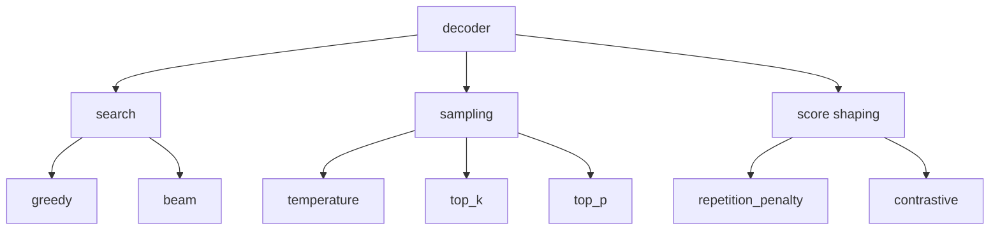

# Beam search — choosing a sequence from next-token scores

`beam_search.py` · Sequences · Tier 2 · 7 variants

## Intuition

A language model answers one question: given the tokens so far, how likely is
each possible next token? Everything about generation is a second question, and
it is a search problem. A sequence of length $T$ over a vocabulary of size $V$
has $V^T$ candidates, and the model only ever scores one step at a time.

```
 step 1        step 2                 step 3
   a 0.6        a a 0.30               a a a 0.15
   b 0.4        a b 0.30               a a b 0.15
                b a 0.04               a b a 0.27
                b b 0.36               a b b 0.03
                                       b a ·  ...
                                       b b a 0.32
                                       b b b 0.04
```

Greedy decoding follows the boldest branch at every step. It is optimal at each
step and not optimal overall, because the best first token can lead to a poor
second one. The table in the figure is exactly that: taking `a` pays $0.6$ and
then splits evenly, while taking `b` pays $0.4$ and then offers $0.9$. Greedy
returns `a a` at $0.30$; the better sequence `b b` is worth $0.36$.

Beam search keeps the $B$ best prefixes at each step and extends all of them. It
is still not exact — a prefix that looks mediocre now can recover later — but it
fixes the failure above, and $B$ is the knob that trades compute for quality.
The rest of the atom is about the other knobs: how to draw a sample instead of
taking an argmax, how to cut the tail of the distribution before drawing, and how
to bias the scores away from repetitions and from generic text.

Temperature rescales the logits before the softmax. Dividing by $T<1$ sharpens
the distribution, multiplying by $T>1$ flattens it, and the exact statement is
that the new probability of a token is its old probability to the power $1/T$,
renormalised. Top-$k$ keeps the $k$ best tokens and renormalises; top-$p$ keeps
the smallest set whose mass reaches $p$. Both are truncation, and truncation
before sampling is what removes the long tail of nonsense without removing the
variety.

Repetition penalty divides the logits of tokens already in the context, which
pushes a model out of a loop. Contrastive decoding subtracts the
log-probabilities of a smaller *amateur* model from those of the expert: a token
that both models like is probably generic, and a token that only the expert likes
is probably a response to the context. Both are score transformations, and both
compose with any of the searches.

The demos use exact tables, so every claim is checkable. A beam of two turns the
$0.30$ greedy answer into $0.36$. A beam wide enough to keep all $27$ prefixes
of a three-token vocabulary matches brute force to the last digit, while a beam
of one ends $0.34$ behind. Top-$p$ at $0.7$ keeps exactly the two tokens holding
$0.75$ of the mass. A penalty of two sends a model that would repeat one token
through four before it locks. Contrastive decoding flips a choice the expert
alone makes, and an end token that greedy never emits wins the beam comparison.

## Variants

| variant | what it does | draw or argmax | cost |
|:--|:--|:--|:--|
| `greedy` | best token at each step | argmax | $O(TV)$ |
| `beam` | best $B$ prefixes at each step | argmax | $O(TBV)$ |
| `temperature` | logits divided by $T$ | draw | $O(TV)$ |
| `top_k` | keep the $k$ best tokens | draw | $O(TV\log V)$ |
| `top_p` | keep the smallest set with mass $p$ | draw | $O(TV\log V)$ |
| `repetition_penalty` | divide scores of used tokens | argmax | $O(TV)$ |
| `contrastive` | subtract an amateur's log-probabilities | argmax | $O(TV)$ |



**`greedy`** takes the argmax at each step. It is the cheapest option and the
baseline every other variant is measured against, and it never recovers from a
bad early token.

**`beam`** keeps the $B$ best prefixes and extends each by every token. It finds
better sequences at $B$ times the cost, and it is exact when $B$ is at least the
number of distinct prefixes at every step.

**`temperature`** samples from $\mathrm{softmax}(z/T)$. It is the standard way to
control how surprising a sample is, and it is a no-op at $T=1$.

**`top_k`** samples from the $k$ best tokens only. The count is fixed, so a peaked
distribution and a flat one get the same amount of variety.

**`top_p`** samples from the smallest set of tokens whose cumulative probability
reaches $p$. The set shrinks when the model is confident and grows when it is
not, which is the property top-$k$ lacks.

**`repetition_penalty`** divides positive logits and multiplies negative ones for
every token in the context. It is the lowest-cost fix for looping, and it is a
blunt instrument because it cannot tell a useful repetition from a degenerate one.

**`contrastive`** subtracts $\alpha$ times the amateur's log-probabilities from
the expert's. It needs a second model, and it targets text that is likely for
reasons unrelated to the prompt.

## Derivation

### The sequence score

An autoregressive model factorises the probability of a sequence into one
conditional per token,

$$
p(y_1,\ldots,y_T)=\prod_{t=1}^{T}p(y_t\mid y_{<t}),\qquad
\log p(y)=\sum_{t=1}^{T}\log p(y_t\mid y_{<t}).
\qquad (1)
$$

The search never sees the product: it sees one row of log-probabilities at a
time, indexed by the prefix. Both searches below are the same recursion over
prefixes, differing only in how many prefixes they keep.

### Greedy

Greedy maximises (1) one factor at a time:

$$
y_t=\arg\max_{v}\ \log p(v\mid y_{<t}).
\qquad (2)
$$

It is exact when the best continuation is independent of the choice made now, and
wrong otherwise. In the figure it picks `a` because $0.6>0.4$ and then has to
settle for $0.5$, so its final score is $\log 0.3$; the sequence `b b` scores
$\log 0.36$. The difference is $0.18$ in log space, and it is entirely due to the
first step.

### Beam search

Let $B_t$ be the set of $B$ highest-scoring prefixes of length $t$. The recursion
is

$$
B_0=\{()\},\qquad
B_t=\mathrm{top}_B\Big\{\big(y_{<t},v\big):\
y_{<t}\in B_{t-1},\ v\in V\Big\},
\qquad (3)
$$

where the score of an item is its prefix score plus
$\log p(v\mid y_{<t})$. Every prefix in $B_{t-1}$ is extended by every token, all
$B V$ candidates are scored, and the best $B$ survive. With $B\ge V^t$ no prefix
is ever pruned and the search is exhaustive, which is how the demo builds an
exact reference for a vocabulary of three.

The cost is the $B V$ scores per step. The reason to prefer a beam over exhaustive
search is that the model's distribution is usually concentrated: the number of
plausible prefixes grows much more slowly than $V^t$.

### Stopping and the end token

Extending a prefix can only lower its score, since
$\log p(y_t\mid y_{<t})\le 0$. So the best score any active prefix can still
reach is its current score. That gives the bound behind the stopping rule:

$$
\max_{y_{<t}\in\text{active}}\ \mathrm{score}(y_{<t})
\le \max_{y\in\text{finished}}\ \mathrm{score}(y)
\quad\Longrightarrow\quad
\text{stop}.
\qquad (4)
$$

The code only applies it once at least $B$ sequences have finished, because a
single early ending is not enough evidence that the search is done. At the end the
finished sequences and the surviving active prefixes are compared together: an
active prefix that never emitted the end token is still a valid continuation when
the length limit is reached.

### Temperature

With logits $z$ and temperature $T>0$, the shaped distribution is

$$
p_T(v)=\frac{\exp(z_v/T)}{\sum_u \exp(z_u/T)}
=\frac{p(v)^{1/T}}{\sum_u p(u)^{1/T}}.
\qquad (5)
$$

The second form is the useful one: raising every probability to $1/T$ and
renormalising is the same operation as dividing the logits. As $T\to0$ the mass
concentrates on the argmax; as $T\to\infty$ it approaches uniform. The demo checks
the identity against a direct softmax of $z/T$ for three temperatures.

### Truncation

Top-$k$ keeps the $k$ largest logits and sets the rest to $-\infty$ before
renormalising:

$$
S_k=\mathrm{topk}(p,k),\qquad
p_k(v)=\frac{p(v)\mathbf{1}[v\in S_k]}{\sum_{u\in S_k}p(u)}.
\qquad (6)
$$

Top-$p$ keeps the shortest prefix of the sorted probabilities whose cumulative
mass reaches $p$:

$$
S_p=\Big\{v_1,\ldots,v_m\Big\},\qquad
m=\min\Big\{j:\sum_{i=1}^{j}p_{(i)}\ge p\Big\},
\qquad (7)
$$

where $p_{(1)}\ge p_{(2)}\ge\cdots$ are the sorted probabilities. The demo's
distribution is $0.5,0.25,0.15,0.1$: at $p=0.7$ the first two already hold
$0.75$, so $m=2$, while top-$k$ with $k=2$ happens to agree and with $k=3$ does
not. On a flat distribution top-$p$ keeps many tokens; on a peaked one it keeps
few, and that is the whole point.

Both are applied before the draw, so the sample is drawn from the renormalised
truncated distribution rather than from the full one.

### Repetition penalty

For a token $v$ that already appears in the context, the CTRL-style penalty is

$$
z'_v=\begin{cases}z_v/\theta & z_v>0,\\ \theta\,z_v & z_v\le 0,\end{cases}
\qquad \theta\ge 1,
\qquad (8)
$$

which moves the logit toward zero from either side. A positive logit shrinks by
the factor $\theta$, a negative one grows in magnitude, and the ranking of used
tokens relative to unused ones drops. The demo uses four logits
$4,3,2.5,2.2$: with $\theta=2$ the model visits $0,1,2,3$ and then locks onto
$0$, because after every token has been used the ranking is the original one
again, scaled. The penalty reads the set of tokens in the context, not their
recency, which is why it cannot produce a long cycle.

### Contrastive decoding

Let $p_e$ be the expert and $p_a$ the amateur, and let $\alpha\ge0$. Contrastive
decoding scores a token by

$$
\log \tilde p(v)=(1+\alpha)\log p_e(v\mid y_{<t})
-\alpha\log p_a(v\mid y_{<t}),
\qquad (9)
$$

and samples or takes the argmax of $\tilde p$. The same expression is the
pointwise mutual information between the token and the context under the two
models:

$$
\log\tilde p(v)=\log p_e(v\mid y_{<t})
+\alpha\log\frac{p_e(v\mid y_{<t})}{p_a(v\mid y_{<t})}.
\qquad (10)
$$

The first term is what the expert wants; the second rewards tokens the expert
likes more than the amateur does. A token both models love has a ratio near one
and gets no bonus, and a token the amateur loves more is actively suppressed. In
the demo the expert's logits are $1.0,0.9,0.9$ and the amateur's are $3,0,0$: the
expert alone picks token $0$, and at $\alpha=0.5$ the amateur's preference for
the same token outweighs the expert's $0.1$ margin, so the choice moves to token
$1$. With $\alpha=0$ the variant reduces to the expert and the choice returns.

### Sampling

The three sampling variants share one loop: shape the logits, exponentiate and
renormalise, draw one token, append it. With a seeded generator the draw is
deterministic, which is what lets the demo compare runs. The categorical draw is

$$
v\sim\mathrm{Categorical}\Big(\frac{\exp z'}{\sum_u\exp z'_u}\Big),
\qquad (11)
$$

and the loop stops at the end token or at the length limit, whichever comes
first. Sampling is not an approximation to the argmax: it explores the
distribution on purpose, which is why the same model produces different
sentences on different seeds.

### Why beam is not exact

The recursion in (3) prunes by current score, and a prefix that is behind now can
still win later. A beam of width $B$ is exact only if the pruned mass is zero,
which in practice means never. The demo makes the gap concrete: on a random table
over three tokens and three steps, a beam of one is $0.34$ behind the brute-force
optimum, while a beam of $27$ is exact. Beam search is a good heuristic with a
knob, not an algorithm with a guarantee.

## Code walkthrough

### Truncating the tail

```python
def _masked_top_k(logits: np.ndarray, k: int) -> np.ndarray:
    """Keep the k largest logits, set the rest to -inf."""
    if k >= logits.size:
        return logits
    order = np.argsort(-logits)
    output = np.full_like(logits, -np.inf)
    output[order[:k]] = logits[order[:k]]
    return output
```

```python
def _masked_top_p(logits: np.ndarray, p: float) -> np.ndarray:
    """Keep the smallest set of tokens whose probability reaches p."""
    probabilities = np.exp(_log_softmax(logits))
    order = np.argsort(-probabilities)
    cumulative = np.cumsum(probabilities[order])
    keep = int(np.searchsorted(cumulative, p) + 1)
    keep = min(max(keep, 1), logits.size)
    output = np.full_like(logits, -np.inf)
    output[order[:keep]] = logits[order[:keep]]
    return output
```

Both functions do the same two things: decide a set, then set everything outside
it to $-\infty$. The $-\infty$ entries survive the later log-softmax as exact
zeros, so the draw can never pick a pruned token. `searchsorted` finds the first
index where the cumulative mass reaches $p$; the `+1` converts that index to a
count, and the clamp keeps at least one token alive even when $p$ is smaller than
the top probability.

### The penalty

```python
        output = logits.copy()
        for token in set(context):
            if 0 <= token < output.size:
                output[token] = (output[token] / self.penalty if output[token] > 0.0
                                 else output[token] * self.penalty)
        return output
```

`set(context)` is the key detail: the penalty depends on whether a token has
appeared at all, not on how often or how recently. Dividing a positive logit and
multiplying a negative one both move it toward zero, which is what makes the rule
symmetric around zero and monotone in the penalty. Guarding the index keeps a
prompt from a larger vocabulary from raising an `IndexError`.

### Shaping the distribution

```python
        shaped = self._penalise(logits, context)
        if self.variant == "contrastive":
            if amateur is None:
                raise ValueError("contrastive decoding needs an amateur model")
            expert = _log_softmax(shaped)
            weak = _log_softmax(self._logits(amateur, context))
            shaped = (1.0 + self.alpha) * expert - self.alpha * weak
            return _log_softmax(shaped)
        if self.variant == "temperature":
            shaped = shaped / self.temperature
        elif self.variant == "top_k":
            shaped = _masked_top_k(shaped, self.k)
        elif self.variant == "top_p":
            shaped = _masked_top_p(shaped, self.p)
        return _log_softmax(shaped)
```

Every variant funnels through one function, which is why they compose with any of
the searches: the search asks for log-probabilities and does not care how they
were produced. Contrastive is the exception that returns early, because it works
in log-probability space rather than on logits — the subtraction in (9) is only
meaningful after both models have been normalised.

### Greedy

```python
    def _argmax(self, scores, prompt: tuple, eos, amateur) -> tuple:
        tokens = prompt
        logprob = 0.0
        for _ in range(self.max_length):
            logits = self._logits(scores, tokens)
            log_probs = self._distribution(logits, tokens, amateur)
            token = int(log_probs.argmax())
            logprob += float(log_probs[token])
            tokens = tokens + (token,)
            if eos is not None and token == eos:
                break
        return tokens, logprob
```

The prefix is a tuple, so extending it is $O(1)$ amortised and hashing it for a
dictionary costs the length of the prefix. `logprob` accumulates the model's own
log-probability of the tokens it chose, and it is what `logprob_` reports after a
call. The `eos` check comes after the append, so the end token is part of the
returned sequence.

### Beam extension

```python
        for _ in range(self.max_length):
            candidates = []
            for tokens, logprob in beams:
                log_probs = self._distribution(self._logits(scores, tokens), tokens,
                                               amateur)
                for token in range(log_probs.size):
                    value = logprob + float(log_probs[token])
                    if not np.isfinite(value):
                        continue
                    if eos is not None and token == eos:
                        finished.append((tokens + (token,), value))
                    else:
                        candidates.append((tokens + (token,), value))
```

This is (3) written out. Each prefix is scored once, not once per extension, so
the model call count is $|B|$ per step rather than $|B|V$. A token whose
log-probability is $-\infty$ — pruned by top-$k$ or top-$p$ — is skipped, which
is what stops a truncated variant from resurrecting the tail inside the beam. The
branch on `eos` is the only structural difference between the finished pool and
the active pool.

### Stopping and the final choice

```python
            candidates.sort(key=lambda item: -item[1])
            beams = candidates[:self.beam]
            if len(finished) >= self.beam:
                best_finished = max(score for _, score in finished)
                if candidates[0][1] <= best_finished:
                    break
        pool = finished + beams
        best = max(pool, key=lambda item: item[1])
        return best[0], best[1]
```

The sort is by negative score, so `candidates[0]` is the best active prefix and
the comparison is against the best finished sequence. Because scores only
decrease, `candidates[0][1]` is an upper bound on anything the active set can
still produce, and the break is safe rather than heuristic. The final `pool`
concatenates both lists; in the demo the early end token wins that comparison,
which greedy never even considers.

### The sampling loop

```python
            probabilities = np.exp(log_probs)
            probabilities = probabilities / probabilities.sum()
            token = int(rng.choice(probabilities.size, p=probabilities))
```

Renormalising after `exp` is not redundant: the log-probabilities are already
normalised, but truncation and contrastive shaping happen in log space and the
exponentiated rows can carry rounding error. Dividing by the sum makes
`rng.choice` receive a valid probability vector, and doing it explicitly keeps
the dependency visible. The generator is seeded per call, so two calls with the
same seed return the same sequence.

### Dispatch

```python
        if self.variant == "beam":
            tokens, logprob = self._beam(scores, prompt, eos, amateur)
        elif self.variant in ("top_k", "top_p", "temperature"):
            tokens, logprob = self._sample(scores, prompt, eos, amateur)
        else:
            tokens, logprob = self._argmax(scores, prompt, eos, amateur)
```

Three searches for seven variants: the sampling variants differ only in how they
shape the distribution, and the shaping variants differ only in which search
consumes them. `decode` also validates the prompt and the end token before any
model call, so a bad argument fails before the expensive part.

## Complexity

Let $T$ be the generated length, $V$ the vocabulary, $B$ the beam width, $P$ the
model's cost per call and $N$ the prompt length.

| operation | model calls | extra work | memory |
|:--|:--|:--|:--|
| greedy | $T$ | $O(TV)$ | $O(N+T)$ |
| beam | $TB$ | $O(TBV\log(BV))$ | $O(BV)$ candidates |
| temperature sample | $T$ | $O(TV)$ | $O(N+T)$ |
| top-$k$ sample | $T$ | $O(TV\log V)$ | $O(V)$ |
| top-$p$ sample | $T$ | $O(TV\log V)$ | $O(V)$ |
| repetition penalty | $T$ | $O(T(N+T))$ | $O(V)$ |
| contrastive | $2T$ | $O(TV)$ | $O(V)$ |

The model call dominates everything else in practice, so the honest comparison is
in calls: greedy and the sampling variants make $T$, beam makes $T B$, and
contrastive doubles the count because it evaluates the amateur as well. The sorts
are over $V$ or $BV$ items and are negligible next to a transformer forward pass.

Memory is the other difference. Greedy keeps one prefix and one distribution;
beam keeps $B V$ scored candidates per step, which is small compared with the
KV cache a real model keeps for the prompt and the generated tokens. The cost of
a wide beam is latency, not memory.

## Failure modes

**Greedy treated as optimal.** The demo's two-step table is the smallest possible
counterexample, and it is not contrived: any model whose first-token preference
disagrees with the joint preference fails the same way. A greedy decoder is a
baseline, not a guarantee.

**A beam that is too narrow.** A beam of one is greedy, and a beam of four can
still prune the eventual winner in the first step. The demo's random table puts a
beam of one $0.34$ behind the optimum; widening it to $27$ closes the gap
exactly. Beam width is a quality knob with a cost, and there is no width that is
correct for every input.

**Beam collapse.** With a beam and a likelihood objective, the highest-scoring
sequence is often short and repetitive, because the end token and common tokens
are cheap. The classic symptom is a beam whose candidates are all the same
sentence with different lengths. Length normalisation or a coverage penalty is
the usual fix.

**Unnormalised scores after shaping.** Truncation sets entries to $-\infty$ and
contrastive subtraction does not preserve normalisation, so the row must be
renormalised before a draw. Skipping the division still produces a valid-looking
sample because `rng.choice` tolerates small errors, and the bug shows up as a
slightly wrong distribution rather than as a crash.

**A temperature of zero.** Division by zero is the obvious failure, and the
constructor refuses it. The subtler one is a temperature so small that the
softmax underflows to a one-hot vector, after which sampling is greedy and the
seeds stop mattering.

**Top-$p$ with a tiny $p$.** The clamp to one token keeps the distribution valid,
but it silently turns top-$p$ into greedy. A caller who wanted variety and got
none should check $p$ before blaming the model.

**A penalty that cannot see recency.** The rule in (8) reads the set of tokens in
the context. Once every token has been used, the ranking returns to the original
one and the loop resumes, as the demo shows. Frequency penalties and
no-repeat-ngram constraints exist because the static penalty cannot express "not
again so soon".

**Contrastive with a badly matched amateur.** The amateur must share the expert's
tokeniser and be weaker in the same domain; otherwise the subtraction suppresses
the right tokens for the wrong reason. An amateur that is stronger than the
expert inverts the objective, and an amateur with a different vocabulary makes
the log-probabilities incomparable.

**The stopping rule with a length limit.** The bound in (4) is about finished
sequences. When the length limit is what stops the search, the comparison is
between truncated continuations of different lengths, and the scores are not
directly comparable without a length normalisation. The demo sidesteps this by
using a short limit; a production decoder has to choose a policy.

**An end token inside a truncated set.** If top-$k$ or top-$p$ removes the end
token, the beam can never finish and always runs to the length limit. The failure
is quiet: the sequences look fine, they are just longer than they should be.

## Applications

**Machine translation.** Beam search was the default decoder for encoder-decoder
translation for years, usually with a length penalty because the raw likelihood
favours short outputs. Widths of four to eight were standard, and the quality
difference against greedy was large enough to justify the cost.

**Speech recognition.** A beam over the CTC lattice or over an attention decoder
is how acoustic models become transcripts, often with an external language model
shaping the scores. The `ctc` atom implements the lattice version of the same
search.

**Summarisation and captioning.** Beam search with a length penalty and a
coverage term is still common for tasks judged on ROUGE or CIDEr, where the
reference is one particular sentence rather than a distribution.

**Code generation.** Sampling with a low temperature and top-$p$ is the default
for code assistants, because a single greedy completion cannot express the
several valid ways to write the same function. The truncation keeps the sample
inside the syntax the model is confident about.

**Creative writing and dialogue.** Temperature and top-$p$ are the knobs users
actually feel. A high temperature increases diversity and the rate of incoherence
together; top-$p$ is the usual compromise because it adapts the candidate set to
the model's confidence.

**Constrained generation.** The same beam machinery carries hard constraints: a
grammar mask sets the logits of illegal tokens to $-\infty$, and the search then
only ever emits valid syntax. JSON mode in production APIs is this idea at the
logit level.

**Retrieval-augmented and tool-using models.** Contrastive decoding and
classifier-free guidance are the same subtraction with different references, and
they are used to make a model attend to the retrieved context instead of falling
back on its prior.

## References

- Graves, A. (2012). Sequence transduction with recurrent neural networks.
  *arXiv:1211.3711*. The introduction of beam search for neural sequence models.
- Sutskever, I., Vinyals, O. & Le, Q. V. (2014). Sequence to sequence learning
  with neural networks. *NeurIPS*. Beam search as the decoder for an
  encoder-decoder translator.
- Huang, L., Zhao, K. & Ma, M. (2017). When to finish? Optimal beam search for
  neural machine translation. *EMNLP*. The stopping rule and its optimality
  condition.
- Holtzman, A., Buys, J., Du, L., Forbes, M. & Choi, Y. (2020). The curious case
  of neural text degeneration. *ICLR*. Why likelihood maximisation produces
  repetitive text, and nucleus sampling.
- Fan, A., Lewis, M. & Dauphin, Y. (2018). Hierarchical neural story generation.
  *ACL*. Top-$k$ sampling for open-ended generation.
- Keskar, N. S., McCann, B., Varshney, L. R., Xiong, C. & Socher, R. (2019). CTRL:
  a conditional transformer language model for controllable generation.
  *arXiv:1909.05858*. The repetition penalty in (8).
- Li, X. L., Holtzman, A., West, P., Liang, Y. & Hashimoto, T. (2023).
  Contrastive decoding: open-ended text generation as optimization.
  *ACL*. The expert-amateur subtraction.
- Su, Y., Lan, T., Wang, Y., Yogatama, D., Kong, L., Liu, L. & Collier, N.
  (2022). A contrastive framework for neural text generation. *NeurIPS*.
  Contrastive search and the degeneracy it targets.
- Meister, C., Vieira, T. & Cotterell, R. (2020). Best-first beam search.
  *TACL*. A variant that keeps the optimality guarantee while pruning.
- Koehn, P. & Knowles, R. (2017). Six challenges for neural machine translation.
  *WMT*. Beam search, length bias and the evaluation gap in practice.
