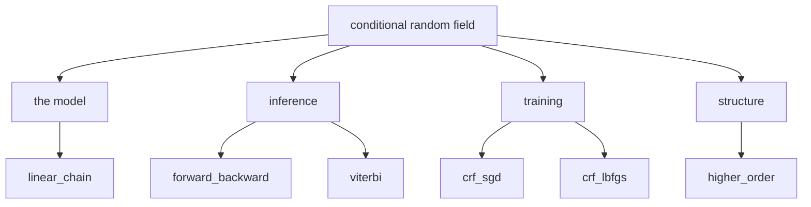

# Conditional random fields — exact inference on a chain

`crf.py` · Sequences · Tier 2 · 6 variants

## Intuition

A classifier that labels each position independently can produce a sequence that
no sensible process would emit: a verb after a determiner, a closing bracket
without an opening one, a state transition the model itself assigns probability
zero. A conditional random field fixes this by scoring a *whole labelling* and
normalising over all labellings, so the model's answer is always a path, and the
training signal is always a path.

The trick is that the score is local even though the probability is global. Each
position contributes a unary term from its features, each adjacent pair
contributes a transition term, and the sequence score is their sum. The
probability is that sum exponentiated and divided by the sum over every possible
labelling — a number that is exponential in the length to write down and linear
to compute, because a chain factors.

```
   x_0     x_1     x_2     x_3
    │       │       │       │
   ┌▼─┐    ┌▼─┐    ┌▼─┐    ┌▼─┐
   │U │    │U │    │U │    │U │     unary scores, one row per position
   └┬─┘    └┬─┘    └┬─┘    └┬─┘
    │  ┌───┐│  ┌───┐│  ┌───┐│
    └─▶│ A │└─▶│ A │└─▶│ A │┘       transition scores between neighbouring labels
       └───┘   └───┘   └───┘
```

Everything in the atom follows from that picture. Forward-backward sums over the
exponential number of paths with two linear passes and, on the way, hands back
the marginal probability of every label at every position. Viterbi replaces the
sum with a maximum and returns the single best path. The gradient of the
likelihood is an expected count minus an observed count, and both counts come
from the same forward-backward pass. Training is then ordinary optimisation:
full-batch descent, minibatch descent, or L-BFGS.

The sixth variant is the interesting extension. A first-order field scores a
transition $A(y_{t-1}, y_t)$, so its state is one label. A second-order field
scores $A(y_{t-2}, y_{t-1}, y_t)$, so its state is a *pair* of labels. All three
algorithms run unchanged once the chain is built over pairs, which is why the
implementation has one inference engine and a small adapter that changes the
state space.

The demos are checks first and stories second. Enumeration of all $243$ paths
agrees with the recursions to $4\times10^{-16}$, the analytic gradient agrees
with central differences to $1.1\times10^{-8}$ for both orders, and posterior
decoding loses $0.32$ of joint score to Viterbi on a random chain because the
best label at each position need not be part of the best sequence. Then a
process that only a pair of labels can predict: labels run
$0,0,1,1,2,2,0,0,\ldots$ through a noisy channel. The first-order field reaches
$0.769$ held-out accuracy at a log-likelihood of $-7.105$; the second-order
field reaches $1.000$ at $-0.001$.

## Variants

| variant | what it adds | what it answers |
|:--|:--|:--|
| `linear_chain` | the model and full-batch descent | scores, labels, a trained field |
| `forward_backward` | the alpha and beta tables | the partition function, marginals |
| `viterbi` | max-plus decoding | the single best labelling |
| `crf_sgd` | minibatch descent with momentum | the same fit, scaled to many sequences |
| `crf_lbfgs` | quasi-Newton with a line search | the same fit in far fewer passes |
| `higher_order` | states are pairs of labels | transitions that depend on two labels |



**`linear_chain`** is the model of (1) plus plain gradient descent on the
negative log-likelihood. It exists as its own variant because the simplest
optimiser makes the objective visible: every iteration is one exact gradient and
nothing else.

**`forward_backward`** exposes the two tables that everything else uses. Asking
it for the tables is how you inspect a model, and its `alpha` and `beta` are the
same arrays the marginal computation consumes.

**`viterbi`** decodes by max-plus dynamic programming and also offers
`posterior_decode`, which takes the per-position argmax of the marginals. The two
disagree often, and the disagreement is instructive rather than a bug.

**`crf_sgd`** takes the same gradient on minibatches with momentum. Each pass
costs a fixed number of gradient evaluations rather than one, but the updates
start moving before the whole training set has been read.

**`crf_lbfgs`** keeps the last few curvature pairs and runs the two-loop
recursion. It reaches the same loss in a quarter of the passes of plain
descent on the demo data, at the price of a line search that evaluates the
objective several times per iteration.

**`higher_order`** replaces the transition with a second-order one by running the
first-order machinery over pairs $(y_{t-1}, y_t)$. The state space grows from
$K$ to $K^2$, so the cost grows by a factor of $K$; nothing else changes.

## Derivation

### The model

Let $f_t\in\mathbb{R}^F$ be the features at position $t$ of one sequence, and
$y_t\in\{0,\ldots,K-1\}$ its label. With weights $W\in\mathbb{R}^{F\times K}$, a
unary bias $b$, transition scores $A\in\mathbb{R}^{K\times K}$, and start and
end scores $s,e\in\mathbb{R}^{K}$, the score of a labelling $y$ is

$$
E(x,y)=\sum_{t=1}^{T}\big(f_t^{\top}W+b\big)_{y_t}
+\sum_{t=2}^{T}A_{y_{t-1},y_t}+s_{y_1}+e_{y_T},
\qquad (1)
$$

and the conditional probability is

$$
p(y\mid x)=\frac{\exp E(x,y)}{Z(x)},\qquad
Z(x)=\sum_{y'}\exp E(x,y').
\qquad (2)
$$

The normaliser is a sum over $K^T$ labellings, which is why the next section
matters. Note what is *not* in the model: no distribution over $x$, and no
independence assumption about the features. The field conditions on the whole
input, which is what separates it from a hidden Markov model. That difference is
also why a CRF does not suffer the label bias problem of a maximum-entropy
Markov model: the transition scores are not renormalised per state before the
observation is seen.

### The forward recursion

Write $u_t=W^{\top}f_t+b$ for the unary scores at position $t$ and define

$$
\alpha_t(j)=u_t(j)+\log\sum_{i}\exp\big(\alpha_{t-1}(i)+A_{ij}\big),
\qquad \alpha_1(j)=s_j+u_1(j).
\qquad (3)
$$

$\alpha_t(j)$ is the log of the total unnormalised score of every prefix of
length $t$ that ends in label $j$. The definition is a sum over prefixes, but the
recursion only needs the previous row: every prefix ending in $i$ can be extended
to $j$ by adding one transition. At the end,

$$
\log Z=\log\sum_{j}\exp\big(\alpha_T(j)+e_j\big).
\qquad (4)
$$

The sum inside (3) is in log space, so it uses the same stable `logsumexp` as the
mixture models. The code is the recursion and nothing else:

```python
        alpha[:, 0] = start + unary[:, 0]
        for t in range(1, length):
            alpha[:, t] = _logsumexp(
                alpha[:, t - 1, :, None] + transition[None], axis=1) + unary[:, t]
        return alpha, _logsumexp(alpha[:, -1] + end[None], axis=1)
```

The shape gymnastics are worth reading once. `alpha[:, t-1, :, None]` is
`(batch, states, 1)`, `transition[None]` is `(1, states, states)`, and the sum is
over the *first* state axis, which is the previous label; the result is
`(batch, states)` indexed by the current label. One axis change turns the
recursion into a batch of matrix operations with no Python loop over states.

### The backward recursion and the marginals

Define the suffix score

$$
\beta_t(i)=\log\sum_{j}\exp\big(A_{ij}+u_{t+1}(j)+\beta_{t+1}(j)\big),
\qquad \beta_T(j)=e_j.
\qquad (5)
$$

Then the marginal probability of label $j$ at position $t$ is the product of the
prefix and suffix that meet there, divided by the partition function:

$$
\gamma_t(j)=\frac{\exp\big(\alpha_t(j)+\beta_t(j)\big)}{Z},
\qquad (6)
$$

and the marginal probability of the transition $i\to j$ between $t$ and $t+1$ is

$$
\xi_t(i,j)=\frac{\exp\big(\alpha_t(i)+A_{ij}+u_{t+1}(j)+\beta_{t+1}(j)\big)}{Z}.
\qquad (7)
$$

In code both are one `exp` away from the tables, because the log partition
function is subtracted inside the exponent:

```python
        node = np.exp(alpha + beta - log_z[:, None, None])
```

```python
            edge = np.exp(alpha[:, :-1, :, None] + transition[None]
                          + (unary[:, 1:] + beta[:, 1:])[:, :, None, :]
                          - log_z[:, None, None, None])
```

The edge tensor is `(batch, steps - 1, states, states)` and its last two entries
satisfy $\sum_{ij}\xi_t(i,j)=1$ for every $t$. The demo checks exactly that, and
checks both tensors against enumeration.

### The gradient

The log-likelihood of a batch is $\sum_n \log Z_n-E(x_n,y_n)$, so its gradient
with respect to any score is the model's expected count of that score minus the
count the observed labels actually produce:

$$
\frac{\partial(-\log p)}{\partial\theta}
=\mathbb{E}_{p(y\mid x)}\Big[\frac{\partial E}{\partial\theta}\Big]
-\frac{\partial E(x,y)}{\partial\theta}.
\qquad (8)
$$

For the unary weights, the expected count of feature $f$ paired with label $k$ is
$\sum_t f_{t}\,\gamma_t(k)$, so

$$
\frac{\partial(-\log p)}{\partial W}
=\sum_t f_t\big(\gamma_t-\mathbf{1}_{y_t}\big)^{\top},
\qquad (9)
$$

and the transition gradient is the expected edge count minus the observed edge
count. The implementation computes the difference once and reuses it:

```python
        difference = (expected - observed) / labels.shape[0]
        grads = {"W_": np.einsum("ntf,ntk->fk", features, difference),
                 "b_": difference.sum(axis=(0, 1))}
```

```python
            grads["A_"] = (edge.sum(axis=(0, 1)) - observed_edge) / labels.shape[0]
```

The observed edge count is a histogram of adjacent label pairs, computed with
`np.add.at` so that repeated pairs accumulate instead of overwriting. The start
and end scores get the same treatment at the first and last position. Dividing by
the batch size makes the loss a mean, which is what the line search and the
learning rates assume.

The whole gradient is exact. There is no sampling, no truncation and no
approximation of $Z$; the demo verifies it against central differences for every
score in both orders.

### Viterbi

Replace every log-sum-exp in (3) with a max and every sum in (4) with a max, and
keep an argmax at each step:

$$
\delta_t(j)=u_t(j)+\max_i\big(\delta_{t-1}(i)+A_{ij}\big),
\qquad \delta_1(j)=s_j+u_1(j),
\qquad (10)
$$

then walk the argmax back from $\arg\max_j(\delta_T(j)+e_j)$. The max-plus
semiring is the log-sum-exp semiring with the sum replaced by a maximum, which is
why the same code shape appears twice:

```python
        for t in range(1, length):
            scores = delta[:, t - 1, :, None] + transition[None]
            back[:, t] = scores.argmax(axis=1)
            delta[:, t] = scores.max(axis=1) + unary[:, t]
```

Viterbi returns the most probable *path*, not the sequence of most probable
labels. The two agree only when one path dominates every marginal, and the demo
measures the gap on a random chain: the posterior path is $0.32$ of joint score
worse than the Viterbi path.

### Training

Any optimiser can consume (9). The three in the atom are deliberately different
in character:

- `linear_chain` takes the full-batch gradient and steps downhill.
- `crf_sgd` takes a minibatch gradient with momentum $0.9$.
- `crf_lbfgs` builds a low-rank approximation of the inverse Hessian from the
  last curvature pairs and takes a line-searched step.

The L-BFGS direction comes from the two-loop recursion: walk backwards through
the stored pairs to build the vector $q$, scale it, then walk forwards to add the
curvature corrections back. The forward half is

```python
            q = grad.copy()
            alphas = []
            for direction, difference in zip(directions[::-1],
                                             differences[::-1], strict=True):
                rho = 1.0 / float(difference @ direction)
                alpha = rho * float(direction @ q)
                q = q - alpha * difference
                alphas.append(alpha)
```

The stored pairs are $(s_k,u_k)$ with $s_k=\theta_{k+1}-\theta_k$ and
$u_k=g_{k+1}-g_k$. A pair is kept only when $s_k^{\top}u_k>10^{-12}$, because a
pair with negative curvature would make the approximate Hessian indefinite; the
ten most recent pairs are enough in practice.

The minibatch update is three lines, and the momentum is what makes a small
batch usable on a sequence model:

```python
                for name, grad in grads.items():
                    velocity[name] = 0.9 * velocity[name] - self.lr * grad
                    setattr(self, name, getattr(self, name) + velocity[name])
```

### Second order

A second-order field scores $A(y_{t-2},y_{t-1},y_t)$, which is not a chain over
labels. It becomes one over *pairs*: define the state $z_t=(y_{t-1},y_t)$ for
$t\ge 2$, and a sentinel state $(\star,y_1)$ for the first position. The
transition from $z_{t-1}=(y_{t-2},y_{t-1})$ to $z_t=(y_{t-1},y_t)$ exists only
when the shared label matches, and its score is $A(y_{t-2},y_{t-1},y_t)$.

$$
z_t=(y_{t-1},y_t)\in\{0,\ldots,K-1\}^2,\qquad
z_1=(\star,y_1).
\qquad (11)
$$

The state space is $K^2+K$ with the sentinel row. The adapter builds exactly that
chain, with impossible transitions set to $-\infty$:

```python
        pair_unary = np.concatenate([unary] * (states + 1), axis=2)
        start = np.full(size, -np.inf)
        start[states * states:] = self.s2_
```

```python
        transition = np.full((size, size), -np.inf)
        for previous in range(states + 1):
            for middle in range(states):
                row = previous * states + middle
                for current in range(states):
                    transition[row, middle * states + current] = self.A2_[
                        previous, middle, current]
```

The unary term is replicated across the $K+1$ copies of the pair, so a position
contributes its evidence once whichever pair it is in. After decoding, the label
sequence is the second coordinate of every pair:

```python
    def _pair_labels(self, path: np.ndarray) -> np.ndarray:
        """Recover labels from a path over pairs (previous, current)."""
        return path % self.n_states_
```

The demo's second-order experiment is the reason to bother. The labels follow
$0,0,1,1,2,2,0,0,\ldots$, so the next label depends on two previous labels and
no first-order transition can express the rule. With $27$ scores the first-order
field is capped by what the emissions say; with $54$ the second-order field
reaches $1.000$ held-out accuracy.

## Code walkthrough

### A stable log-sum-exp

```python
def _logsumexp(values: np.ndarray, axis: int) -> np.ndarray:
    """Log-sum-exp along one axis, safe when an entry is negative infinity."""
    peak = values.max(axis=axis, keepdims=True)
    safe = np.where(np.isfinite(peak), peak, 0.0)
    with np.errstate(divide="ignore"):
        total = safe + np.log(np.exp(values - safe).sum(axis=axis, keepdims=True))
    return np.squeeze(total, axis=axis)
```

The subtle case is a row that is entirely $-\infty$, which happens in the
second-order chain: a pair that cannot follow the previous pair. Its maximum is
$-\infty$, the subtraction would be `nan`, and the whole recursion would be
poisoned. Replacing a non-finite peak with zero makes that row's exponentials
zero, the log of zero is $-\infty$, and the row stays impossible, which is
correct.

### Reading a labelling's score

```python
        if self.order == 1:
            transition = self.A_[labels[:, :-1], labels[:, 1:]].sum(axis=1)
            start = self.s_[labels[:, 0]]
            end = self.e_[labels[:, -1]]
```

Fancy indexing with two label arrays gathers one score per adjacent pair without
a loop, and the sum over positions gives the transition part of (1). The same
expression serves training, where the observed score is subtracted from
$\log Z$, and the demo's scoring of the posterior path against the Viterbi path.

### The mask that is not a mask

```python
        pair_unary = np.concatenate([unary] * (states + 1), axis=2)
```

There is no boolean mask anywhere in the second-order adapter. Illegal pairs are
handled by a transition score of $-\infty$, which the same log-sum-exp treats as
zero probability. That is the log-space equivalent of a mask, and it composes
with the existing recursion instead of requiring a second implementation.

### Checking the tables

```python
    for t in range(length):
        for state in range(states):
            node[:, t, state] = probabilities[:, paths[:, t] == state].sum(axis=1)
```

The brute-force reference in the demo groups the enumerated paths by their label
at each position and sums the probabilities. It is the definition of a marginal,
written in the least efficient way possible, which is exactly what a reference
should be. Enumeration is only possible for a small alphabet and a short chain —
$243$ paths here — and the test is worthless for anything larger, which is why
the recursions exist.

## Complexity

Let $T$ be the length, $K$ the number of labels, $F$ the number of features and
$B$ the batch size.

| operation | time | memory |
|:--|:--|:--|
| unary scores | $O(BTFK)$ | $O(BTK)$ |
| forward or backward | $O(BTK^2)$ | $O(BTK)$ |
| marginals | $O(BTK^2)$ | $O(BTK^2)$ for edges |
| Viterbi | $O(BTK^2)$ | $O(BTK)$ plus backpointers |
| one gradient | $O(BTFK+BTK^2)$ | $O(BTK^2)$ |
| second-order gradient | $O(BTFK+BTK^3)$ | $O(BTK^2)$ |

The transition term dominates unless $F\gg K$. The second-order adapter has
$K^2+K$ states and a transition matrix of that size, but only $K$ outgoing edges
per state are finite, so a sparse implementation would be $O(BTK^3)$ time and
$O(BTK^2)$ memory rather than the dense $O(BTK^4)$ the matrix suggests. A third
order would multiply by another $K$ and is rarely worth it.

### Where the time goes

On the demo's $40$ sequences of length $8$, plain descent takes $400$ gradient
evaluations to reach a loss of $0.6953$; minibatch descent takes $1000$
evaluations across $200$ passes and reaches $0.7316$; L-BFGS takes $321$
evaluations across $100$ iterations and reaches $0.6948$. The quasi-Newton
method wins on both counts here because the parameter count is tiny and the
curvature is informative. The story reverses on a large feature space, where the
$O(md)$ work per iteration and the line search start to matter and stochastic
updates win on wall-clock time.

## Failure modes

**Underflow in linear space.** Multiplying $K^T$ probabilities is hopeless for
any realistic length; the recursions must run in log space, and every sum inside
them must be a `logsumexp`. A single `exp` of raw scores and a product across
positions underflows at around position $30$ for moderate scores.

**A row that is entirely impossible.** If a transition is set to $-\infty$ and a
whole label becomes unreachable, the forward row is $-\infty$ and $\log Z$ is
$-\infty$. That is a modelling error, not a numerical one: some path must remain
possible, or the data is inconsistent with the constraints. The second-order
adapter can produce such rows for a malformed `A2_`, and the log-space arithmetic
turns the symptom into `nan` marginals rather than a crash.

**Posterior decoding mistaken for Viterbi.** Taking the argmax of each marginal
gives a sequence that can have a *lower* joint score than the Viterbi path, and
can even be a sequence the model considers less likely than many others. The demo
shows a $0.32$ gap on a random chain. Structured prediction requires the joint
decoder; per-position accuracy is a different objective.

**Label bias.** A locally normalised model — an MEMM — divides by the outgoing
mass at each state before seeing the observation, so a state with few outgoing
transitions is favoured regardless of the evidence. A CRF avoids this by
normalising once over whole sequences, but only if the transitions are global.
Renormalising anything per position reintroduces the bias.

**Feature leakage across time.** Features that summarise the whole sequence, or
that are computed after the labels are known, make the training likelihood
optimistic and the test likelihood meaningless. The field assumes $f_t$ is a
function of the input only; nothing in the code enforces that.

**Overfitting with few sequences.** There is no regularisation in this atom. With
one sequence and a rich feature map the transition and unary scores can grow
without bound while the training likelihood rises. An L2 penalty is one extra
term in the gradient; the demo's held-out split is the cheap alternative.

**Second-order blow-up.** The state space grows as $K^{\text{order}}$. Three
labels at order two is $12$ states; ten labels at order three is $1100$, and
the transition tensor has more than a million entries. Most of them are zero, which is why real
implementations use sparse transitions or feature-based scoring instead of a
dense tensor.

**Misaligned start and end scores.** The first position gets $s$ but no
transition, the last gets $e$ but no outgoing transition. A loop that applies the
transition at every step double-counts or drops one end, and the symptom is a
likelihood that trains but a Viterbi path that is one label short. The
second-order adapter's sentinel row exists to keep this bookkeeping explicit.

**Optimiser masking a modelling error.** L-BFGS will happily converge to a local
optimum of a misspecified model. The second-order experiment in the demo is a
reminder: the first-order field does not fail to *fit*, it fits as well as its
state space allows and is simply unable to represent the rule, so more iterations
do not help.

## Applications

**Named entity recognition.** The classic use: unary features from word shape,
prefixes and a gazetteer, transition scores that learn "I-ORG cannot follow
B-PER", and Viterbi decoding. The constraints are hard because the transition
scores are global, which is exactly what a per-token classifier cannot promise.

**Part-of-speech tagging and chunking.** Both are sequence labelling with strong
local dependencies, and both were early CRF benchmarks. Sha and Pereira's shallow
parser and Kudo and Matsumoto's chunker are the standard references for the
feature templates that made CRFs competitive before neural taggers.

**Gene finding and biological sequence labelling.** Exon and intron boundaries
are long-range and constrained; a chain with a handful of labels and rich
k-mer features is a natural fit, and the forward-backward marginals give
per-base posterior probabilities for free.

**Speech and handwriting.** Frame-level acoustic scores become unary terms, and
the transition matrix encodes phoneme or character order. CTC, the next atom,
is the neural version of the same alignment problem with a blank symbol and a
sum over alignments instead of a single path.

**Structured output layers.** A bidirectional LSTM or transformer produces the
unaries and a CRF layer supplies the transitions; the layer is trained by the
same negative log-likelihood and decoded by the same Viterbi recursion. The
`crf_lbfgs` optimiser is the piece that a neural framework replaces with
backpropagation and Adam, while the inference stays identical.

**Segmentation with semi-Markov structure.** A segment-level field scores a whole
span rather than a single label, which is the `higher_order` idea taken to
arbitrary length. Semi-Markov CRFs are the standard tool when the duration of a
label matters, as in information extraction or activity recognition.

**Constrained generation.** Any decoder that must emit a valid sequence — a
parser, a finite-state transducer, a schema-constrained generator — can be seen
as a field with hard transitions. Viterbi over that chain is the constrained
decoding, and the partition function is the normaliser that turns scores into
probabilities.

## References

- Lafferty, J., McCallum, A. & Pereira, F. (2001). Conditional random fields:
  probabilistic models for segmenting and labeling sequence data. *ICML*,
  282–289. The original linear-chain CRF and the conditional likelihood.
- Sutton, C. & McCallum, A. (2012). An introduction to conditional random
  fields. *Foundations and Trends in Machine Learning* 4(4), 267–373. The
  forward-backward and Viterbi derivations in full.
- Rabiner, L. R. (1989). A tutorial on hidden Markov models and selected
  applications in speech recognition. *Proceedings of the IEEE* 77(2), 257–286.
  The alpha-beta recursions that the field inherits.
- Viterbi, A. J. (1967). Error bounds for convolutional codes and an
  asymptotically optimum decoding algorithm. *IEEE Transactions on Information
  Theory* 13(2), 260–269. The max-plus recursion.
- Wallach, H. M. (2004). Conditional random fields: an introduction.
  *Technical Report MS-CIS-04-21*, University of Pennsylvania. A short, clear
  derivation aimed at sequence labelling.
- Sha, F. & Pereira, F. (2003). Shallow parsing with conditional random fields.
  *NAACL*, 134–141. Feature templates and the first strong CRF parsing results.
- Kudo, T. & Matsumoto, Y. (2001). Chunking with support vector machines.
  *NAACL*. The structured chunking benchmark that CRFs later dominated.
- Sarawagi, S. & Cohen, W. W. (2004). Semi-Markov conditional random fields for
  information extraction. *NeurIPS*. Segment-level states and the generalisation
  of the chain.
- Huang, Z., Xu, W. & Yu, K. (2015). Bidirectional LSTM-CRF models for sequence
  tagging. *arXiv:1508.01991*. The neural unary plus CRF transition layer.
- Liu, D. C. & Nocedal, J. (1989). On the limited memory BFGS method for large
  scale optimization. *Mathematical Programming* 45, 503–528. The two-loop
  recursion used for `crf_lbfgs`.
- Smith, N. A. (2011). *Linguistic Structure Prediction*. Morgan & Claypool.
  Structured prediction as inference and learning over a graphical model.
