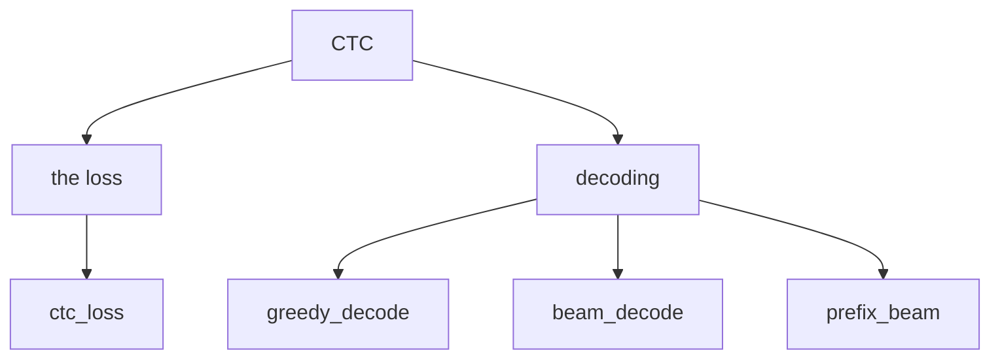

# Connectionist temporal classification — summing over alignments

`ctc.py` · Sequences · Tier 2 · 4 variants

## Intuition

A frame-level sequence model says something at every frame, but the training data
for speech, handwriting or gesture gives one transcription for a whole recording
and no idea where each character starts. CTC makes that mismatch into a
definition: a label sequence is produced by *every* frame path that reduces to
it, and its probability is the sum of those paths' probabilities. Reduce means
merge runs of the same symbol and delete the blank.

```
 frames   f0     f1     f2     f3     f4     f5
 symbols  a      a     •      b      •      a

 collapse: merge aa -> a, drop blanks      ->   a  b  a
```

The blank is the part that is easy to miss. Without it, `a a` at two frames
collapses to a single `a`, so a model could never emit a doubled letter. With it,
the path `a • a` has a blank separator and collapses to `a a`. The blank is also
where the model puts "nothing is happening here", which is most frames of most
recordings.

The sum over paths looks exponential, and it is: there are $C^T$ frame paths for
$T$ frames and $C$ channels. But the paths that collapse to a fixed target form a
lattice with $2S+1$ states, and the sum over lattice paths is two linear
recursions. That is the whole algorithm. Forward gives the likelihood, backward
gives the posterior over lattice states, and their product gives the gradient
with respect to the frame logits, which is exactly the expected count minus the
observed count at every frame and symbol.

Decoding is a separate question. The most likely frame path — take the argmax at
every frame and collapse — is not the most likely label sequence, because one
label sequence owns many frame paths. A beam over collapsed prefixes, keeping
separate probabilities for prefixes that end in a blank and in a label, is the
standard answer. The demos measure the difference rather than assert it: on
$24$ random problems greedy decoding matches the exact marginal decoder $9$
times, a width-eight beam over extended paths matches it $13$ times, and a
width-eight prefix beam $23$ times.

Everything is numpy. The loss matches the enumeration of all $81$ frame paths on
a small lattice to $4\times10^{-16}$, the symbol marginals to $2.2\times10^{-16}$,
and the gradient through a softmax to $8.4\times10^{-10}$. On that lattice the
best single alignment carries only $7.1\%$ of the target's probability, which is
the cleanest statement of what the sum is doing.

## Variants

| variant | what it computes | cost |
|:--|:--|:--|
| `ctc_loss` | likelihood, posterior and gradient | $O(T S)$ per sequence |
| `greedy_decode` | argmax per frame, collapsed | $O(T C)$ |
| `beam_decode` | beam over extended paths | $O(T B C)$ |
| `prefix_beam` | beam over collapsed prefixes | $O(T B C)$ |



**`ctc_loss`** is the forward-backward pass over the extended lattice. It is the
only variant that trains: given frame probabilities and target sequences, it
returns the mean negative log-likelihood and the gradient with respect to the
frame logits. Its `decode` is greedy, so it is a complete model on its own.

**`greedy_decode`** takes the most likely channel at each frame and applies the
collapse rule. It is exact for the best *path*, not for the best *label
sequence*, and it is the baseline that everything else is measured against.

**`beam_decode`** keeps the best `beam` extended paths at each frame, then
collapses them at the end and sums the probabilities of paths that agree. It is a
beam over alignments, so its slots are spent on different phrasings of the same
output.

**`prefix_beam`** searches over collapsed prefixes instead. Each prefix carries
two probabilities — the mass of paths ending in a blank and the mass ending in
the last label — which lets one beam entry stand for every alignment of that
prefix. It is the same search with the alignments merged online.

## Derivation

### The alignment sum

Let $x$ be $T$ frames, $y_t\in\mathbb{R}^{C}$ the model's distribution at frame
$t$, and $\ell=(\ell_1,\ldots,\ell_S)$ a target with $S\le T$. A frame path
$\pi\in\{0,\ldots,C-1\}^T$ collapses to $\ell$ if merging runs and deleting the
blank symbol $b$ gives $\ell$. Then

$$
p(\ell\mid x)=\sum_{\pi\,:\,\mathrm{collapse}(\pi)=\ell}\ \prod_{t=1}^{T}y_t(\pi_t),
\qquad (1)
$$

and training minimises $-\log p(\ell\mid x)$. The number of terms is the number
of alignments, which the atom counts exactly with a small dynamic program; for
two channels and five frames the counts for $1$, $1\,1$ and $1\,1\,1$ are $15$,
$15$ and $1$. Three runs of one label can only be written as `1 blank 1 blank 1`,
so there is exactly one alignment left.

### The extended lattice

Interleave the target with blanks:

$$
\ell'=(b,\ell_1,b,\ell_2,\ldots,b,\ell_S,b)\in\mathbb{N}^{2S+1}.
\qquad (2)
$$

A path through the lattice visits states in order, may stay, may advance one, and
may advance two — the last move skips the blank between two different labels. It
may not advance two into a blank, and it may not skip over a repeated label,
because the two copies would merge. The condition for entering state $s$ from
$s-2$ is therefore

$$
\ell'_s\ne b \quad\text{and}\quad \ell'_s\ne \ell'_{s-2}.
\qquad (3)
$$

The code builds that condition once and reuses it in the forward pass, the
backward pass, the Viterbi alignment and the alignment count.

### Forward and backward

Let $\alpha_t(s)$ be the log of the total probability of every lattice path that
ends in state $s$ at frame $t$ and has emitted frames $1$ to $t$. Then

$$
\alpha_1(1)=y_1(b),\quad \alpha_1(2)=y_1(\ell_1),
\qquad (4)
$$

$$
\alpha_t(s)=y_t(\ell'_s)+\log\!\sum_{s'\in\{s,s-1,s-2\}}
\exp\alpha_{t-1}(s'),
\qquad (5)
$$

with the terms for $s-1$ and $s-2$ dropped at the boundary and $s-2$ dropped when
(3) fails. The likelihood is the sum over the two final states, the last blank
and the last label:

$$
\log p(\ell\mid x)=\log\big(\exp\alpha_T(2S+1)+\exp\alpha_T(2S)\big).
\qquad (6)
$$

The backward table is the same recursion read from the end, and it deliberately
*excludes* the emission at frame $t$:

$$
\beta_T(2S+1)=\beta_T(2S)=0,\qquad
\beta_t(s)=\log\!\sum_{s'\in\{s,s+1,s+2\}}
\exp\big(\beta_{t+1}(s')+y_{t+1}(\ell'_{s'})\big).
\qquad (7)
$$

With both tables the posterior over lattice states at frame $t$ is

$$
\gamma_t(s)=\frac{\exp\big(\alpha_t(s)+\beta_t(s)\big)}{p(\ell\mid x)},
\qquad (8)
$$

and, unlike a hidden Markov model, the two tables multiply rather than one being
a conditional of the other. Summing $\gamma_t(s)$ over the states whose symbol is
$k$ gives the posterior mass on channel $k$ at frame $t$.

### The gradient

Let $z_t(k)$ be the logit behind $y_t(k)$, so $y_t=\mathrm{softmax}(z_t)$.
Differentiating $-\log p$ through the softmax gives the usual form,

$$
\frac{\partial(-\log p)}{\partial z_t(k)}
=y_t(k)-\sum_{s:\,\ell'_s=k}\gamma_t(s),
\qquad (9)
$$

which is the model's probability minus the posterior mass that the target puts on
that channel at that frame. The first term is local; the second is the entire
sequence's opinion about that frame, delivered by the backward pass.

The code scatters the posterior back onto symbols and subtracts:

```python
            mass = np.zeros((frames, channels))
            for state in range(extended.size):
                mass[:, extended[state]] += posterior[:, state]
            gradient[index] = batch[index] - mass
```

Summing (9) over $k$ gives zero, because both terms sum to one. The demo checks
that the frame columns of the gradient sum to $4.4\times10^{-16}$, and that every
entry matches a central difference through the softmax.

### Collapse and greedy decoding

The collapse rule is a single pass with one piece of state, the previous symbol:

$$
\mathrm{collapse}(\pi)_i=\pi_t
\quad\text{if}\quad \pi_t\ne\pi_{t-1}\ \text{and}\ \pi_t\ne b.
\qquad (10)
$$

Greedy decoding applies it to the per-frame argmax. It is exactly the best path
through the lattice with the target left free, which is why it is cheap and why
it is not the best label sequence.

### Beam search

A frame-synchronous beam over *extended* paths keeps the best $B$ paths at each
frame and extends each by every channel. At the end the paths are collapsed and
the ones that agree are summed. Its weakness is visible in the cost: two paths
that differ only by a blank in a place that does not change the collapse occupy
two beam slots for one output.

Prefix search fixes that by making the beam entry a collapsed prefix and
carrying two masses, $p_b$ for paths that end in a blank and $p_{nb}$ for paths
that end in the last label. For a prefix $\ell$ and a channel $k\ne b$ with
$p=p_b+p_{nb}$,

$$
\begin{aligned}
k=b:&\quad p_b'(\ell)\mathrel{+}=p\,y_t(b),\\
k=\ell_{|\ell|}:&\quad p_{nb}'(\ell)\mathrel{+}=p_{nb}\,y_t(k),\quad
p_{nb}'(\ell k)\mathrel{+}=p_b\,y_t(k),\\
\text{otherwise}:&\quad p_{nb}'(\ell k)\mathrel{+}=p\,y_t(k).
\end{aligned}
\qquad (11)
$$

The middle line is the whole trick: emitting the same label twice in a row merges
into the same prefix only if the previous frame was a blank, and otherwise starts
a new run. The code is those three cases:

```python
                        elif prefix and symbol == last:
                            blank, nonblank = updated.get(prefix, (NEG, NEG))
                            merged = float(np.logaddexp(nonblank, p_nonblank + score))
                            updated[prefix] = (blank, merged)
                            longer = prefix + (symbol,)
                            blank, nonblank = updated.get(longer, (NEG, NEG))
                            reopened = float(np.logaddexp(nonblank, p_blank + score))
                            updated[longer] = (blank, reopened)
```

With enough width the prefix beam is exact, and the demo checks that width $32$
matches the enumerated marginal decoder on all $24$ problems.

### The best alignment

Replacing the log-sum-exp in (5) with a max and keeping an argmax gives the
single best path that collapses to a fixed target:

$$
\delta_t(s)=y_t(\ell'_s)+\max_{s'\in\{s,s-1,s-2\}}
\big(\delta_{t-1}(s')\big).
\qquad (12)
$$

The demo's best alignment carries $7.1\%$ of the target's probability, and the
remaining $92.9\%$ is spread over other alignments of the same labels. That ratio
is the difference between a path and a sequence, and it is why CTC needs a sum.

## Code walkthrough

### Interleaving the blank

```python
    def _extended(self, target: np.ndarray) -> np.ndarray:
        """Interleave blanks: blank, l1, blank, l2, ..., lS, blank."""
        extended = np.full(2 * target.size + 1, self.blank, dtype=int)
        extended[1::2] = target
        return extended
```

The odd positions receive the labels and every even position is a blank, so the
lattice has a blank before the first label, between every pair, and after the
last. The two sentinel blanks are what let the model emit silence at either end
without inventing a label for it.

### The skip condition

```python
    def _skip(self, extended: np.ndarray) -> np.ndarray:
        """May state s be reached from s - 2, skipping the symbol between?"""
        allowed = np.zeros(extended.size, dtype=bool)
        index = np.arange(extended.size)
        later = index >= 2
        allowed[later] = ((extended[later] != self.blank)
                          & (extended[later] != extended[index[later] - 2]))
        return allowed
```

A jump into a blank would skip a label, and a jump between two equal labels
would skip the blank that keeps them separate. Both are excluded, and because
the vector is built once, the four algorithms cannot disagree about the lattice.
Getting this condition wrong is the classic CTC bug: the likelihood still runs,
the numbers still look plausible, and repeated letters are silently impossible.

### The forward pass

```python
        for t in range(1, frames):
            previous = alpha[t - 1]
            stay = previous
            step = np.concatenate(([NEG], previous[:-1]))
            jump = np.concatenate(([NEG, NEG], previous[:-2])) if width > 2 else (
                np.full(width, NEG))
            jump = np.where(skip, jump, NEG)
            alpha[t] = log_probs[t, extended] + _lse_rows(np.stack([stay, step, jump]))
```

The three candidates are one row of the previous table shifted by zero, one and
two places. Stacking them into a `(3, width)` array and taking a log-sum-exp along
axis zero is the vectorised form of the three-term sum in (5). Masked candidates
are $-\infty$, so they vanish from the sum without a branch.

### The backward pass

```python
        for t in range(frames - 2, -1, -1):
            following = beta[t + 1] + log_probs[t + 1, extended]
            stay = following
            step = np.concatenate((following[1:], [NEG]))
            jump = np.concatenate((following[2:], [NEG, NEG])) if width > 2 else (
                np.full(width, NEG))
```

The shifts run the other way and the emission is folded into `following`, so
`beta[t]` never contains frame $t$'s own symbol. That convention is what makes
$\alpha_t+\beta_t$ the probability of every path *through* state $s$ at frame $t$
without double-counting the frame.

### Collapsing a path

```python
    def _collapse(self, path) -> np.ndarray:
        """Merge repeats, then delete the blank."""
        output = []
        previous = -1
        for symbol in path:
            if symbol != previous and symbol != self.blank:
                output.append(int(symbol))
            previous = int(symbol)
        return np.array(output, dtype=int)
```

`previous` starts at $-1$, outside the channel range, so the first frame is never
mistaken for a repeat. Merging and deleting in one pass is equivalent to the
textbook two-pass definition, and it is the function the decoders and the
alignment counter share, which is why the loss and the search cannot disagree
about what a path means.

### Extending the beam

```python
                for path, score in beams.items():
                    for symbol in range(channels):
                        extension = path + (symbol,)
                        value = score + float(frame[symbol])
                        old = candidates.get(extension)
                        candidates[extension] = (
                            value if old is None else float(np.logaddexp(old, value)))
```

A tuple is the path, so two extensions that produce the same tuple hash together
and their probabilities merge with `logaddexp`. The beam then keeps the best `B`
tuples. This is a correct beam over alignments and a wasteful one: entries that
collapse to the same output stay separate, which is exactly what the prefix
version avoids.

### Counting the alignments

```python
            for state in range(extended.size):
                total = counts[state]
                if state >= 1:
                    total += counts[state - 1]
                if state >= 2 and skip[state]:
                    total += counts[state - 2]
                following[state] = total
```

The same lattice, with sums of counts instead of log-probabilities, gives the
exact number of frame paths. It is a useful sanity check and a useful warning:
the count is binomial-ish and grows fast, so enumeration is only a reference for
tiny cases.

## Complexity

Let $T$ be the frames, $C$ the channels, $S$ the target length, $B$ the beam
width and $N$ the batch size.

| operation | time | memory |
|:--|:--|:--|
| loss and gradient | $O(NTC + NTS)$ | $O(NTS)$ |
| greedy decode | $O(NTC)$ | $O(NT)$ |
| beam over alignments | $O(NTBC)$ | $O(NTB)$ paths |
| prefix beam | $O(NTBC)$ | $O(NTB)$ prefixes |
| best alignment | $O(NTS)$ | $O(NTS)$ |
| exact marginal decode | $O(C^T)$ | exponential |

The loss is linear in the length because the lattice has $2S+1$ states and each
state has three predecessors. The extended sequence is only twice the target
length, so the cost is dominated by the frame-by-channel matrix rather than by
the target.

### Where the time goes

The two searches share an asymptotic bound and differ by a large constant in
quality. On one problem the exact answer has log probability $-2.311$; a beam
over alignments never finds it at widths $1$ through $32$ and keeps returning a
sequence with $86\%$ of that probability, while the prefix beam finds it at width
$4$. The alignment beam is spending its slots on different placements of blanks
inside the same output; the prefix beam spends one slot per output.

## Failure modes

**The blank at the wrong index.** The blank is a channel like any other, and the
constructor lets it be any index, but every collapse, target check and lattice
builder has to agree on which one. Passing a target that contains the blank is a
silent corruption in a careless implementation: here it raises.

**Skipping a repeated label.** If the skip transition is allowed between two
equal labels, the lattice claims that `a • a` and `a a` are the same path, and
the model loses the ability to represent doubled letters. The condition in (3) is
easy to write as "the destination is not blank" and forget the second half.

**Too few frames for the target.** A target of length $S$ with repeats needs at
least $S$ plus the number of adjacent equal pairs frames. Asking for more than
the lattice can supply makes the forward table entirely $-\infty$; the code
raises instead of returning an infinite loss, because a `nan` in training is
much harder to diagnose than an exception.

**Greedy decoding mistaken for the answer.** The best path is not the best
sequence, and the gap is not small: on the demo's random problems greedy agrees
with the exact marginal decoder $9$ times out of $24$. Production systems decode
with a beam and often with an external language model on top.

**Peaky posteriors and vanishing gradients.** CTC's conditional independence
assumption means the model can become extremely confident at every frame and
still be wrong about the alignment. A frame whose posterior is one-hot
contributes almost no gradient, and a model that collapses to the blank at every
frame minimises a large part of the loss while learning nothing. Blank
probability is worth monitoring directly.

**Beam collapse at the end.** Summing the probabilities of beam entries that
collapse to the same output is an approximation, because entries that were pruned
are gone. A narrow alignment beam can therefore be worse than greedy on some
problems, which is not a paradox: it is the same search with a different
objective.

**The wrong normalisation for a batch.** The gradient here is the mean over
sequences, so it carries a factor $1/N$. Mixing it with a per-sequence loss and a
learning rate tuned for the other convention produces a model that trains at a
different speed and looks like a bad schedule.

**Length leakage through padding.** Padded frames must not contribute to the
loss. Here the batch is rectangular by construction and every sequence uses all
its frames, so the caller is responsible for masking; the demos use equal
lengths, and a real pipeline has to pass `lengths` or slice the frames.

## Applications

**Speech recognition.** CTC is the loss that made end-to-end speech practical:
acoustic frames go in, characters or phonemes come out, and no forced alignment
is needed. DeepSpeech and wav2letter are the canonical systems, and the blank
channel learns to absorb silence, noise and the frames between words.

**Handwriting and OCR.** A line image is a sequence of columns, and the
transcription gives no column boundaries. CTC trains the column model directly,
and a beam with a character language model decodes it.

**Gesture and sign language.** Video frames are labelled with a gloss sequence
for the whole clip. The same lattice handles the unknown segmentation, and the
blank absorbs the transition frames between signs.

**Keyword spotting.** A small vocabulary and a blank-heavy signal make a
lightweight CTC model practical on a device; the peak of the blank posterior is
also a usable voice-activity detector.

**Music transcription.** Audio frames to note sequences, with the blank standing
for silence and the collapse merging the sustained part of a note. The repeated
note problem is real here, which is why the separator blank matters.

**Neural sequence labelling without alignment.** Any task where the input is
longer than the output and the alignment is unknown — protein secondary
structure, sensor event detection, video captioning — can use the same loss. The
`crf` atom is the alternative when the labels are dense and a transition matrix
is affordable.

**Distillation and pseudo-labelling.** A CTC model's posterior over lattice
states is a soft alignment, useful for bootstrapping a frame-level model or for
confidence estimation. `posterior` exposes it directly.

## References

- Graves, A., Fernández, S., Gomez, F. & Schmidhuber, J. (2006). Connectionist
  temporal classification: labelling unsegmented sequence data with recurrent
  neural networks. *ICML*, 369–376. The original loss and the forward-backward
  recursion on the extended lattice.
- Graves, A. (2012). *Supervised Sequence Labelling with Recurrent Neural
  Networks*. Springer. The book-length treatment of CTC, including the
  conditional independence assumption.
- Hannun, A. et al. (2014). Deep speech: scaling up end-to-end speech
  recognition. *arXiv:1412.5567*. The system that made CTC the default for
  end-to-end speech.
- Amodei, D. et al. (2016). Deep speech 2: end-to-end speech recognition in
  English and Mandarin. *ICML*, 173–182. Scale, batch normalisation and the
  engineering around the loss.
- Maas, A., Le, Q. V., O'Neil, T. M. & Ng, A. Y. (2015). Recurrent neural
  network feature generation for robust speech recognition. *ICML*. CTC applied
  to large-vocabulary recognition.
- Hwang, K. & Sung, W. (2016). Character-level incremental speech recognition
  with recurrent neural networks. *ICASSP*. CTC with a character-level beam and
  an external language model.
- Zeyer, A., Schlüter, R. & Ney, H. (2021). Why does CTC result in peaky
  behavior? *arXiv:2105.14849*. The analysis behind the blank-dominating
  posterior and the vanishing-gradient failure mode.
- Graves, A. & Jaitly, N. (2014). Towards end-to-end speech recognition with
  recurrent neural networks. *ICML*, 1764–1772. The MAP and CTC decoders side
  by side.
- Scheidl, H., Fiel, S. & Sablatnig, R. (2018). Word beam search: a connectionist
  temporal classification decoding algorithm. *ICFHR*. Prefix search with
  lexicon and word constraints.
- Kuchaiev, O. et al. (2019). Nemo: a toolkit for building AI applications using
  neural modules. *arXiv:1909.09577*. A production implementation of CTC loss
  and prefix beam search.
