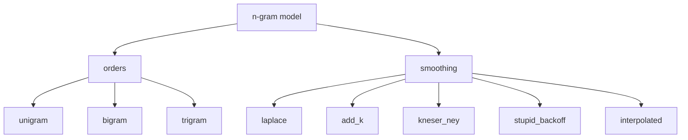

# N-gram language models — counting, smoothing and backoff

`ngram_lm.py` · Sequences · Tier 2 · 8 variants

## Intuition

An n-gram language model predicts a token from the previous $n-1$ tokens and
nothing else. The model is a table: for every context, a count for every token
that followed it. Training is counting; scoring is a lookup; the interesting
part is what to do when the lookup misses.

```
        a    b    c   </s>
 <s>    2    0    0    0
  a     0    2    0    0
  b     0    0    1    1
  c     0    0    0    1
```

The table above is a bigram model of the corpus `a b c` and `a b c`, padded with
the start token `<s>`. Every row sums to the number of times its context
appeared, so the maximum-likelihood estimate is a division. The zeros are the
problem: a held-out sentence that contains `a c` gets probability zero, the log
probability is $-\infty$, and the perplexity of the whole test set is infinite.
Every smoothing method in this atom is an answer to those zeros.

Add-one smoothing puts a phantom count in every cell, which makes the table
dense and the model worse on the cells that were already accurate. Add-$k$
generalises the phantom count, and $k<1$ is usually better than $k=1$.
Interpolation mixes the orders: the trigram estimate gets weight $\lambda$, the
bigram estimate $1-\lambda$, and so on down to the unigram. Backoff keeps the
trigram when it has evidence and drops a token of context when it does not, but
the multiplier that makes the dropped estimate comparable breaks normalisation,
so backoff is a score rather than a probability.

Kneser-Ney is the one that earns its complexity. It discounts every seen count
by a fixed amount $D$ and gives the discounted mass to the shorter context — the
same idea as interpolation — but it changes what the shorter context counts. A
trigram count is the number of times a phrase occurred. A bigram count is the
number of *different trigram contexts* the bigram occurred in. The demo's toy
corpus makes the difference visible: `x` and `a` both appear three times after
some token, but `x` follows three different words and `a` follows two, so the
unigram Kneser-Ney model gives `x` probability $0.241$ and `a` $0.158$. A word
that is always preceded by the same word is not a versatile word, however often
it occurs.

The demos are exact where exactness is available. The maximum-likelihood
probabilities are checked against counts computed by hand ($p(b\mid a)=2/3$ on
the toy corpus). Add-$k$ is checked against $(c+k)/(c+kV)$. Every normalised
variant sums to one over the vocabulary for seen and unseen contexts alike.
Stupid backoff is checked to be exactly $0.4$ times the shorter-context score,
and its rows are checked to sum above one. On a held-out split of a tiny
grammar, the trigram maximum-likelihood model is infinite, add-one is $5.92$,
interpolation is $3.22$ and Kneser-Ney is $3.02$.

## Variants

| variant | estimate | normalised | main weakness |
|:--|:--|:--|:--|
| `unigram` | $c(w)/N$ | yes | ignores order |
| `bigram` | $c(hw)/c(h)$ | yes | sparse |
| `trigram` | $c(hw)/c(h)$ | yes | sparser |
| `laplace` | $(c+1)/(c+V)$ | yes | over-smooths |
| `add_k` | $(c+k)/(c+kV)$ | yes | $k$ must be tuned |
| `kneser_ney` | discounted, continuation counts | yes | needs a good $D$ |
| `stupid_backoff` | $0.4$ times shorter context | no | not a distribution |
| `interpolated` | $\lambda$ longest $+$ rest shorter | yes | fixed $\lambda$ |



**`unigram`** ignores order and predicts from the marginal frequencies. It is
the baseline that shows how much the context is worth, and it is the fallback at
the bottom of every backoff chain.

**`bigram`** conditions on one token. It is the workhorse of the pre-neural era:
small enough for a phone, strong enough for a keyboard.

**`trigram`** conditions on two tokens and is the largest order most classical
systems used. The atom's trigram maximum-likelihood variant is the one that
returns an infinite perplexity on held-out data, on purpose.

**`laplace`** adds one to every count and divides by the context total plus the
vocabulary size. It is add-$k$ with $k=1$, and it is included because it is the
textbook first smoothing method and a useful cautionary tale.

**`add_k`** adds $k$ instead of one. With $k<1$ it is much better than add-one;
the atom exposes $k$ so the demo can show the difference.

**`kneser_ney`** is interpolated absolute discounting with continuation counts at
every order below the longest. It is the best of the normalised variants here and
the standard strong baseline for n-gram models.

**`stupid_backoff`** uses the longest context with a nonzero count and multiplies
by $0.4$ for each token of context it drops. It is not a probability
distribution, and the demo measures that.

**`interpolated`** mixes every order with a fixed weight $\lambda$ on the
longest context. It is Jelinek-Mercer smoothing, and it is what most people mean
by "interpolated n-gram".

## Derivation

### The Markov assumption

A sentence is a sequence $w_1,\ldots,w_T$ with a distinguished end token $w_T=
\mathrm{eos}$. Padding the start with $n-1$ copies of $\mathrm{bos}$ lets every
prediction use a full context, and the model assumes

$$
p(w_{1:T})=\prod_{t=1}^{T}p\big(w_t\mid w_{t-n+1:t-1}\big),
\qquad w_t=\mathrm{bos}\ \text{for}\ t\le0.
\qquad (1)
$$

The approximation is that the next token depends on the last $n-1$ tokens and
nothing earlier. It is wrong about long-range agreement and coreference, and it
is remarkably hard to beat on local statistics.

### Maximum likelihood

For a context $h$ of length $n-1$ and a token $w$, the estimate is the relative
frequency

$$
p_{\mathrm{ML}}(w\mid h)=\frac{c(hw)}{c(h)},\qquad
c(h)=\sum_{w'}c(hw').
\qquad (2)
$$

If $c(hw)=0$ the estimate is zero, and a single zero makes the log probability of
a test sentence $-\infty$. That is the sparsity problem, and it gets worse with
$n$: the number of possible contexts grows as $V^{n-1}$ while the corpus grows
linearly.

The implementation backs off to a shorter context only when $c(h)=0$ itself. An
unseen *continuation* of a seen context stays at zero, which is what the
`smoothing` variants exist to fix.

### Add-k smoothing

The simplest fix puts a phantom count in every cell:

$$
p_k(w\mid h)=\frac{c(hw)+k}{c(h)+kV},\qquad k>0,
\qquad (3)
$$

where $V$ is the number of predictable tokens. The numerator adds $k$ to every
one of the $V$ cells, so the row still sums to one. Add-one is $k=1$. The
estimate is biased toward the uniform distribution, and the bias is severe for
rare contexts: a context seen once gets $1/(1+V)$ for a token it actually
predicted.

### Interpolation

Instead of choosing one order, mix them:

$$
p_{\mathrm{int}}(w\mid h)=\lambda\,p_{\mathrm{ML}}(w\mid h)
+(1-\lambda)\,p_{\mathrm{int}}(w\mid h'),
\qquad h'=h_{2:},
\qquad (4)
$$

with the unigram model as the base case. If every level is normalised then the
mixture is normalised, because a convex combination of distributions is a
distribution. The fixed $\lambda$ is the weakness: a context seen ten thousand
times deserves more weight on its own estimate than one seen twice, and a
constant cannot express that. The implementation uses $\lambda=0$ weight when the
context is unseen, which keeps the recursion normalised.

### Backoff

Backoff uses the longest context with evidence and scales as it drops:

$$
p_{\mathrm{bo}}(w\mid h)=
\begin{cases}
c(hw)/c(h) & c(hw)>0,\\
0.4\,p_{\mathrm{bo}}(w\mid h') & \text{otherwise},
\end{cases}
\qquad (5)
$$

with the unigram relative frequency as the base. The factor $0.4$ is empirical
and has no probabilistic justification. Because each drop multiplies by $0.4$
without redistributing the remaining mass, the scores do not sum to one over $w$;
they can sum above or below. That is fine for ranking and for a downstream
decoder that only needs relative scores, and it is not fine if the number is
called a probability.

### Kneser-Ney

Kneser-Ney starts from absolute discounting. Every nonzero count is reduced by a
fixed $D\in(0,1)$, and the total discount is handed to the shorter context:

$$
p_{\mathrm{KN}}(w\mid h)=
\frac{\max\big(c(hw)-D,\,0\big)}{c(h)}
+\underbrace{\frac{D\,N_{1+}(h\,\cdot)}{c(h)}}_{\gamma(h)}
\,p_{\mathrm{KN}}(w\mid h'),
\qquad (6)
$$

where $N_{1+}(h\,\cdot)$ is the number of distinct tokens that follow $h$. The
first term keeps the observed counts, the second is the mass that was taken away,
and $\gamma(h)$ is exactly the fraction of the context's count that was
discounted.

The continuation-count idea applies the same recursion at lower orders, but with
a different count. For an $m$-gram $g$ with $m<n$,

$$
c_{\mathrm{cont}}(g)=\big|\{u:\ c(ug)>0\}\big|,
\qquad (7)
$$

the number of distinct tokens that can precede $g$. A bigram that occurs in many
different trigram contexts is a versatile bigram; one that only ever occurs after
a single word is not, and the continuation count says so. The recursion uses
$c_{\mathrm{cont}}$ in place of $c$ at every order below the longest, and the
unigram base case is

$$
p_{\mathrm{KN}}(w)=\frac{\max\big(c_{\mathrm{cont}}(w)-D,0\big)}
{\sum_{w'}c_{\mathrm{cont}}(w')}
+\frac{D\,N_{1+}(\cdot)}{\sum_{w'}c_{\mathrm{cont}}(w')}\cdot\frac{1}{V}.
\qquad (8)
$$

The demo's toy corpus is the smallest case that shows the difference. With
`b a x`, `b a a`, `c b x` and `d c x`, both `x` and `a` are followed by something
three times, but `x` follows three distinct words and `a` follows two. The
continuation counts are $3$ and $2$, and the unigram probabilities come out
$0.241$ and $0.158$.

### Perplexity

Perplexity is the geometric mean inverse probability per token:

$$
\mathrm{PP}(D)=\exp\!\left(-\frac{1}{N}\sum_{i=1}^{N}\log p(w_i\mid h_i)\right),
\qquad (9)
$$

where $N$ counts the end token of every sentence. It is the exponential of the
average negative log likelihood, so lower is better and a uniform model over $V$
tokens scores exactly $V$. The end token must be included: a model that is not
charged for ending a sentence will happily prefer never to end one.

### Generation

Sampling walks the chain. Start from $n-1$ start tokens, draw the next token from
the row, append it, drop the oldest token from the context, and stop at the end
token or at the length limit:

$$
w_t\sim p(\cdot\mid w_{t-n+1:t-1}).
\qquad (10)
$$

An n-gram model can loop forever because the state is finite; the length limit is
what makes generation terminate. The demo also removes the unknown token from the
draw, since emitting `<unk>` is never useful text.

## Code walkthrough

### Counting

```python
        for sentence in sentences:
            padded = [BOS] * (self.order - 1) + list(sentence) + [EOS]
            for n in range(1, self.order + 1):
                table = self.counts_[n - 1]
                for start in range(len(padded) - n + 1):
                    gram = tuple(padded[start:start + n])
                    if gram[-1] == BOS:
                        continue
                    table[gram] = table.get(gram, 0) + 1
```

Every order is counted in one pass over the padded sentence. The `gram[-1] == BOS`
skip is the subtle line: a start token is never predicted, so n-grams that end in
one must not inflate the counts. Without it the unigram distribution puts mass on
`<s>` and no longer sums to one over the tokens a sentence can contain.

The context totals are accumulated separately:

```python
        for n in range(2, self.order + 1):
            for gram, count in self.counts_[n - 1].items():
                context = gram[:-1]
                previous = self.totals_[n - 1].get(context, 0)
                self.totals_[n - 1][context] = previous + count
```

`totals_[n - 1][h]` is $c(h)$, the denominator of (2). It is a separate table
because the same context is looked up once per candidate token, and summing the
counts each time would make scoring quadratic in the vocabulary.

### Maximum likelihood

```python
    def _mle(self, history: tuple, word: str) -> float:
        """Maximum likelihood, backing off only when the context is unseen."""
        if not history:
            return self._count((word,)) / self.total_ if self.total_ else 0.0
        total = self._total(history)
        if total == 0:
            return self._mle(history[1:], word)
        return self._count(history + (word,)) / total
```

The base case divides by the number of predicted tokens, not by the number of
tokens including the start padding. The recursion on `total == 0` is a pragmatic
choice: a context the corpus never contained has no maximum-likelihood estimate
at all, and returning the shorter-context estimate is less surprising than
returning zero. An unseen continuation of a *seen* context is not rescued, which
is what makes the trigram variant fail on held-out data.

### Add-k

```python
    def _laplace(self, history: tuple, word: str) -> float:
        vocabulary = len(self.vocabulary_)
        return ((self._count(history + (word,)) + 1.0)
                / (self._total(history) + vocabulary))

    def _add_k(self, history: tuple, word: str) -> float:
        vocabulary = len(self.vocabulary_)
        return ((self._count(history + (word,)) + self.k)
                / (self._total(history) + self.k * vocabulary))
```

Both are (3) with different numerators, and both use `_total`, which returns the
global token count for the empty context. That is what makes the unigram version
sum to one: the denominator is $\sum_w c(w)=N$, the numerator sums to $N$ as
well. The vocabulary includes `<unk>` even when it never occurs, so the phantom
counts cover the possibility of an unknown token.

### Interpolation

```python
    def _interpolated(self, history: tuple, word: str) -> float:
        if not history:
            return self._mle((), word)
        total = self._total(history)
        lower = self._interpolated(history[1:], word)
        if not total:
            return lower
        longest = self._count(history + (word,)) / total
        return self.lam * longest + (1.0 - self.lam) * lower
```

The recursion computes the shorter-context estimate first and then blends. The
`if not total: return lower` line is the normalisation fix: applying the mixture
with a zero longest-context term would multiply the lower estimate by
$1-\lambda$ and lose mass. Returning the lower estimate directly is the
convention that keeps every row summing to one.

### Backoff

```python
    def _stupid_backoff(self, history: tuple, word: str) -> float:
        total = self._total(history)
        count = self._count(history + (word,))
        if total and count:
            return count / total
        if not history:
            return self._count((word,)) / self.total_ if self.total_ else 0.0
        return 0.4 * self._stupid_backoff(history[1:], word)
```

The first branch is the only one that uses the context. The second is the
unigram base, and the third drops one token and multiplies. There is no
renormalisation anywhere, which is why the demo can assert that a row of this
model sums above one. The constant belongs in the code rather than in the
constructor because it is part of the definition of the method, not a tuning
knob.

### Continuation counts

```python
        for m in range(1, self.order):
            table: dict = {}
            for gram in self.counts_[m]:
                shorter = gram[1:]
                table[shorter] = table.get(shorter, 0) + 1
            self.continuation_[m - 1] = table
```

For each $(m+1)$-gram in the raw counts, the suffix of length $m$ gets one
continuation. Because a dictionary is keyed by the suffix, repeated occurrences
of the same context collapse and the value becomes the number of distinct
predecessors in (7). This is the entire Kneser-Ney idea in five lines, and it is
why the same raw bigram count can mean different things at different orders.

The totals and distinct counts are then built for every level, including the
longest, so the recursion can treat the top order and the continuation orders
uniformly:

```python
        for order in range(1, self.order + 1):
            table = (self.counts_[order - 1] if order == self.order
                     else self.continuation_[order - 1])
            totals: dict = {}
            distinct: dict = {}
            for gram, value in table.items():
                context = gram[:-1]
                totals[context] = totals.get(context, 0) + value
                distinct[context] = distinct.get(context, 0) + 1
```

### The Kneser-Ney recursion

```python
        table = (self.counts_[order - 1] if order == self.order
                 else self.continuation_[order - 1])
        total = self.continuation_totals_[order - 1].get(history, 0)
        count = table.get(history + (word,), 0)
        distinct = self.distinct_[order - 1].get(history, 0)
        if order == 1:
            if not total:
                return 1.0 / len(self.vocabulary_)
            weight = self.discount * distinct / total
            held = weight / len(self.vocabulary_)
            return max(count - self.discount, 0.0) / total + held
```

`table` is the raw counts at the top order and the continuation counts below it.
`total` is the denominator, `count` the numerator, and `distinct` is
$N_{1+}(h\,\cdot)$, the number of continuations. The base case spreads the
discounted mass uniformly, which is the only choice available once there is no
shorter context left. The recursion for higher orders is the same expression with
`weight * self._kneser_ney_level(...)`, and because each level is normalised the
result is normalised.

### Scoring a sentence

```python
        history = [BOS] * (self.order - 1)
        total = 0.0
        for word in tokens:
            probability = self.probability(history, word)
            if probability <= 0.0:
                return -np.inf
            total += float(np.log(probability))
            history = (history + [word if word in self.index_ else UNK])[
                -(self.order - 1):] if self.order > 1 else []
```

The history starts as the start padding, and each step appends the token — the
unknown token if it was not in training — and truncates to the context length.
The `probability <= 0` guard returns $-\infty$ explicitly instead of taking the
log of zero, which would raise a warning and produce the same number more
noisily. A token that is out of vocabulary is scored as `<unk>`, so a model that
has seen `<unk>` in training can assign it mass and a model that has not gets
zero from the maximum-likelihood variants.

## Complexity

Let $N$ be the number of training tokens, $n$ the order, $V$ the vocabulary and
$G$ the number of stored n-grams.

| operation | time | memory |
|:--|:--|:--|
| training | $O(Nn)$ | $O(G)$ |
| one probability, MLE | $O(n)$ lookups | $O(1)$ |
| one probability, interpolation | $O(n)$ lookups | $O(1)$ |
| one probability, backoff | $O(n)$ lookups | $O(1)$ |
| one probability, Kneser-Ney | $O(n)$ lookups | $O(1)$ |
| score a sentence | $O(Tn)$ | $O(n)$ |
| perplexity of $M$ tokens | $O(Mn)$ | $O(G)$ |

Training is one pass per order over the corpus, so it is linear in the corpus and
in the order. Scoring is a dictionary lookup per token per level, which is
$O(n)$ and independent of $V$ — that is the reason n-gram models survived so long
in latency-critical systems.

The memory is the number of distinct n-grams, which for a corpus of $N$ tokens
is at most $N$ per order and usually much less because of repeats. The
continuation tables add another copy of the lower orders, so Kneser-Ney costs
roughly twice the storage of the raw counts.

## Failure modes

**Zero counts and infinite perplexity.** The maximum-likelihood trigram model
scores $-\infty$ on the first unseen trigram, and the reported perplexity is
infinite. A number that large is not a bug in the evaluation: it is the model
telling you it assigned no probability to the test set. Check for it before
comparing models.

**The end token left out of the denominator.** If perplexity counts the end token
but the model is never scored on it, every model looks better by a constant
factor and the comparison between orders shifts. The atom scores `</s>` and
counts it, which is the convention that makes $V$ the perplexity of a uniform
model.

**Backoff treated as a probability.** Stupid backoff's rows do not sum to one,
and on the demo corpus one row sums to $1.3$. A downstream calculation that treats
the score as a probability — a mixture weight, a confidence, a likelihood ratio —
is wrong, even though ranking with it works. The variant is included because
the distinction matters in practice.

**Perplexity compared across tokenisations.** A model over characters, over
words and over subwords has a different vocabulary and different numbers of
tokens per sentence, so their perplexities are not comparable. The same model
evaluated with a different end-of-sentence convention is not comparable either.

**Out-of-vocabulary tokens.** Mapping an unseen word to `<unk>` is only useful if
`<unk>` was counted in training. Otherwise every smoothing method except add-$k$
gives it zero, and the effective vocabulary is smaller than the test vocabulary.
The standard fix is to reserve a rare-word bucket during training, not to hope.

**A high order on a small corpus.** A five-gram model of a hundred sentences has
almost no n-gram seen twice, so the effective model is the backoff and the extra
orders only cost memory. The held-out perplexity is the test, not the training
perplexity, which always improves with the order.

**Discounting too hard.** Kneser-Ney with $D$ near one reserves almost all the
mass for the shorter contexts and behaves like a unigram model; with $D$ near
zero it behaves like maximum likelihood and keeps the zeros. The demo uses
$0.75$, which is the usual default, and the right value depends on the corpus.

**Generation that loops.** With a deterministic decoder an n-gram model can
cycle forever between two states, and even with sampling a short cycle is likely.
The length limit is not a detail; the model has no notion of having said enough
unless the end token has enough mass.

**Smoothing that hides a broken tokeniser.** Add-$k$ gives every token a nonzero
probability, so a tokeniser that splits words differently in training and test
produces a finite but meaningless perplexity. Smoothing makes the number
survivable, not correct.

## Applications

**Speech recognition.** N-gram language models were the decoder's language prior
for two decades, and they are still used as a shallow-fusion prior or a
second-pass rescorer because they are cheap and easy to update with a new domain.
KenLM and SRILM are the classic implementations.

**Machine translation.** Statistical MT decoded with a phrase table and an
n-gram language model, and the BLEU gains from moving from a trigram to a
five-gram were real. Neural MT replaced the whole pipeline, and n-gram models
survive as a baseline and as a domain-adaptation trick.

**Keyboard prediction and autocomplete.** A bigram or trigram model over a user's
typing history fits in a phone's memory and predicts the next word with
single-digit millisecond latency. The smoothing choice matters more than the
order when the history is short.

**Spelling correction.** A character n-gram model scores how word-like a
candidate is, and a noisy-channel model combines it with the edit distance. The
same machinery ranks confusions and suggests corrections.

**Compression.** Prediction by partial matching is an n-gram model with escape
probabilities, and it is competitive with modern compressors on text. The
counts, the escapes and the arithmetic coder are the whole algorithm.

**Text classification and authorship.** Character n-gram profiles are a strong
baseline for language identification and authorship attribution, and they are
still used when the training set is tiny.

**Evaluation of tokenisers and corpora.** Perplexity under a fixed n-gram model
is a cheap way to compare tokenisations and to detect a corpus that has shifted
domain, precisely because the model is simple enough to be understood.

## References

- Shannon, C. E. (1948). A mathematical theory of communication. *Bell System
  Technical Journal* 27, 379–423. Entropy, redundancy and the first n-gram
  approximations of English.
- Jelinek, F. & Mercer, R. L. (1980). Interpolated estimation of Markov source
  parameters from sparse data. *Workshop on Pattern Recognition in Practice*.
  The interpolation in (4).
- Katz, S. M. (1987). Estimation of probabilities from sparse data for the
  language model component of a speech recognizer. *IEEE Transactions on
  Acoustics, Speech, and Signal Processing* 35(3), 400–401. Backoff with a
  normalising factor.
- Kneser, R. & Ney, H. (1995). Improved backing-off for m-gram language modeling.
  *ICASSP*, 181–184. Continuation counts and the discounting in (6).
- Chen, S. F. & Goodman, J. (1999). An empirical study of smoothing techniques
  for language modeling. *Computer Speech & Language* 13(4), 359–394. The
  systematic comparison that made Kneser-Ney the default.
- Brants, T., Popat, A. C., Xu, P., Och, F. J. & Dean, J. (2007). Large language
  models in machine translation. *EMNLP-CoNLL*, 858–867. Stupid backoff and the
  0.4 factor.
- Stolcke, A. (2002). SRILM — an extensible language modeling toolkit. *ICSLP*.
  The toolkit that standardised the variants and the file formats.
- Heafield, K. (2011). KenLM: faster and smaller language model queries. *WMT*.
  The data structures that make n-gram queries fast at web scale.
- Rosenfeld, R. (2000). Two decades of statistical language modeling: where do
  we go from here? *Proceedings of the IEEE* 88(8), 1270–1298. A survey of the
  field at its peak.
- Teh, Y. W. (2006). A hierarchical Bayesian language model based on Pitman-Yor
  processes. *ACL*. The Bayesian generalisation that Kneser-Ney approximates.
