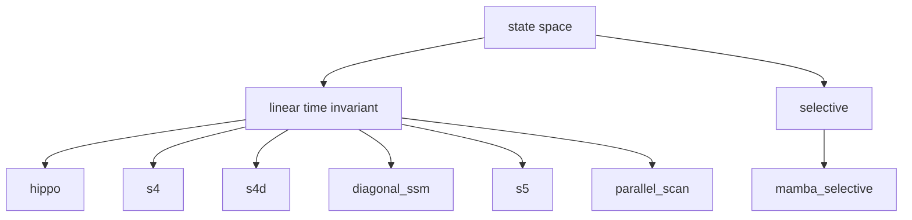

# State-space models — convolution, scan and selection

`ssm.py` · Sequences · Tier 2 · 7 variants

## Intuition

A state-space model carries a vector of numbers from step to step. At each step
it mixes the old state with the new input, then reads an output out of the state:

```
 x_t ──► B ──►(+)──► h_t ──► C ──► y_t
              ▲     │
              └── A ┘
```

Two linear maps and a sum. Because the map is the same at every step, the whole
sequence is a convolution: the impulse response is
$K_j=C A^j B$, and the output is the input convolved with $K$. That gives three
equivalent ways to compute the same numbers — a recurrence, a convolution, and a
matrix power — and the demo checks that they agree to rounding.

The point of the family is what $A$ is. A diagonal $A$ makes $A^j$ a list of
powers, so the kernel is a sum of exponentials and the layer is cheap. A dense
$A$ can be diagonalised once as $A=V\Lambda V^{-1}$, which is the same model in
another basis. The HiPPO initialisation chooses a particular dense $A$ whose state
is a compressed history of the input: a coefficient vector for a Legendre
expansion, with a kernel that decays slowly and keeps a usable memory of old
inputs. S4 is the diagonalised HiPPO, S4D is a diagonal model with a frequency
grid in place of the eigen-decomposition, and S5 is the same diagonal model
applied with a parallel scan instead of a convolution.

The scan is the second idea. A linear recurrence looks serial, but the update is
an associative operation on pairs: composing $(a_1,b_1)$ with $(a_2,b_2)$ gives
$(a_1a_2,\ a_2b_1+b_2)$. Associativity means the steps can be paired in a tree,
so a sequence of length $L$ is scanned in $\log L$ rounds instead of $L$. On a
GPU that is the difference between a kernel launch per step and one scan.

Selection is the third idea, and it is the one that breaks the convolution.
Mamba makes the step size $\Delta_t$, the input map $B_t$ and the output map
$C_t$ depend on the current input. The recurrence is still linear in the state,
but it is no longer linear in the input, so there is no fixed kernel and no FFT.
What it buys is a gate: a large input opens the decay, so the state forgets
quickly; a quiet input keeps it. The demo measures this directly — perturbing the
first token leaves $14\%$ of its trace at step ten when nothing follows, and
$7.7\%$ when a large input arrives at step four.

The last observation is the one that surprises people. Give a random input to
HiPPO, to S4 and to a plain diagonal model of the same state size, and fit a
linear readout that decodes the input at lag $k$ from the state. All three score
identically, to $6.7\times10^{-13}$: $0.606$ at lag one and $0.165$ at lag
sixteen. With one input channel and a linear readout, any two controllable
state-space models of the same dimension span the same $N$-dimensional space of
finite filters. The initialisation changes the basis and the conditioning, not
the linear memory. What actually differs is the cost of applying the model and,
once selection enters, the class of computations it can express.

## Variants

| variant | A | applied by | memory |
|:--|:--|:--|:--|
| `hippo` | dense HiPPO-LegS | convolution, $O(LN^2)$ kernel | designed, long |
| `s4` | HiPPO diagonalised | convolution, $O(LN)$ kernel | same as HiPPO |
| `s4d` | diagonal, frequency grid | convolution | tunable decay |
| `diagonal_ssm` | diagonal, real rates | convolution | exponential |
| `s5` | diagonal, complex | parallel scan | exponential |
| `parallel_scan` | diagonal, random | parallel scan | exponential |
| `mamba_selective` | diagonal, scaled step | sequential | input-dependent |



**`hippo`** builds the HiPPO-LegS matrix and applies it as a convolution. The
matrix is dense, so building the kernel costs $O(LN^2)$, and the state is a
compressed history with a designed basis.

**`s4`** diagonalises that matrix. The eigenvalues are complex, the change of
basis moves $B$ and $C$, and the kernel becomes a sum of $N$ exponentials. The
demo checks that it reproduces the HiPPO kernel to $2.4\times10^{-12}$.

**`s4d`** starts from a diagonal complex $A$ with eigenvalues on a frequency
grid. There is no eigen-decomposition to do and no dense matrix to store; it is
the simplest model that keeps the oscillatory structure.

**`diagonal_ssm`** uses a real diagonal with a geometric spread of decay rates.
It is the easiest variant to reason about, and its kernel has a closed form.

**`s5`** applies the diagonal model with the parallel scan. The mathematics is
identical to `s4d`; the difference is the computation, and the demo checks that
the two agree.

**`parallel_scan`** is the scan itself on a random diagonal model. It is the
variant to read when the point is the algorithm rather than the
parameterisation.

**`mamba_selective`** makes the step size and the input and output maps depend on
the input. It is the only variant without a fixed kernel, and the only one that
can choose what to remember.

## Derivation

### From recurrence to convolution

Let $x_t\in\mathbb{R}$, $h_t\in\mathbb{R}^{N}$, $A\in\mathbb{R}^{N\times N}$ and
$B,C\in\mathbb{R}^{N}$. The layer is

$$
h_t=A h_{t-1}+B x_t,\qquad y_t=C^{\top}h_t,
\qquad (1)
$$

with $h_{-1}=0$. Unrolling the recurrence gives

$$
h_t=\sum_{j=0}^{t}A^{j}B\,x_{t-j},
\qquad
y_t=\sum_{j=0}^{t}\big(C^{\top}A^{j}B\big)x_{t-j}.
\qquad (2)
$$

So the output is a causal convolution of the input with the kernel

$$
K_j=C^{\top}A^{j}B,\qquad j\ge0.
\qquad (3)
$$

Causality is built in: $K_j$ only ever multiplies a past input. The generating
function of the kernel is the transfer function

$$
K(z)=\sum_{j\ge0}K_j z^{j}=C^{\top}(I-zA)^{-1}B,
\qquad (4)
$$

which is where the poles of the system live: the eigenvalues of $A$. A stable
model needs every eigenvalue inside the unit disc, and that is exactly what the
discretisation below guarantees.

### Why diagonal is cheap

If $A=\mathrm{diag}(a_1,\ldots,a_N)$ then $A^{j}=\mathrm{diag}(a_1^{j},\ldots,
a_N^{j})$, and the kernel is a sum of $N$ geometric sequences:

$$
K_j=\sum_{n=1}^{N}C_n\,a_n^{j}\,B_n.
\qquad (5)
$$

Building $L$ kernel entries costs $O(LN)$ instead of $O(LN^2)$, and the layer has
$3N$ parameters instead of $N^2+2N$. The price is that the state can only
represent a sum of exponentials; a dense $A$ can represent any linear system of
dimension $N$.

### Discretisation

The HiPPO matrix is a continuous-time operator $\dot h=A h+B x$. To use it as a
recurrence, the code holds the input constant over a step of length $\Delta$ and
applies the zero-order hold:

$$
\bar A=e^{\Delta A},\qquad
\bar B=A^{-1}\big(\bar A-I\big)B,\qquad
\bar C=C.
\qquad (6)
$$

The code computes $\bar A$ from the eigendecomposition of $A$ and solves the
triangular system for $\bar B$. Using $A$ directly as a discrete transition is
the classic mistake: the HiPPO eigenvalues are $-(n+1)$, outside the unit disc,
so the powers diverge. The demo's ZOH kernel is stable and decays.

### The HiPPO-LegS matrix

HiPPO chooses $A$ so that the state tracks the coefficients of the input history
in an orthogonal polynomial basis. For Legendre polynomials the scaled matrix is

$$
A_{nk}=
\begin{cases}
-\sqrt{(2n+1)(2k+1)} & n>k,\\
-(n+1) & n=k,\\
0 & n<k,
\end{cases}
\qquad
B_n=\sqrt{2n+1},
\qquad (7)
$$

with zero-based indices. It is lower triangular, so its eigenvalues are its
diagonal, $-(n+1)$: stable in continuous time and increasingly fast modes for
higher coefficients. The corresponding kernel decays slowly, which is the memory
the construction is designed for. In the demo the HiPPO kernel is
$7.8\times10^{-3}$ at lag $60$ and $2.4\times10^{-6}$ at lag $240$, against
$5.2\times10^{-2}$ and $6.1\times10^{-6}$ for a real diagonal model with a
comparable slowest rate.

### S4 is a change of basis

A diagonalisable matrix can be written $A=V\Lambda V^{-1}$. Substituting into
(3),

$$
K_j=C^{\top}V\Lambda^{j}V^{-1}B
=\sum_{n=1}^{N}\big(C^{\top}V\big)_n\,\lambda_n^{j}\,\big(V^{-1}B\big)_n,
\qquad (8)
$$

which is the diagonal kernel (5) with $C'=V^{\top}C$, $B'=V^{-1}B$ and
$a_n=\lambda_n$. The model is unchanged; only the numbers used to compute it are.
That is the whole content of "S4 is a diagonal SSM with a special
initialisation". The full S4 paper also adds a low-rank correction to $A$ so that
the diagonalisation is well conditioned; this atom uses the diagonalisation alone,
which is enough to see the identity.

### The parallel scan

For a scalar recurrence $h_t=a_t h_{t-1}+b_t$, define the pair
$p_t=(a_t,b_t)$ and the composition

$$
(a,b)\circ(a',b')=(aa',\ a'b+b').
\qquad (9)
$$

The composition is associative, and the pair for a block of steps is the
composition of the pairs in the block. An inclusive scan applies the operator
across the sequence in $\log_2 L$ doubling rounds:

```
 offset 1:  (a1,b1) (a2,b2) (a3,b3) (a4,b4)
 offset 2:  (a1,b1) (a1a2, a2b1+b2) ...
 offset 4:  the prefix for every position
```

The code's round is two vectorised assignments over the whole sequence, so the
work is $O(L\log L)$ on one processor and the depth is $O(\log L)$ on many. The
demo scans a 37-step recurrence in six rounds and matches the serial loop to
$4.4\times10^{-16}$.

### Selection

Mamba replaces the fixed step with an input-dependent one:

$$
\Delta_t=\mathrm{softplus}\big(w_\Delta x_t+b_\Delta\big),\qquad
h_t=\exp(\Delta_t A)\odot h_{t-1}+\Delta_t B_t x_t,
\qquad (10)
$$

where $A$ is diagonal and negative, and $B_t$ and $C_t$ are linear in $x_t$. The
matrix exponential is now a vector of scalars, so the step is cheap; but $\Delta_t$
depends on the input, so $h_t$ is not a convolution of $x$ with a fixed kernel.
There is no transfer function, no FFT, and no associative scan — the recurrence
must be evaluated in order.

The gate is the point. When $x_t$ is large, $\Delta_t$ grows and
$\exp(\Delta_t A)$ shrinks, so the old state is wiped and the new input is written
in. When $x_t$ is small, $\Delta_t$ is small, the decay is close to one, and the
state persists. In the demo a pulse of one at step zero leaves $14.0\%$ of its
trace at step ten; inserting an input of two at step four drops that to $7.7\%$.
The same model has different memories on different inputs, which no LTI model
can do.

### What a linear readout can see

Let $W\in\mathbb{R}^{N}$ be a readout applied to the state. The filter from
$x_{t-j}$ to $W^{\top}h_t$ has coefficients

$$
g_j=W^{\top}A^{j}B,\qquad j=0,\ldots,N-1.
\qquad (11)
$$

As $W$ ranges over $\mathbb{R}^{N}$, these vectors range over the Krylov space
$\mathcal{K}_N(A,B)=\mathrm{span}\{B,AB,\ldots,A^{N-1}B\}$, which is all of
$\mathbb{R}^{N}$ when the pair is controllable. Every controllable model with the
same state dimension therefore realises the same set of length-$N$ filters, and
a linear probe at a fixed lag cannot tell them apart. The demo's identical scores
are not a coincidence; they are this statement measured.

## Code walkthrough

### The HiPPO matrix

```python
def _hippo_matrix(state: int) -> tuple:
    """HiPPO-LegS: lower triangular, with B_n = sqrt(2n + 1)."""
    matrix = np.zeros((state, state))
    for row in range(state):
        for column in range(state):
            if row > column:
                matrix[row, column] = -np.sqrt((2 * row + 1) * (2 * column + 1))
            elif row == column:
                matrix[row, column] = -(row + 1)
    vector = np.sqrt(2.0 * np.arange(state) + 1.0)
    return matrix, vector
```

The double loop is the definition, written out. The lower triangle is where the
history mixing lives; the diagonal is the decay. Building it is $O(N^2)$ and it
is done once, so the clarity is worth more than a vectorised expression here.
`vector` is both $B$ and the default $C$, which makes the kernel symmetric.

### Discretising it

```python
            matrix, vector = _hippo_matrix(state)
            eigenvalues, vectors = np.linalg.eig(matrix)
            inverse = np.linalg.inv(vectors)
            discrete = np.real(vectors @ np.diag(np.exp(eigenvalues * self.dt))
                               @ inverse)
            self.B_ = np.linalg.solve(matrix, (discrete - np.eye(state)) @ vector)
            self.C_ = vector.copy()
```

This is (6) in four lines. The matrix exponential is evaluated through the
eigen-decomposition, and the real part is taken because the imaginary parts are
rounding noise for a real matrix. The triangular `solve` computes $A^{-1}(\bar
A-I)B$ without forming an inverse. The `discrete` matrix is what `hippo` stores
as `A_`; `s4` goes one step further and diagonalises it.

### Diagonalising

```python
            values, basis = np.linalg.eig(discrete)
            change = np.linalg.inv(basis)
            self.a_ = values
            self.B_ = change @ self.B_
            self.C_ = self.C_ @ basis
```

Equation (8) with the names of the code: `values` are the $\lambda_n$, `change`
is $V^{-1}$, and `self.C_ @ basis` is $C^{\top}V$. From here on the model uses
`a_` and never touches a matrix, so the kernel and the recurrence are both
$O(N)$ per step.

### The scan

```python
    a = np.array(a, copy=True)
    b = np.array(b, dtype=np.result_type(a.dtype, b.dtype), copy=True)
    steps = b.shape[0]
    offset = 1
    while offset < steps:
        b[offset:] = a[offset:] * b[:-offset] + b[offset:]
        a[offset:] = a[offset:] * a[:-offset]
        offset *= 2
    return b
```

The two assignments are one round of the Hillis-Steele scan. The `b` update uses
the *old* `a` on the right-hand side, so the assignments cannot be swapped
without a temporary; the code relies on `a[offset:]` still holding the previous
round's values at the moment `b` is updated. The `dtype` promotion is what lets
the same function scan complex diagonal models: an in-place real array would
silently drop the imaginary part and the check would fail with a warning rather
than an error.

### The kernel, diagonal and dense

```python
        if self.variant == "hippo":
            power = self.B_.astype(float)
            output[0] = float(self.C_ @ power)
            for index in range(1, steps):
                power = self.A_ @ power
                output[index] = float(self.C_ @ power)
            return output
        term = np.asarray(self.C_ * self.B_)
        output[0] = float(np.real(term.sum()))
        for index in range(1, steps):
            term = term * self.a_
            output[index] = float(np.real(term.sum()))
```

The dense branch applies $A$ once per lag, which is $O(LN^2)$. The diagonal
branch multiplies the previous term by `a_`, which is $O(LN)$ and never forms a
matrix. `term` starts at $C\odot B$ and after $j$ updates holds
$C\odot a^{j}\odot B$, whose sum is the kernel entry in (5). Taking the real part
is correct because the output of a real-input system is real even when the
internal basis is complex.

### Forward dispatch

```python
        if self.variant == "mamba_selective":
            return self._forward_selective(array)
        if self.variant in ("hippo", "s4"):
            return np.convolve(array, self.kernel(array.size))[:array.size]
        if self.variant in _SCAN:
            hidden = self._features_diagonal(array)
            return np.real(hidden @ self.C_)
        impulse = self.kernel(array.size)
        return np.convolve(array, impulse)[:array.size]
```

Three engines behind one method. The convolution is `np.convolve`, which is
$O(L^2)$ here and would be an FFT in a production implementation; the scan is
used where the variant is about the scan; and the selective model is the only one
that cannot use either. The `[:array.size]` slice is the causal truncation:
`np.convolve` returns the full linear convolution, whose tail would otherwise
mix in future inputs.

### The selective step

```python
        for index in range(steps):
            delta = float(_softplus(self.w_delta_ * x[index] + self.b_delta_))
            decay = np.exp(-delta * rates)
            write = delta * (self.w_b_ * x[index]) * x[index]
            state = decay * state + write
            output[index] = state
        return output
```

`rates` is the vector of positive rates, so `decay` is $\exp(\Delta_t A)$ with
$A=-\mathrm{diag}(\text{rates})$. `write` is $\Delta_t B_t x_t$ with
$B_t=w_b x_t$, which is why the input appears squared. The step is a Python loop
because the recurrence is genuinely sequential: `delta` and `write` at step $t$
depend on $x_t$, so the scan operator is not constant across the sequence and the
associative trick does not apply.

## Complexity

Let $L$ be the sequence length, $N$ the state size, and $P$ the parameter count.

| operation | time | memory |
|:--|:--|:--|
| dense kernel (`hippo`) | $O(LN^2)$ | $O(L)$ |
| diagonal kernel | $O(LN)$ | $O(L)$ |
| convolution forward | $O(L^2)$, $O(L\log L)$ with FFT | $O(L)$ |
| dense feature recurrence | $O(LN^2)$ | $O(LN)$ |
| diagonal recurrence | $O(LN)$ | $O(LN)$ |
| parallel scan | $O(LN\log L)$ work, $O(\log L)$ depth | $O(LN)$ |
| selective forward | $O(LN)$ sequential | $O(LN)$ |
| parameters | — | $O(N^2)$ dense, $O(N)$ diagonal |

The asymptotics hide the point. The convolution is $O(L\log L)$ with an FFT and
independent of $N$ in the transform, while the scan is $O(LN\log L)$ but has
logarithmic depth and no global transform. On a CPU the FFT usually wins; on a
GPU the scan's parallelism and the avoidance of a large transform buffer can win,
which is why S5 and Mamba use it.

Memory tells the other half of the story. The convolution keeps the kernel and
the input, $O(L)$. The recurrence keeps every state if it needs to backpropagate,
$O(LN)$, which is why a training-time selective model is memory-hungry and why
the efficient kernels recompute states instead of storing them.

## Failure modes

**Using a continuous matrix as a discrete transition.** The HiPPO eigenvalues are
$-(n+1)$, so $A^{j}$ grows like $(n+1)^j$ and the kernel explodes within a few
steps. The zero-order hold in (6) is not an optional refinement; it is what makes
the model stable. The same mistake with a small hand-picked diagonal looks fine
on a short sequence and fails on a long one.

**A step size that is too large.** Even the ZOH can be too coarse: $\bar A$ has
eigenvalues $e^{\Delta\lambda}$, which are stable for any $\Delta>0$ when
$\lambda<0$, but the sampled kernel is a poor approximation of the continuous one
when $\Delta$ is large. The demo uses $\Delta=0.05$ and a state of eight; a
production model tunes $\Delta$ per channel.

**Forgetting the real part.** The diagonal bases are complex, and a real output
comes from taking the real part of $C^{\top}h_t$. Dropping it, or casting a
complex array to real in place, either raises a warning or silently changes the
model. The scan's dtype promotion is there to make that failure loud.

**An ill-conditioned change of basis.** The eigenvectors of a non-normal matrix
can be nearly parallel, and then $V$ and $V^{-1}$ amplify rounding error. S4 adds
a low-rank term to keep the diagonalisation well conditioned; this atom
diagonalises the raw HiPPO matrix, which is fine at $N=8$ and would not be at
$N=256$.

**Reading only the real part of a complex state.** For `s4d` and `s5` the state is
complex, and a linear probe that sees only $\mathrm{Re}(h_t)$ does not span the
same filter space as the real variants. The demo's identical scores are for
`hippo`, `s4` and `diagonal_ssm`, which are real or a real change of basis; the
complex variants are checked by their kernels and scans instead.

**A non-causal kernel.** A convolution with a kernel indexed from $-(L-1)$ to
$L-1$ leaks the future. The code builds only $K_j$ for $j\ge0$ and truncates the
convolution, so the output at $t$ depends on $x_{\le t}$ by construction. A
symmetric kernel would still fit a training set and fail at inference.

**Assuming the scan is always faster.** On one CPU core the serial loop is
$O(L)$ and the scan is $O(L\log L)$; the scan wins only when the rounds run in
parallel. A model that uses a scan for a batch of one on a laptop can be slower
than the loop it replaced.

**The selective model treated as an LTI model.** There is no fixed kernel, so
`kernel()` raises rather than returning something that looks plausible. Caching a
kernel for a selective layer, or applying it with an FFT, silently computes a
different model.

**Softplus overflow.** $\mathrm{softplus}(z)$ is computed with
`logaddexp(0, z)`, which is stable for large $|z|$; a naive `log(1 + exp(z))`
overflows at $z\approx 700$ and returns `inf`, after which the decay is zero and
the state resets at every step.

**The memory claim measured by a linear probe.** As (11) shows, every controllable
LTI model of the same dimension scores the same on a linear readout. A benchmark
that only fits a linear probe cannot distinguish HiPPO from a random diagonal,
and reporting that it does would be a measurement artefact.

## Applications

**Long-range sequence modelling.** S4 set the state of the art on the Long Range
Arena, a suite of tasks with dependencies of thousands of steps, and the
state-space layer is now a standard alternative to attention for long inputs.

**Audio and speech generation.** S4 and S4D model raw waveforms and features with
a kernel that covers a receptive field of seconds, and the convolution form makes
training parallel over the whole clip.

**Language modelling.** Mamba matches transformer perplexity at small and medium
scale while scaling linearly in the sequence length, and hybrid stacks interleave
state-space layers with attention where exact retrieval is needed.

**Time-series forecasting.** A diagonal state-space layer is a learned
exponential-smoothing filter, which is a natural fit for sensor data and
irregular sampling once the step size is made input-dependent.

**Genomics and biological sequences.** Sequences of hundreds of thousands of
bases are where the quadratic cost of attention is prohibitive, and the
convolutional form of an SSM handles them with a fixed-size state.

**Video and long-form generation.** The same kernel handles a temporal axis of
frames; the selective variant can hold a scene summary across cuts and let it
decay when the scene changes.

**Control and filtering.** The recurrence in (1) is a linear filter, and the
Kalman filter is the same model with a stochastic state. The classical
state-space literature is where these equations come from.

**Efficient inference on device.** A diagonal SSM with a small state is a few
multiply-adds per token and no key-value cache, which is attractive for
on-device streaming.

## References

- Kalman, R. E. (1960). A new approach to linear filtering and prediction
  problems. *Journal of Basic Engineering* 82(1), 35–45. The state-space
  recurrence and the filter that shares its equations.
- Gu, A., Goel, K. & Ré, C. (2022). Efficiently modeling long sequences with
  structured state spaces. *ICLR*. S4, the HiPPO initialisation and the
  diagonal-plus-low-rank parameterisation.
- Gu, A., Johnson, M., Goel, K., Saab, K., Dao, T., Rudra, A. & Ré, C. (2021).
  Combining recurrent, convolutional, and continuous-time models with linear
  state space layers. *NeurIPS*. The HiPPO framework and the LegS matrix.
- Gu, A., Gupta, A., Goel, K. & Ré, C. (2022). On the parameterization and
  initialization of diagonal state space models. *NeurIPS*. S4D and the
  frequency-grid initialisation.
- Smith, J. T. H., Warrington, A. & Linderman, S. W. (2023). Simplified
  state space layers for sequence modeling. *ICLR*. S5 and the parallel scan.
- Gu, A. & Dao, T. (2023). Mamba: linear-time sequence modeling with selective
  state spaces. *arXiv:2312.00752*. Input-dependent steps and the selective scan.
- Dao, T. & Gu, A. (2024). Transformers are SSMs: generalized models and
  efficient algorithms through structured state space duality. *ICML*. The
  state-space duality and the hardware-aware scan.
- Blelloch, G. E. (1990). Prefix sums and their applications. Technical report,
  Carnegie Mellon University. The associative scan and its work-depth analysis.
- Orvieto, A., Smith, S. L., Gu, A., Fernando, A., Gulcehre, C., Pascanu, R. &
  De, S. (2023). Resurrecting recurrent neural networks for long sequences.
  *ICML*. The linear recurrent unit, a close relative of the diagonal SSM.
- Fu, D. Y., Dao, T., Saab, K. K., Thomas, A. W., Rudra, A. & Ré, C. (2023).
  Hungry Hungry Hippos: towards language modeling with state space models.
  *ICLR*. The H3 layer and the convolution-scan hybrid.
