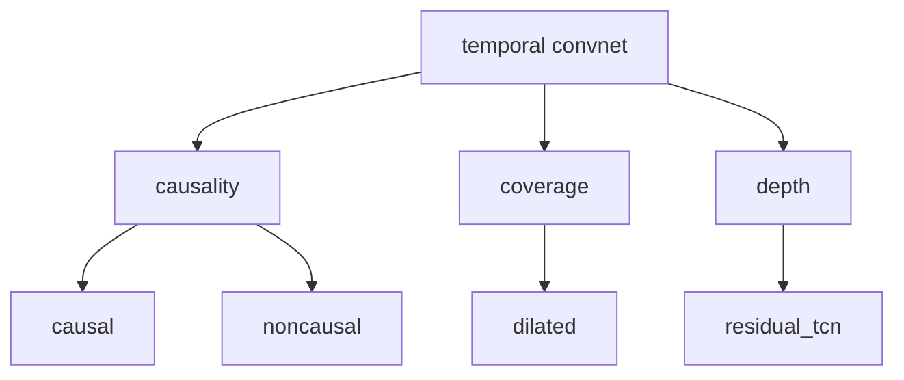

# Temporal convnets — convolution that remembers

`tcn.py` · Sequences · Tier 2 · 4 variants

## Intuition

A convolution along time is a weighted window that slides over the sequence. At
each position it mixes a few neighbouring values with fixed weights, and the same
weights are used everywhere. Stack the operation and each layer composes the
previous window, so the network's view of the past grows with depth.

```
 input   x0 x1 x2 x3 x4 x5 x6 x7
           \  \  \  |  /  /  /
 layer 1    y0 y1 y2 y3 y4 y5 y6     kernel 3, dilation 1, causal
              \     \     \  |
 layer 2       z0    z1    z2 z3     kernel 3, dilation 2, causal
```

The recurrence is replaced by depth. There is no hidden state carried from step
to step, so the whole sequence can be computed in parallel during training, and
the gradient does not have to travel through a long chain of multiplications.
What it costs is a *fixed* memory: a stack of $L$ layers with kernel width $k$ can
only see $1+L(k-1)$ positions, no matter how long the sequence is. A recurrent
network can in principle remember the first frame forever; a convnet cannot.

Dilation is the fix, and it is the main idea in the atom. Layer $l$ spaces its
taps $d_l$ apart instead of one apart, so the window grows exponentially with
depth while the parameter count grows linearly. Five layers with $k=3$ and
$d_l=1,2,4,8,16$ cover $63$ positions with $865$ parameters; a dense causal stack
needs $31$ layers and $6065$ parameters for the same window.

The other three ideas are supporting acts. A *causal* convolution pads only on
the left, so position $t$ never reads the future and the network can run online.
A *residual* block adds the block's input to its output, which puts an identity
in the Jacobian and lets a deep stack train. A *non-causal* convolution pads
symmetrically, which is useful for offline tagging and disqualifying for
streaming — the demo measures the leak rather than asserting it.

The demos are exact where exactness is available. The convolution matches a
direct loop to $9\times10^{-16}$, every parameter gradient matches central
differences to $4\times10^{-11}$, and the impulse response matches the
receptive-field formula exactly: $7$, $63$ and $61$ positions for the three
causal stacks. The delayed-copy task is the payoff. The input is random, the
target is the input from sixteen steps earlier, and a stack that cannot see
sixteen steps back cannot learn it: test loss $0.41$ for the dense stack, and
$0.0003$ once dilation reaches far enough.

## Variants

| variant | padding | dilation | depth |
|:--|:--|:--|:--|
| `causal` | left only | $1$ everywhere | plain stack |
| `dilated` | left only | $b^{l}$ per layer | plain stack |
| `residual_tcn` | left only | $b^{l}$ per block | residual blocks |
| `noncausal` | symmetric | $b^{l}$ per layer | plain stack |



**`causal`** is the baseline: a stack of ordinary convolutions that only look
backwards. It is the right choice for anything online, and it is the variant that
fails the delayed-copy task, which is why it is in the demo.

**`dilated`** doubles the dilation per layer. The receptive field grows as a
geometric series while the parameter count stays linear, and this is the variant
that makes a convnet competitive with a recurrent network on long inputs.

**`residual_tcn`** groups two dilated convolutions into a block and adds the
block's input to its output. The skip connection is what allows the stack to be
deep enough for a long field without the usual optimisation problems.

**`noncausal`** pads on both sides and reads past and future. Offline tagging,
denoising and forecasting from a complete window can use it; a streaming model
cannot, because the output at $t$ depends on inputs that have not arrived.

## Derivation

### The causal convolution

Let $x\in\mathbb{R}^{T\times F}$ be the input, $W_i\in\mathbb{R}^{F\times C}$ the
weight of tap $i$, and $d$ the dilation. The causal convolution is

$$
y_t= b+\sum_{i=0}^{k-1}W_i^{\top}x_{t-id},
\qquad x_s=0\ \text{for}\ s<0,
\qquad (1)
$$

and the sum runs over past positions only. The implementation pads the left by
$(k-1)d$ zeros and then reads the padded array at offsets that map tap $i$ to lag
$i d$; the pad is not a detail, it is the definition of causality.

For the symmetric variant the window is centred instead:

$$
y_t= b+\sum_{i=0}^{k-1}W_i^{\top}x_{t-\lfloor (k-1)d/2\rfloor+id}.
\qquad (2)
$$

The output length is the input length in both cases, because the padding is
chosen to compensate exactly for the dilation. That is a deliberate choice: a
"valid" convolution would shorten the sequence by $(k-1)d$ at every layer, and a
deep stack would run out of positions.

### The receptive field

Let $R_l$ be the number of input positions that affect one output of layer $l$.
One convolution with kernel $k$ and dilation $d$ adds $(k-1)d$ positions to the
window, and composition adds the increments:

$$
R_0=1,\qquad R_l=R_{l-1}+(k-1)d_l,
\qquad (3)
$$

so for a plain stack $R_L=1+(k-1)\sum_l d_l$. With $d_l=b^{l}$ this is the
geometric sum

$$
R_L=1+(k-1)\frac{b^{L}-1}{b-1},
\qquad (4)
$$

which is $63$ for $k=3$, $b=2$, $L=5$. A dense stack needs
$L=(R-1)/(k-1)=31$ layers for the same coverage. The demo measures this by
injecting an impulse and recording which outputs move; the support is exactly
$[t_0,t_0+R_L-1]$ for a causal stack, clipped at the end of the sequence.

For a residual block the increment is doubled, because the block contains two
convolutions with the same dilation:

$$
R^{\text{block}}_L=1+2(k-1)\sum_l d_l.
\qquad (5)
$$

Four blocks with $d=1,2,4,8$ therefore see $61$ positions, one fewer than the
five-layer plain stack, which is why the two are close in the delayed-copy table.

### The residual block

A block computes

$$
h_{l+1}=h_l+F_l(h_l),\qquad
F_l(h)=\mathrm{conv}_{d_l}\big(\mathrm{relu}(\mathrm{conv}_{d_l}
(\mathrm{relu}(h)))\big),
\qquad (6)
$$

with a $1\times1$ stem before the first block to lift the input features to the
hidden width. The skip is not cosmetic: the Jacobian of the block is
$I+\partial F/\partial h$, so the gradient of the loss reaches the early blocks
through the identity even when the convolutional path is small. That is the same
argument as for residual networks in vision, and it is what makes a stack of ten
or twenty blocks trainable.

The code is the forward pass of the block and the two lines of its backward:

```python
                a, first = _conv_forward(incoming, self.params[f"W1_{index}"],
                                         self.params[f"b1_{index}"], dilation,
                                         self.causal)
                mask_a = a > 0.0
                a = _relu(a)
                c, second = _conv_forward(a, self.params[f"W2_{index}"],
                                          self.params[f"b2_{index}"], dilation,
                                          self.causal)
                h = c + incoming
```

```python
                da = dsecond * mask_a
                dconvolved, grads[f"W1_{index}"], grads[f"b1_{index}"] = _conv_backward(
                    da, first)
                dstem = dconvolved + dstem
```

`dstem` starts as the gradient of the block's output and ends as the gradient of
its input; the addition of `dconvolved` to `dstem` is the skip's contribution,
and it appears in exactly the same place as the identity term in (6).

### Backpropagation through a convolution

Write $y_t$ as in (1) and let $d_t=\partial L/\partial y_t$. Then

$$
\frac{\partial L}{\partial W_i}=\sum_t x_{t-id}\,d_t^{\top},\qquad
\frac{\partial L}{\partial x_s}=\sum_i W_i\,d_{s+id},\qquad
\frac{\partial L}{\partial b}=\sum_t d_t.
\qquad (7)
$$

The first sum is a correlation of the input with the output gradient, the second
is a correlation of the output gradient with the flipped kernel, and both are
computed with the same slices of the padded array. The code accumulates them in
one loop over taps:

```python
    for tap in range(kernel):
        offset = (kernel - 1 - tap) * dilation if causal else tap * dilation
        chunk = padded[:, offset:offset + steps, :]
        dweight[tap] = np.einsum("bti,bto->io", chunk, dout)
        dpadded[:, offset:offset + steps, :] += dout @ weight[tap].T
```

The `offset` is the only place where causality and dilation meet, and getting it
wrong flips the kernel or shifts it by a frame; the demo's direct loop is a check
on exactly that expression.

### Training

The model is trained with Adam on half the mean squared error, in minibatches.
There is no weight normalisation and no dropout, because the atom is about the
convolution rather than about regularisation, and the demo's task is small enough
that Adam converges without either. The step is the standard bias-corrected one:

```python
                    moment[name] = 0.9 * moment[name] + 0.1 * gradient
                    velocity[name] = 0.999 * velocity[name] + 0.001 * gradient ** 2
                    corrected = (moment[name] / (1 - 0.9 ** step)
                                 / (np.sqrt(velocity[name]
                                            / (1 - 0.999 ** step)) + 1e-8))
                    self.params[name] -= self.lr * corrected
```

The first and second moments are per parameter, so a weight with a consistently
small gradient still gets a useful step size; that is what lets the same learning
rate work for the input layer and the head.

## Code walkthrough

### Padding

```python
def _pad(x: np.ndarray, kernel: int, dilation: int, causal: bool) -> tuple:
    """Pad along time and report how much went on the left."""
    total = (kernel - 1) * dilation
    left = total if causal else total // 2
    if total == 0:
        return x, 0
    return np.pad(x, ((0, 0), (left, total - left), (0, 0))), left
```

The total padding is $(k-1)d$ in both modes, because that is what the dilated
kernel needs to keep the output length. The split between left and right is the
entire difference between causal and symmetric: all of it on the left, or half
of it on each side. A kernel of width one has nothing to pad, which is why the
residual stem skips the call.

### The forward tap loop

```python
    padded, left = _pad(x, kernel, dilation, causal)
    output = np.zeros((batch, steps, weight.shape[2]))
    for tap in range(kernel):
        offset = (kernel - 1 - tap) * dilation if causal else tap * dilation
        output += padded[:, offset:offset + steps, :] @ weight[tap]
    output += bias
    return output, (padded, left, weight, dilation, causal, x.shape)
```

Each tap is one matrix product over the channel axis and one slice along time, so
the loop runs $k$ times and every iteration is a batched matmul. The kernel is
stored as `(kernel, in, out)`, which makes `padded[...] @ weight[tap]` read as
"mix the channels at this lag". The cache keeps the padded array rather than the
original, because the backward pass reads exactly the same slices.

### Dilation per layer

```python
    def _dilations(self) -> list:
        if self.variant == "causal":
            return [1] * self.layers
        return [self.dilation_base ** index for index in range(self.layers)]
```

The only difference between `causal` and `dilated` is this list. Everything else
— the padding, the convolution, the backward pass, the readout — is shared, which
is why the comparison in the demo is a fair one: the two models have the same
code and differ only in how far apart the taps are.

### The receptive field

```python
        spans = [(self.kernel - 1) * dilation for dilation in self.dilations_]
        if self.variant == "residual_tcn":
            return 1 + 2 * sum(spans)
        return 1 + sum(spans)
```

This is (3) and (5) in two lines. Reporting it is more than cosmetic: a model
whose field is shorter than the dependency in the data will fit the training set
and fail to generalise, and the number is the first thing to check when that
happens.

### Why the copy fails without dilation

```python
def _delayed_copy(seed: int, count: int, length: int, delay: int) -> tuple:
    """A signal and a target that copies it from `delay` steps earlier."""
    rng = np.random.default_rng(seed)
    signal = rng.standard_normal((count, length, 1))
    target = np.zeros_like(signal)
    target[:, delay:] = signal[:, :-delay]
    return signal, target
```

The target at position $t$ is the input at $t-16$, so a model needs a path of
length at least $17$ from that input to that output. A receptive field of $7$ is
not a matter of needing more training: no setting of the weights makes the
dependency visible, so the best the model can do is predict the conditional mean,
which is zero, and the unexplained variance stays. The demo reports exactly that:
$0.41$ for the causal stack against $0.0003$ once the field covers the lag.

## Complexity

Let $T$ be the length, $F$ the input width, $C$ the hidden width, $k$ the kernel,
$L$ the number of layers and $P$ the parameter count.

| operation | time | memory |
|:--|:--|:--|
| one convolution | $O(TkFC)$ | $O(T(kF+C))$ |
| plain stack | $O(TkC^2L)$ | $O(TkC L)$ with caches |
| residual stack | $O(2TkC^2L)$ | $O(2TkC L)$ |
| inference | $O(TkC^2L)$ | $O(TC)$ per layer |
| Adam step | $O(P)$ | $O(P)$ |

The important comparison is with a recurrent network of the same width: a TCN
does $O(TkC^2)$ work per layer but has no sequential dependency, so the $T$ axis
parallelises on a GPU and the wall-clock time is closer to the depth than to the
length. The price is the $O(T)$ activation memory, which a recurrent network
avoids by keeping only the state.

The receptive field grows linearly in the depth for a fixed dilation and
geometrically for a doubling schedule. That is the trade the atom is about: at
fixed parameter count, dilation buys coverage, and at fixed coverage it buys
parameters. At $C=8$, $k=3$ the demo's dense stack needs $6065$ parameters for a
field of $63$ and the dilated stack $865$, a factor of seven.

## Failure modes

**Reading the future.** A symmetric padding is a leak, and a leak is invisible in
training because the model simply gets better. The `noncausal` variant is here to
make the leak measurable: an impulse at position $30$ changes outputs from $27$
onward, while the causal stack starts exactly at $30$. Any streaming claim about
a non-causal model is wrong.

**A receptive field that is too short.** The model cannot learn a dependency it
cannot see, and the failure looks like underfitting rather than like a modelling
mistake. The delayed-copy table is the diagnostic: test loss near the variance of
the target means the field, not the optimiser. Compute $R_L$ before training, not
after.

**Deep stacks without residuals.** A plain stack of twenty dilated layers has a
long field and a hard optimisation problem. The skip connection is not a small
improvement; it is what makes the depth usable. If a deep plain stack trains on
the training set and fails to generalise, the first suspect is the missing
residual, not the regularisation.

**Off-by-one padding.** The output must have the same length as the input, and
the offset in the tap loop must map tap $i$ to lag $i d$. A flipped kernel still
trains — it just learns the time-reversed filter — and a shifted kernel silently
moves every prediction by one frame. The direct-loop check in the demo is cheap
and catches both.

**ReLU dead units.** A large negative bias turns a channel off for every input,
and the gradient through it is exactly zero forever. The atom initialises biases
at zero for this reason; a model that stops improving early is worth checking
channel by channel.

**Aliasing from stride.** Strided convolution and pooling skip positions, which
folds high frequencies onto low ones. Dilation is the alternative for a long
field precisely because it keeps every position; the audio literature learned
this the hard way.

**Padding as a boundary artefact.** A zero pad assumes silence at the start of
the sequence, which is fine for audio and wrong for a series that starts at an
arbitrary level. The first $(k-1)d$ outputs are then driven by the pad rather than
by data, and a masked loss is needed if those positions matter.

**The loss mask on a delayed target.** The first `delay` targets are zero here,
and a model can lower the loss by predicting zero everywhere. That is a real
failure mode when the delay is long and the signal is sparse: the copy region
must dominate the loss, or the model learns the constant.

## Applications

**Audio generation.** WaveNet is a stack of dilated causal convolutions over raw
samples, and the dilation schedule in this atom is its architecture in miniature.
The gate is replaced by a gated activation unit, but the coverage arithmetic is
identical.

**Speech recognition.** A TCN acoustic model is fully parallel during training
and has a fixed lookahead at inference, which is attractive for streaming. The
field is chosen to cover the phonetic context, typically a few hundred
milliseconds.

**Source separation.** Conv-TasNet uses a learned encoder, a deep dilated
convolutional separator and a decoder; the mask estimator is exactly a stack of
the blocks in `residual_tcn`, and the long field is what lets it separate
speakers.

**Sequence modelling benchmarks.** The 2018 comparison of generic convolutional
and recurrent networks found that a well-tuned TCN matches or beats an LSTM on
many sequence tasks, and that the advantage grows with the length of the
dependency — which is the receptive-field argument in one sentence.

**Action segmentation.** Video frames to action labels is an offline task, so a
non-causal or multi-scale TCN is standard; the temporal smoothing a convolution
provides is a feature, not a leak.

**Time-series forecasting.** A causal TCN gives a fixed-lookback forecaster with
no hidden state, which is easy to deploy and easy to reason about. The
`11-time-series` chapter compares it with the recurrent and state-space models.

**Translation and language modelling.** ByteNet and the convolutional
seq2seq models were the first serious alternatives to recurrent encoders, and the
gated convolutional language model of Dauphin et al. showed that the same stack
could model text. Attention replaced them, but the convolution is still the
cheap local mixer in many hybrids.

## References

- van den Oord, A. et al. (2016). WaveNet: a generative model for raw audio.
  *arXiv:1609.03499*. Dilated causal convolutions and the doubling schedule.
- Bai, S., Kolter, J. Z. & Koltun, V. (2018). An empirical evaluation of generic
  convolutional and recurrent networks for sequence modeling.
  *arXiv:1803.01271*. The TCN architecture, the residual block and the benchmark
  against recurrent models.
- Kalchbrenner, N., Espeholt, L., Simonyan, K., van den Oord, A., Graves, A. &
  Kavukcuoglu, K. (2016). Neural machine translation in linear time.
  *arXiv:1610.10099*. ByteNet and the convolutional encoder-decoder.
- Dauphin, Y. N., Fan, A., Auli, M. & Grangier, D. (2017). Language modeling with
  gated convolutional networks. *ICML*, 933–941. Gated linear units over a
  convolutional stack.
- Gehring, J., Auli, M., Grangier, D., Yarats, D. & Dauphin, Y. N. (2017).
  Convolutional sequence to sequence learning. *ICML*, 1243–1252. The
  convolutional alternative to the recurrent encoder.
- Luo, Y. & Mesgarani, N. (2019). Conv-TasNet: surpassing ideal time-frequency
  magnitude masking for speech separation. *IEEE/ACM Transactions on Audio,
  Speech, and Language Processing* 27(8), 1256–1266. Deep dilated blocks for
  source separation.
- Lea, C., Flynn, M. D., Vidal, R., Reiter, A. & Hager, G. D. (2017). Temporal
  convolutional networks for action segmentation and detection. *CVPR*.
  Multi-scale temporal convolution for offline video labelling.
- He, K., Zhang, X., Ren, S. & Sun, J. (2016). Deep residual learning for image
  recognition. *CVPR*, 770–778. The identity skip that makes deep stacks
  trainable.
- Kingma, D. P. & Ba, J. (2015). Adam: a method for stochastic optimization.
  *ICLR*. The optimiser used by the demo.
- Vaswani, A. et al. (2017). Attention is all you need. *NeurIPS*. The
  self-attention layer that replaced the convolutional mixer for long sequences.
