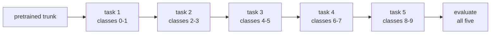

# Continual learning — eight ways to keep old tasks alive

`continual_learning.py` · Training · Tier 3 · 8 variants

## Intuition

A model that learns five tasks in sequence has one obvious failure: it gets
good at the last one and bad at the first. The weights that solve task five
are not the weights that solved task one, and nothing in the loss of task five
mentions task one. This is *catastrophic forgetting*, and it is the default
behaviour, not an edge case.

The demo makes the sequence concrete. Ten classes live on a ring at radius
two, two adjacent classes per task, and the five tasks are visited in order.
A two-layer trunk with a ten-way head is pretrained on a *disjoint* ring
family, so it starts with generic circle features rather than random ones.
Trained jointly on all five tasks it reaches 0.917. Trained sequentially with
no defence it reaches 0.742, and the damage is concentrated where the theory
predicts: the first task falls to 0.56, which is chance for two classes, while
the last task stays at 0.87.



Eight defences attack the problem from four directions. Regularisation keeps
the *weights* near where they were: `ewc` uses a diagonal Fisher, `si` a path
integral of gradient times parameter change, `mas` the gradient of the output
norm on unlabelled data. Rehearsal keeps *examples*: `replay` mixes a small
buffer into every batch, `gem` projects the current gradient so it cannot
increase the loss on the buffer. Distillation keeps the *outputs*: `lwf`
matches the old model's softmax on the new task's inputs. Isolation keeps the
*parameters*: `packnet` gives each task its own units, `lora_merge` gives each
task its own low-rank adapter on a frozen trunk.

| variant | family | what it protects | score |
|:--|:--|:--|--:|
| `ewc` | regularisation | diagonal Fisher of each task | 0.683 |
| `si` | regularisation | path integral of updates | 0.762 |
| `mas` | regularisation | output-norm sensitivity | 0.740 |
| `replay` | rehearsal | twenty examples per task | 0.930 |
| `gem` | rehearsal | gradient constraints from memory | 0.805 |
| `lwf` | distillation | old softmax on new inputs | 0.503 |
| `packnet` | isolation | four units per task per layer | 0.923 |
| `lora_merge` | isolation | rank-two adapter per task | 0.927 |

The ordering is the lesson. The methods that actually store or reserve
something — examples, units, adapters — land at or above joint training. The
methods that only add a penalty to the same shared weights recover part of the
gap, and the two that assume something about the data distribution fail:
`ewc` anchors to a task-one representation that is already specialised, and
`lwf` distils on inputs that do not cover the old tasks' region. Neither is a
bug in the implementation; both are the mechanism meeting a task family it
does not fit.

## Variants

All eight start from the same pretrained trunk and see the same five tasks in
the same order. The differences are entirely in what each one is allowed to
change or keep.

**`ewc`** — Elastic weight consolidation. After each task, the diagonal of the
Fisher information is estimated on that task's training set and accumulated.
Later tasks pay a quadratic penalty for moving parameters with a large
accumulated Fisher. It reaches 0.683, below naive: the Fisher is measured
*after* the first task has already moved the trunk, so the penalty protects a
representation that is good for task one and mediocre for the rest.

**`si`** — Synaptic intelligence. Instead of a Fisher, it accumulates, online,
the product of each update and the gradient that produced it. Parameters that
consistently contributed to lowering the loss become expensive to move; the
importance is clamped at zero so a parameter that helped and then hurt does not
become repulsive. It reaches 0.762, the best of the three regularisers, because
the path integral measures the actual trajectory rather than a local curvature
at the task boundary.

**`mas`** — Memory aware synapses. The importance of a parameter is the
sensitivity of the squared output norm to it, averaged over the task's inputs,
with no labels required. It reaches 0.740. The unlabelled signal is cheaper
than a Fisher but noisier, and normalising each parameter's importance by its
mean keeps the penalty from being dominated by the head.

**`replay`** — Keep twenty examples per task and concatenate the buffer with
every new batch. The loss is computed over all classes present in the batch, so
old logits keep receiving positive gradient. It reaches 0.930, essentially
joint training, at the cost of storing data and of a batch that grows with the
sequence.

**`gem`** — Gradient episodic memory. It stores the same twenty examples per
task but instead of replaying them, it computes their gradient at the current
parameters and projects the current gradient onto the half-spaces where the
memory loss does not increase. The projection is a small quadratic program,
solved through its non-negative dual. It reaches 0.805: the constraint is
first-order, the memory is small, and task four collapses to 0.52 anyway.

**`lwf`** — Learning without forgetting. It keeps a copy of the model from the
end of the previous task and adds a temperature-two KL term that asks the new
model to reproduce the old softmax on the new task's inputs. It reaches 0.503,
which is worse than doing nothing. The reason is structural: the new task's
inputs are a different sector of the ring, so matching the old model there says
nothing about the old sector, and the KL term competes with the new task's
cross-entropy over the shared head.

**`packnet`** — Parameter isolation by pruning. Each task trains on all units
that are still free, ranks them by the norm of their outgoing weights, keeps
the best four per layer, and fine-tunes those for 200 steps. The kept units are
frozen; later tasks may only use the remaining ones. At inference the task's
mask is applied, so old tasks are reproduced exactly. It reaches 0.923, and its
limit is capacity: four units per task times five tasks uses twenty of the
thirty-two units per layer.

**`lora_merge`** — Low-rank adaptation. The trunk is frozen after pretraining.
Each task first trains its two head rows for 300 steps, then trains a rank-two
adapter on both trunk matrices plus the head for 400 steps. At inference the
adapter is merged into the weight, $W + AB$, so the forward pass is unchanged.
It reaches 0.927: no forgetting by construction, and the adapter adds little
because the pretrained features already separate the rings.

## Derivation

### The sequential objective

Let $\mathcal D_t$ be the data of task $t$ and $\theta_t$ the parameters after
finishing it. Sequential training solves, for each $t$,

$$
\theta_t=\arg\min_\theta\ \mathbb E_{(x,y)\sim\mathcal D_t}
\left[-\log p_\theta(y\mid x)\right],
\qquad (1)
$$

with no term mentioning $\mathcal D_1,\dots,\mathcal D_{t-1}$. The joint
solution, which the demo computes as a reference, minimises the sum of all five
losses at once. Forgetting is the gap between the two.

### Regularisation: EWC, SI and MAS

EWC adds a quadratic anchor to the previous parameters:

$$
L_t(\theta)=L_t^{\mathrm{CE}}(\theta)
+\frac{\lambda}{2}\sum_i F_i\left(\theta_i-\theta_{t-1,i}\right)^2,
\qquad (2)
$$

where $F_i$ is the diagonal Fisher information of task $t$,

$$
F_i=\mathbb E_{x\sim\mathcal D_t}
\left[\left(\frac{\partial}{\partial\theta_i}
\log p_\theta(y\mid x)\right)^2\right].
\qquad (3)
$$

The code estimates (3) with one backward pass per training point and
accumulates it across tasks. A parameter that mattered a lot to any earlier
task becomes expensive to move. The penalty's gradient is
$\lambda F_i(\theta_i-\theta_{t-1,i})$, which is what `_fit_ewc` adds to the
cross-entropy gradient.

SI replaces the Fisher with a path integral along the optimisation trajectory:

$$
\Omega_i=\sum_t-\Delta\theta_i^{(t)}\,g_i^{(t)},
\qquad \Delta\theta_i^{(t)}=\theta_i^{(t)}-\theta_i^{(t-1)},
\qquad (4)
$$

where $g_i^{(t)}$ is the gradient at step $t$. A parameter that moved a long
way in a direction that reduced the loss accumulates a large $\Omega_i$; a
parameter that oscillated accumulates little. The penalty has the same
quadratic form as (2) with $\Omega_i$ in place of $F_i$, and the importance is
clamped at zero after each task so it cannot turn into a repulsive force.

MAS needs no labels. It measures how sensitive the output is to each parameter:

$$
\Omega_i=\mathbb E_x\left|
\frac{\partial}{\partial\theta_i}\frac12\|f_\theta(x)\|^2
\right|,
\qquad (5)
$$

and then uses the same penalty. The absolute value keeps positive and negative
sensitivities from cancelling, and dividing by the mean importance keeps the
penalty comparable across layers.

### Rehearsal: replay and GEM

Replay changes the objective rather than the penalty:

$$
\theta_t=\arg\min_\theta\ L_t^{\mathrm{CE}}(\theta)
+\sum_{s<t}\mathbb E_{(x,y)\sim\mathcal M_s}
\left[-\log p_\theta(y\mid x)\right],
\qquad (6)
$$

where $\mathcal M_s$ is a small stored subset of task $s$'s data. The code
concatenates the buffer with the current batch and lets the ordinary
cross-entropy do the work; the only subtlety is that the gradient mask must
cover every class present in the batch, not just the current task's two.

GEM keeps the same memory but constrains the update instead of replaying it.
For the current gradient $g$ and the memory gradients $g_k$ of earlier tasks,
it solves

$$
\tilde g=\arg\min_{v}\ \frac12\|v-g\|^2
\quad\mathrm{s.t.}\quad v^\top g_k\ge 0,\ k<t.
\qquad (7)
$$

The constraint says that a small step along $\tilde g$ cannot increase any
stored task's loss to first order. The dual is a non-negative quadratic
program,

$$
\tilde g=g+G^\top\lambda,\qquad
\lambda=\arg\min_{\lambda\ge0}\ \frac12\lambda^\top GG^\top\lambda
+\lambda^\top Gg,
\qquad (8)
$$

with $G$ the matrix whose rows are the $g_k$. The code solves (8) by projected
gradient for 200 iterations. It uses plain SGD, not Adam: the guarantee in (7)
is about the direction of the update, and Adam's per-parameter rescaling
destroys that relationship.

### Distillation: LwF

LwF keeps a copy of the previous model and adds a soft-target term on the new
task's inputs:

$$
L_t(\theta)=L_t^{\mathrm{CE}}(\theta)
+\lambda T^2\,\mathrm{KL}\left(
p_{\mathrm{old}}^{T}(x)\,\|\,p_{\mathrm{new}}^{T}(x)\right),
\qquad (9)
$$

with $p^{T}(x)=\mathrm{softmax}(f(x)/T)$. The gradient with respect to the new
logits is $\lambda T(p_{\mathrm{new}}^{T}-p_{\mathrm{old}}^{T})$, which is what
`_fit_lwf` backpropagates. The $T^2$ factor compensates for the $1/T$ inside
the softmax gradient.

Everything in (9) is evaluated on $x\sim\mathcal D_t$. That is the assumption:
the new inputs must be representative of the old ones. In this sequence they
are not, which is why the variant loses to naive.

### Isolation: packnet and LoRA

Packnet assigns each task a binary mask over the trunk:

$$
f_t(x)=f\left(x;M_t\odot\theta\right),
\qquad \sum_{t=1}^{T}M_t\le\mathbf 1,
\qquad (10)
$$

so masks are disjoint and a task's parameters cannot be touched by a later
task. The demo uses a unit-level budget of four units per layer per task,
which is the structured version of the original weight-level pruning. The
mask is applied both during training (so the task sees only its units) and at
inference (so it is reproduced exactly).

LoRA leaves the trunk $W$ alone and learns a low-rank correction per task:

$$
W_t=W+AB,\qquad A\in\mathbb R^{d\times r},\ B\in\mathbb R^{r\times k},
\qquad (11)
$$

with $r=2$. At inference the product is folded into the weight, so the merged
model has the same shape and the same forward cost as the base. The base never
changes, which is why retention is exact; the rank is the capacity limit.

### Measuring forgetting

The demo reports mean accuracy over the five tasks. A sharper statistic is
backward transfer,

$$
\mathrm{BWT}=\frac{1}{T-1}\sum_{t=1}^{T-1}
\left(a_{T,t}-a_{t,t}\right),
\qquad (12)
$$

where $a_{t,t}$ is task $t$'s accuracy right after learning it and $a_{T,t}$ is
its accuracy at the end. A negative BWT is forgetting; zero is perfect
retention. The per-task vectors printed by the demo are the rows of that
matrix, so they show *which* tasks were lost, not just how much.

### Why EWC can lose to naive

Equation (2) anchors to $\theta_{t-1}$, but $\theta_{t-1}$ is itself the result
of fine-tuning on task $t-1$. With a pretrained trunk, task one moves the trunk
toward its own two classes; the Fisher then declares those moved parameters
important, and the strong penalty blocks tasks two through five from reshaping
the trunk back. Naive training has no such anchor, so later tasks can at least
reuse the trunk, and the last two tasks score 0.93 and 0.87. The anchor is only
as good as the model it is measured on, and here it is measured too late.

## Code walkthrough

The sequence is five slices of one ring, two adjacent classes per slice. The
only thing that makes the tasks different is which sector of the ring they
occupy.

```python
    for t in range(N_TASKS):
        classes = np.arange(t * PER_TASK, (t + 1) * PER_TASK)
        keep = np.isin(y, classes)
        xt, yt = x[keep], y[keep]
        order = rng.permutation(len(xt))
        xt, yt = xt[order], yt[order]
        cut = int(0.7 * len(xt))
        tasks.append((xt[:cut], yt[:cut], xt[cut:], yt[cut:]))
```

Every variant shares one forward pass. Masks gate activations, adapters add a
low-rank term to the weight, and both are optional, so the same function
serves dense training, packnet and LoRA.

```python
def _forward(params: dict, x: np.ndarray, mask1=None, mask2=None,
             ad1=None, ad2=None):
    w1 = params["W1"] if ad1 is None else params["W1"] + ad1[0] @ ad1[1]
    w2 = params["W2"] if ad2 is None else params["W2"] + ad2[0] @ ad2[1]
    z1 = x @ w1 + params["b1"]
    a1 = np.maximum(z1, 0.0)
    if mask1 is not None:
        a1 = a1 * mask1
    z2 = a1 @ w2 + params["b2"]
    a2 = np.maximum(z2, 0.0)
    if mask2 is not None:
        a2 = a2 * mask2
    return a2 @ params["W3"] + params["b3"], (x, z1, a1, z2, a2, w1, w2)
```

The backward pass has one job that a naive implementation gets wrong: the
gradient mask `rows` must be applied to the logits *after* the softmax, so a
task's cross-entropy only updates its own two output rows even though the
normaliser runs over all ten classes.

```python
    if dlogits is None:
        shifted = logits - logits.max(axis=1, keepdims=True)
        prob = np.exp(shifted)
        prob /= prob.sum(axis=1, keepdims=True)
        d = prob.copy()
        d[np.arange(len(y)), y] -= 1.0
        d /= len(y)
        if rows is not None:
            allowed = np.zeros(N_CLASSES)
            allowed[np.asarray(rows)] = 1.0
            d *= allowed
```

EWC accumulates a Fisher per task and anchors at the task boundary. The
penalty is a closure over the anchor and the running Fisher, so the training
loop only ever sees a function from parameters to gradients.

```python
            if t:
                def penalty(p, anchor=anchor, fisher=fisher):
                    return {key: EWC_LAMBDA * fisher[key] * (p[key] - anchor[key])
                            for key in fisher}
            _train(self.params, self.data[t][0], self.data[t][1], rows,
                   self.steps, self.lr, penalty=penalty)
            count = len(self.data[t][0])
            task_fisher = _zeros(self.params)
            for i in range(count):
                grads = _backward(self.params, self.data[t][0][i:i + 1],
                                  self.data[t][1][i:i + 1], rows)
                for key in task_fisher:
                    task_fisher[key] += grads[key] ** 2 / count
            for key in fisher:
                fisher[key] += task_fisher[key]
```

SI needs the *change* in each parameter, so it cannot use the generic
`_train`; it runs its own loop and records the product of the step and the
gradient that produced it. The clamp at the end is part of the algorithm.

```python
                _adam(self.params, grads, state, step, self.lr)
                for key in grads:
                    path[key] += -grads[key] * (self.params[key] - previous[key])
                    previous[key] = self.params[key].copy()
            for key in importance:
                importance[key] = np.maximum(importance[key] + path[key], 0.0)
```

MAS reuses the backward pass with a different seed gradient: the logits
themselves are the derivative of $\frac12\|f\|^2$, so passing them as
`dlogits` gives the output-norm sensitivity without labels.

```python
            logits = _forward(self.params, self.data[t][0])[0]
            grads = _backward(self.params, self.data[t][0], self.data[t][1],
                              rows, dlogits=logits / len(self.data[t][0]))
            for key in importance:
                weight = np.abs(grads[key])
                importance[key] += weight / (weight.mean() + 1e-12)
```

Replay is a concatenation. The subtle line is `rows = np.unique(y)`: the
gradient mask has to cover the replayed labels too, or the buffer's examples
would be trained against the wrong rows.

```python
            if examples:
                x = np.vstack([x] + examples)
                y = np.concatenate([y] + labels)
                rows = np.unique(y)
            _train(self.params, x, y, rows, self.steps, self.lr)
```

GEM's projection is the non-negative dual of (8), solved by projected
gradient. The constraints are recomputed at the current parameters every step,
which is what makes the first-order guarantee meaningful.

```python
    constraints = np.stack([_flatten(_backward(params, x, y, rows))
                            for x, y, rows in memory])
    gram = constraints @ constraints.T + 1e-9 * np.eye(len(memory))
    linear = constraints @ current
    dual = np.zeros(len(memory))
    rate = 1.0 / (np.linalg.norm(gram, 2) + 1e-9)
    for _ in range(200):
        dual = np.maximum(0.0, dual - rate * (gram @ dual + linear))
    projected = current + constraints.T @ dual
```

LwF's extra gradient is the soft-target difference (9). Note that it is added
to the cross-entropy gradient *before* the parameter update, and that it runs
over all ten logits, not only the two of the current task.

```python
                d = LWF_LAMBDA * temperature * (current - target)
                x_, z1, a1, z2, a2, w1, w2 = cache
                grads = {"W3": a2.T @ d / len(x), "b3": d.sum(0) / len(x)}
                dz2 = (d @ p["W3"].T) * (z2 > 0.0)
                grads["W2"] = a1.T @ dz2 / len(x)
                grads["b2"] = dz2.sum(0) / len(x)
```

Packnet's two phases are train-and-prune: first learn with every free unit,
then rank the free units by how strongly they feed the task's outputs, keep a
fixed budget, and fine-tune only those. The mask is stored per task and used
at inference.

```python
            score1 = np.linalg.norm(self.params["W2"][free1][:, free2], axis=1)
            score2 = np.linalg.norm(self.params["W3"][free2][:, rows], axis=1)
            index1 = np.where(free1)[0]
            index2 = np.where(free2)[0]
            take1 = index1[np.argsort(-score1)[:PACK_BUDGET]]
            take2 = index2[np.argsort(-score2)[:PACK_BUDGET]]
```

LoRA trains the head first, then the adapter. The warm-up matters: with a
random adapter attached from step one, the tiny trunk is perturbed before the
head has learned anything, and the run collapses to chance. The adapter starts
at zero, so the model begins at the pretrained function.

```python
            ad1 = (rng.normal(0.0, 0.01, (2, LORA_RANK)),
                   np.zeros((LORA_RANK, WIDTH)))
            ad2 = (rng.normal(0.0, 0.01, (WIDTH, LORA_RANK)),
                   np.zeros((LORA_RANK, WIDTH)))
```

## Complexity

Let $T=5$ be the number of tasks, $N_t\approx280$ the training points of a
task, $S=600$ the steps, and $P\approx1{,}500$ the trunk parameters.

- **Naive, EWC, SI, MAS, LwF:** $O(SN_tP)$ per task. EWC adds one backward per
  training point to build the Fisher, so it runs about 50% more backward
  passes than the others. SI and MAS need no extra passes beyond the one
  they already run.
- **Replay:** the batch grows with the buffer, so the per-step cost is
  $O((N_t+20t)P)$; the fifth task sees about twice the first task's data.
- **GEM:** $O(SN_tP)$ for the current gradient plus $O(StP)$ for the $t$ memory
  gradients, and a 200-iteration solve of a $t\times t$ system. The method is
  $O(T^2)$ in backward passes over the sequence.
- **Packnet:** the same training cost plus a 200-step fine-tune; the mask is
  two bit-vectors per task. Its capacity is
  $\sum_t M_t\le\mathbf 1$, which is the binding constraint.
- **LoRA:** 300 head-only steps plus 400 adapter steps per task. The adapter
  has $r(d+k)$ parameters per matrix, 196 floats at $r=2$, against $P$ for
  full fine-tuning. Inference merges it, so there is no extra forward cost.

The demo's pretraining is the fixed cost: 2,500 steps on 2,000 points, once,
cached and shared by every variant. Without that cache the eight runs would
pay it eight times, which is why `_base` memoises it by seed.

## Failure modes

**An anchor is only as good as its reference.** EWC at 0.683 is the clearest
example: the Fisher is measured after task one has specialised the trunk, so
the penalty protects the wrong representation. Measuring the Fisher on the
pretraining corpus, or anchoring to the pretrained weights, would give a very
different number. The code implements the standard per-task version because
that is the version the method is usually described with.

**Distillation needs coverage.** LwF at 0.503 is not a broken KL term; it is
the right term applied to the wrong inputs. The old tasks live in other
sectors of the ring, and the new task's inputs never visit them. On a sequence
where all tasks share an input distribution — CIFAR classes, for example — the
same code recovers much more. State the assumption before using the method.

**First-order constraints leak.** GEM's projection guarantees that the *first
order* change in memory loss is non-negative, not that the loss stays low
after 600 steps. With twenty examples per task the memory gradient is noisy,
and the task-four column at 0.52 shows the constraint being satisfied while the
task is being forgotten. More memory or a trust region helps; neither is free.

**Replay is a data-storage decision.** The 0.930 comes from keeping real
examples. That is a privacy question, a licensing question, and a memory that
grows linearly in the sequence. GEM keeps the same data; it just uses it to
constrain rather than to replay.

**Isolation has a capacity budget.** Packnet spends four units per layer per
task. Five tasks use twenty of thirty-two; a ninth task would have no free
units, and the method would have to recycle or stop. LoRA's budget is rank two,
which is enough here because the rings are nearly linear in the pretrained
features, and would not be enough for a harder shift.

**The pretraining set must be disjoint.** The trunk is pretrained on a
separate ring family with its own seed and jitter. If the pretraining set
contained the task examples, the 0.9+ scores would be leakage, not continual
learning. The code uses a separate seed and separate angles for exactly this
reason.

**The evaluation is task-aware.** Each task is scored by an argmax over its own
two logits, not over all ten. That is the standard task-incremental protocol,
but it is easier than class-incremental inference, where the model must also
decide which task it is facing. Do not compare these numbers to a
class-incremental benchmark.

**One hundred and twenty test points per task is noisy.** A 0.02-0.03
difference in the mean is around two standard errors; the 0.930 versus
0.923 gap between replay and packnet is not a result. The large gaps —
naive to replay, EWC to SI — are.

## Applications

Continual learning is the default setting for anything that is deployed and
then keeps receiving data: a phone keyboard that adapts to one user, a robot
that meets new rooms, a hospital model that gets a new scanner, a recommender
that sees new items. The methods map onto different constraints. Replay is the
strongest when data can be stored; isolation is the strongest when it cannot
and the model can afford per-task parameters; regularisation is the cheapest
when neither storage nor extra parameters are available.

The pretrained-trunk framing is also how continual learning is practised with
foundation models: freeze most of the network, adapt a small part per task, and
merge or route at inference. LoRA is the current default for that pattern, and
packnet is the same idea with hard masks instead of low-rank updates. The
distillation family is used when the old model is available but its data is
not, which is common in model updates and in federated deployments.

The failure modes are as useful as the successes. A regulariser that anchors
to a bad reference, a distillation term that never sees the old distribution,
and a gradient constraint that is only first-order are three different ways to
believe you are retaining knowledge while losing it. The per-task vectors in
the demo are the cheapest diagnostic: they tell you which task went first.

## References

- French, R. M. (1999). *Catastrophic forgetting in connectionist networks.*
  Trends in Cognitive Sciences. The phenomenon and the sequential-training
  protocol.
- Kirkpatrick, J., Pascanu, R., Rabinowitz, N., Veness, J., Desjardins, G.,
  Rusu, A. A., Milan, K., Quan, J., Ramalho, T., Grabska-Barwinska, A.,
  Hassabis, D., Clopath, C., Kumaran, D., Hadsell, R. (2017). *Overcoming
  catastrophic forgetting in neural networks.* PNAS. EWC, (2)-(3).
- Zenke, F., Poole, B., Ganguli, S. (2017). *Continual learning through
  synaptic intelligence.* ICML. The path integral, (4).
- Aljundi, R., Babiloni, F., Elhoseiny, M., Rohrbach, M., Tuytelaars, T.
  (2018). *Memory aware synapses: learning what (not) to forget.* ECCV.
  The unlabelled importance, (5).
- Rolnick, D., Ahuja, A., Schwartz, J., Lillicrap, T., Wayne, G. (2019).
  *Experience replay for continual learning.* NeurIPS. Replay, (6).
- Lopez-Paz, D., Ranzato, M. (2017). *Gradient episodic memory for continual
  learning.* NeurIPS. The constrained projection, (7)-(8).
- Li, Z., Hoiem, D. (2017). *Learning without forgetting.* IEEE TPAMI.
  The soft-target term, (9).
- Mallya, A., Lazebnik, S. (2018). *PackNet: adding multiple tasks to a single
  network by iterative pruning.* CVPR. Masks and the unit budget, (10).
- Hu, E. J., Shen, Y., Wallis, P., Allen-Zhu, Z., Li, Y., Wang, S., Wang, L.,
  Chen, W. (2021). *LoRA: low-rank adaptation of large language models.* ICLR.
  The low-rank correction, (11).
- Wang, X., Chen, T., Ge, Q., Xia, H., Bao, R., Zheng, R., Zhang, Q., Gui, T.,
  Huang, X. (2024). *Orthogonal subspace learning for language model continual
  learning.* EMNLP Findings. LoRA adapters for continual learning, the setting
  behind `lora_merge`.
- De Lange, M., Aljundi, R., Masana, M., Parisot, S., Jia, X., Leonardis, A.,
  Slabaugh, G., Tuytelaars, T. (2022). *A continual learning survey: defying
  forgetting in classification tasks.* IEEE TPAMI. The taxonomy of the four
  families used here.
