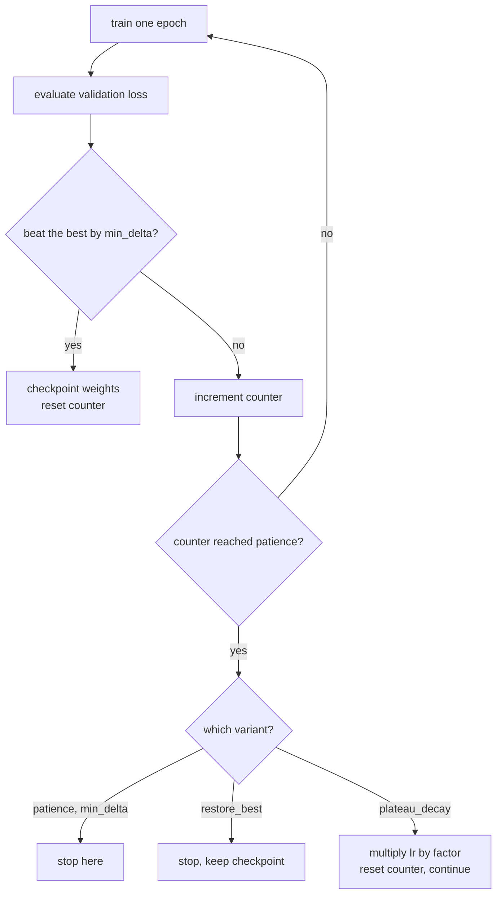

# Early stopping — four ways to decide when a training run is finished

`early_stopping.py` · Training · Tier 3 · 4 variants

## Intuition

Training loss is not the objective. It falls on every epoch of a long enough
run, including the epochs where the model is memorising the training set, and
it says nothing about what happens on data the model has not seen. Early
stopping reads a second signal — a validation set — and uses the epoch where
that signal is best, or the point where it stops improving.

The demo makes the two curves visible. There are 240 training points in two
concentric rings, 10% of the labels are flipped, and the budget is 400 epochs
of full-batch Adam on a two-layer MLP.

```
epoch    20     40     55     80    120    240    400
train   .472   .273   .246   .221   .194   .141   .099
val     .420   .128   .084   .094   .097   .111   .142
```

The validation loss reaches 0.084 at epoch 55 and then climbs while the
training loss keeps falling. At epoch 400 the model scores 0.126 on a held-out
test set; at the point where validation was best, 0.088. Nothing about the
optimiser is wrong — it is doing exactly what it was asked, which is to fit the
training data, and fitting the last 10% means fitting noise.

The training curve also hides a trap. At epoch 70 the training loss (0.229) is
*higher* than the validation loss (0.094); at epoch 400 it is *lower* (0.099
against 0.142). The generalisation gap changes sign during training, because
early on the flipped labels are still unfitted and contribute a large loss to
the training average, and later they have been memorised. A stopped run is not
a run with a small gap; it is a run that stopped before the gap became
informative.



The four variants map onto the four places that decision can go wrong. A stop
that is too late wastes epochs and overfits; a stop that is too early leaves
accuracy on the table; a stop that keeps the wrong weights throws away the best
epoch it saw; and a run that never stops needs a schedule instead.

| variant | epochs | last counted best | train | val | test | acc |
|:--|--:|--:|--:|--:|--:|--:|
| fixed budget | 400 | 55 | 0.099 | 0.142 | 0.126 | 0.954 |
| `patience` | 70 | 55 | 0.229 | 0.094 | 0.096 | 0.987 |
| `min_delta` | 59 | 44 | 0.241 | 0.087 | 0.090 | 0.989 |
| `restore_best` | 70 | 55 | 0.246 | 0.084 | 0.088 | 0.989 |
| `plateau_decay` | 400 | 55 | 0.216 | 0.093 | 0.094 | 0.985 |

`patience` costs 70 epochs and gets within 0.008 of the best test loss in the
table. `restore_best` spends the same 70 epochs and recovers the actual minimum.
`min_delta` stops earlier still and lands at 0.090, because demanding a real
improvement is a cheaper way to notice a plateau. `plateau_decay` never stops;
it anneals the learning rate instead, and reaches a comparable loss at the end
of the full budget.

## Variants

All four train the same model on the same data with the same optimiser. They
differ only in what they do with the validation numbers.

**`patience`** — stop after $p=15$ consecutive epochs without a new best
validation loss. It is the default rule, and its cost is visible in the table:
the best epoch is 55 and the run stops at 70, so fifteen epochs of overfitting
are paid for on every run. With a noisy validation curve those fifteen epochs
are also the margin that keeps the run from stopping on a spurious dip.

**`min_delta`** — an improvement only counts if the new loss is at least
$\delta=0.02$ below the best so far. Near the minimum, epoch-to-epoch gains are
smaller than that, so the patience counter starts running sooner: this run stops
at epoch 59 instead of 70, and its test loss is 0.090. The trade-off is that a
genuinely slow improvement — a long plateau followed by a drop — can be cut
off before it arrives.

**`restore_best`** — keep the patience rule, but return the weights from the
epoch with the lowest validation loss rather than the weights from the stopping
epoch. It is not a stopping rule at all; it is a decision about what to hand
back. On this run it is worth 0.008 test loss. The implementation detail that
matters is that the checkpoint must be a deep copy of every array: assigning
`best_params = params` aliases the dictionary, and the "best" weights keep
training along with everything else.

**`plateau_decay`** — never stop; when the counter reaches patience, multiply
the learning rate by $\gamma=0.5$ and reset the counter. The run spends all 400
epochs, halves the rate 23 times, and ends at $6\times10^{-10}$. That is
effectively a frozen model, which is fine here: the point is that the schedule
reaches a good loss without needing a stopping decision, at the price of never
saving any compute.

## Derivation

### What early stopping estimates

Write the population risk and its validation estimate as

$$
R(\theta)=\mathbb E_{(x,y)\sim\mathcal D}\left[\ell(\theta;x,y)\right],
\qquad
\hat R_{\mathrm{val}}(\theta)=\frac1{n_{\mathrm{val}}}
\sum_{i\in\mathrm{val}}\ell(\theta;x_i,y_i).
\qquad (1)
$$

Training walks a path $\theta_1,\theta_2,\dots$ that depends on the training set
only. The validation loss along that path,

$$
R_{\mathrm{val}}(\theta_t)=R^{*}+E_{\mathrm{approx}}(t)+E_{\mathrm{est}}(t),
\qquad (2)
$$

has a U-shape for the usual reason. $E_{\mathrm{approx}}$ falls as the model
fits more of the signal; $E_{\mathrm{est}}$ rises as the fit becomes specific to
the training sample, including its noise. Early stopping is a bet that the sum
has a minimum before the budget ends, and that the minimum can be located from
validation data.

### The patience rule

With $t_{\mathrm{best}}$ the epoch of the current best validation loss, the
stopping time is

$$
\hat t=\min\left\{t:\ t-t_{\mathrm{best}}\ge p\right\}.
\qquad (3)
$$

If a new best arrives on each epoch with probability $q$, independently, the
number of epochs spent waiting for $p$ consecutive failures has mean

$$
\mathbb E\left[\hat t-t_{\mathrm{best}}\right]
=\frac{1-q^{p}}{(1-q)\,q^{p}}.
\qquad (4)
$$

The formula is the reason patience helps at all: $q$ is never 1, so a rule that
stopped at the first non-improvement would stop almost immediately on any noisy
curve. It also explains the cost: for $q=0.5$ and $p=15$ the run spends about
65,000 epochs looking for fifteen failures in a row — patience is only
affordable because near a minimum $q$ collapses and the wait is short in
practice.

### min_delta

The improvement test becomes

$$
\text{improvement}\iff L_t<L_{\mathrm{best}}-\delta,
\qquad (5)
$$

which lowers the effective $q$ in (4) and therefore shortens the wait. It is a
deadband on the controller: small wiggles that would reset the counter no
longer count as progress. The danger is symmetric. A run that improves by
$0.9\delta$ every epoch is making real progress and will be stopped, so
$\delta$ has to be smaller than the improvement the task is expected to produce
per epoch.

### Restoring the best weights

Stopping tells you the run is over; it does not tell you which weights to keep.
The restored estimator is

$$
\hat\theta=\theta_{t^{*}},\qquad
t^{*}=\arg\min_{t\le\hat t}L_{\mathrm{val}}(\theta_t).
\qquad (6)
$$

There is a subtle bias in (6) that no amount of checkpointing removes: the
minimum of noisy estimates is itself biased low,

$$
\mathbb E\left[\min_{t\le T}\hat L_t\right]
\le\min_{t\le T}\mathbb E\left[\hat L_t\right],
\qquad (7)
$$

by Jensen's inequality. The selected epoch looks better on validation than it
really is, and the more epochs you search over, the larger the optimism. That is
why the demo keeps a test set that the rule never touches: the 0.084 validation
loss at the chosen epoch is an optimistic number, and 0.088 on a thousand
held-out points is the honest one.

### Plateau decay

Instead of stopping, the schedule reacts:

$$
\eta\leftarrow\gamma\eta
\quad\text{when}\quad t-t_{\mathrm{best}}\ge p,
\qquad (8)
$$

with $\gamma=0.5$ here. The reason this helps is the shape of the noise floor
near a minimum. For stochastic gradient descent with step size $\eta$ on a
quadratic with Hessian $H$ and gradient-noise covariance $\Sigma$, the
stationary covariance is approximately

$$
\mathrm{Cov}(\theta_\infty)\approx\frac{\eta}{2}H^{-1}\Sigma,
\qquad (9)
$$

so the radius of the ball the iterates wander in shrinks with $\eta$. Halving
the rate halves the width of that ball, which is what the flat stretch of the
validation curve is measuring. With no lower bound the rate eventually reaches
zero — 23 halvings from $5\times10^{-3}$ is $6\times10^{-10}$ — and the run
freezes at whatever weights it had. Production schedules add a minimum rate or
a cooldown for exactly this reason.

### Early stopping as regularisation

For gradient flow on a quadratic loss
$L(\theta)=\tfrac12(\theta-\theta^{*})^{\top}H(\theta-\theta^{*})$ started at
zero, the iterate after time $t$ is

$$
\theta(t)=\left(I-e^{-Ht}\right)\theta^{*},
\qquad
\theta_\lambda=\left(I+\lambda H^{-1}\right)^{-1}\theta^{*},
\qquad (10)
$$

where the second expression is ridge regression with penalty $\lambda$. In the
eigenbasis the two filters are $1-e^{-\lambda_i t}$ and
$\lambda_i/(\lambda_i+\lambda)$; for small $\lambda$ they agree with
$\lambda\approx 1/t$. Stopping early is therefore shrinkage in the directions
the data constrains weakly, and the number of epochs plays the role of the
regularisation strength. That is why early stopping can substitute for weight
decay on a small model, and why the two together are not additive.

### Why the gap changes sign

With a flip rate $\varepsilon$ the training loss is a mixture,

$$
L_{\mathrm{train}}(\theta)
=(1-\varepsilon)L_{\mathrm{clean}}(\theta)
+\varepsilon L_{\mathrm{flip}}(\theta),
\qquad (11)
$$

while the validation set is clean. Before the model memorises the flips,
$L_{\mathrm{flip}}$ is large and $L_{\mathrm{train}}$ can sit above
$L_{\mathrm{val}}$. Afterwards the flipped points are fitted, $L_{\mathrm{flip}}$
collapses, and the usual ordering returns:

$$
\mathrm{gap}(\theta)=L_{\mathrm{val}}(\theta)-L_{\mathrm{train}}(\theta).
\qquad (12)
$$

So the gap is not a fixed property of a run. It starts negative when labels are
noisy, turns positive as memorisation proceeds, and the moment it turns
positive is roughly when the validation curve turns up. Watching the gap is
useful, but watching the validation curve is what the stopping rule needs.

## Code walkthrough

The two rings overlap by design, so the boundary is not perfectly
separable, and 10% of the training labels are flipped after the points are
drawn. The test and validation sets never see a flip.

```python
    if noise:
        flip = rng.random(n) < noise
        y[flip] = 1 - y[flip]
    order = rng.permutation(n)
    return x[order], y[order]
```

The monitored quantity is the validation loss, computed with the same clipped
cross-entropy as training. Clipping at $10^{-12}$ keeps a saturated wrong
prediction finite instead of turning the running mean into an infinity.

```python
def _loss(params: dict, x: np.ndarray, y: np.ndarray) -> float:
    prob = _softmax(_forward(params, x)[0])
    picked = prob[np.arange(len(y)), y]
    return float(-np.mean(np.log(picked + 1e-12)))
```

One epoch is one full-batch Adam step, with the standard softmax gradient. The
full batch is deliberate: the validation curve in the introduction is then a
property of the optimisation, not of minibatch sampling noise, which makes the
stopping experiment repeatable.

```python
    delta = _softmax(logits)
    delta[np.arange(len(y)), y] -= 1.0
    delta /= len(y)
    grads = {"W3": a2.T @ delta, "b3": delta.sum(0)}
```

The controller is the loop's only non-standard part. It keeps a running best, a
deep copy of the weights at that best, a counter of epochs since the last
counted improvement, and the current learning rate.

```python
        for epoch in range(1, self.epochs + 1):
            _adam(params, _backward(params, x, y), state, epoch, lr)
            current = _loss(params, x_val, y_val)
            self.history.append(current)
            if current < best - threshold:
                best = current
                best_epoch = epoch
                bad = 0
                best_params = _copy(params)
            else:
                bad += 1
```

`threshold` is the only difference between `patience` and `min_delta`: it is
zero for the first and $\delta$ for the second. That single number changes the
stopping epoch from 70 to 59.

```python
        threshold = self.min_delta if self.variant == "min_delta" else 0.0
```

The reaction is a branch on the variant. `plateau_decay` multiplies the rate and
resets the counter, so it never leaves the loop through this path; the other
three stop, and `restore_best` then swaps in the checkpoint.

```python
            if self.variant == "plateau_decay":
                if bad >= self.patience:
                    lr *= self.factor
                    self.decays += 1
                    bad = 0
            elif bad >= self.patience:
                self.stopped = epoch
                break
        if self.variant == "restore_best":
            params = best_params
```

Evaluation never re-runs training; it just reads the kept weights. Reporting
accuracy next to loss is what catches the case where a lower loss came from
better calibration rather than better decisions.

```python
        prob = _softmax(_forward(self.params, x)[0])
        return {
            "loss": _loss(self.params, x, y),
            "accuracy": float(np.mean(prob.argmax(axis=1) == y)),
        }
```

The no-stopping baseline is not a separate training loop. It is the patience
rule with a patience longer than the budget, which can never fire, so the
baseline is guaranteed to take exactly the same path as the stopped runs.

```python
def fixed_budget(x: np.ndarray, y: np.ndarray, x_val: np.ndarray,
                 y_val: np.ndarray, *, epochs: int = EPOCHS,
                 seed: int = 1) -> EarlyStopper:
    """The baseline: a patience longer than the budget can never trigger."""
    model = EarlyStopper("patience", patience=epochs + 1, epochs=epochs,
                         seed=seed)
    return model.fit(x, y, x_val, y_val)
```

## Complexity

The model has $2\cdot48+48\cdot48+48\cdot48+48\cdot2+2=2{,}594$ parameters. One
training epoch over 240 points costs about
$240(2\cdot48+48\cdot48+48\cdot2)\approx0.6$ million multiply-adds, and the
backward pass is roughly twice that, so a training step is about 1.8 million.
One validation pass over 600 points costs about 1.5 million, 2.5 times the
training forward pass, because the validation set is larger than the training
set. Monitoring is not free: on this workload the validation passes are roughly
45% of the compute that the stopped runs spend.

The stopping variants save epochs, and that is the whole point of the trade.
`patience` and `restore_best` run 70 of 400 epochs, so they skip 82% of the
training work but pay the 70 validation passes. `plateau_decay` runs the full
budget and pays 400 validation passes, which is why it is the slowest of the
four despite having the same per-epoch cost. Memory is one model plus one
checkpoint — 2,594 floats each — and the history is one float per epoch.

The cost of a bad stopping rule is asymmetric. Stopping too late costs compute
and test accuracy; stopping too early costs the accuracy that the discarded
epochs would have bought. The table shows the first cost clearly (0.126 against
0.088) and the `min_delta` row shows that the second is easier to avoid than it
sounds, at least when the curve is as well behaved as this one.

## Failure modes

**The validation set is part of the estimate.** Every epoch is judged on the
same 600 points, and the stopping epoch is chosen because it looked good on
them. Equation (7) says that number is optimistic, so reporting it as the
model's performance is a mistake; the demo's test column exists to make the
difference visible. With a small validation set the optimism is larger, because
the per-epoch noise is larger and the minimum of more noise is more extreme.

**Patience is tuned by the noise level.** Fifteen epochs is a reasonable
default at this scale, but it was chosen by looking at the curve. A noisier
validation set needs more patience, a smoother one needs less, and the right
value changes with the learning rate. The rule has one hyperparameter and no
principled default, which is why `min_delta` exists: it lets you express "an
improvement smaller than this is not worth waiting for".

**The checkpoint must be a copy.** The most common implementation bug in this
atom is `best_params = params`. That stores a reference to the live dictionary,
so the "best" weights are overwritten by every subsequent epoch and
`restore_best` silently returns the final weights. The code uses a per-array
copy, and the demo asserts that the restored model's best epoch matches
`argmin` of the recorded history, which is what catches the aliasing.

**A rate schedule with no floor freezes the model.** `plateau_decay` halves the
rate 23 times and reaches $6\times10^{-10}$; the last hundred epochs change
nothing. That is not a bug in the rule, it is the rule without a minimum. Add
`min_lr`, or stop decaying after a fixed count, or switch to a cosine schedule
that decays to a known value over a known horizon.

**Early stopping is not a substitute for a good model.** It picks an epoch; it
does not fix an architecture, a learning rate, or a data pipeline. On the fixed
budget the ceiling is 0.126 test loss because the model memorised the noise,
and stopping recovers 0.088 — a real gain, but the same model with clean labels
would be better than both. The rule buys time and generalisation, not capacity.

**The curve must be monotone enough to read.** If the validation loss has a
second, lower basin after a long plateau — common with learning-rate restarts —
patience will stop in the first basin and never see it. That is a schedule
interaction, not a stopping-rule interaction: the same 400-epoch run with a
restart at epoch 200 would need its patience counter reset at the restart.

**A minimum that is only one standard error deep is not a minimum.** The
validation loss at the selected epoch is 0.084 and the values around it are
0.087 to 0.094; with 600 points the standard error of the mean loss is roughly
0.01. The difference between `patience`, `min_delta` and `restore_best` on the
test column — 0.096, 0.090, 0.088 — is within that noise. The ordering is
suggestive, not established, and the demo's assertions only claim the
directions that are large.

## Applications

Early stopping is the default regulariser of gradient-boosted trees: XGBoost
and LightGBM both take an evaluation set and a patience, and it is the standard
way to choose the number of boosting rounds without a grid search. Neural
network fine-tuning uses the same rule, usually with `restore_best` and a
learning-rate schedule attached. In scikit-learn the API is
`n_iter_no_change`, which is patience by another name.

The larger the run, the less the rule is about overfitting and the more it is
about compute. A pretraining job does not stop when validation plateaus — the
curve is monotone for weeks — but a fine-tuning job on a small dataset can
finish in a fraction of its budget, and the saving is the whole reason to
monitor. The same logic applies to hyperparameter search: a trial that stops
early frees budget for the next one, which is the connection to successive
halving and Hyperband.

The restoring half of the rule matters in production for a second reason: the
model that is deployed should be a checkpoint, not the last state of an
optimiser. Reusing the best weights is also what makes an interrupted job
resumable, and it is the same machinery that underpins checkpoint averaging and
early-stopped ensembles.

## References

- Morgan, N., Bourlard, H. (1990). *Generalization by cross-validation and
  early stopping of back-propagation learning.* IEEE ICASSP. The original
  validation-monitored stopping rule.
- Prechelt, L. (1998). *Early stopping — but when?* In Neural Networks: Tricks
  of the Trade. Patience, validation error, and the practical pitfalls of both.
- Yao, Y., Rosasco, L., Caponnetto, A. (2007). *On early stopping in gradient
  descent learning.* Constructive Approximation. The ridge equivalence, (10).
- Zhang, T., Yu, B. (2005). *Boosting with early stopping: convergence and
  consistency.* Annals of Statistics. The same regularisation view for
  boosting.
- Bengio, Y. (2012). *Practical recommendations for gradient-based training of
  deep architectures.* In Neural Networks: Tricks of the Trade. The
  validation-curve protocol and the test-set discipline behind (6)-(7).
- Loshchilov, I., Hutter, F. (2017). *SGDR: stochastic gradient descent with
  warm restarts.* ICLR. The restart interaction that breaks a plain patience
  counter.
- Smith, L. N. (2018). *A disciplined approach to neural network
  hyper-parameters.* arXiv:1803.09820. Cyclical rates, the one-cycle schedule,
  and the connection between the rate and the noise floor, (9).
