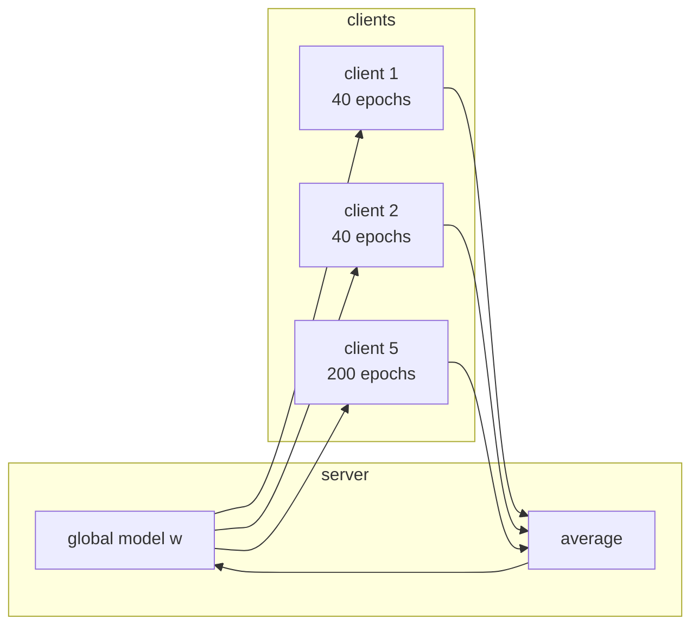

# Federated learning — six ways to combine models that never see the data

`federated.py` · Training · Tier 3 · 6 variants

## Intuition

Averaging the weights of models trained on different data does not give you the
model trained on all of it. It gives you something between the best client and
the worst, and which one you get depends on how far each client walked before
the average.

The demo makes that concrete with five clients and ten classes on a ring. Client
`j` holds classes `2j` and `2j+1` and never sees the other eight, so every client
is a specialist with a two-way problem. The local budget is deliberately uneven —
`[40, 40, 40, 40, 200]` epochs — because that is what a real deployment looks
like when one phone is idle and charging while the other four are busy.

```
variant          global   local  worst   comm
centralised       0.778   0.773  0.705     --
fedavg            0.728   0.731  0.430     1x
fedprox           0.770   0.764  0.725     1x
scaffold          0.747   0.758  0.595     2x
secure_agg        0.728   0.731  0.430     1x
dp_fedavg         0.725   0.727  0.485     1x
personalization   0.728   0.892  0.855     1x
```

The pooled model scores 0.778 and plain averaging scores 0.728, but the mean is
not where the damage is. Client 3 — the one that ran 200 local epochs — scores
0.430 on its own classes under the averaged model and 0.855 under a model
fine-tuned on its own data. Five clients averaging to 0.73 hides a model that is
unusable for one of them.

The ranking is not fixed. The three methods cross over:

```
round  fedavg  fedprox  scaffold
    1   0.224    0.208     0.224
    3   0.379    0.421     0.547
    5   0.511    0.499     0.684
   10   0.629    0.617     0.716
   20   0.708    0.730     0.739
   30   0.728    0.770     0.747
```

Plain averaging needs thirty rounds to pass 0.71; the control-variate method is
there at round ten. The proximal term is not faster early — it is a shorter step
— but by round 30 it is the best of the three, and it is the only one that
repairs the client that overfits.



What separates the six variants is what travels in those arrows. `fedavg` sends
a model. `fedprox` sends a model that was not allowed to stray. `scaffold` sends
a model plus a gradient estimate, and pays double the bandwidth. `secure_agg`
sends a model hidden inside random masks. `dp_fedavg` sends a clipped model
plus calibrated noise. `personalization` sends the same model and then keeps a
copy.

## Variants

**`fedavg`** — average the weights. One round is `E_k` local epochs per client
followed by an unweighted mean. It is the baseline every paper compares against
and it is surprisingly hard to beat when clients are balanced; the drift in the
table comes from the 5× spread in local work, not from the partition alone.

**`fedprox`** — add $\frac{\mu}{2}\lVert w-w^{t}\rVert^{2}$ to each local
objective with $\mu=0.1$. The gradient gains a term $\mu(w-w^{t})$ that grows as
the client walks away, so no client can travel more than about $G/\mu$ from the
round's starting point no matter how many epochs it is given. On this run it
recovers 0.042 global accuracy and moves the worst client from 0.430 to 0.725,
which is better than the pooled model's 0.705 on that client.

**`scaffold`** — give each client a control variate $c_k$ and the server one $c$,
and correct every local gradient to $g_k + c - c_k$. The correction makes each
client follow the *global* gradient instead of its own, so it is at 0.716 by
round 10 where averaging is at 0.629, and its round-20 accuracy (0.739) already
beats what averaging reaches at round 30. It costs twice the upload bandwidth
because the variates travel too, and it plateaus at 0.747 rather than at the
pooled 0.778, because the correction is only accurate while the local step is
small.

**`secure_agg`** — clients add pairwise random masks that cancel in the sum, so
the server only ever sees $\sum_k m_k = \sum_k w_k$. The masks here move one
client's vector 29.5 away from its true value while two clients are only 0.7
apart, so a single masked vector says nothing. It is arithmetic, not
cryptography: the shares cancel exactly, so the server gets the same sum it
would have got anyway, and the masking is only as strong as the assumption that
the shares stay secret. Deployed protocols add a secret-sharing round so the
shares can be rebuilt when a client drops out mid-round.

**`dp_fedavg`** — clip each client's update to norm $C=1.0$ and add Gaussian
noise with standard deviation $\sigma C/K$ before averaging. At $\sigma=0.1$ the
accuracy is unchanged (0.725 against 0.727) because the noise is small next to
the signal, and the worst client even improves. At $\sigma=0.2$ the global
accuracy falls to 0.599 and at $0.4$ to 0.521. The mechanism is the same in both
cases; only the budget differs.

**`personalization`** — train the global model as usual, then give every client
a copy and let it fine-tune for 200 epochs on its own data. The global model is
unchanged, so global accuracy is unchanged at 0.728; the mean local accuracy
goes from 0.731 to 0.892 and the worst client from 0.430 to 0.855. It is the
cheapest win in the table, and the one with a deployment question attached: you
now have five models, not one.

## Derivation

### The objective

With $K$ clients holding $n_k$ examples each and $p_k=n_k/n$, federated learning
minimises the weighted average of the local risks:

$$
F(w)=\sum_{k=1}^{K}p_kF_k(w),
\qquad
F_k(w)=\frac1{n_k}\sum_{i\in\mathcal D_k}\ell(w;x_i,y_i).
\qquad (1)
$$

Everything below is a different approximation to the same $F$. The data is
never pooled, so no client ever evaluates $\nabla F$ — that is the whole
constraint, and it is why the algorithm has to reconstruct a global direction
out of $K$ local ones.

### What one round actually does

Let all clients run $E$ local steps from $w^{t}$, writing $w_k^{t,e}$ for the
iterate after $e$ steps of round $t$, and let $\eta$ be the local step size.
Since aggregation is a plain average of models,

$$
w^{t+1}=w^{t}-\eta\sum_k p_k\sum_{e=0}^{E-1}\nabla F_k(w_k^{t,e}).
\qquad (2)
$$

Add and subtract the honest gradient step $E\nabla F(w^{t})$:

$$
w^{t+1}=w^{t}-\eta E\nabla F(w^{t})
+\eta\sum_k p_k\sum_{e=0}^{E-1}\left[\nabla F_k(w^{t})
-\nabla F_k(w_k^{t,e})\right].
\qquad (3)
$$

The first two terms are $E$ steps of gradient descent on (1). The third is
**client drift**: the average over clients of how much each local gradient has
turned away from the value it had at the start of the round. It is a bias, not
noise, and it does not average out over rounds because it is a function of the
partition, which is fixed.

### The size of the drift

Assume $\nabla F_k$ is $L$-Lipschitz and bounded by $G$. After $e$ local steps
$\lVert w_k^{t,e}-w^{t}\rVert\le\eta eG\le\eta EG$, so each bracket in (3) is at
most $L\eta EG$ and the sum over $E$ steps gives

$$
\left\lVert\text{drift}\right\rVert
\;\le\;\eta L\sum_k p_k\sum_{e=0}^{E-1}\eta eG
\;=\;\frac{L\eta^{2}G\,E(E-1)}{2}.
\qquad (4)
$$

Drift is quadratic in the step size and quadratic in the number of local epochs.
That single line explains the whole design space: every method below is a way of
making one of those two factors smaller without giving up the compute saved by
local work. Cut $E$ to one and you have centralised SGD with $K$ times the
communication; cut $\eta$ and you barely move.

### FedProx as a trust region

The proximal objective

$$
\min_{w}\;F_k(w)+\frac{\mu}{2}\left\lVert w-w^{t}\right\rVert^{2}
\qquad (5)
$$

has a stationary point satisfying
$\nabla F_k(w_k^{*})+\mu(w_k^{*}-w^{t})=0$, so

$$
\left\lVert w_k^{*}-w^{t}\right\rVert
=\frac{\left\lVert\nabla F_k(w_k^{*})\right\rVert}{\mu}
\;\le\;\frac{G}{\mu}.
\qquad (6)
$$

The bound does not mention $E$ or $\eta$. A client with 200 epochs and a client
with ten are both confined to a ball of radius $G/\mu$ around the round's start,
which is exactly the property you want when the local budgets are unequal. The
price is the same bound applied to clients that were behaving: they are slowed
down too, which is why `fedprox` is the slowest of the three in the early
rounds.

### SCAFFOLD as variance reduction

Each client keeps $c_k$, the server keeps $c$, and the local step becomes

$$
w_k\leftarrow w_k-\eta\left(\nabla F_k(w_k)+c-c_k\right).
\qquad (7)
$$

If $c_k=\nabla F_k(w^{t})$ and $c=\nabla F(w^{t})$, the bracket is
$\nabla F_k(w_k)-\nabla F_k(w^{t})+\nabla F(w^{t})$: the client's own gradient
with its start-of-round value removed, plus the global one. The leading term of
the drift in (3) is cancelled by construction, and what is left is second order
in $\eta E$.

The variates have to be estimated without a second pass over the data. After the
local run, the average step is available for free:

$$
c_k=\frac{w^{t}-w_k^{t,E}}{E\eta},\qquad
c=\sum_k p_kc_k.
\qquad (8)
$$

Equation (8) is the non-obvious line of the atom. The displacement divided by
the total step size is the mean of the $E$ gradients the client actually used,
which is an estimate of $\nabla F_k$ at the start of the round — no extra
gradient evaluations, one extra vector per client on the wire.

### Differential privacy

With a clipping norm $C$, client $k$'s update becomes

$$
\tilde\Delta_k=\Delta_k\cdot\min\left(1,\frac{C}{\lVert\Delta_k\rVert}\right),
\qquad
w^{t+1}=w^{t}-\frac1K\left(\sum_k\tilde\Delta_k+\mathcal N(0,\sigma^{2}C^{2}I)\right).
\qquad (9)
$$

Changing one client's data changes the clipped sum by at most $2C$, so the
mechanism is $(\varepsilon,\delta)$-DP whenever

$$
\sigma\;\ge\;\frac{\sqrt{2\ln(1.25/\delta)}}{\varepsilon}.
\qquad (10)
$$

The noise enters as $\sigma C/K$ per coordinate because it is added to the sum
and then divided by $K$. The signal-to-noise ratio of a round is therefore
$K/(\sigma\sqrt d)$: with $K=5$ and $d=922$ that is $0.17/\sigma$, which is what
puts the demo's cliff between $\sigma=0.1$ and $\sigma=0.2$. Deployments use
thousands of clients per round precisely because the ratio is linear in $K$.

### Secure aggregation

Client $k$ samples a share $s_{kj}$ with every client $j>k$ and sends

$$
m_k=w_k+\sum_{j>k}s_{kj}-\sum_{j<k}s_{jk},
\qquad (11)
$$

so every share appears twice in the sum with opposite signs:

$$
\sum_km_k=\sum_kw_k.
\qquad (12)
$$

The server learns the sum and nothing else, as long as it does not collude with
a client and no client drops out. Dropout is the hard part: if client $j$ leaves
after collecting its shares, the terms no longer cancel, and the protocol has to
fall back on secret-sharing a reconstruction of the dropped client's shares —
which is why real secure aggregation implementations are much longer than
eleven lines.

### Personalisation

The two-level objective is

$$
\min_{w}\;\sum_kp_kF_k(v_k)
\quad\text{subject to}\quad
v_k\in\arg\min_{v}F_k(v),
\qquad (13)
$$

approximated here by letting $v_k$ be $P$ local steps from the global model,

$$
v_k=\mathrm{local\_sgd}(w,\mathcal D_k,P,\eta),
\qquad (14)
$$

which is a proximal step on $F_k$ with penalty $1/(2P\eta)$ rather than an exact
minimiser. This is the cheapest form of the idea; the literature's versions
either meta-learn $w$ so that a few steps reach a good $v_k$ (`maml`, in this
chapter) or learn $w$ and $v_k$ jointly with an explicit penalty.

### Why averaging weights is not averaging functions

A last piece of pessimism that the numbers hide. For a nonlinear model,

$$
\sum_kp_kf_{w_k}(x)\;\ne\;f_{\bar w}(x),
\qquad (15)
$$

with $\bar w=\sum_kp_kw_k$. Two clients whose hidden units have permuted roles
produce an average with no units in either role. Nothing in the algorithm fixes
this; it is why averaged models lose accuracy even when every client's local
model is good, and the reason the literature contains everything from matching
permutations before averaging to never averaging at all.

## Code walkthrough

The partition is where the difficulty comes from, so it comes first. Client `j`
draws from exactly two of the ten centres, which makes every client's local
problem well posed and the global one harder than any single local one.

```python
    for j in range(CLIENTS):
        rows, labels = [], []
        for c in (2 * j, 2 * j + 1):
            rows.append(centres[c] + rng.normal(0.0, SPREAD, (per_class, 2)))
            labels.append(np.full(per_class, c))
        x = np.vstack(rows)
        y = np.concatenate(labels)
```

Every variant shares one local solver. `mu` and the control variates are optional
terms in the same loop, which is the point: the three methods differ in one
gradient correction each, not in their training code.

```python
    for _ in range(epochs):
        grads = _grad(current, x, y)
        for key, grad in grads.items():
            if c is not None:
                grad = grad + c[key] - ci[key]
            if mu:
                grad = grad + mu * (current[key] - anchor[key])
            current[key] = current[key] - lr * grad
```

`anchor` has to be a separate dictionary. `current` is stepped in place, so a
penalty written against `current` would be identically zero and `mu` would
silently do nothing; passing the round's starting model in is what makes the
term a pull toward the place the client began. The SCAFFOLD correction is a
plain addition to the same gradient, which is why the two compose without
special cases.

The dispatch in `fit` is one branch per aggregation rule. `scaffold` needs the
local models *and* their drift estimates, so it cannot share the common path.

```python
                drift = [{k: (self.model[k] - q[k]) / (epochs[j] * self.lr)
                          for k in q} for j, q in enumerate(updates)]
                self.model = self._average(updates)
                c = {k: np.mean([d[k] for d in drift], axis=0) for k in c}
                ci = drift
```

`epochs[j] * self.lr` is the denominator in (8), and it must be the client's own
budget. Using one client's budget for all of them mis-scales four of the five
variates, the correction stops cancelling the drift, and the run collapses to
0.100 — chance on ten classes, from 0.747. This is the line to get wrong.

```python
                if self.variant == "dp_fedavg":
                    self.model = self._noisy_average(updates, turn)
                elif self.variant == "secure_agg":
                    self.model = self._masked_average(updates, turn)
                else:
                    self.model = self._average(updates)
```

The DP path clips before it averages, and it counts a clip whenever the scale
factor binds. `self.clipped` is the honest diagnostic: at $C=1.0$ only 9 of the
150 client updates in the run ever hit the norm, which is why the noiseless
$\sigma=0$ row scores the same as `fedavg`.

```python
        for update in updates:
            delta = {key: self.model[key] - update[key] for key in update}
            scales.append(min(1.0, self.clip / (_norm(delta) + 1e-12)))
            deltas.append(delta)
```

The noise is added to the *average*, so its scale is $\sigma C/K$; adding it per
client instead would give $\sigma C/\sqrt K$ and silently buy accuracy with
privacy.

```python
            noise = rng.normal(0.0, self.noise * self.clip / n,
                               self.model[key].shape)
            out[key] = self.model[key] - mean + noise
```

Masking is sign bookkeeping. Client `i` adds the share it owns for every `j>i`
and subtracts the share `j` owns for every `j<i`; each share is created exactly
once by the lower-indexed client, so the two appearances are the same numbers.

```python
        for j in range(n):
            if j > i:
                for key in out:
                    out[key] = out[key] + share[i, j][key]
            elif j < i:
                for key in out:
                    out[key] = out[key] - share[j, i][key]
```

The demo's `4.4e-16` residual is floating-point summation order, not a leak. The
masks cancel as real numbers; they do not cancel bit for bit, because the sum is
evaluated left to right and each share's rounding depends on where it sits.

Personalisation happens after the loop, so the global model is exactly the
`fedavg` model and the comparison in the table is fair.

```python
        if self.variant == "personalization":
            self.personal = [local_sgd(self.model, x, y, self.finetune, self.lr)
                             for x, y in clients]
```

Evaluation falls back to the global model whenever there is no personal copy, so
`local_metrics` means "what this client would actually run" for every variant.

```python
        models = self.personal if self.personal is not None else (
            [self.model] * len(tests))
```

## Complexity

One round costs $\sum_k n_kE_kd$ multiply-adds, with
$d=2\cdot24+24\cdot24+24\cdot10+58=922$ parameters; the demo's 30 rounds over
864k example-epochs is seven seconds of numpy. The pooled reference needs the same
number of example-epochs and is not faster in wall-clock terms, because its
matmuls are $K$ times wider.

Communication is the actual constraint: one model up and one down per client
per round, so $2Kd$ floats. `scaffold` also uploads $c_k$, which makes it $3Kd$
and 1.5× the traffic — the `comm` column says $2\times$ because it counts
uploads only. At $d=922$ the upload is 9,220 floats, or 74 kB per round for five
clients: trivial. At a language model's $d=10^{10}$ it is the reason the field
exists.

Memory is one model on the server plus one model and one variate per client, and
in `secure_agg` one share per pair — $\binom{K}{2}d$ floats, which is the real
cost of masking and the reason secure aggregation is applied to a subsampled
round rather than to everyone.

The stopping criterion is a separate budget: the demo trains for a fixed 30
rounds and reports where each variant got to. Real deployments stop on a
validation signal, which is the `early_stopping` atom with a global model and a
per-client average.

## Failure modes

**The gap depends on the operating point, and the demo picks one that shows
it.** The same run at $\eta=0.015$ is *worse* (0.711 for `fedavg`),
because a smaller step means clients travel less per round and the run is cut
short at 30 rounds; raise it to $\eta=0.05$ and the drift disappears — `fedavg`
reaches 0.781, above the pooled reference at 0.778 and above `scaffold`'s 0.743.
The table is a measurement at one operating point, not a ranking. The diagnostic
is to plot global accuracy against local epochs with everything else fixed: a
method that is drift-limited has a monotone gap, one that is step-size-limited
does not care.

**`fedprox` does not improve monotonically in $\mu$.** The same run gives 0.770
at $\mu=0.1$, 0.750 at $\mu=1$ and 0.757 at $\mu=10$. The bound in (6) is a cap,
not a target: once $\mu\eta$ is large enough that the proximal term dominates,
every client returns essentially $w^{t}$ and the round becomes one small
averaged step, which is slow centralised training with a round trip in the
middle — it never drifts, and it never uses the local compute either. The
sweet spot is the smallest $\mu$ that stops the worst client, and it has to be
found, not assumed.

**`scaffold` is out of its regime when $\eta E$ is large.** The correction in (7)
assumes the client's gradient does not change much along the local trajectory.
At $\eta E=12$ — 600 local epochs at $\eta=0.02$ — the variates are stale by the
time they are applied, and the run scores 0.528 against `fedavg`'s 0.693. The
correction is a first-order argument; it removes the drift term only while the
second-order term is small. Keep $\eta E$ to a few units, or accept that the
method degrades faster than the thing it was meant to fix.

**DP noise at five clients is not a utility trade-off, it is a utility cliff.**
Each coordinate gets $\sigma C/K$ of noise while the model has $d=922$ of them,
so the total noise norm is $\sigma C\sqrt d/K\approx 6.1\sigma$. At $\sigma=0.1$
that is 0.61 against update norms of about 1.0 — survivable. At $\sigma=0.2$ it
is 1.2, larger than the signal, and accuracy drops 0.13 in one step. The demo's
$\sigma=0.1$ row is a *small* budget: five clients with 400 examples between them
cannot support a meaningful $\varepsilon$.

**Masks hide values only while the round is complete.** Drop one client from
`mask_updates` and the shares it was supposed to cancel survive, so the sum is
wrong by a masked amount nobody can remove until those shares are reconstructed.
The masking also says nothing about a client that lies: a malicious client can
send any vector it likes, and the server will average it in without ever seeing
it. Both problems are why deployed secure aggregation is a multi-round protocol
with commitments and secret-shared recovery, and why `dp_fedavg` is usually
layered on top. The demo's 29.5-versus-0.7 statistic is the passive, complete
round only.

**A personal model is a deployment commitment.** `personalization` lifts the
mean local accuracy by 0.16 here because every client has 80 points of its own.
With ten points it overfits; with no labelled data it cannot run at all, and the global
model is then the only model you have. The demo's fallback in `local_metrics`
exists for exactly that case: a client with no personal copy must still be
served.

**Averaging assumes the clients are telling the truth about their data.** The
partition here is honest label skew. A client that duplicates its data, or
weights it, moves the global model toward itself — and with the masks of
`secure_agg` the server cannot see it happening. Detection needs a different
mechanism entirely (contribution accounting, robust aggregation), and it is out
of scope for a file this long.

## Applications

Federated averaging is what runs when the data cannot move: keyboard prediction
trained on phones (Gboard), next-word models on messaging apps, handwriting
models, and the clinical-imaging work where patient records stay inside the
hospital. The same machinery is used for less obvious reasons — a bank with
regulated regional subsidiaries, a manufacturer whose machines are on customer
premises, a consortium that wants a shared model without a shared dataset.

`fedprox` is the standard fix for uneven participation: mobile devices have
wildly different amounts of compute available per charging window, and the
proximal term is what stops the phones that ran 200 epochs from drowning out
the ones that ran 20. `scaffold` is the choice when the number of rounds is the
bottleneck, at twice the bandwidth.

DP-FedAvg is deployed at scale with tens of thousands of clients per round,
where the $1/K$ noise averaging in (9) is what makes the budget affordable, and
with secure aggregation layered on top so the server cannot inspect the clipped
updates it is averaging. `personalization` is what most real products actually
ship: one global model for cold start, one fine-tuned model per user for
everything after.

The trap is treating this as a privacy technique by itself. Averaging weights is
not DP; without clipping and noise, and without masking, a curious server can
reconstruct training examples from updates. The two privacy variants here are
mechanisms, and both of them are load-bearing.

## References

- McMahan, B., Moore, E., Ramage, D., Hampson, S., Agüera y Arcas, B. (2017).
  *Communication-efficient learning of deep networks from decentralized data.*
  AISTATS. FedAvg, (2)-(4).
- Li, T., Sahu, A. K., Zaheer, M., Sanjabi, M., Talwalkar, A., Smith, V.
  (2020). *Federated optimization in heterogeneous networks.* MLSys. FedProx,
  (5)-(6), and the unequal-local-epochs argument.
- Karimireddy, S. P., Kale, S., Mohri, M., Reddi, S. J., Stich, S. U., Suresh,
  A. T. (2020). *SCAFFOLD: stochastic controlled averaging for federated
  learning.* ICML. Client drift, (7)-(8).
- Bonawitz, K., Ivanov, V., Kreuter, B., Marcedone, A., McMahan, H. B., Patel,
  S., Ramage, D., Segal, A., Seth, K. (2017). *Practical secure aggregation for
  privacy-preserving machine learning.* CCS. (11)-(12) and the dropout recovery
  protocol.
- McMahan, H. B., Ramage, D., Talwar, K., Zhang, L. (2018). *Learning with
  differential privacy in federated learning.* arXiv:1710.06963. Clipping plus
  noise, (9)-(10).
- Fallah, A., Mokhtari, A., Ozdaglar, A. (2020). *Personalized federated
  learning with theoretical guarantees.* AISTATS. The meta-learning view of
  (13)-(14); see `meta_learning` in this chapter.
- Kairouz, P. et al. (2021). *Advances and open problems in federated learning.*
  Foundations and Trends in Machine Learning. The survey to read next; it is
  where the permutation problem (15) and the systems questions live.
- Hsu, T.-M. H., Qi, H., Brown, M. (2019). *Measuring the effects of non-identical
  data distribution for federated visual classification.* arXiv:1909.06335. The
  Dirichlet partition and the benchmark the demo's ring stands in for.
