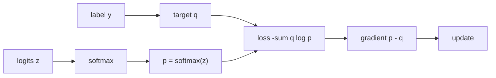

# Label smoothing — four schedules for a softer target

`label_smoothing.py` · Training · Tier 3 · 4 variants

## Intuition

The training set is 260 points from three overlapping blobs, split 150/80/30.
A two-layer MLP with 4,547 parameters memorises it: 0.981 training accuracy,
0.883 test accuracy. That model assigns 1.590 nats of negative log-likelihood
to a test point, and a constant predictor that always says one third assigns
$\log 3=1.099$. The overconfident model is *worse than knowing nothing*, because
its errors are not just frequent, they are loud. Expected calibration error is
0.099: when it says 95%, it is right about 86% of the time.

One line of target construction fixes most of that. Instead of asking the model
to put probability one on the gold class and zero everywhere else, ask for
0.933, 0.033, 0.033:

```
hard      [1.000 | 0.000 | 0.000]
uniform   [0.933 | 0.033 | 0.033]
```

The same network, same seed, same 800 steps, now scores 0.893 accuracy, 0.406
nats, and 0.026 ECE. Accuracy barely moves — the ordering of the logits is
almost unchanged — but the confidence it reports becomes usable. This is label
smoothing: a one-line change to the target that acts as a regulariser, a
calibrator, and, on noisy data, a small robustness device.

The reason it works is geometric. The three blobs overlap, so some points near
a boundary are genuinely ambiguous. A one-hot target tells the model that the
ambiguity does not exist and that the gold logit must beat every other logit by
an unbounded margin. Cross-entropy is happy to comply: it keeps pushing logits
apart, the softmax saturates, and the reported probability stops meaning
anything. A softened target says the margin should be *finite* — about 3.33
nats at $\alpha=0.1$ over three classes — and the optimisation stops there.



Four schedules differ in how $q$ is built: the same weight for every example
(`uniform`), a weight tied to class frequency (`per_class`), a weight that
follows the model's own confidence (`adaptive`), and a weight mixed with another
example's target (`mixup_smoothing`).

| schedule | clean acc | clean nll | clean ece | noisy acc | noisy nll | noisy ece |
|:--|--:|--:|--:|--:|--:|--:|
| hard targets | 0.883 | 1.590 | 0.099 | 0.783 | 0.747 | 0.085 |
| `uniform` | 0.893 | 0.406 | 0.026 | 0.812 | 0.572 | 0.073 |
| `per_class` | 0.889 | 0.451 | 0.051 | 0.822 | 0.591 | 0.097 |
| `adaptive` | 0.892 | 0.408 | 0.026 | 0.818 | 0.588 | 0.090 |
| `mixup_smoothing` | 0.902 | 0.321 | 0.086 | 0.856 | 0.505 | 0.138 |

Two columns tell the whole story. Under clean labels the win is calibration:
NLL falls by a factor of four and ECE by a factor of four, while accuracy moves
by one point. Under 20% flipped labels the win is accuracy, and it grows as the
target softens or the inputs get mixed: 0.783, 0.812, 0.818, 0.822, 0.856. The
last row buys that accuracy with the worst calibration of the five, which is the
central trade-off of this atom.

## Variants

All four use the same network, the same optimiser and $\alpha=0.1$. Only the
target matrix changes.

**`uniform`** — the standard schedule. Every example gets
$q=(1-\alpha)y+\alpha/K$, so all three classes are smoothed by the same amount.
It is the calibration winner on clean data (ECE 0.026 against 0.099) and a solid
second on noisy data (0.812). At $\alpha=0$ it degenerates exactly to the hard
target, which is how the demo builds its baseline: a `uniform` model with
`alpha=0.0`.

**`per_class`** — one weight per class, proportional to how many examples the
class has: $\alpha_k=\alpha\,n_k/n_{\max}$. With 150/80/30 points that gives
0.100, 0.053 and 0.020. Head classes are smoothed hard, the tail class is
almost untouched, because a rare class has little data and a softened target
there is a softened signal. It reaches the second-best noisy accuracy (0.822)
and the worst fixed-schedule calibration (0.097): the tail stays confident, and
on a balanced test set that confidence is mostly wrong.

**`adaptive`** — one weight per example, read off the model's own prediction:
$\alpha_i=\alpha\,p_{y_i}$. Confident examples are smoothed, uncertain ones keep
a sharp target. On clean data it is indistinguishable from `uniform`
(0.892/0.408/0.026 against 0.893/0.406/0.026) because after a few hundred steps
the model is confident on almost everything. On noisy data it behaves in a way
the name does not advertise: the flipped labels are the ones the model is
unsure about, so they receive *less* smoothing (0.040) than the clean labels
(0.081). It still beats the hard baseline, at 0.818.

**`mixup_smoothing`** — smooth the input as well as the target. For each example
draw $\lambda\sim\mathrm{Beta}(0.4,0.4)$, pick another example, and train on the
convex combination of inputs and of targets. The target is uniform-smoothed
before mixing. It gives the best clean accuracy (0.902), the best noisy accuracy
(0.856), and the best noisy NLL (0.505), but its ECE is 0.086 clean and 0.138
noisy — the model is trained on points that never occur at test time, so its
confidence on clean inputs is not calibrated. This is the `augmentation:mixup`
operation used as a target schedule rather than an input transform.

The ordering is not a leaderboard. Calibration and robustness are different
objectives, and the four rows sit at different points on that frontier:
`uniform` is the safe default, `per_class` and `mixup_smoothing` trade
calibration for noise accuracy, and `adaptive` lands close to `uniform` because
its schedule is nearly constant once training converges.

## Derivation

### The target

For a $K$-class problem with logits $z$, probabilities
$p=\mathrm{softmax}(z)$, and a target distribution $q$ over the classes, the
loss is

$$
L(z,q)=-\sum_{k=1}^{K}q_k\log p_k .
\qquad (1)
$$

With a one-hot label $y$ this is the usual cross-entropy. Uniform label
smoothing replaces the target with

$$
q_k=(1-\alpha)\,y_k+\frac{\alpha}{K},
\qquad (2)
$$

so the gold class keeps $1-\alpha+\alpha/K$ and every other class gets
$\alpha/K$. For $K=3$ and $\alpha=0.1$ that is 0.933 and 0.033.

### What the optimum becomes

Cross-entropy is minimised when $p=q$, because

$$
\frac{\partial L}{\partial z_k}=p_k-q_k .
\qquad (3)
$$

Setting (3) to zero for the gold class and any other class gives

$$
\frac{p_y}{p_k}=
\frac{1-\alpha+\alpha/K}{\alpha/K}
=\frac{K(1-\alpha)}{\alpha}+1,
\qquad (4)
$$

and therefore an *optimal margin*

$$
z_y-z_k=\log\left(1+\frac{K(1-\alpha)}{\alpha}\right).
\qquad (5)
$$

For $K=3$, $\alpha=0.1$ this is $\log 28=3.332$. With $\alpha=0$ the margin is
infinite: that is the overconfidence in the introduction, and it is why the
hard-target model keeps growing its logits after it has already classified every
training point correctly. Smoothing turns an unbounded objective into a bounded
one.

The same calculation gives the entropy the target injects. Writing
$p_y=1-\alpha+\alpha/K$,

$$
H(q)=-p_y\log p_y-(K-1)\frac{\alpha}{K}\log\frac{\alpha}{K},
\qquad (6)
$$

which is 0.291 nats at $K=3$, $\alpha=0.1$ — 26% of the maximum $\log 3=1.099$.
The model is asked to leave that much uncertainty on the table, no more.

### Per-class schedules

A class-dependent schedule replaces the scalar $\alpha$ with one weight per
class. For an example of class $c$, with $y_k$ the one-hot component,

$$
\alpha_c=\alpha\,\frac{n_c}{n_{\max}},
\qquad
q_k=(1-\alpha_c)\,y_k+\frac{\alpha_c}{K},
\qquad (7)
$$

where $n_c$ is the number of training examples of class $c$. Each class then has
its own optimal margin from (5). The demo's three classes get
$\alpha=(0.100,0.053,0.020)$, so their margins are 3.33, 4.00 and 5.00 nats:
the head class is held to a tight margin, the tail to a sharp one. The direction
matters. Smoothing a class injects probability mass into its neighbours, and for
a class with thirty examples that mass is a large fraction of all the evidence
it has.

### Adaptive schedules

An instance-dependent schedule makes the weight a function of the current
prediction, for an example with one-hot vector $e_i$:

$$
\alpha_i=\alpha\,p_{y_i}^{(t)},
\qquad
q_i=(1-\alpha_i)\,e_i+\frac{\alpha_i}{K}\mathbf 1 .
\qquad (8)
$$

The gold probability $p_{y_i}^{(t)}$ is read from the model at step $t$ and
treated as a constant. This is no longer the gradient of a fixed loss — the
target moves while the parameters move — which is why the implementation
recomputes it every step and why the convergence argument behind (5) does not
strictly apply. What it buys is targeting: smoothing is spent on examples the
model already finds easy, and withheld from examples it finds hard, where a
sharp target still carries information.

A related family uses the opposite direction, smoothing the *hard* examples
more; that is Beta smoothing from the self-distillation literature. The code
implements the confidence-following direction because it is the one that
connects to the calibration argument: overconfidence lives on the easy points.

### Mixup

Mixup draws a mixing weight and a partner for every example,

$$
\lambda\sim\mathrm{Beta}(0.4,0.4),\qquad
\tilde x=\lambda x_i+(1-\lambda)x_j,\qquad
\tilde q=\lambda q_i+(1-\lambda)q_j,
\qquad (9)
$$

and trains on $(\tilde x,\tilde q)$. Each $q$ is already uniformly smoothed, so
the interpolation happens between two soft targets. The target stays a valid
distribution because a convex combination of distributions is a distribution.
The input, unlike the target, leaves the data manifold, which is the source of
both the robustness and the miscalibration.

### Why smoothing is robust to a flipped label

The gradient of (1) with respect to the gold logit is $p_y-q_y$. For a hard
target $q_y=1$, so the pull lies in $[-1,0]$: a confidently mislabelled example
contributes a full unit of gradient. For a smoothed target $q_y=1-\alpha$, the
pull lies in $[-(1-\alpha),\alpha]$, and the largest downward force is
$1-\alpha$. For $\alpha=0.1$ that is a 10% cap, which matches the size of the
accuracy gain: 0.783 to 0.812 is 3 points on a 900-point test set. Smoothing
does not repair a wrong label; it bounds how hard the model is allowed to
believe it.

The same algebra, applied to a non-gold logit, shows why the margin shrinks.
Splitting the uniform case,

$$
p_k-q_k=(p_k-y_k)+\alpha\left(y_k-\frac 1K\right),
\qquad (10)
$$

and the second term is $+\alpha(1-1/K)$ on the gold class and $-\alpha/K$ on
every other. The upward push on the gold logit weakens by $\alpha(1-1/K)$, the
downward push on the others weakens by $\alpha/K$, and the equilibrium moves to
(5). Nothing about the ordering of the logits is forced to change, which is why
accuracy is nearly flat while confidence changes a lot.

### Measuring calibration

Let $B$ be a partition of $[0,1]$ into equal-width bins, $n_b$ the number of
test points in bin $b$, and $\mathrm{conf}_b$, $\mathrm{acc}_b$ their mean
confidence and accuracy. Expected calibration error is

$$
\mathrm{ECE}=\sum_{b}\frac{n_b}{n}
\left|\mathrm{acc}_b-\mathrm{conf}_b\right|,
\qquad (11)
$$

and negative log-likelihood is

$$
\mathrm{NLL}=-\frac1n\sum_{i=1}^{n}\log p_{y_i}(x_i).
\qquad (12)
$$

ECE reads only the top probability, so a model can have low ECE and poor
probabilities elsewhere; NLL reads the whole vector and punishes confident
errors without bound. The demo reports both because they disagree in
informative ways: `mixup_smoothing` has the best NLL under noise and the worst
ECE, because its confident errors are rare but extreme.

## Code walkthrough

The data is three blobs on a circle, deliberately unequal in size, with an
optional label-flip pass. The flip loop is short but it is the whole noise
model: a flipped label becomes a uniformly random *other* class, never the same
one.

```python
def _flip(y: np.ndarray, rate: float, seed: int) -> np.ndarray:
    """Move a fraction of labels to a different class."""
    rng = np.random.default_rng(seed)
    y = y.copy()
    hit = rng.random(len(y)) < rate
    for i in np.flatnonzero(hit):
        y[i] = rng.choice([k for k in range(N_CLASSES) if k != y[i]])
    return y
```

All four schedules are one function of `(y, variant, alpha, counts, prob)`. The
uniform row is the `full` branch; the per-class row indexes a vector by label;
the adaptive row indexes the probability of the gold class. The mixup variant
is the only one that needs the input as well, so it is handled in the training
loop, not here.

```python
    gold = np.zeros((len(y), N_CLASSES))
    gold[np.arange(len(y)), y] = 1.0
    if variant == "adaptive":
        if prob is None:
            raise ValueError("adaptive targets need the current probabilities")
        weight = alpha * prob[np.arange(len(y)), y]
    elif variant == "per_class":
        weight = alpha * counts[y] / counts.max()
    elif variant == "uniform":
        weight = np.full(len(y), alpha)
```

The network is a plain two-layer ReLU MLP. It is small on purpose: the point is
the target, not the architecture, and a linear model would not overfit enough to
show the calibration failure.

```python
def _forward(params: dict, x: np.ndarray):
    z1 = x @ params["W1"] + params["b1"]
    a1 = np.maximum(z1, 0.0)
    z2 = a1 @ params["W2"] + params["b2"]
    a2 = np.maximum(z2, 0.0)
    return a2 @ params["W3"] + params["b3"], (x, z1, a1, z2, a2)
```

The gradient is where a naive implementation goes wrong. Cross-entropy's
derivative is $p-y$ only for a one-hot label; with a soft target it is $p-q$,
and the code must pass the *target matrix* into the backward pass, not the
integer labels.

```python
    delta = (_softmax(logits) - target) / len(x)
    grads = {"W3": a2.T @ delta, "b3": delta.sum(0)}
```

Adam is written out rather than imported, and the weight decay is decoupled —
added to the update, not to the gradient. With a 4.5k-parameter model on 260
points, that decay is part of what keeps the logits finite.

```python
        first[key] = 0.9 * first[key] + 0.1 * grad
        second[key] = 0.999 * second[key] + 0.001 * grad ** 2
        scaled = (first[key] / (1.0 - 0.9 ** step)) / (
            np.sqrt(second[key] / (1.0 - 0.999 ** step)) + 1e-8)
        params[key] -= lr * scaled + lr * WEIGHT_DECAY * params[key]
```

The training loop has one branch per schedule. Adaptive is the expensive one:
it needs a forward pass to read $p_y$ before it can build the target, and then
the backward pass runs its own forward pass for the cache.

```python
            else:
                inputs = x
                prob = _softmax(_forward(params, x)[0])
                batch_target = targets(y, self.variant, self.alpha, counts,
                                       prob)
            _adam(params, _backward(params, inputs, batch_target), state, step,
                  self.lr)
```

Mixup is the other branch. Both the inputs and the targets are mixed with the
same per-example $\lambda$, and the two targets are built before mixing so the
result is a convex combination of distributions.

```python
                lam = rng.beta(0.4, 0.4, len(x))[:, None]
                order = rng.permutation(len(x))
                inputs = lam * x + (1.0 - lam) * x[order]
                left = targets(y, "uniform", self.alpha, counts)
                right = targets(y[order], "uniform", self.alpha, counts)
                batch_target = lam * left + (1.0 - lam) * right
```

Calibration is a histogram, and the trap is the open-closed interval: a
confidence of exactly 1.0 would fall into no bin if the test were `low <= c <
high`, so the code uses `(low, high]` and lets 1.0 land in the last bin.

```python
        inside = (confidence > low) & (confidence <= high)
        if inside.any():
            gap += inside.mean() * abs(correct[inside].mean()
                                       - confidence[inside].mean())
```

The three metrics share one forward pass, and the NLL is clipped at $10^{-12}$
so a saturated wrong prediction produces a large finite number instead of an
infinity that would poison the mean.

```python
        prob = _probabilities(self, x)
        picked = prob[np.arange(len(y)), y]
        return {
            "accuracy": float(np.mean(prob.argmax(axis=1) == y)),
            "nll": float(-np.mean(np.log(picked + 1e-12))),
            "ece": expected_calibration_error(prob, y),
        }
```

The mechanism behind the adaptive row is visible only if you can ask the fitted
model what weight it would give a batch. `weight()` exposes exactly that, and
the demo uses it to show that flipped labels receive about half the smoothing of
clean ones.

```python
        if self.variant == "per_class":
            return self.alphas[y]
        if self.variant == "adaptive":
            prob = _probabilities(self, x)
            return self.alpha * prob[np.arange(len(y)), y]
        return np.full(len(y), self.alpha)
```

## Complexity

The model has $2\cdot64+64\cdot64+64\cdot64+64\cdot3+3=4{,}547$ parameters. A
forward pass over the 260 training points costs about $260(2\cdot64+64\cdot64+
64\cdot3)\approx1.1$ million multiply-adds; the backward pass is roughly twice
that. One fit is 800 steps, so a single schedule is about $2.6$ billion
multiply-adds, and the demo runs ten fits (hard and four variants, on clean and
noisy data).

The schedules are almost free relative to the model. `uniform` and `per_class`
add one `bincount` and a vector index per step. `adaptive` adds one extra
forward pass per step — the largest constant in the table, at roughly 50% more
work than `uniform`. `mixup_smoothing` adds a Beta draw, a permutation and two
target matrices, but no extra forward pass. Memory is one model, two Adam
moments and one target matrix of $260\times3$ floats; nothing scales with the
number of steps.

## Failure modes

**Calibration and accuracy are different objectives.** `mixup_smoothing` is the
best row under noise — 0.856 accuracy, 0.505 NLL — and the worst calibrated:
ECE 0.138, nearly twice the hard baseline. Training on mixed inputs means the
model never sees a clean input during training, so its confidence on the clean
test set is not the confidence it was optimised for. Reporting only accuracy
would hide this completely.

**The adaptive schedule is misaligned with label noise.** The name suggests it
smooths what needs smoothing. Measured on the noisy batch, it does the
opposite: flipped labels get weight 0.040 and clean labels 0.081, because the
model is unsure precisely on the points whose labels are wrong. A schedule that
smoothed *low*-confidence examples more would bound exactly those gradients;
this one leaves them nearly hard, and its 0.818 against `uniform`'s 0.812 is
within noise.

**Per-class smoothing trades tail calibration for tail accuracy.** The tail
class gets $\alpha=0.020$, almost a hard target, and its optimal margin grows
from 3.33 to 5.00 nats. Under noise that helps accuracy (0.822, the second best)
and hurts ECE (0.097, the worst of the fixed schedules). With thirty training
examples, "less smoothing" and "less regularisation" are the same sentence, and
the variance is highest exactly where the regularisation was removed.

**ECE is a coarse instrument.** Ten equal-width bins over 900 points means the
extreme bins can hold a handful of examples, and the number moves if you change
the bin count. Differences of 0.01 between rows are noise; the 0.099-to-0.026 gap is
not. ECE also ignores the non-max probabilities entirely, which is why NLL is
reported beside it.

**$\alpha=0.1$ is a default, not a law.** The injected mass per class is
$\alpha/K$. At $K=3$ that is 3.3% and at $K=1{,}000$ it is 0.01%, where it does
essentially nothing; large-vocabulary models need a larger $\alpha$ or a
different prior. The right value depends on the overlap of the classes, the
amount of data, and whether the downstream consumer wants accuracy or a usable
probability.

**Smoothing is not a repair for wrong labels.** It caps the gradient a
mislabelled example can contribute at $1-\alpha$, a 10% reduction at the default
setting. The accuracy gains under 20% noise are real but modest, and the label
is still wrong. Relabelling, robust losses, or a noise model do the actual work;
smoothing is a cheap hedge.

**It interacts with distillation and with temperature scaling.** A teacher
trained with label smoothing has already had the information that distinguishes
the non-gold classes removed, which is precisely the information a distillation
student is supposed to learn. And applying temperature scaling on top of a
label-smoothed model double-corrects: the targets already encode a finite
confidence, so the fitted temperature will be near one and the "correction"
is smaller than expected.

## Applications

Label smoothing is a default in image classification — the original Inception
recipe used $\alpha=0.1$ and it survives in ViT training — and in neural machine
translation, where the Transformer paper uses the same value. Speech recognition,
recommender ranking, and audio tagging use it for the same two reasons: it
regularises a high-capacity classifier and it makes the reported probability
usable for downstream thresholding.

The per-class schedule is the standard fix for long-tailed recognition, where
head classes are far more overconfident than tail classes and a single $\alpha$
either over-smooths the tail or under-smooths the head. The instance-dependent
schedules are used when the model's own confidence is a useful signal: dialogue
generation, where smoothing the predicted token reduces repetition, and
self-distillation, where the teacher's confidence ranks the examples.

The measurement side matters as much as the training side. Expected calibration
error and reliability diagrams are the standard way to check whether a smoothed
model's probabilities can be used, and temperature scaling on a validation set
is the usual post-hoc correction. Label smoothing is the in-training version of
the same idea: instead of fitting a temperature after the fact, cap the
confidence during training. Modern practice often uses both — a small
$\alpha$ for regularisation and a fitted temperature for the final calibration.

## References

- Szegedy, C., Vanhoucke, V., Ioffe, S., Shlens, J., Wojna, Z. (2016).
  *Rethinking the Inception architecture for computer vision.* CVPR. The
  original label-smoothing target, (2).
- Pereyra, G., Tucker, G., Chorowski, J., Kaiser, Ł., Hinton, G. (2017).
  *Regularizing neural networks by penalizing confident output distributions.*
  The confidence-penalty view of the same regulariser.
- Müller, R., Kornblith, S., Hinton, G. (2019). *When does label smoothing
  help?* NeurIPS. The margin argument, the calibration effect, and the
  interaction with distillation.
- Zhang, H., Cissé, M., Dauphin, Y., Lopez-Paz, D. (2018). *mixup: beyond
  empirical risk minimization.* ICLR. The input-and-target interpolation, (9).
- Zhang, Z., Sabuncu, M. R. (2020). *Self-distillation as instance-specific
  label smoothing.* NeurIPS. Per-example smoothing weights from model
  confidence; the opposite direction to the `adaptive` variant here.
- Wang, Y., Zheng, Y., Jiang, Y., Huang, M. (2021). *Diversifying dialogue
  generation via adaptive label smoothing.* ACL. Confidence-driven adaptive
  targets in a sequence model.
- Zhong, Z., Cui, J., Liu, S., Jia, J. (2021). *Improving calibration for
  long-tailed recognition.* CVPR. Class-dependent smoothing weights tied to
  class counts, the family behind `per_class`.
- Lee, D., Cheung, K. C., Zhang, N. L. (2022). *Adaptive label smoothing with
  self-knowledge in natural language generation.* EMNLP. A unigram prior as an
  alternative to the uniform one, and a per-example smoothing weight.
- Park, S., Lee, S., Kim, S., et al. (2023). *ACLS: adaptive and conditional
  label smoothing for network calibration.* ICCV. A survey and correction of
  the adaptive family, including its failure to smooth selectively.
- Guo, C., Pleiss, G., Sun, Y., Weinberger, K. Q. (2017). *On calibration of
  modern neural networks.* ICML. Reliability diagrams, ECE, (11), and
  temperature scaling as the post-hoc baseline.
