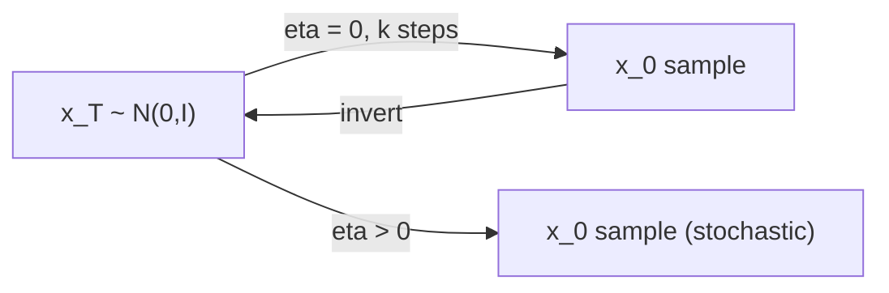

# DDIM — a deterministic reverse process, and the knob that makes it stochastic

`ddim.py` · Generative · Tier 2 · 4 variants

A diffusion model is a denoiser plus a choice of how to run it backwards. The
denoiser is trained on the forward marginals, and those marginals do not
determine the reverse chain: many generative processes have the same
$q(x_t\mid x_0)$ as the forward one. DDPM picks a Markov chain with injected
noise. DDIM picks a family in which one parameter $\eta$ controls how much noise
each step injects, and at $\eta=0$ the process is deterministic. Everything
interesting about DDIM follows from that: the same starting noise always gives
the same sample, ten steps can match two hundred, and the trajectory can be run
backwards to map data into noise. This file trains one denoiser architecture and
reads it four ways.

## Intuition

The forward process is fixed: after $t$ rungs the point is
$\sqrt{\bar\alpha_t}\,x_0+\sqrt{1-\bar\alpha_t}\,\epsilon$. A sampler has to
invent a path between those marginals. DDPM's path takes a small step down one
rung and adds noise of the posterior variance. DDIM's path jumps straight to the
point that has the right signal-to-noise ratio, using the model's prediction of
the clean point, and adds nothing:



One step is easy to picture. Given $x_t$, the denoiser proposes a clean point
$\hat x_0$ and a noise $\hat\epsilon$. The pair defines a line; every rung of the
schedule is a point on that line. DDIM takes the point at the next rung, with no
randomness. In the limit of small steps this is an Euler integrator of the
probability-flow ODE, so the sampler is a numerical method, and its error is
discretisation error rather than sampling variance.

Three practical facts follow.

- **Reproducibility.** A sample is a deterministic function of $x_T$. The demo
  asserts that two calls with the same seed return identical arrays, which is
  not true of the ancestral sampler.
- **Few steps.** Because nothing is injected, there is no variance to
  accumulate; the cost of a larger stride is truncation error. On this data ten
  steps are indistinguishable from two hundred (0.178 against 0.177), and five
  steps are still all eight modes (0.216).
- **Inversion.** A deterministic map can be run backwards. Given a data point,
  solve each step for the noisier state and recover the $x_T$ that generates
  it. This is the basis of editing methods that invert an image, change
  something in the latent, and resample.

$\eta$ re-introduces the missing noise. At $\eta=1$ the per-step variance is
exactly the DDPM posterior variance, so the family contains the ancestral
sampler as one end of a dial; intermediate values interpolate. The demo runs all
three from the *same* starting noise and measures how far the samples move: zero
at $\eta=0$, 0.80 at $\eta=0.5$, 1.03 at $\eta=1$.

The last ingredient is the prediction target. DDIM's clean point is
$\hat x_0=(x_t-\sqrt{1-\bar\alpha_t}\,\hat\epsilon)/\sqrt{\bar\alpha_t}$, and at
high noise that divides a noisy quantity by a tiny number. The file therefore
trains on the velocity $v$, for which the same inversion has coefficients of
magnitude at most one. This is not cosmetic. The first version of this atom used
$\epsilon$-prediction and its distance at 50 steps was 0.473, at ten steps 2.46,
and at five 5.90 — the sampler amplified the model's high-noise error on every
long jump. With $v$ the same sampler at the same step counts gives 0.177, 0.178
and 0.216. The sampler did not change; the conditioning of the target did.

## Variants

| variant | steps | $\eta$ | modes | share | distance |
|:--|--:|--:|--:|--:|--:|
| `ddim` | 50 | 0.0 | 8/8 | 0.15 | 0.177 |
| `eta_sampling` | 50 | 1.0 | 8/8 | 0.15 | 0.174 |
| `ddim_inversion` | 200 | 0.0 | 8/8 | 0.15 | 0.177 |
| `few_step` | 10 | 0.0 | 8/8 | 0.14 | 0.178 |

All four use the same denoiser: 2048 points from eight Gaussians of radius 0.8
and spread 0.07, a cosine schedule with 200 training rungs, a $2+4\to64\to64\to2$
SiLU network (4738 parameters), 3000 Adam steps at $2\times10^{-3}$ on batches
of 256. Each variant trains its own copy with the same seed, so the four
denoisers are byte-identical — the demo checks every weight against the
`few_step` copy — and the table isolates the sampler.

**`ddim`** — the standard fast sampler: 50 steps, $\eta=0$, distance 0.177,
which matches the 200-step run to three decimals. The cost of sampling is the
step count, and this is the row that says the step count can be cut by four with
no measurable loss *on this data*.

**`eta_sampling`** — the same 50 steps with $\eta=1$. Coverage and distance are
unchanged (0.174), which is the honest result: on a distribution this easy, the
stochasticity does not buy quality. What it changes is the sample itself — from
a fixed start the outputs move by 1.03 in mean norm — and it is what makes
inversion impossible, which the demo checks by asking this variant to invert and
expecting a refusal.

**`ddim_inversion`** — the deterministic map run at full resolution (200 steps)
and read backwards. `invert` maps a data point to a latent with the same update
solved for the other direction, and `round_trip` inverts and resamples.
Round-trip error at 200 steps is 0.0033 mean and 0.0105 max; at 50 steps it is
0.0128 and 0.043; at 20 it is 0.0317 and 0.143. Inversion is not free: it
evaluates the model at states the forward process never produced, so the error
compounds, and a longer stride compounds it faster. The inverted latents are
also slightly narrower than standard normal (std 0.953 against 1.0), which is
worth knowing before editing in that space.

**`few_step`** — ten steps, $\eta=0$. Distance 0.178 against 0.177 for 200
steps. This is the result that made DDIM the default sampler for a generation:
a tenfold saving with no visible cost. It is also the result that is most
data-dependent, and the failure section says why.

## Derivation

### The marginals, and what they do not determine

The forward process has the closed form

$$
q(x_t\mid x_0)=\mathcal N\bigl(\sqrt{\bar\alpha_t}\,x_0,\,
(1-\bar\alpha_t)I\bigr),
\qquad (1)
$$

and the training objective only ever asks the model about these marginals. Any
joint distribution over $x_{1:T}$ whose $t$-marginals equal (1) produces the
same training signal, so it is a valid generative model to run backwards. DDIM
constructs one with a free variance parameter:

$$
q_\sigma(x_{1:T}\mid x_0)
=q(x_T\mid x_0)\prod_{t=2}^{T}q_\sigma(x_{t-1}\mid x_t,x_0),
\qquad (2)
$$

$$
q_\sigma(x_{t-1}\mid x_t,x_0)=\mathcal N\Bigl(
\sqrt{\bar\alpha_{t-1}}\,x_0
+\sqrt{1-\bar\alpha_{t-1}-\sigma_t^2}\,
\frac{x_t-\sqrt{\bar\alpha_t}\,x_0}{\sqrt{1-\bar\alpha_t}},
\;\sigma_t^2 I\Bigr).
\qquad (3)
$$

The claim that makes this useful is that the marginals do not depend on
$\sigma$:

$$
q_\sigma(x_t\mid x_0)=q(x_t\mid x_0)
\qquad (4)
$$

for every admissible $\sigma_t$. The proof is induction: (3) is Gaussian and
linear in $x_t$, so its marginal is Gaussian; its mean is
$\sqrt{\bar\alpha_t}x_0$ by construction, and its variance is
$(1-\bar\alpha_t)$, which a one-line calculation from the coefficients in (3)
confirms. Nothing in the derivation uses a particular $\sigma_t$.

### The step

At sampling time $x_0$ is unknown, so the model supplies $\hat x_0$ and
$\hat\epsilon$. Substituting them into (3) and reading off the mean gives the
update:

$$
x_{s}=\sqrt{\bar\alpha_{s}}\,\hat x_0
+\sqrt{1-\bar\alpha_{s}-\sigma^2}\,\hat\epsilon
+\sigma z,
\qquad (5)
$$

where $s<t$ is the next rung visited — not necessarily $t-1$, which is what
makes few-step sampling possible. With $\sigma=0$ the update is the point on the
segment from $\hat x_0$ through $\hat\epsilon$ at signal fraction
$\bar\alpha_s$; in the notation of (1), it is the state whose implied noise is
exactly $\hat\epsilon$.

The variance has one natural parameterisation, with $\eta$ controlling how much
of the DDPM variance is used:

$$
\sigma^2=\eta^2\,
\frac{1-\bar\alpha_s}{1-\bar\alpha_t}
\Bigl(1-\frac{\bar\alpha_t}{\bar\alpha_s}\Bigr).
\qquad (6)
$$

For $s=t-1$, the bracket is $1-\alpha_t=\beta_t$, so $\eta=1$ gives
$\sigma^2=\beta_t(1-\bar\alpha_{t-1})/(1-\bar\alpha_t)$ — the DDPM posterior
variance exactly. The family therefore contains the ancestral sampler at
$\eta=1$ and the deterministic map at $\eta=0$, and nothing else has to change.

### Why $\eta=0$ is an ODE

Take $s=t-1$ and let the schedule become fine. Equation (5) at $\sigma=0$
expresses $x_{t-1}$ as $x_t$ plus a drift proportional to the step size; the
drift is a function of $(x_t,t)$ only. That is the Euler update of the
probability-flow ODE (Song et al. 2021), and the sampler is its integrator. Two
consequences matter here: the map
$x_T\mapsto x_0$ is deterministic, and the error at a fixed number of steps is
truncation error, not variance.

Neither consequence says how *large* the error is. That depends on how straight
the trajectory is, which depends on the data and the model. On a two-dimensional
manifold the trajectory is almost straight, so ten Euler steps suffice; on
natural images it is not, and ten steps of a first-order integrator are visibly
worse than two hundred. This file's flat ladder is a property of the toy, not a
promise about images.

### Velocity prediction

The denoiser is trained on

$$
v=\sqrt{\bar\alpha_t}\,\epsilon-\sqrt{1-\bar\alpha_t}\,x_0,
\qquad (7)
$$

which inverts without division:

$$
x_0=\sqrt{\bar\alpha_t}\,x_t-\sqrt{1-\bar\alpha_t}\,v,
\qquad
\epsilon=\sqrt{\bar\alpha_t}\,v+\sqrt{1-\bar\alpha_t}\,x_t .
\qquad (8)
$$

Compare the sensitivity of the recovered clean point to an error in the
prediction:

$$
\frac{\partial\hat x_0}{\partial\hat\epsilon}
=-\frac{\sqrt{1-\bar\alpha_t}}{\sqrt{\bar\alpha_t}},
\qquad
\frac{\partial\hat x_0}{\partial\hat v}
=-\sqrt{1-\bar\alpha_t}.
\qquad (9)
$$

At the last rung of this cosine schedule $\bar\alpha_T=6\times10^{-8}$, so the
$\epsilon$ route multiplies an error by about 4000 and the $v$ route by at most
one. A few-step sampler evaluates the model at high noise and takes large jumps,
which is precisely where the amplification is worst; that is why the
$\epsilon$-trained version of this file degrades to 0.47 and then 2.46 as the
stride grows, and why the $v$-trained one does not.

### Inversion

The $\eta=0$ step is a map from one rung to the next. Given a state $x_s$ on the
trajectory, the same two predictions define the noisier state:

$$
x_t=\sqrt{\bar\alpha_t}\,\hat x_0(x_s,s)
+\sqrt{1-\bar\alpha_t}\,\hat\epsilon(x_s,s).
\qquad (10)
$$

Starting from a data point and iterating (10) upward produces a latent $x_T$.
If the model's predictions were consistent — if the $\hat\epsilon$ it returns at
the reconstructed state equalled the one used to build it — the round trip would
be exact, because (5) and (10) are algebraic inverses. They are not consistent:
the model is evaluated off the training distribution, and each step's error
becomes the next step's input. The measured round-trip error is therefore a
measure of the model's self-consistency, not of the algebra:

| steps | mean error | max error | latent std |
|--:|--:|--:|--:|
| 200 | 0.0033 | 0.0105 | 0.953 |
| 50 | 0.0128 | 0.0433 | 0.920 |
| 20 | 0.0317 | 0.1430 | 0.865 |

Two things in that table are worth keeping. The error grows as the stride grows,
so editing pipelines invert at full resolution and sample at reduced one. And the
latent standard deviation falls below one, so inverted latents are not samples
from the prior the sampler expects; resampling from them drifts toward the data.

### Determinism and \(\eta\)

At $\eta=0$, (5) contains no random draw, so the entire trajectory is a function
of $x_T$. Different seeds change only the initial draw; the same seed gives the
same sample bit for bit. At $\eta>0$ each step adds $\sigma z$, so the same
$x_T$ gives a distribution of samples — the demo measures a mean displacement of
0.80 at $\eta=0.5$ and 1.03 at $\eta=1$ from the $\eta=0$ path.

The training objective is untouched by any of this:

$$
\mathcal L=\mathbb E_{t,x_0,\epsilon}
\bigl\lVert v-v_\theta(x_t,t)\bigr\rVert^2 .
\qquad (11)
$$

DDIM is a different way to *use* a model, not a different model. That is why the
four variants in this file share byte-identical weights.

## Code walkthrough

The rung list is the first design decision. `steps` is the number of
*transitions*, so the grid has `steps + 1` points, and the endpoints are always
$T$ and zero. Rounding can in principle repeat a rung; the guard on the range
keeps that from happening silently for long trajectories.

```python
    def _times(self, steps: int) -> np.ndarray:
        """The descending rungs visited, from STEPS to zero inclusive."""
        if steps < 1 or steps > STEPS:
            raise ValueError(f"steps must lie in [1, {STEPS}]")
        grid = np.rint(np.linspace(0.0, STEPS, steps + 1)).astype(int)
        return grid[::-1]
```

The variance is a function of the two rungs and $\eta$ alone, which is what
makes (6) cheap to inspect. The `s == 0` branch is not an optimisation: at the
last rung $\bar\alpha_s=1$, so the bracket in (6) is already zero, and the guard
only avoids a zero-over-zero in floating point.

```python
    def _sigma(self, t: int, s: int, eta: float) -> float:
        at, as_ = self.abar[t], self.abar[s]
        if eta == 0.0 or s == 0:
            return 0.0
        return float(eta * np.sqrt((1.0 - as_) / (1.0 - at)
                                   * (1.0 - at / as_)))
```

The split between a prediction and the pair $(\hat x_0,\hat\epsilon)$ is where
the target choice lives. With $v$ it is two linear combinations, (8), and
neither divides:

```python
    def _split(self, x: np.ndarray, t: int) -> tuple:
        """The velocity prediction turned into (x_hat_0, eps_hat)."""
        v = self._predict(x, t)
        abar = self.abar[t]
        return (np.sqrt(abar) * x - np.sqrt(1.0 - abar) * v,
                np.sqrt(abar) * v + np.sqrt(1.0 - abar) * x)
```

The sampler is then (5) in five lines. `max(..., 0.0)` guards the square root
when $\sigma^2$ nearly fills the budget; with $\eta\le1$ the quantity is
non-negative in exact arithmetic.

```python
        for t, s in zip(times[:-1], times[1:], strict=True):
            x0, eps = self._split(x, t)
            sig = self._sigma(t, s, eta)
            x = (np.sqrt(self.abar[s]) * x0
                 + np.sqrt(max(1.0 - self.abar[s] - sig ** 2, 0.0)) * eps)
            if sig > 0.0:
                x = x + sig * rng.normal(0.0, 1.0, x.shape)
        return x
```

Inversion is the same loop in the other direction, from the cleanest rung
upward. The first step asks the model at $t=0$, which training never visits;
the velocity limit there is well defined ($v=\epsilon$ when
$\bar\alpha=1$), and the model extrapolates it without trouble. The `eta = 0`
check is the guard that keeps a stochastic variant from pretending to invert.

```python
        times = self._times(self.steps if steps is None else steps)
        z = np.array(x, dtype=float, copy=True)
        for i in range(len(times) - 1, 0, -1):
            s, t = times[i], times[i - 1]
            x0, eps = self._split(z, s)
            z = (np.sqrt(self.abar[t]) * x0
                 + np.sqrt(1.0 - self.abar[t]) * eps)
        return z
```

`round_trip` is two calls and a norm. It exists as a method because the
diagnostic is the point of the variant: the error is the model's, and the demo
prints it at three resolutions rather than asserting a single number.

```python
        x = _check_data(x)
        z = self.invert(x, steps=steps)
        recon = self.sample(len(z), steps=steps, eta=0.0, start=z)
        err = np.linalg.norm(recon - x, axis=1)
        return recon, float(err.mean()), float(err.max())
```

Training is the diffusion training loop with one line changed. The target is the
velocity, and the rest — cosine schedule, four time features, SiLU, Adam — is
the same machinery as `diffusion.py`:

```python
            target = np.sqrt(abar) * eps - np.sqrt(1.0 - abar) * x0
            out, cache = _forward(params, xt, t, STEPS)
            dout = 2.0 * (out - target) / (len(x0) * x0.shape[1])
            opt.step(params, _backward(params, cache, dout))
```

## Complexity

The denoiser has 4738 parameters, so a forward pass on 1024 points is about
4.9M multiply-adds. A 50-step sample is therefore 0.24G, a 10-step sample 49M,
and a 200-step sample 0.97G. The ratio is exactly the step ratio — unlike
samplers that reuse computation between steps, DDIM simply calls the network
fewer times.

Training is 3000 steps on batches of 256, each a forward and two backward
passes, about 3.6G multiply-adds forward and 11G total. Sampling is therefore
cheap relative to training once the model exists: the demo's four trainings
dominate its work, and the eight sampling runs it reports add less than a tenth
of the multiply-adds.

Inversion costs one forward pass per rung, the same as sampling. A round trip is
two trajectories. Editing a single image at 200 steps therefore costs 400
forward passes at batch one, which is why pipelines invert at the coarsest
resolution whose error they can tolerate.

Memory is one batch of activations per layer per trajectory, plus the model and
its Adam moments. Nothing is sequential across batch elements, so the loop over
rungs is the only serial dimension.

## Failure modes

**$\epsilon$-prediction with a long stride.** The clean point divides by
$\sqrt{\bar\alpha_t}$, so a high-noise prediction error is amplified by up to
4000 on this schedule. The sampler is fine at 200 steps and falls apart at ten:
the same code with an $\epsilon$ target gives distance 0.473 at 50 steps, 2.46
at ten, 5.90 at five. The fix is a target whose inversion is well conditioned,
not a different sampler.

**Inverting a stochastic sampler.** With $\eta>0$ the step has a random draw, so
there is no inverse; `invert` raises rather than returning a plausible-looking
wrong answer. Editing pipelines that use $\eta>0$ must either fix the noise
(which turns them into $\eta=0$ maps) or accept an approximate inverse.

**Reading the few-step result as universal.** Ten steps match two hundred here
because the data is a two-dimensional circle. On images, the same ten steps are
a clearly worse sample and the trajectory is visibly curved; DPM-Solver,
distillation and consistency models exist because the gap there is real. The
honest statement is "ten steps sufficed on this manifold", not "ten steps
suffice".

**Inverted latents that are not prior samples.** The latent std is 0.953 at 200
steps and 0.865 at 20, not 1.0. The inverse map shrinks slightly, so resampling
from an inverted latent starts from a narrower distribution than the sampler was
trained for. Editing works anyway because the drift is small; measuring it is
what tells you how small.

**A rung grid that silently repeats.** `np.linspace` with more steps than rungs
rounds to duplicates, and a duplicated rung makes a zero-length step. The range
check refuses `steps > 200` here; a general implementation should also dedupe.

**Confusing $\eta=1$ with DDPM.** At $\eta=1$ and a single-rung step the
variance matches the DDPM posterior exactly, but a 50-step DDIM with $\eta=1$
is not the 200-step ancestral sampler: the rungs are different and the
per-step variances are computed for the larger stride. It is a stochastic DDIM,
which is what the name `eta_sampling` says.

**Sampling without a fixed start.** Determinism is a property of the pair
(start, model). Reproducing a sample requires storing $x_T$, not just the seed,
if the seed also drives other draws. The demo passes an explicit `start` for
exactly this reason.

## Applications

**Fast sampling.** DDIM was the first widely used answer to diffusion's
sampling cost: 20–50 steps instead of 1000, with the same trained model. It is
still the baseline that DPM-Solver and distillation improve on.

**Editing and img2img.** Invert an image, modify the latent or the conditioning,
resample. SDEdit's "add noise to level $t$, then denoise" is the stochastic
version; DDIM inversion is the deterministic one used when the edit must
preserve the original closely.

**Interpolation.** Because the map from $x_T$ to $x_0$ is continuous and
deterministic, interpolating between two latents and decoding gives a smooth
path between two samples — the latent-space interpolation that made diffusion
models usable as generative tools.

**Likelihoods and ODE methods.** The probability-flow ODE has a tractable
likelihood via the instantaneous change of variables, so deterministic samplers
connect diffusion to continuous normalising flows. That connection is what
score-based generative modelling and later flow-matching methods build on.

**Consistency and distillation.** A deterministic teacher is easier to
distil: consistency models and progressive distillation train a student to jump
along the teacher's trajectory, and the teacher's determinism is what makes the
target well defined. Few-step DDIM is the usual teacher.

**Video and long sequences.** Determinism matters when frames must be
consistent across a batch or across calls; a stochastic sampler changes the
output on every call, which is unacceptable for some pipelines and fine for
others. The $\eta$ knob is the switch between the two regimes.

## References

- Song, Meng & Ermon (2021). *Denoising Diffusion Implicit Models.* ICLR.
- Song, Sohl-Dickstein, Kingma, Kumar, Ermon & Poole (2021). *Score-Based
  Generative Modeling through Stochastic Differential Equations.* ICLR.
- Ho, Jain & Abbeel (2020). *Denoising Diffusion Probabilistic Models.* NeurIPS.
- Nichol & Dhariwal (2021). *Improved Denoising Diffusion Probabilistic Models.*
  ICML.
- Salimans & Ho (2022). *Progressive Distillation for Fast Sampling of Diffusion
  Models.* ICLR.
- Meng, He, Song, Song, Wu, Zhu & Ermon (2022). *SDEdit: Guided Image Synthesis
  and Editing with Stochastic Differential Equations.* ICLR.
- Lu, Zhou, Bao, Chen, Li & Zhu (2022). *DPM-Solver: A Fast ODE Solver for
  Diffusion Probabilistic Model Sampling in Around 10 Steps.* NeurIPS.
- Karras, Aittala, Aila & Laine (2022). *Elucidating the Design Space of
  Diffusion-Based Generative Models.* NeurIPS.
- Song, Dhariwal, Chen & Sutskever (2023). *Consistency Models.* ICML.
