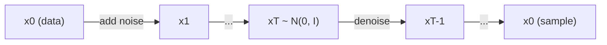

# Diffusion models — a fixed noising process and a learned reverse

`diffusion.py` · Generative · Tier 1 · 6 variants

A diffusion model is a denoiser run backwards. The forward process is not
learned: it adds Gaussian noise on a fixed schedule until the data is
indistinguishable from a standard normal. The reverse is learned, one small
denoising step at a time, and sampling is that loop run from noise. There is no
adversary, no encoder and no likelihood network — only regression on noise,
which is why diffusion trains more reliably than a GAN and samples more slowly
than a VAE. This file runs the process on eight Gaussians whose circle is
isometrically embedded in eight dimensions, so that the difference between the
ambient space and the data's own two-dimensional plane can be measured rather
than asserted.

## Intuition

Fix a schedule $\beta_1,\dots,\beta_T$ with $\beta_t$ small. One forward step
shrinks the data by $\sqrt{1-\beta_t}$ and adds noise of variance $\beta_t$:



The forward chain has a closed form: after $t$ steps the point is
$\sqrt{\bar\alpha_t}\,x_0+\sqrt{1-\bar\alpha_t}\,\epsilon$ with
$\bar\alpha_t=\prod_{s\le t}(1-\beta_s)$. At $t=T$ the signal fraction
$\bar\alpha_T$ is tiny — $4\times10^{-5}$ for the 1000-step schedule here — so
$x_T$ is essentially noise and can be replaced by a standard normal draw without
measurable loss.

The reverse step is the hard direction, and it is learned. The model is shown
$(x_t,t)$ and asked to predict the noise $\epsilon$ that was added. That target
is available for free during training — draw a clean point, draw a noise level,
draw the noise, and the label is the noise you drew. The model never has to
imagine a distribution; it has to regress a vector the training loop can see.

Everything else follows from that. Sampling starts at $x_T\sim\mathcal N(0,I)$
and applies the model's estimate of $\epsilon$ at each step, subtracting a
fraction of it and adding a smaller amount of fresh noise. Each step is a
denoising; the composition is a sampler. Two consequences are worth stating at
the start:

- **The model must be told $t$.** One network is asked to denoise at every noise
  level from nearly clean to nearly pure noise. Without a time embedding it can
  only learn the average, which is a blur.
- **The chain is sequential.** Sampling costs $T$ forward passes and cannot be
  parallelised across steps. That is the price of the reliability; DDIM and
  distillation are the ways to pay less.

The three axes this file varies are the schedule (where the noise is placed),
the target ($\epsilon$ or the velocity $v$), and the space (ambient or a learned
latent). They are independent, and the demo arranges the six variants as three
controlled pairs so each axis is isolated.

## Variants

| variant | T | schedule | target | space | distance |
|:--|--:|:--|:--|:--|--:|
| `ddpm` | 1000 | linear $10^{-4}$–$0.02$ | $\epsilon$ | ambient | 0.308 |
| `linear_schedule` | 200 | linear $10^{-3}$–$0.05$ | $\epsilon$ | ambient | 0.280 |
| `cosine_schedule` | 200 | cosine | $\epsilon$ | ambient | 0.254 |
| `epsilon_prediction` | 100 | cosine | $\epsilon$ | ambient | 0.241 |
| `v_prediction` | 100 | cosine | $v$ | ambient | 0.334 |
| `latent_diffusion` | 100 | cosine | $v$ | 2-D latent | 0.175 |

**`ddpm`** — the reference configuration (Ho, Jain & Abbeel 2020): 1000 steps,
the linear $\beta$ schedule from $10^{-4}$ to $0.02$, $\epsilon$-prediction, the
ancestral sampler. It has the best per-step denoising in the table (0.0019 mean
squared error at $t=10$) because a thousand rungs make each step tiny, and the
worst sample distance (0.308) because those thousand steps also compound a
thousand small errors — and 3000 updates is a thin budget for a thousand-rung
chain.

**`linear_schedule`** — the same schedule rescaled to 200 steps, from $10^{-3}$
to $0.05$. The rescaling is the point: the paper's numbers assume 1000 steps, and
using them with 200 leaves $\bar\alpha_T=0.13$, so $x_T$ still contains an
eighth of the data's signal and the sampler starts from the wrong
distribution. With the rescaled schedule $\bar\alpha_T=5.6\times10^{-3}$ and the
distance improves from 0.308 to 0.280.

**`cosine_schedule`** — the cosine schedule of Nichol & Dhariwal (2021), which
places $\bar\alpha_t$ on a cosine curve instead of letting it decay linearly in
$t$. It keeps more signal in the early steps and destroys it faster at the end:
$\bar\alpha_T=6.1\times10^{-8}$ against $5.6\times10^{-3}$, and the midpoint
$\bar\alpha_t=0.5$ lands exactly at $t=T/2$ by construction, against $t=72$ of
200 for the linear one. Same cost, same sampler, distance 0.254.

**`epsilon_prediction`** — $\epsilon$-prediction at 100 steps on the cosine
schedule. It is the bridge between the schedule ladder and the target ladder: it
is the 200-step cosine model with half the steps, and it has the best ambient
sample distance (0.241). Fewer steps does not hurt here, because 100 updates per
sample is already generous for a two-dimensional manifold.

**`v_prediction`** — the same 100 steps and schedule, predicting the velocity
$v=\sqrt{\bar\alpha}\,\epsilon-\sqrt{1-\bar\alpha}\,x_0$ instead of the noise
(Salimans & Ho 2022). Its samples are slightly worse (0.334), and its point is
not sample quality: at the last rung its implied clean point has error 0.340,
against 78,097 for $\epsilon$-prediction, because $v$ never divides by
$\sqrt{\bar\alpha_T}$. Anything that needs $\hat x_0$ — clipping, guidance,
deterministic samplers — inherits that difference.

**`latent_diffusion`** — $v$-prediction at 100 steps in the two-dimensional code
$z=xB^{\mathsf T}$, decoded by $zB$ (Rombach et al. 2022). The embedding is
isometric, so the round trip is exact ($1.3\times10^{-33}$) and the encoder costs
nothing; the model is 4738 parameters against 5512, and its samples land 0.175
from the nearest centre against 0.334. The ambient model has to spend part of
every step re-learning which six directions carry no signal; the latent model
never sees them.

## Derivation

### The forward process

One step is a Gaussian kernel that shrinks and noises:

$$
q(x_t\mid x_{t-1})=\mathcal N\bigl(\sqrt{1-\beta_t}\,x_{t-1},\,\beta_t I\bigr).
\qquad (1)
$$

Composing $t$ of them gives the closed form used in training:

$$
q(x_t\mid x_0)=\mathcal N\bigl(\sqrt{\bar\alpha_t}\,x_0,\,
(1-\bar\alpha_t)I\bigr),
\qquad
x_t=\sqrt{\bar\alpha_t}\,x_0+\sqrt{1-\bar\alpha_t}\,\epsilon,
\qquad (2)
$$

with $\alpha_t=1-\beta_t$ and $\bar\alpha_t=\prod_{s\le t}\alpha_s$. The
composition is exact because a sum of independent Gaussians is Gaussian; no
approximation is involved in the forward direction at all.

### The reverse is Gaussian too, given the clean point

The true reverse $q(x_{t-1}\mid x_t)$ is not Gaussian. But conditioned on
$x_0$ it is, by Bayes' rule for Gaussians:

$$
q(x_{t-1}\mid x_t,x_0)=\mathcal N\bigl(\tilde\mu_t(x_t,x_0),\,
\tilde\beta_t I\bigr),
\qquad
\tilde\beta_t=\frac{1-\bar\alpha_{t-1}}{1-\bar\alpha_t}\beta_t,
\qquad (3)
$$

$$
\tilde\mu_t=\frac{\sqrt{\bar\alpha_{t-1}}\,\beta_t}{1-\bar\alpha_t}\,x_0
+\frac{\sqrt{\alpha_t}\,(1-\bar\alpha_{t-1})}{1-\bar\alpha_t}\,x_t .
$$

This is the quantity the network is asked to imitate. Since the mean is affine
in $x_0$, and $x_0$ can be written in terms of $x_t$ and $\epsilon$ by (2),
predicting $\epsilon$ is the same as predicting the posterior mean: the two
differ by a fixed affine map at each $t$.

### The ELBO

Maximise a variational bound on the data likelihood, with the forward chain as
the variational distribution:

$$
\mathcal L=\mathbb E_q\Bigl[-\log p(x_T)
-\sum_{t=1}^{T}\log\frac{p_\theta(x_{t-1}\mid x_t)}{q(x_t\mid x_{t-1})}\Bigr].
\qquad (4)
$$

Rearranging into a prior term, a sum of per-step KLs and a decoder term:

$$
\mathcal L=\mathcal L_T+\sum_{t=2}^{T}\mathcal L_{t-1}+\mathcal L_0,
\qquad
\mathcal L_{t-1}=\mathrm{KL}\bigl(q(x_{t-1}\mid x_t,x_0)\,\|\,
p_\theta(x_{t-1}\mid x_t)\bigr).
\qquad (5)
$$

$\mathcal L_T$ has no parameters — the forward chain is fixed and $p(x_T)$ is
standard normal. Take $p_\theta$ to be Gaussian with the posterior variance
$\tilde\beta_t$ and the network's mean, and the KL becomes a scaled squared
error. Substituting the network's $\epsilon$-prediction for its mean:

$$
\mathcal L_{t-1}=\mathbb E\Bigl[
\frac{\beta_t}{2\alpha_t(1-\bar\alpha_{t-1})}
\bigl\|\epsilon-\epsilon_\theta(x_t,t)\bigr\|^2\Bigr]+C .
\qquad (6)
$$

For the 1000-step linear schedule the coefficient runs from 0.600 at $t=2$ down
to 0.0102 at $t=T$: the bound weights the near-clean steps sixty times more
heavily than the noisiest one. That is statistically correct — a small error at
low noise is very visible — and it is not what produces good samples.

### The simplified objective

DDPM drops the coefficient:

$$
\mathcal L_{\mathrm{simple}}=\mathbb E_{t,x_0,\epsilon}\Bigl[
\bigl\|\epsilon-\epsilon_\theta\bigl(
\sqrt{\bar\alpha_t}\,x_0+\sqrt{1-\bar\alpha_t}\,\epsilon,\,t\bigr)\bigr\|^2
\Bigr],
\qquad (7)
$$

with $t$ uniform over $1,\dots,T$. This is the objective every implementation
actually minimises, and it is a *reweighting* of the bound toward high noise, not
an approximation to it. The demo trains on (7) everywhere; the difference from
the bound is why the reported loss is a mean squared error and not a
log-likelihood.

### Velocity prediction

The $\epsilon$-target is nearly the input at high noise: $x_t$ is dominated by
$\epsilon$, so predicting $\epsilon$ means "copy $x_t$ and correct a little".
The velocity target rotates the problem so that both components stay order one:

$$
v=\sqrt{\bar\alpha_t}\,\epsilon-\sqrt{1-\bar\alpha_t}\,x_0,
\qquad (8)
$$

and, inverting (2) and (8),

$$
x_0=\sqrt{\bar\alpha_t}\,x_t-\sqrt{1-\bar\alpha_t}\,v,
\qquad
\epsilon=\sqrt{\bar\alpha_t}\,v+\sqrt{1-\bar\alpha_t}\,x_t .
\qquad (9)
$$

The reason to care is conditioning. Recovering the clean point from an
$\epsilon$-prediction divides by the signal fraction:

$$
\frac{\partial\hat x_0}{\partial\hat\epsilon}
=-\frac{\sqrt{1-\bar\alpha_t}}{\sqrt{\bar\alpha_t}},\qquad
\bigl\|\delta\hat x_0\bigr\|=
\sqrt{\frac{1-\bar\alpha_t}{\bar\alpha_t}}\;\|\delta\epsilon\|.
\qquad (10)
$$

For the cosine schedule at $T=200$, $\bar\alpha_T=6.1\times10^{-8}$, so the
amplification is 4058: a noise estimate off by half a unit becomes a clean-point
estimate off by two thousand. The demo measures exactly this: the implied
$\hat x_0$ has mean squared error $328{,}000$ at the last rung under
$\epsilon$-prediction and $0.340$ under $v$-prediction. With $v$ the map in (9)
has coefficients at most one and no division.

### The ancestral update

Given $\hat\epsilon$, the posterior mean (3) becomes

$$
x_{t-1}=\frac{1}{\sqrt{\alpha_t}}\Bigl(
x_t-\frac{\beta_t}{\sqrt{1-\bar\alpha_t}}\,\hat\epsilon\Bigr)
+\sigma_t z,
\qquad
\sigma_t^2=\tilde\beta_t,
\qquad (11)
$$

with $z\sim\mathcal N(0,I)$ for $t>1$ and no noise at $t=1$. If $\hat\epsilon$ is
the *true* noise and no noise is injected, (11) is exact: substituting
$x_t=\sqrt{\bar\alpha_t}x_0+\sqrt{1-\bar\alpha_t}\epsilon$ gives
$\sqrt{\bar\alpha_{t-1}}x_0+\sqrt{1-\bar\alpha_{t-1}}\epsilon$, the same
functional form one rung down. Iterating from $x_T$ therefore returns $x_0$ with
no error at all. The demo runs that oracle through the real update and gets a
maximum deviation of $0.0$: the arithmetic of the sampler is exact, so every
error in a real sample belongs to the model.

### Schedules

The linear schedule interpolates the per-step variance:

$$
\beta_t=\beta_1+\frac{t-1}{T-1}\bigl(\beta_T-\beta_1\bigr).
\qquad (12)
$$

The cosine schedule instead places the cumulative signal on a cosine:

$$
\bar\alpha_t=\frac{\cos^2\bigl(\frac{t/T+s}{1+s}\cdot\frac{\pi}{2}\bigr)}
{\cos^2\bigl(\frac{s}{1+s}\cdot\frac{\pi}{2}\bigr)},
\qquad s=0.008,
\qquad (13)
$$

and recovers $\beta_t=1-\bar\alpha_t/\bar\alpha_{t-1}$, clipped at $0.999$. The
$s$ offset keeps $\beta_t$ from vanishing at $t=0$. Because
$\cos^2(\pi/4)=\tfrac12$, this schedule is defined so that half the signal is
gone at the midpoint: the demo's crossover step is 100 of 200, against 72 for
the linear one.

### Latent diffusion

Let $B$ be a $2\times8$ matrix with orthonormal rows, and make every data point
$B^{\mathsf T}$ times a point on the circle. Then

$$
z=Bx\in\mathbb R^2,
\qquad
\hat x=B^{\mathsf T}z,
\qquad
\hat x=B^{\mathsf T}Bx=x
\qquad (14)
$$

for every point in the data's plane, so the autoencoder is exact here. Diffusion
runs on $z$; the sampler decodes once at the end. The point is not compression
for its own sake — it is that the model is never asked to represent the six
directions in which the data has no variance.

## Code walkthrough

The data: a circle in two dimensions, lifted into eight by an isometric basis.
`encode` is a projection and `decode` its transpose, and on this data the two
compose to the identity.

```python
def _basis() -> np.ndarray:
    """The (2, 8) matrix whose rows span the data's plane."""
    rng = np.random.default_rng(BASIS_SEED)
    q, _ = np.linalg.qr(rng.normal(size=(DIM, LATENT)))
    return q.T
```

```python
def encode(x: np.ndarray) -> np.ndarray:
    """Project ambient points onto the two-dimensional data plane."""
    return np.asarray(x, dtype=float) @ BASIS.T
```

```python
def decode(z: np.ndarray) -> np.ndarray:
    """Lift latent codes back into the ambient space, exactly."""
    return np.asarray(z, dtype=float) @ BASIS
```

The schedule is a pure function of the step count and the kind, so the two
schedules are compared on identical arithmetic. The linear one is rescaled for
short chains; the cosine one is inverted from a cosine curve and clipped.

```python
def make_schedule(steps: int, kind: str) -> tuple:
    """Return (beta, alpha, abar), each of length `steps`.

    `linear` interpolates the per-step variance from LINEAR_LO to LINEAR_HI;
    `cosine` places the cumulative signal on a cosine curve (Nichol & Dhariwal
    2021), which keeps more signal at small t and destroys it faster at the end.
    """
    if kind == "linear":
        lo, hi = (LINEAR_LO, LINEAR_HI) if steps >= 500 else (SHORT_LO, SHORT_HI)
        beta = np.linspace(lo, hi, steps)
    elif kind == "cosine":
        t = np.arange(steps + 1) / steps
        f = np.cos((t + COSINE_S) / (1.0 + COSINE_S) * np.pi / 2.0) ** 2
        abar = f / f[0]
        beta = np.clip(1.0 - abar[1:] / abar[:-1], 1e-5, 0.999)
    else:
        raise ValueError(f"unknown schedule {kind!r}")
    alpha = 1.0 - beta
    return beta, alpha, np.cumprod(alpha)
```

The network needs the step number, and one scalar is not enough: a single
monotone input makes the high-noise regime a thin slice of the domain. Four
Fourier features give the model a periodic code in which nearby noise levels are
nearby inputs and the two ends of the schedule are far apart.

```python
def _time_features(t: np.ndarray, steps: int) -> np.ndarray:
    """Four features: sin and cos at one and two cycles over the schedule."""
    phase = (np.asarray(t, dtype=float) / steps) * np.pi
    return np.stack([np.sin(phase), np.cos(phase),
                     np.sin(2.0 * phase), np.cos(2.0 * phase)], axis=1)
```

The stack is a two-hidden-layer MLP with SiLU. The last layer is initialised to
zero, so the model starts by predicting no noise and learns the scale before it
learns the shape.

```python
def _forward(params: list, x: np.ndarray, t: np.ndarray,
             steps: int) -> tuple:
    """Run the stack; returns (prediction, cache) with one entry per layer."""
    h = np.concatenate([x, _time_features(t, steps)], axis=1)
    cache = []
    last = len(params) - 1
    for i, layer in enumerate(params):
        pre = h @ layer["W"] + layer["b"]
        out = pre if i == last else pre * _sig(pre)
        cache.append((h, pre, out))
        h = out
    return h, cache
```

SiLU's derivative is $\sigma(z)+z\sigma(z)(1-\sigma(z))$, which is why the
backward pass recomputes the sigmoid rather than storing it: the cache is
already three arrays per layer, and memory is what limits diffusion models at
scale.

```python
def _backward(params: list, cache: list, dout: np.ndarray) -> list:
    """Return parameter gradients; `dout` carries the 1/(n*d) of a mean."""
    grads = [None] * len(params)
    d = dout
    last = len(params) - 1
    for i in range(last, -1, -1):
        h, pre, out = cache[i]
        if i != last:
            s = _sig(pre)
            d = d * (s + pre * s * (1.0 - s))
        grads[i] = {"W": h.T @ d, "b": d.sum(axis=0)}
        if i:
            d = d @ params[i]["W"].T
    return grads
```

The two parameterisations are one branch each. `_target` builds the regression
label during training; `_split` inverts a prediction at sampling time.

```python
def _target(x0: np.ndarray, eps: np.ndarray, abar: np.ndarray,
            kind: str) -> np.ndarray:
    """The regression target at the batch's own noise levels."""
    if kind == "eps":
        return eps
    return np.sqrt(abar) * eps - np.sqrt(1.0 - abar) * x0
```

```python
def _split(out: np.ndarray, xt: np.ndarray, abar: np.ndarray,
           kind: str) -> tuple:
    """Turn a prediction into (x_hat_0, eps_hat) at one noise level."""
    if kind == "eps":
        eps = out
        return (xt - np.sqrt(1.0 - abar) * out) / np.sqrt(abar), eps
    x0 = np.sqrt(abar) * xt - np.sqrt(1.0 - abar) * out
    eps = np.sqrt(abar) * out + np.sqrt(1.0 - abar) * xt
    return x0, eps
```

Training samples one noise level per point, not a trajectory: the forward chain
is simulated in closed form by (2), so a step costs one forward and one backward
pass regardless of $T$. The `abar` broadcast is the only place the schedule
enters the loop.

```python
        for _ in range(self.train_steps):
            idx = rng.integers(0, len(z), self.batch)
            x0 = z[idx]
            t = rng.integers(1, self.steps + 1, self.batch)
            eps = rng.normal(0.0, 1.0, x0.shape)
            abar = self.abar[t - 1][:, None]
            xt = np.sqrt(abar) * x0 + np.sqrt(1.0 - abar) * eps
            y = _target(x0, eps, abar, self.target)
            out, cache = _forward(params, xt, t, self.steps)
            dout = 2.0 * (out - y) / (len(x0) * x0.shape[1])
            opt.step(params, _backward(params, cache, dout))
```

Sampling is the same network called $T$ times, with the noise level decreasing
by one each call. The model's prediction is converted to $\hat\epsilon$ by
`_split`, which is the only line that differs between the two targets.

```python
        x = rng.normal(0.0, 1.0, (n, self.dim))
        for t in range(self.steps, 0, -1):
            out, _ = _forward(self.params, x, np.full(n, t), self.steps)
            _, eps = _split(out, x, self.abar[t - 1], self.target)
            noise = (rng.normal(0.0, 1.0, (n, self.dim))
                     if t > 1 else None)
            x = self._step(x, t, eps, noise)
        return decode(x) if self.latent else x
```

The update itself is written once and used by both the sampler and the oracle
check. `noise=None` makes it deterministic, which is how the demo proves the
arithmetic: fed the true noise, the loop must return the point it started from.

```python
    def _step(self, x: np.ndarray, t: int, eps: np.ndarray,
              noise: np.ndarray | None) -> np.ndarray:
        """One ancestral update; `noise=None` makes it deterministic."""
        abar = self.abar[t - 1]
        mean = (x - self.beta[t - 1] / np.sqrt(1.0 - abar) * eps)
        mean = mean / np.sqrt(self.alpha[t - 1])
        if noise is None or t == 1:
            return mean
        var = self.beta[t - 1] * (1.0 - self.abar[t - 2]) / (1.0 - abar)
        return mean + np.sqrt(var) * noise
```

The diagnostic projects every model's implied clean point onto the data's plane
before scoring it. Without that projection the ambient model would be flattered
by six coordinates whose true value is zero, and the comparison with the latent
model would be meaningless.

```python
            out, _ = _forward(self.params, xt, np.full(len(z), t), self.steps)
            x0, _ = _split(out, xt, abar, self.target)
            x0 = x0 if self.latent else encode(x0)
            total += float(np.mean((x0 - z) ** 2))
        return total / repeats
```

## Complexity

The ambient model has 5512 parameters and the latent one 4738: the input is
12 numbers (8 ambient plus 4 time features) against 6, and the output 8 against
2, so the saving is confined to the first and last layers — 14% here, and more
when the ambient dimension is large. The hidden layers, which dominate both
counts, are identical.

A training step is one forward and one backward pass on a batch of 256, about
4M multiply-adds, and 3000 steps is roughly 13G. Sampling is $T$ forward passes;
at 1024 draws that is 5.6G for the 1000-step model and 0.56G for a 100-step one,
so the reference configuration is ten times the sampling cost of the short ones
for a slightly worse distance. The sequential loop is the bottleneck no batched
implementation can remove; it is why step distillation and DDIM exist.

Memory is the parameter count plus the activations of one batch per layer,
doubled for Adam. Nothing here needs checkpointing; a 512-channel image model at
256×256 does, and the same code shape applies.

## Failure modes

**$\bar\alpha_T$ that is not small enough.** The linear schedule's constants are
tied to $T=1000$. Run them at 200 steps and $\bar\alpha_T=0.56$: $x_T$ still
carries more than half the signal, the sampler starts from a distribution that
is not noise, and no amount of training fixes it. The check is one number, and
the rescaling is one line.

**$\epsilon$-prediction's implied clean point is ill-conditioned at high noise.**
The amplification is $\sqrt{(1-\bar\alpha_T)/\bar\alpha_T}$ — 4058 for the
cosine schedule at 200 steps. The sampler is safe because it uses $\hat\epsilon$,
not $\hat x_0$; everything downstream that needs the clean point (clipping,
guidance, inversion) is not. The demo's 328,000 against 0.340 is that difference
in one row.

**More steps are not free quality.** The 1000-step model has the best per-step
denoising (0.0019 at $t=10$) and the worst sample distance (0.308) under a fixed
update budget, because a thousand rungs need more than 3000 updates to learn.
Steps, capacity and training budget trade against each other; the schedule is
not a dial that improves monotonically.

**The time embedding is not optional.** Without $t$ the network sees a mixture of
all noise levels and can only return their average, which samples as a blur. A
single scalar input is enough in principle and thin in practice; Fourier
features are the cheap fix. The related bug is an off-by-one between $t$ and the
array index: this file stores $\bar\alpha_{t}$ at `abar[t - 1]` and reads
`abar[t - 2]` for the previous rung, and the oracle check is what catches a
mistake there.

**An ELBO weight that is not a good training weight.** For the linear schedule
the bound's coefficient falls from 0.600 at $t=2$ to 0.0102 at $T$; for the
cosine schedule the clipped last step $\beta_T\approx1$ makes its coefficient
about 500, so the weighted bound is dominated by the final rung. The simplified
objective drops all of this on purpose. Reporting "the ELBO" from a model
trained on the simplified loss is a category error.

**A lossy encoder caps the sampler.** Latent diffusion is only as good as the
autoencoder: here the round trip is exact because the data lies in the encoded
plane, so the latent model has no reconstruction error to inherit. A convolutional
autoencoder at image scale does not have that property, and its reconstruction
artefacts are the floor under every sample.

**Mode collapse is not the failure to watch for.** All six variants cover all
eight modes; diffusion's failure mode is distance, off-manifold mass and
over-smoothing, not a generator that picks one mode. A coverage table alone
would call every row a success.

**Evaluating with the loss at $t=T$.** The implied clean point at maximum noise
is meaningless for $\epsilon$-prediction by construction (it divides by
$\sqrt{\bar\alpha_T}$), so a large number there is arithmetic, not a bad model.
The meaningful diagnostics are the error at low and middle noise and the
distribution of final samples.

## Applications

**Image, audio and video generation.** The reason the field moved: DALL·E 2,
Imagen and Stable Diffusion are diffusion models (with a text conditioner), and
audio and video followed the same recipe. The training stability relative to
GANs is the main reason.

**Conditional restoration.** Super-resolution, inpainting, deblurring and
colouring are diffusion with the known pixels clamped at every step. The same
ancestral loop runs, with the observed region overwritten between steps; no
retraining is needed for a new mask.

**Science and engineering.** Molecular conformation, protein backbone design and
weather downscaling all use the same denoiser-plus-sampler template, often with
equivariance built into the network. The data's structure lives in the
architecture; the process is unchanged.

**Planning and control.** A trajectory is a point in a high-dimensional space,
and a diffusion model over trajectories is a policy (Diffuser and successors).
The classifier or cost function enters as a guidance term on $\hat x_0$, which
is exactly where the conditioning problem from the failure section bites.

**As a sampler for an unnormalised density.** The score-based reading (Song &
Ermon) makes diffusion a way to sample from $p(x)\propto e^{-U(x)}$ by estimating
$\nabla\log p$ at every noise level. The $\epsilon$-network and the score network
differ by a factor of $\sqrt{1-\bar\alpha_t}$.

**Latent diffusion as the default.** For anything larger than a toy, running the
process in a compressed space is the difference between feasible and not: Stable
Diffusion's autoencoder reduces 512×512×3 to 64×64×4 before the chain starts, a
48-fold reduction in the sequence the model has to denoise.

## References

- Sohl-Dickstein, Weiss, Maheswaranathan & Ganguli (2015). *Deep Unsupervised
  Learning using Nonequilibrium Thermodynamics.* ICML.
- Ho, Jain & Abbeel (2020). *Denoising Diffusion Probabilistic Models.* NeurIPS.
- Song & Ermon (2019). *Generative Modeling by Estimating Gradients of the Data
  Distribution.* NeurIPS.
- Song, Meng & Ermon (2021). *Denoising Diffusion Implicit Models.* ICLR.
- Nichol & Dhariwal (2021). *Improved Denoising Diffusion Probabilistic Models.*
  ICML.
- Dhariwal & Nichol (2021). *Diffusion Models Beat GANs on Image Synthesis.*
  NeurIPS.
- Kingma, Salimans, Poole & Ho (2021). *Variational Diffusion Models.* NeurIPS.
- Salimans & Ho (2022). *Progressive Distillation for Fast Sampling of Diffusion
  Models.* ICLR.
- Ho & Salimans (2022). *Classifier-Free Diffusion Guidance.* arXiv.
- Rombach, Blattmann, Lorenz, Esser & Ommer (2022). *High-Resolution Image
  Synthesis with Latent Diffusion Models.* CVPR.
- Song, Sohl-Dickstein, Kingma, Kumar, Ermon & Poole (2021). *Score-Based
  Generative Modeling through Stochastic Differential Equations.* ICLR.
