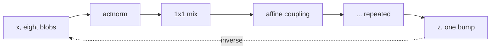

# Normalising flows — one invertible map, one exact likelihood

`flows.py` · Generative · Tier 2 · 6 variants

A normalising flow is a diffeomorphism $f$ trained to push a standard normal
through itself onto the data. Because $f$ is invertible and its Jacobian
determinant is cheap to compute, the model has a *closed-form* density at every
point, not just a sampler. That single property separates this atom from the
rest of the chapter: the generator in `gan.py` can be judged only by the
statistics of what it emits, while here the loss itself is the quantity of
interest, and the gap between the fitted density and the true one is a number
you can print.

The six variants are six answers to "which invertible map". They share the
same data, the same optimiser and the same budget, so the table in the demo is
a comparison of *architectures at fixed compute*, and the spread is large: the
best variant is 0.42 nats closer to the truth than the worst while using less
than half the parameters of the most expensive one.

## Intuition

Picture the data as eight tight blobs arranged on a circle of radius 0.8. A flow
does not draw new blobs; it learns to *unbend* the plane so that those blobs
become the eight mild bumps of a standard normal, then samples the normal and
replays the bend backwards.



Every block must be invertible, and every block must report the volume change
it caused, because the density transforms by that volume. The whole design
problem is: what invertible map has a *cheap* Jacobian determinant? A general
matrix costs $O(d^3)$ to invert and does not adapt. A coupling layer restricts
the map so that one coordinate is copied and the other is an affine function of
the copy — and then the Jacobian is triangular, with one diagonal entry equal
to 1 and the other equal to a learned scale. That is the trick everything else
builds on.

```
      x1 ────────────────► y1 = x1
       │
       ├─ s(x1) ─┐
       └─ t(x1) ─┴────────► y2 = (x2 - t(x1)) · e^{-s(x1)}
```

Two things follow, and both are visible in the numbers.

The first is that **a coupling layer is only half a transform**. Coordinate 1
passes through untouched, so a single layer cannot move the data in both
directions; it can only shear. Stacking layers with the roles alternated is
what buys a real map, and the depth sweep makes this quantitative: one layer
reaches 1.785 nats, two 0.568, three 0.341, six 0.171. More than half of the
total improvement comes from the *second* layer, because that is the first one
that can move both coordinates.

The second is that **the likelihood is a volume bookkeeping exercise**. Nothing
in the loss asks the map to place the blobs anywhere in particular; the density
term $-\log|\det J|$ is what forces the map to expand exactly where the data is
dense. A model that expands too much gets a high likelihood everywhere and is
punished on the test set; one that expands too little leaves the blobs tight
and pays a large negative log-likelihood. That tension is present in every
variant, and it is why the exact mixture's $-0.395$ nats is a floor and not a
target.

## Variants

| variant | nll | gap | params | modes | share | dist | radius |
|:--|--:|--:|--:|--:|--:|--:|--:|
| `glow` | 0.080 | 0.475 | 5965 | 8/8 | 0.163 | 0.140 | 0.785 |
| `coupling` | 0.171 | 0.566 | 7116 | 8/8 | 0.150 | 0.150 | 0.783 |
| `realnvp` | 0.376 | 0.771 | 14256 | 8/8 | 0.171 | 0.157 | 0.785 |
| `continuous_flow` | 0.390 | 0.786 | 1250 | 8/8 | 0.140 | 0.179 | 0.809 |
| `autoregressive_flow` | 0.442 | 0.837 | 2376 | 8/8 | 0.188 | 0.199 | 0.786 |
| `spline_flow` | 0.500 | 0.895 | 5536 | 8/8 | 0.179 | 0.204 | 0.793 |

Every variant is trained on the same 2048 points — eight Gaussians of radius
0.8 and spread 0.07 at angles $22.5^\circ + 45^\circ k$ — for 3000 Adam steps
on batches of 256, with two hidden layers of 32 SiLU units per conditioner.
`nll` and `gap` are nats per sample on a held-out 2048; the exact mixture scores
$-0.395$ and a standard normal 2.161. `dist` is the mean distance to the nearest
mode centre, against a floor of 0.088 — the mean distance from a sample of the
true mixture to its own centre.

**`coupling`** — six affine coupling layers with the split reversed on alternate
layers. This is the reference: 1186 parameters per layer, one conditioner
evaluation per direction, and a Jacobian that is triangular by construction.
It reaches 0.171 nats and every sample lands near a mode.

**`realnvp`** — the same stack with an activation normalisation in front of each
coupling layer and with **two** conditioners per layer, one for the scale and
one for the shift, as in the original paper. The extra network doubles the
parameter count to 14256 and makes the fit *worse* (0.376 against 0.171). On
two dimensions the shared trunk was acting as a regulariser: forcing $s$ and $t$
to be linear functions of a common hidden layer is a constraint that this data
likes. RealNVP's other contribution, the multi-scale factoring with squeeze
operations, needs four or more dimensions to be meaningful and has no analogue
here.

**`glow`** — actnorm, a $1\times1$ convolution and a coupling layer, five times.
The convolution is the cheapest possible way to mix the two coordinates: a
lower-triangular $2\times2$ matrix with positive diagonal, stored as three
numbers, whose determinant is the product of the diagonal. It beats the plain
coupling stack (0.080 against 0.171) with *fewer* parameters (5965 against
7116), because it lets every layer mix without spending a whole extra layer on
the alternating split.

**`autoregressive_flow`** — a masked autoregressive flow: two layers, each
transforming both coordinates with parameters that depend on the coordinate
already fixed. The Jacobian is triangular by *causality* rather than by
copies, so a single layer is a full transform. It is the smallest of the
discrete models (2376 parameters) and reaches 0.442. The catch is sampling: the
inverse needs coordinate 1 before it can compute coordinate 2, so generating
$d$ coordinates costs $d$ sequential conditioner passes. In two dimensions that
is two passes; for an image with 3072 pixels it is 3072, which is why
autoregressive flows are used for density estimation of small vectors and not
for image generation.

**`spline_flow`** — four coupling layers where the affine map is replaced by a
monotone piecewise-linear spline with 8 bins. The bin widths come from a
softmax, so they are positive and sum to a fixed total range; the derivative is
piecewise constant, so the Jacobian costs one lookup. It is the most expressive
map per layer and it finishes last (0.500), because a piecewise-constant
derivative means the fitted density is piecewise-constant in the same way: eight
bins per dimension quantise the shape of each blob, and no amount of depth
removes that floor. The learned widths are far from uniform — the demo prints
per-block ratios from 5.15 to 14.15 — so the spline is using its capacity, just
not on the thing that matters here.

**`continuous_flow`** — a continuous normalising flow: an ODE
$\dot x = v_\theta(x,t)$ trained by flow matching, integrated with RK4 in 20
steps. It has no invertibility constraint at all (the velocity field is an
arbitrary MLP), 1250 parameters, and reaches 0.390. It is simultaneously the
smallest model in the table and the third best, and its two costs are visible:
the round trip is only accurate to $3.4\times10^{-6}$ because RK4 is a
discretisation, and its density needs a divergence integral rather than a sum
of log-determinants.

## Derivation

### Change of variables

For a diffeomorphism $f:\mathbb R^d \to \mathbb R^d$ with inverse $g$, and a
base density $p_Z$,

$$
\log p_X(x) = \log p_Z\bigl(f(x)\bigr)
+ \log\left|\det \frac{\partial f}{\partial x}(x)\right| .
\qquad (1)
$$

With $p_Z = \mathcal N(0,I)$ the training objective is the mean negative
log-likelihood

$$
\mathcal L = \frac1N\sum_{i=1}^{N}\left[
\frac12\lVert f(x_i)\rVert^2 + \frac d2\log 2\pi
- \log\left|\det J_{f}(x_i)\right| \right].
\qquad (2)
$$

Only the last term is hard, and every variant below is a different way to make
it cheap while keeping $f$ expressive.

### Coupling

Split the input into two parts, here one coordinate each. Define

$$
y_1 = x_1, \qquad y_2 = \bigl(x_2 - t(x_1)\bigr)\,e^{-s(x_1)} .
\qquad (3)
$$

The Jacobian is triangular with diagonal $(1, e^{-s})$, so

$$
\log\left|\det J\right| = -s(x_1),
\qquad
x_2 = y_2\,e^{s(x_1)} + t(x_1) .
\qquad (4)
$$

The inverse needs no series expansion and no iterative solve: it recomputes the
same conditioner and undoes the affine map. That is the whole attraction.
Reversing the roles on alternate layers gives the map access to both
coordinates, and the log-determinants add because determinants multiply along a
composition:

$$
\log\left|\det J_{f_N\circ\cdots\circ f_1}\right|
= \sum_{k=1}^{N}\log\left|\det J_{f_k}\right| .
\qquad (5)
$$

The scale is bounded, $s = r\tanh(u/2)$ with $r=2$, which keeps
$e^{-s}\in[e^{-2},e^{2}]$ and stops a single layer from collapsing or exploding
the volume. Without a bound the network can drive $s\to\infty$ on a region with
no data and buy an unbounded likelihood there.

### Actnorm and mixing

Activation normalisation is an affine map with two $d$-vectors:

$$
y = (x - \mu)\odot e^{-\sigma},
\qquad
\log\left|\det J\right| = -\sum_{k}\sigma_k .
\qquad (6)
$$

It is initialised from the first batch so that its output has zero mean and unit
variance, $\mu_k = \bar x_k$ and $\sigma_k = \log(\mathrm{sd}_k x + 10^{-6})$;
after that it trains like any other parameter. The point of the data-dependent
init is that the first update is not spent undoing a scale mismatch.

The $1\times1$ convolution is a general linear map with a cheap determinant.
Parameterising it as lower-triangular with positive diagonal,

$$
W = \begin{pmatrix} e^{a} & 0 \\ b & e^{d}\end{pmatrix},
\qquad
\log\left|\det W\right| = a + d ,
\qquad
y = Wx .
\qquad (7)
$$

Two of the three parameters are log-scales, so $W$ is invertible by
construction, and mixing costs one matrix-vector product with no
decomposition.

### Autoregressive

An autoregressive flow conditions each coordinate on the ones before it:

$$
y_i = \bigl(x_i - t_i(x_{<i})\bigr)\,e^{-s_i(x_{<i})},
\qquad
\log\left|\det J\right| = -\sum_{i=1}^{d} s_i(x_{<i}) .
\qquad (8)
$$

The Jacobian is triangular because $y_i$ does not depend on $x_{>i}$, so again
the determinant is the product of the diagonal. Generation is the mirror image
and is sequential: recovering $x_i$ needs $x_{<i}$, so the $d$ coordinates come
out one at a time. In two dimensions the file implements (8) with a single
conditioner per layer that emits $s_2, t_2$ from $x_1$ and a pair of scalars
$\mu, \sigma$ for $x_1$ itself; the alternating split makes the two layers cover
both directions.

### Splines

On $[-B,B]$ with $K$ bins, let $w = \mathrm{softmax}(u)$ sum to one. The knots
are offsets inside a fixed total span,

$$
k_b = -B + 2B\sum_{j<b} w_j ,
\qquad
\text{slope}_b = \frac{2B w_b}{2B/K} = K w_b ,
\qquad (9)
$$

and the map and its log-determinant are

$$
y = k_b + K w_b\,(x + B - b\,\delta),
\qquad
\log\left|\det J\right| =
\begin{cases}
\log (K w_b), & x\in(-B,B),\\
0, & \text{otherwise},
\end{cases}
\qquad (10)
$$

with $\delta = 2B/K$. Outside the range the map is the identity, so the model
assigns exactly standard-normal density there — a real limitation, discussed
below. Because the input partition is uniform and the output partition is
learned, the forward direction finds its bin by arithmetic while the inverse has
to search the knots:

$$
b = \#\{j : k_j < y\}, \qquad
x = -B + b\delta + \frac{y - k_b}{K w_b} .
\qquad (11)
$$

Differentiating through the softmax uses its Jacobian
$\partial w_j/\partial u_i = w_j(\delta_{ij}-w_i)$, which collapses to

$$
\frac{\partial \mathcal L}{\partial u}
= w \odot \left(g - (g\cdot w)\right),
\qquad g = \frac{\partial \mathcal L}{\partial w} .
\qquad (12)
$$

### Continuous flows

A continuous flow replaces the stack with an ODE. For $\dot x_t = v_\theta(x_t,t)$
the density obeys the instantaneous change of variables

$$
\frac{d}{dt}\log p_t(x_t) = -\nabla\cdot v_\theta(x_t,t),
\qquad
\log p_1(x) = \log p_0(z) + \int_{1}^{0}\nabla\cdot v_\theta(x_t,t)\,dt ,
\qquad (13)
$$

where $z$ is the solution at $t=0$ of the backward integration from $x$ at
$t=1$. The divergence is the trace of the Jacobian, and for the two-layer MLP
used here it is an explicit product of three matrices:

$$
\nabla\cdot v = \mathrm{tr}\left(
\mathrm{diag}(\sigma'(h_1))W_1\,
\mathrm{diag}(\sigma'(h_2))W_2\,W_3
\right),
\qquad (14)
$$

with $W_1$ the $3\times 32$ input layer, whose first two rows are the spatial
coordinates and whose third is time — so the trace runs over those two rows.
Training does not need the density at all: flow matching regresses the
velocity field on straight-line interpolants,

$$
x_t = (1-t)x_0 + t x_1,
\qquad
\mathcal L = \mathbb E\left\lVert v_\theta(x_t,t) - (x_1-x_0)\right\rVert^2 ,
\qquad (15)
$$

which is a plain regression and needs no ODE solve and no divergence. The
density is only computed when someone asks for it.

### What the gap means

The gap column is not noise. For the true density $p$ and a model $q$,

$$
\mathbb E_p[-\log q] - \mathbb E_p[-\log p]
= \mathrm{KL}(p\Vert q) \ge 0 ,
\qquad (16)
$$

so no flow can beat $-0.395$ in expectation, and the observed gap is the test
estimate of the KL divergence. A gap of 0.475 nats is a fit that has placed the
mass almost right; 0.895 nats is a fit that has the shape wrong somewhere. The
ordering of the six variants is therefore a statement about *densities*, which
is something the adversarial atoms of this chapter cannot produce.

## Code walkthrough

The conditioner is the only learned object in a coupling layer, and the only
subtlety is the bounded scale. `raw_s` is the network's first output; passing it
through $r\tanh(u/2)$ keeps the log-scale in $[-r,r]$ and is invertible as a
function of $u$, which matters because the same expression is differentiated on
the way back:

```python
def _cond(params: list, block: dict, x1: np.ndarray) -> tuple:
    """Conditioner: x1 -> (bounded log-scale, shift) plus its cache."""
    q = block["p"]
    outs = []
    for k in range(2 if block["split"] else 1):
        sub = [params[i] for i in q[6 * k:6 * k + 6]]
        outs.append(_mlp_forward(sub, x1[:, None]))
    if len(outs) == 1:
        raw_s, raw_t = outs[0][0][:, 0], outs[0][0][:, 1]
    else:
        raw_s, raw_t = outs[0][0][:, 0], outs[1][0][:, 0]
    s = block["scale_range"] * np.tanh(0.5 * raw_s)
    return s, raw_t, (outs, raw_s)
```

The `split` flag is the difference between the two conditioner styles: two
networks of 1186 parameters each instead of one. `realnvp` stacks those behind
an actnorm and finishes 0.2 nats worse than `coupling` (0.376 against 0.171). The
block parameter indices are a flat slice of the module's parameter list, so a
block never holds weights directly and the optimiser sees one flat vector.

Forward is (3) and (4). The flip is applied to the input and then to the
output, so every layer sees the coordinates in the same order and only the
conditioner's *meaning* alternates:

```python
    x1, x2 = x[:, 0], x[:, 1]
    s, t, cache = _cond(params, block, x1)
    if block["scale_first"]:
        mu, log_s = params[block["p"][6]], params[block["p"][7]]
        y1 = (x1 - mu) * np.exp(-log_s)
    else:
        y1, log_s = x1, None
    y2 = (x2 - t) * np.exp(-s)
    y = np.stack([y1, y2], axis=1)
    ld = -s - (np.full(len(x), log_s[0]) if log_s is not None else 0.0)
```

The `1.0` in the backward pass is the log-determinant. It looks like a stray
constant and it is not: the loss contains $-ld = +s$, so every sample
contributes $+1$ to $\partial \mathcal L/\partial s$ regardless of where it
sits. Drop it and the scale still trains — the fit degrades quietly, which is
the worst kind of bug:

```python
    e = np.exp(-s)
    dx2 = d2 * e
    ds = 1.0 - d2 * (x2 - t) * e
    dt = -d2 * e
```

`d` is a summed gradient throughout the file; the optimiser divides by the batch
size once, at the step. That convention is what makes the `1.0` literal, and
mixing the two conventions is the easiest way to train a flow that never
converges — the demo's `lr 2e-2` row is the mild version of that mistake.

Actnorm's initialisation runs a forward pass through the blocks built so far,
because each actnorm normalises the *output of its predecessors*, not the raw
data. This is why it cannot be done in the constructor:

```python
    def _init_actnorm(self, x: np.ndarray) -> None:
        """Data-dependent init: the first batch maps to zero mean unit var."""
        h = x
        for block in self.blocks:
            if block["kind"] == "actnorm":
                shift = self.params[block["p"][0]]
                log_scale = self.params[block["p"][1]]
                shift[...] = h.mean(axis=0)
                log_scale[...] = np.log(h.std(axis=0) + 1e-6)
            h = self._block_forward(block, h)[0]
```

Glow's mixing layer is three scalars and one matrix product. The lower-triangular
form is what makes the determinant free and the inverse trivial:

```python
def _mix_matrix(params: list, block: dict) -> np.ndarray:
    """Lower-triangular 1x1 convolution: [[e^a, 0], [b, e^d]]."""
    a, b, d = (params[i][0] for i in block["p"])
    return np.array([[np.exp(a), 0.0], [b, np.exp(d)]])
```

The spline is (9)–(11) in three lines of array arithmetic. Note the two
different bin searches: `floor` on the input here, and a comparison count on
the output in `_spline_inverse`:

```python
    w = _spline_weights(u)
    knots = _spline_knots(w)
    slope = SPLINE_BINS * w
    width = 2.0 * SPLINE_RANGE / SPLINE_BINS
    b = np.clip(np.floor((x2 + SPLINE_RANGE) / width).astype(int),
                0, SPLINE_BINS - 1)
    inside = (x2 > -SPLINE_RANGE) & (x2 < SPLINE_RANGE)
    rows = np.arange(len(x2))
    y2 = np.where(inside, knots[rows, b] + slope[rows, b]
                  * (x2 + SPLINE_RANGE - b * width), x2)
    ld = np.where(inside, np.log(slope[rows, b]), 0.0)
```

Its gradient is the softmax Jacobian (12) plus the two ways a knot position
affects the loss: through the bin's starting height, which depends on all
widths below it, and through the slope itself. The `below` mask is the first of
those; the `g[rows, b] +=` line adds the second and the log-determinant term:

```python
    below = (np.arange(SPLINE_BINS)[None, :] < b[:, None]).astype(float)
    g = inside[:, None] * 2.0 * SPLINE_RANGE * (d2[:, None] * below)
    g[rows, b] += inside * (SPLINE_BINS * (x2 + SPLINE_RANGE - b * width) * d2
                            - 1.0 / np.maximum(w[rows, b], 1e-9))
    du = w * (g - (g * w).sum(axis=1, keepdims=True))
```

For the continuous flow, the divergence is a single einsum over the
three-matrix product in (14). Building the two diagonal Jacobians as
`(n, in, out)` arrays and chaining them gives the trace in one pass, with no
loop over dimensions and no finite differences:

```python
        A = P[0][None] * _dsilu(h1)[:, None, :]
        B = P[2][None] * _dsilu(h2)[:, None, :]
        J = np.einsum("nij,njk,kl->nil", A, B, P[4])
        return v, J[:, 0, 0] + J[:, 1, 1]
```

The demo checks that expression against central differences and gets
$1.4\times10^{-9}$. The integrator then accumulates the trace along the path.
RK4 evaluates the velocity four times per step, and in the density case each
evaluation also carries its divergence, so a 20-step solve costs 80 network
calls forward plus 80 divergence traces:

```python
        for i in range(RK4_STEPS):
            t = np.full(len(x), t0 + i * h)
            if want_div:
                k1, d1 = self._velocity_div(x, t)
                k2, d2 = self._velocity_div(x + 0.5 * h * k1, t + 0.5 * h)
                k3, d3 = self._velocity_div(x + 0.5 * h * k2, t + 0.5 * h)
                k4, d4 = self._velocity_div(x + h * k3, t + h)
                acc = acc + h / 6.0 * (d1 + 2.0 * d2 + 2.0 * d3 + d4)
```

The sign convention is (13) with the integral running from 1 down to 0, which
is why `log_prob` returns `base + acc` and not `base - acc`. Getting that wrong
produces a plausible-looking density that integrates to something other than
one; the demo's `learned density integrates to 0.9998` is the check that
catches it.

## Complexity

Let $d$ be the dimension, $n$ the batch, $h$ the hidden width and $N$ the number
of layers. Every coupling layer costs one conditioner forward and one backward,
so training is $O(nNdh^2)$ per step and the constant is the same for all the
discrete variants.

In this atom $d=2$, $h=32$ and a conditioner is 1186 multiply-adds per sample,
so a six-layer forward pass over 2048 test points is 14.6M multiply-adds. The
whole demo is dominated by training: 3000 steps of batch 256 through 7116
parameters, forward and backward, is roughly 16G multiply-adds for `coupling`,
and the six fits plus the depth sweep and the learning-rate row come to about
a minute.

The costs that differ are in *sampling* and in *density*:

| variant | parameters | per-sample sampling work | per-sample density work |
|:--|--:|:--|:--|
| `coupling` | 7116 | 6 conditioners | 6 conditioners |
| `realnvp` | 14256 | 12 conditioners | 12 conditioners |
| `glow` | 5965 | 5 conditioners, 5 mixes | same |
| `autoregressive_flow` | 2376 | 2 sequential conditioners | 2 conditioners |
| `spline_flow` | 5536 | 4 conditioners, 4 knot scans | same |
| `continuous_flow` | 1250 | 80 velocity calls | 80 calls plus 80 traces |

The continuous flow's column is the honest one: it uses a sixth of the
parameters of `coupling` and pays thirteen times its sampling cost. That trade
is why CNFs are used where the density or the velocity field is the product —
likelihood-based inference, importance sampling, ODE-based editing — and
coupling stacks are used where sampling speed dominates.

Memory is the batch of activations plus the caches. Each block caches the
conditioner's hidden layers, so a six-layer flow holds twelve hidden arrays per
sample; this is the usual backpropagation cost and it is why flows are trained
with smaller batches than GANs of comparable size.

## Failure modes

**A learning rate written for the wrong convention.** The file averages
gradients over the batch and divides once. A reader who copies a per-sample
scale of $2\times10^{-3}$ from a summed-gradient implementation and uses it here
gets a step 256 times too small, and the result is worse than doing nothing:
3.002 nats after the same 3000 steps, against 2.161 for the standard normal it
never left. The map has drifted just enough to distort the base density without
learning the blobs — seven modes covered, mean radius 1.219. The other
direction is milder but still costly: ten times the correct step reaches 0.894
against 0.171. Adam is scale-free only asymptotically; the first thousand steps
are not.

**An unbounded scale.** Without the $\tanh$ in (3), the network finds that
driving $s\to\infty$ on an empty region of the plane gives an unbounded
likelihood there. The training loss falls while the samples collapse. Bounding
the scale to $[-2,2]$ is not a detail; it is the constraint that keeps the map
a diffeomorphism onto a sensible region.

**A coupling layer that cannot rotate.** One layer leaves $x_1$ untouched, so a
dataset rotated by $45^\circ$ relative to the axes cannot be captured — the map
can shear but not turn. The depth sweep is the measurement: 1.785 at one layer,
0.568 at two. If a single-layer flow fits well, the data was already aligned
with the split; if it plateaus, add layers or add Glow's mixing.

**Splines and their support.** Outside $[-B,B]$ the spline map is the identity
and the density is exactly standard normal, so a mode placed at radius 4 or an
outlier at radius 10 is modelled as noise. Inside, the piecewise-constant
derivative quantises the density, which is why `spline_flow` lands at 0.500 with
8 bins. The fix is more bins or a rational-quadratic spline with continuous
derivatives; both cost per-bin work in the inverse.

**Autoregressive sampling is sequential.** The inverse of (8) needs coordinate
1 before coordinate 2. In two dimensions that is two passes; for a 3072-pixel
image it is 3072, each of which is a full network evaluation. The usual escape
is to make the *forward* direction (training) sequential and the inverse cheap
— which is exactly the trade an inverse autoregressive flow makes, at the cost
of losing the exact likelihood.

**A density that integrates to the wrong number.** The continuous flow's sign
convention in (13) is easy to flip, and the resulting density looks reasonable
pointwise while integrating to 2 or 0.5. The check that catches it costs one
grid evaluation: `learned density integrates to 0.9998`. The same check on a
discrete flow is exact by construction (1.0000 here) and therefore says nothing
about the fit — only that the Jacobian bookkeeping is right.

**Silent gradient errors.** The input gradient of the conditioner is used only
by the block *behind* it, so a missing `@ W.T` in the first layer's backward
pass leaves the last block's gradients exact and corrupts everything below it.
Building this file, the check reported $4.3\times10^{-1}$ on the first block
and $7\times10^{-10}$ on the last, which located the missing transpose in a
minute. Check every block, not the one you happen to look at.

**A regime that is too easy.** With eight blobs of spread 0.07 on a circle of
radius 0.8, adjacent centres are 0.61 apart — nearly nine standard deviations.
All six variants cover 8/8 and none merges neighbours, so the table above
separates the architectures by how well they *shape* each blob, not by whether
they can find them. Bring the radius down or widen the blobs and the ordering
would change: at three or four standard deviations apart the coupling stack has
to spend depth on separating modes instead of sharpening them, and the spline's
8-bin quantisation stops being the limiting factor.

## Applications

**Density estimation and anomaly detection.** The exact likelihood is the
product: score a new point, threshold it, and you have a detector whose
calibration is a real likelihood rather than a discriminator score. This is the
main use of flows in tabular and scientific settings, where $d$ is small enough
for the sequential-inverse cost of autoregressive variants not to matter.

**Variational inference.** A flow is the standard way to make a variational
posterior flexible while keeping the ELBO a single expectation: the change of
variables term is analytic, so the objective stays low-variance. Planar and
radial flows were introduced for exactly this, and every modern normalising-flow
posterior inherits the construction.

**Image and audio generation.** Glow generates images at 256×256 with a coupling
stack, and WaveGlow does the same for raw audio. Both rely on actnorm and the
$1\times1$ convolution from this file; the multi-scale factoring that makes them
practical needs 3-D tensors and is the part that does not appear here.

**Boltzmann generators and lattice field theory.** Sampling a Boltzmann
distribution at a fixed temperature is a density-modelling problem with a known
unnormalised target, and a flow trained by maximum likelihood on samples is the
standard tool. The exactness of the likelihood is what makes the acceptance
ratio computable.

**Continuous flows in diffusion.** The probability-flow ODE of a diffusion model
is a continuous normalising flow whose velocity is the score, so `score_sde` and
this atom are two views of one object. Sampling from the ODE is deterministic
and invertible, which is what makes image editing by inversion possible — the
`ddim_inversion` variant in `ddim.py` is the discrete cousin.

**Importance sampling and resampling.** A flow trained on a proposal distribution
gives exact importance weights, because both the proposal and the target
densities are available in closed form. This is used to correct a cheap model's
samples into an expensive model's distribution without retraining the sampler.

## References

- Tabak & Turner (2013). *A Family of Nonparametric Density Estimation
  Algorithms.* Communications on Pure and Applied Mathematics.
- Rezende & Mohamed (2015). *Variational Inference with Normalizing Flows.*
  ICML.
- Dinh, Krueger & Bengio (2015). *NICE: Non-linear Independent Components
  Estimation.* ICLR Workshop.
- Dinh, Sohl-Dickstein & Bengio (2017). *Density Estimation using Real NVP.*
  ICLR.
- Kingma & Dhariwal (2018). *Glow: Generative Flow with Invertible 1×1
  Convolutions.* NeurIPS.
- Papamakarios, Pavlakou & Murray (2017). *Masked Autoregressive Flow for
  Density Estimation.* NeurIPS.
- Durkan, Bekasov, Murray & Papamakarios (2019). *Neural Spline Flows.*
  NeurIPS.
- Chen, Rubanova, Bettencourt & Duvenaud (2018). *Neural Ordinary Differential
  Equations.* NeurIPS.
- Grathwohl, Chen, Bettencourt, Sutskever & Duvenaud (2019). *FFJORD: Free-form
  Continuous Dynamics for Scalable Reversible Generative Models.* ICLR.
- Lipman, Chen, Ben-Hamu, Nickel & Le (2023). *Flow Matching for Generative
  Modeling.* ICLR.
- Albergo & Vanden-Eijnden (2023). *Building Normalizing Flows with Stochastic
  Interpolants.* ICLR.
- Papamakarios, Nalisnick, Rezende, Mohamed & Lakshminarayanan (2021).
  *Normalizing Flows for Probabilistic Modeling and Inference.* JMLR.
- Kobyzev, Prince & Brubaker (2021). *Normalizing Flows: An Introduction and
  Review of Current Methods.* IEEE TPAMI.
