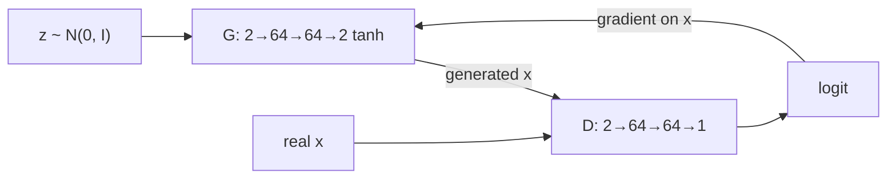

# Generative adversarial network — seven losses, one minimax game

`gan.py` · Generative · Tier 1 · 7 variants

A GAN replaces the likelihood with a classifier. The generator is trained to
fool a discriminator that is itself trained to tell real from generated points,
so the generator's loss is not written down in advance — it is whatever the
discriminator learns to punish. That buys sharp samples and costs every
guarantee: no bound, no likelihood, and a two-player game that need not
converge. This file plays the game on eight Gaussians around a circle. The seven
variants are four objectives, one architecture and two ways of feeding a code,
all sharing one backward pass, so that "which GAN" becomes a table of gradients
rather than a zoo of architectures.

## Intuition

Two networks, one adversarial signal. The generator maps a standard normal code
to a point; the discriminator maps a point to a logit saying how real it looks.
The discriminator descends its classification loss on real and generated
batches; the generator ascends it, which by the chain rule means descending the
discriminator's verdict on its own output.



The generator never sees the data. Everything it learns about the distribution
arrives as a gradient through the discriminator, which is why the discriminator
is best understood as a *learned loss function* rather than a classifier to be
maximised. A good discriminator says "this region is thin" in a way that points
the generator's mass toward the data; a perfect one says "fake" everywhere the
generator already is, which is a gradient of almost zero.

At the optimum of the inner problem the discriminator becomes the density ratio
$p_{\mathrm{data}}/(p_{\mathrm{data}}+p_g)$, and the game's value is a
Jensen–Shannon divergence. That is the theory. The practice is that the ratio is
estimated from a finite batch by a network that is also being trained, and that
the objective is satisfied by *any* generator whose support sits inside the
data's support. A generator that produces one mode perfectly is as good as one
that produces eight, as far as the loss is concerned: the discriminator cannot
tell a missing mode from a mode that was never sampled. This is mode collapse,
and it is a property of the objective, not a bug in the optimiser.

The seven variants differ in three places:

- the gradient the discriminator hands the generator (the loss table);
- the shape of the two networks (`dcgan` is deeper and wider);
- what the networks are shown (`conditional` shows the label to both,
  `infogan` shows a code only to the generator).

Everything else — the data, the Adam state, the backward pass, the evaluation —
is shared, so the differences in the table below are attributable to the
variant and not to a re-implementation.

## Variants

| variant | discriminator minimises | generator minimises |
|:--|:--|:--|
| `vanilla` | binary cross-entropy | $\log(1-D(G(z)))$ |
| `non_saturating` | binary cross-entropy | $-\log D(G(z))$ |
| `lsgan` | $(D(x)-1)^2/2+D(G(z))^2/2$ | $(D(G(z))-1)^2$ |
| `hinge` | hinge on both sides | $-D(G(z))$ |
| `dcgan` | binary cross-entropy | $-\log D(G(z))$ |
| `conditional` | binary cross-entropy on $(x,y)$ | $-\log D(G(z,y),y)$ |
| `infogan` | binary cross-entropy on $x$ | $-\log D(G(z,c))+$ MI term |

**`vanilla`** — the original minimax game (Goodfellow et al. 2014). The
generator minimises $\log(1-\sigma(D(G(z))))$, whose derivative with respect to
the logit is $-\sigma(D(G(z)))$: it vanishes exactly when the discriminator is
confident the sample is fake, which is when the generator most needs it. The
demo's signal column is the mean absolute value of that derivative: 0.496 here,
against 1.000 for hinge and 0.998 at logit $-6$ for the non-saturating form
below.

**`non_saturating`** — the same game with the generator minimising
$-\log\sigma(D(G(z)))$ instead. The gradient is now $\sigma(-D(G(z)))$, which is
large precisely where the saturating form is flat. It is not the same objective,
but it has the same fixed point and trains far better from a bad initialisation,
so it became the default and is this class's default too.

**`lsgan`** — least squares (Mao et al. 2017). The discriminator is linear and
regresses to 1 on real points and 0 on generated ones; the generator regresses
its own output toward 1. The quadratic penalty keeps growing when the
discriminator is confident, so the generator's gradient does not vanish. On this
data it is the most stable of the four unconditional losses: eight modes from a
fresh draw, largest share 0.15, and a discriminator that ends at chance.

**`hinge`** — the geometric/SVM objective (Lim & Ye 2017). The discriminator
wants a margin of one on both sides; the generator wants its score pushed up
with a constant gradient. The constant is the point and the problem: every
sample receives the same push regardless of how far it is from the boundary, and
here the generator overshoots, keeping five modes with a 0.30 largest share.

**`dcgan`** — not a loss but an architecture (Radford et al. 2016): three hidden
layers of width 128, a 16-dimensional code, and the non-saturating objective. On
2-D points there is nothing to convolve, so what this variant isolates is depth
and width. It is the most confident discriminator in the table (0.84 accuracy)
and it drops a mode: a strong discriminator plus a small generator is the
classic way to lose coverage.

**`conditional`** — both players see a class label: the generator maps
$(z,y)$ to a point, the discriminator scores $(x,y)$ (Mirza & Osindero 2014).
The game factorises over classes, so each class gets its own ratio and its own
optimum. The demo draws 64 points for each of the eight labels: all 512 land
nearest their own centre, at mean distance 0.072.

**`infogan`** — only the generator sees the code; the discriminator does not
(Chen et al. 2016). An auxiliary head $Q$ reads the discriminator's features and
predicts the code from the generated point, and its cross-entropy is added to
the generator's loss. The generator is therefore rewarded for making the code
recoverable, which is a lower bound on $I(c;G(z,c))$. Here the bound is tight:
1.000 consistency and 8/8 codes resolved, against 0.521 and 2/8 with the MI
weight set to zero.

## Derivation

### The game

Write $D$ for the probability the discriminator assigns to "real" and $G(z)$ for
a generated point. The minimax objective is

$$
\min_G\max_D\;V(D,G)=
\mathbb E_{x\sim p_{\mathrm{data}}}\bigl[\log D(x)\bigr]+
\mathbb E_{z\sim p_z}\bigl[\log\bigl(1-D(G(z))\bigr)\bigr].
\qquad (1)
$$

The code works with logits and applies $\sigma$ inside the loss table, but the
mathematics is clearest with probabilities, so this section uses $D$ as a
probability and $a$ for the logit when the distinction matters.

### The optimal discriminator

For fixed $G$, the second expectation is an expectation over the pushforward
$p_g$, so (1) is a pointwise problem in $D(x)$:

$$
V=\int\Bigl[p_{\mathrm{data}}(x)\log D(x)+p_g(x)\log\bigl(1-D(x)\bigr)\Bigr]dx.
$$

Differentiate the integrand with respect to $D$ and set it to zero:

$$
\frac{p_{\mathrm{data}}}{D}-\frac{p_g}{1-D}=0
\quad\Longrightarrow\quad
D^*(x)=\frac{p_{\mathrm{data}}(x)}{p_{\mathrm{data}}(x)+p_g(x)}.
\qquad (2)
$$

Substituting (2) back gives the value of the game. Let
$m=(p_{\mathrm{data}}+p_g)/2$; then

$$
V(D^*,G)=2\,\mathrm{JSD}\bigl(p_{\mathrm{data}}\,\|\,p_g\bigr)-\log 4,
\qquad (3)
$$

where the Jensen–Shannon divergence is
$\tfrac12\mathrm{KL}(p_{\mathrm{data}}\|m)+\tfrac12\mathrm{KL}(p_g\|m)$. It is
non-negative and zero only when the two distributions agree, so the game's
minimum is $-\log 4$ at $p_g=p_{\mathrm{data}}$, where $D^*=\tfrac12$ everywhere.

This is the most misread number in the subject. A discriminator at 50% accuracy
is not broken; at the equilibrium of the *training* distribution it is exactly
right. The demo's `vanilla`, `lsgan`, `non_saturating` and `conditional` models
all report 0.48–0.50, and they are the ones that cover all eight modes. The
`dcgan` model reports 0.84 and covers seven.

### Saturating and non-saturating

Let $a(x)=D(G(z))$ be the discriminator's logit on a generated point. With
$\sigma'(a)=\sigma(a)(1-\sigma(a))$,

$$
\frac{\partial}{\partial a}\log\bigl(1-\sigma(a)\bigr)=-\sigma(a),
\qquad
\frac{\partial}{\partial a}\bigl(-\log\sigma(a)\bigr)=-\sigma(-a).
\qquad (4)
$$

The first row is the saturating objective: when the discriminator is confident
the sample is fake, $a\ll 0$ and $\sigma(a)\to 0$, so the generator's gradient
disappears. The demo evaluates both at five logits:

| logit $a$ | $-6$ | $-4$ | $-2$ | $0$ | $2$ |
|:--|--:|--:|--:|--:|--:|
| $\lvert\partial\log(1-\sigma)\rvert$ | 0.002 | 0.018 | 0.119 | 0.500 | 0.881 |
| $\lvert\partial(-\log\sigma)\rvert$ | 0.998 | 0.982 | 0.881 | 0.500 | 0.119 |

At logit $-6$ the saturating signal is 0.002 of the other: two thousand times
weaker exactly where a bad generator starts. The two objectives are related by
the identity

$$
-\log\sigma(a)=-\log\bigl(1-\sigma(a)\bigr)-a,
$$

so the non-saturating loss is the negative of the saturating one shifted by
$-a$. At the equilibrium $a=0$ both have derivative $-\tfrac12$, which is why
they share a fixed point; away from it the shift is what keeps the gradient
alive, and that is the whole reason the heuristic works.

### Least squares

LSGAN drops the sigmoid and the logarithm. With targets 1 for real, 0 for
generated and 1 for the generator's output, the discriminator solves

$$
D^*=\arg\min_D\;\tfrac12\mathbb E_{p_{\mathrm{data}}}\bigl[(D-1)^2\bigr]
+\tfrac12\mathbb E_{p_g}\bigl[D^2\bigr]
=\frac{p_{\mathrm{data}}}{p_{\mathrm{data}}+p_g},
\qquad (5)
$$

the same ratio as (2), obtained by a linear rather than a logistic regression.
At that $D^*$ the generator's objective is exactly

$$
\mathbb E_{p_g}\bigl[(D^*-1)^2\bigr]
=\int\frac{p_g^3}{(p_{\mathrm{data}}+p_g)^2}\,dx .
\qquad (6)
$$

Because the discriminator is linear, a confident verdict does not saturate: the
squared error at $D(G(z))$ far from 1 is far from zero, and its gradient is
proportional to the distance. That is why this variant holds all eight modes
here while the log-based ones are more delicate.

### Hinge

The hinge objective gives the discriminator a margin and the generator a
constant push:

$$
\mathcal L_D=\mathbb E_{p_{\mathrm{data}}}\bigl[\min(0,D(x)-1)\bigr]
+\mathbb E_{p_g}\bigl[\min(0,-D(x)-1)\bigr],
\qquad
\mathcal L_G=-\mathbb E_{p_g}\bigl[D(x)\bigr].
\qquad (7)
$$

The discriminator's per-sample gradients are $-1$ while a real point is inside
the margin and $+1$ while a generated one is, and zero outside; the generator's
is $-1$ always. It is a support vector machine in which the boundary is learned
adversarially, and it is the only row of the table whose generator signal is
constant — 1.000 in the demo. Constant does not mean good: the push carries no
information about distance, and this variant is the least stable of the four.

### Conditioning

A conditional GAN makes both players functions of the label:

$$
\mathcal L=\mathbb E_{p_{\mathrm{data}}(x,y)}\bigl[\log D(x,y)\bigr]
+\mathbb E_{p_g}\bigl[\log\bigl(1-D(G(z,y),y)\bigr)\bigr].
\qquad (8)
$$

For each $y$ the inner problem is (1) restricted to that class, so
$D^*(x,y)=p_{\mathrm{data}}(x\mid y)/(p_{\mathrm{data}}(x\mid y)+p_g(x\mid y))$
provided both sides use the same distribution of labels — which they do, because
the demo draws the fake label uniformly. The label is one-hot concatenated to
the input, eight extra columns on both networks; the cost is
$8\times64+8$ parameters on the discriminator and the same on the generator, and
the benefit is that the model no longer has to spend capacity on class identity.

### The InfoGAN bound

InfoGAN wants the code to control the output without telling the discriminator
which code was used. The quantity to maximise is the mutual information

$$
I(c;G(z,c))=H(c)-H(c\mid G(z,c))
=H(c)+\mathbb E_{x=G(z,c)}\bigl[\log p(c\mid x)\bigr],
\qquad (9)
$$

and $p(c\mid x)$ is intractable because it requires the generator's posterior
over codes. Introduce any distribution $Q(c\mid x)$ and use
$\mathrm{KL}(p\|Q)\ge 0$:

$$
\mathbb E\bigl[\log p(c\mid x)\bigr]
=\mathbb E\bigl[\log Q(c\mid x)\bigr]
+\mathrm{KL}\bigl(p(c\mid x)\,\|\,Q(c\mid x)\bigr)
\ge\mathbb E\bigl[\log Q(c\mid x)\bigr].
$$

Combining with (9),

$$
I(c;G(z,c))\ge H(c)+\mathbb E_{z,c}\bigl[\log Q(c\mid G(z,c))\bigr].
\qquad (10)
$$

With uniform codes $H(c)=\log 8$ is a constant, so the practical objective is to
make an auxiliary classifier $Q$, reading the discriminator's features, good at
naming the code of a generated point:

$$
\max_{G,Q}\;\mathbb E_{z,c}\bigl[\log Q(c\mid G(z,c))\bigr].
\qquad (11)
$$

$Q$ is trained by cross-entropy on the generated batch; the same cross-entropy's
gradient is passed to the generator. With $\mathcal L_G$ the adversarial loss
and $\mathrm{CE}$ the auxiliary cross-entropy, the generator's update is

$$
\theta_G\leftarrow\theta_G-\eta\Bigl(
\nabla_{\theta_G}\mathcal L_G
+\lambda\,\nabla_{\theta_G}\mathrm{CE}\Bigr).
\qquad (12)
$$

The sign in (12) is the whole variant. The first version of this file subtracted
the auxiliary gradient, and the run looked healthy: the adversarial loss went
down and mode coverage stayed 8/8, because the generator can ignore the code and
still produce eight modes. What collapsed was the code — 0.22 consistency, below
the 0.52 that the code channel reaches with no MI term at all, because the
generator was being trained to make the code *un*predictable. A wrong sign in an
auxiliary term is invisible in the adversarial loss; only the auxiliary metric
catches it.

### A discriminator with a constant output

The simplest failure to diagnose is a discriminator that outputs the same logit
for everything. Fix a base rate $\pi$ of positives and a constant logit $c$; the
binary cross-entropy is

$$
\mathcal L(c)=-\pi\log\sigma(c)-(1-\pi)\log\bigl(1-\sigma(c)\bigr),
$$

whose derivative is $\sigma(c)-\pi$. Hence

$$
\hat c=\log\frac{\pi}{1-\pi},
\qquad
\mathcal L(\hat c)=\mathrm H(\pi),
\qquad (13)
$$

the entropy of the label. The demo sweeps the logit on a grid for three base
rates and recovers the entropy to within 0.002 (the grid step): 0.325 nats at
$\pi=0.1$, 0.693 at $\pi=0.5$, 0.325 at $\pi=0.9$. A discriminator stuck at a
constant has not learned nothing; it has learned the marginal and nothing else,
which is precisely what a generator that matched the marginal would leave it.
The number says *which* aggregate matched, never which modes are missing.

## Code walkthrough

The data first. Eight centres on a circle of radius 0.8, isotropic noise of 0.07,
256 points each. The radius matters: the generator ends in `tanh`, so anything
outside $[-1,1]$ is unreachable and the model would pile up on the boundary.

```python
def centres() -> np.ndarray:
    """The eight mode centres, (8, 2)."""
    angle = 2.0 * np.pi * np.arange(MODES) / MODES
    return RADIUS * np.stack([np.cos(angle), np.sin(angle)], axis=1)
```

```python
def make_data(seed: int, per_mode: int = 256) -> tuple:
    """Return (x, y) with `per_mode` points around each of the eight centres."""
    rng = np.random.default_rng(seed)
    x = np.vstack([c + rng.normal(0.0, SPREAD, (per_mode, 2))
                   for c in centres()])
    y = np.repeat(np.arange(MODES), per_mode)
    order = rng.permutation(len(y))
    return x[order], y[order]
```

Coverage is measured against those centres, not against a loss. A mode counts
when it wins more than 3% of 1024 draws, so a collapsed generator scores one and
a uniform one scores eight; the 3% floor is a choice, and every number in this
file inherits it.

```python
def mode_stats(samples: np.ndarray) -> tuple:
    """Return (modes covered, largest share, mean distance to nearest centre).

    A mode counts as covered when it wins more than 3% of the samples, so a
    collapsed generator scores one and a uniform one scores eight.
    """
    s = np.asarray(samples, dtype=float)
    d = np.linalg.norm(s[:, None, :] - centres()[None], axis=2)
    share = np.bincount(d.argmin(axis=1), minlength=MODES) / len(s)
    return int(np.sum(share > 0.03)), float(share.max()), float(d.min(1).mean())
```

Both networks are stacks of dense layers with one forward cache per layer. The
generator's last layer is `tanh`; the discriminator's is linear, and the sigmoid
lives in the loss table so that the hinge and least-squares variants can omit
it.

```python
def _forward(layers: list, x: np.ndarray, leak: float = 0.0,
             tanh_last: bool = False) -> tuple:
    """Run the stack; returns (output, cache) with one entry per layer."""
    cache = []
    h = x
    last = len(layers) - 1
    for i, layer in enumerate(layers):
        pre = h @ layer["W"] + layer["b"]
        if i == last:
            out = np.tanh(pre) if tanh_last else pre
        else:
            out = np.where(pre > 0.0, pre, leak * pre)
        cache.append((h, pre, out))
        h = out
    return h, cache
```

The backward pass returns both the parameter gradients and the gradient with
respect to its input, because the generator needs the latter: the chain rule
through the discriminator *is* the generator's loss. `dout` already carries the
$1/n$ of a batch mean, so the two share one scale.

```python
def _backward(layers: list, cache: list, dout: np.ndarray, leak: float = 0.0,
              tanh_last: bool = False) -> tuple:
    """Return (per-layer grads, gradient wrt the input).

    `dout` must already carry the 1/n of a batch mean, so that the parameter
    gradients and the input gradient share one scale.
    """
    grads = [None] * len(layers)
    d = dout
    last = len(layers) - 1
    for i in range(last, -1, -1):
        h, pre, out = cache[i]
        if i == last:
            if tanh_last:
                d = d * (1.0 - out ** 2)
        else:
            d = d * np.where(pre > 0.0, 1.0, leak)
        grads[i] = {"W": h.T @ d, "b": d.sum(axis=0)}
        d = d @ layers[i]["W"].T
    return grads, d
```

The seven variants are one function. Each row is a derivative with respect to
the discriminator logit; the discriminator descends the first two, the generator
descends the third. The least-squares rows are linear because $D$ is linear; the
hinge rows are indicators; the log rows use `_sig`.

```python
def loss_grads(variant: str, real: np.ndarray, fake: np.ndarray) -> tuple:
    """Return (dD/d real, dD/d fake, dG/d fake), one entry per sample.

    The discriminator descends its two rows; the generator descends the third.
    Keeping all three here is what makes the variants comparable: they differ
    in this table, in the network shapes, and in what the networks are shown.
    """
    if variant == "vanilla":
        return _sig(real) - 1.0, _sig(fake), -_sig(fake)
    if variant in ("dcgan", "non_saturating", "conditional", "infogan"):
        return _sig(real) - 1.0, _sig(fake), _sig(fake) - 1.0
    if variant == "lsgan":
        return real - 1.0, fake, fake - 1.0
    if variant == "hinge":
        return (-(real < 1.0).astype(float),
                (fake > -1.0).astype(float), -1.0)
```

Network shapes are a function of the variant. `conditional` grows both inputs by
the eight one-hot columns; `infogan` grows only the generator's; `dcgan` adds a
layer and doubles the width.

```python
    def _sizes(self) -> tuple:
        d_in = 2 + (CODE if self.conditional else 0)
        g_in = self.z_dim + (CODE if self.conditional or self.infogan else 0)
        depth = 3 if self.variant == "dcgan" else 2
        return ([d_in] + [self.hidden] * depth + [1],
                [g_in] + [self.hidden] * depth + [2])
```

That asymmetry is the whole of InfoGAN. The discriminator is shown a point and
nothing else, so the only way the code can become recoverable is through $Q$ and
the generator's auxiliary gradient.

```python
    def _d_input(self, x: np.ndarray, c: np.ndarray | None) -> np.ndarray:
        # Only the conditional variant shows the code to the discriminator;
        # InfoGAN's whole point is that it does not.
        onehot = self._onehot(c) if self.conditional else None
        return x if onehot is None else np.concatenate([x, onehot], axis=1)
```

One training step is two discriminator passes (real, fake), one accumulator
addition, then a fresh discriminator pass on the same generated batch for the
generator. The generator is updated against the discriminator it just changed,
which is the standard simultaneous update; no extra inner loop.

```python
            gr, _ = _backward(params["D"], dr_cache,
                              _col(kdr, self.batch) / self.batch, LEAK)
            gf, _ = _backward(params["D"], df_cache,
                              _col(kdf, self.batch) / self.batch, LEAK)
            grads_d = _add(gr, gf)
            self.history.append(float(np.mean(np.abs(kgen))))
```

```python
            # Generator step, against the discriminator it just updated.
            d_fake, df_cache = _forward(
                params["D"], self._d_input(fake, c_fake), leak=LEAK)
            kgen = loss_grads(self.variant, d_real[:, 0], d_fake[:, 0])[2]
            _, dx = _backward(params["D"], df_cache,
                              _col(kgen, self.batch) / self.batch, LEAK)
            if self.infogan:
                feat, feat_cache = _forward(params["D"][:-1], fake, leak=LEAK)
                logits = feat @ params["Q"]["W"] + params["Q"]["b"]
                d_logits = (_softmax(logits) - np.eye(CODE)[c_fake]) \
                    / self.batch
                _, dx_mi = _backward(params["D"][:-1], feat_cache,
                                     d_logits @ params["Q"]["W"].T, LEAK)
                # Maximise I(c; G(z, c)): descend the auxiliary cross-entropy,
                # so add its gradient instead of subtracting it.
                dx = dx + self.mi_weight * dx_mi
            if self.conditional or self.infogan:
                dx = dx[:, :self.z_dim]
            grads_g, _ = _backward(params["G"], g_cache, dx, tanh_last=True)
            opt_g.step(params["G"], grads_g)
```

The InfoGAN block fits $Q$ on the generated batch only — the quantity being
bounded is $I(c;G(z,c))$, so real points are not evidence about the code — and
then pushes the same cross-entropy back through the discriminator's features
into the generator. The Q update and the D update use separate Adam states, but
the feature layers are shared, so `grads_d` receives the auxiliary gradient too.

Finally the test. The code need not equal the mode's number: InfoGAN has no
reason to use the same labelling, and forcing it would measure the indexing
convention rather than the information. What matters is that each code lands on
one mode.

```python
        hits = 0
        resolved = 0
        for k in range(CODE):
            mine = near[c == k]
            if not len(mine):
                continue
            top = int(np.bincount(mine, minlength=MODES).max())
            hits += top
            resolved += int(top >= 0.6 * len(mine))
        return hits / n, resolved
```

With no MI term the code channel still gives 0.521 consistency and 2 of 8 codes
resolved; the generator uses the code as a private random seed even when
nothing asks it to. With the term, both are 1.000 and 8. That gap — not the
coverage gap, which is zero either way — is what InfoGAN buys.

## Complexity

The standard pair has 4482 generator parameters and 4417 discriminator
parameters: two hidden layers of width 64, plus the input and output. The
conditional model adds $8\times64+8=520$ parameters to each network, because
eight one-hot columns enter each first layer. InfoGAN adds 520 to the generator
and a 520-parameter $Q$ head, but not to the discriminator. The `dcgan` variant
is the outlier: 35,458 and 33,537, roughly eight times the standard pair, for one
more layer and double the width.

One step touches each generated batch three times — once through $G$, and twice
through $D$ (real and fake) plus a second fake pass after the update. At batch
128 that is about 5M multiply-adds per step for the standard pair, so 20G over
the demo's 4000 steps. `dcgan` has eight times the parameters, costs about 35M
per step, and reaches 140G over the same run. The demo trains eight models
(seven variants plus the zero-MI ablation), which is 32,000 adversarial steps;
the cost is linear in the number of variants and quadratic in the width, and
there is no epoch structure to tune.

Memory is the parameter count plus the largest activation cache: batch times
width per layer, doubled by Adam's two moment estimates. At this size everything
fits in L2; at image scale the discriminator's activations, not its weights,
are the constraint, and gradient checkpointing in $D$ is the usual answer.

## Failure modes

**Mode collapse is the objective, not a bug.** Any generator whose support is
inside the data's support can drive the discriminator to a constant on that
support; the missing modes are simply never sampled, so they contribute nothing
to either expectation. The demo's `hinge` run keeps five modes with a 0.30
largest share. Remedies change the objective (Wasserstein, which compares
distributions rather than classifying points), the batch (minibatch
discrimination), or the update (unrolled GANs); none of them is a proof.

**The saturating gradient vanishes at exactly the wrong time.** At logit $-6$
the saturating signal is 0.002 of the non-saturating one. The non-saturating
form is a heuristic, not an equivalent objective — the identity above shows the
extra $-a$ term — and it is the reason every practical GAN writes $-\log D$ and
calls the original "vanilla".

**An auxiliary term's sign is invisible in the main loss.** Adding instead of
subtracting the InfoGAN cross-entropy gave a healthy adversarial loss, full mode
coverage and a code that was *anti*-learned: 0.22 consistency against a 0.53
baseline. The fix is one character, and only the auxiliary metric can see it.

**A discriminator that is too good starves the generator.** `dcgan` reaches 0.84
accuracy and drops a mode; the generator is chasing a boundary that has already
moved. One-sided label smoothing, input noise, a smaller $D$, or a slower $D$
learning rate all trade some discrimination for signal. The opposite failure —
a discriminator that never learns — leaves the generator with a constant loss
and produces blobs.

**Batch normalisation in the discriminator leaks across the batch.** If real
and fake points share a normalisation batch, each fake's score depends on the
real points beside it, and the generator can exploit the coupling. The usual fix
is to normalise each batch separately or to use layer normalisation; this file
uses no normalisation, which is feasible only because the data is two
dimensional and standardised by construction.

**The output range is a hard constraint.** The generator ends in `tanh`, so a
mode at radius 1.2 would be unreachable and all mass would collect on the unit
circle's boundary in that direction. The data here sits at 0.8 for exactly this
reason. At image scale the same mistake appears as clipped highlights and
saturated colours.

**Seed sensitivity is large enough to change the verdict.** `hinge` keeps five
modes in the table and six on a fresh draw; `vanilla` keeps eight either time.
A single seed is an anecdote, and a table of single seeds is a table of
anecdotes. The demo's thresholds are deliberately loose for this reason: it
asserts that the stable losses keep at least seven modes and that hinge keeps
fewer than vanilla, not that any particular count is exact.

**The loss is not a quality metric.** The signal column ranges from 0.496 to
1.000 across variants that produce equally good samples, and no row's loss is
comparable to another's. Coverage, distance to the nearest centre and
precision/recall against a held-out set are the honest measures; the 3% coverage
threshold is itself a choice that a different threshold would move.

## Applications

**Image synthesis.** The reason the field exists: from DCGAN's 64×64 bedrooms to
StyleGAN's photorealistic faces, the generator is a sampler from a distribution
that was only ever given as examples. The engineering that matters is
architectural (progressive growing, style modulation) and the loss is often the
least interesting part.

**Conditional generation and translation.** pix2pix and CycleGAN make the label
or the other domain part of the input; the same conditional game in (8) is the
whole of it. Super-resolution, colourisation, inpainting and style transfer are
all conditional GANs with different conditioning.

**As a loss function.** A discriminator trained on real data is a learned
perceptual metric, and it is used as an auxiliary loss in compression, speech
enhancement and video prediction long after the generator is gone. This is the
most durable use: adversarial training as a regulariser, not as a sampler.

**Synthetic data and augmentation.** A GAN can produce more examples of a rare
class than were measured. The caveat is the one from the failure section: the
generator drops modes and memorises training points, so downstream models
inherit both biases. Differential-privacy-flavoured GANs exist but do not make
this safe by construction.

**Adversarial robustness.** The same saddle point, read the other way: perturb
an input to maximise the loss of a fixed classifier. Fast gradient sign and PGD
are the inner maximisation; adversarial training is the outer minimisation. The
GAN view explains why the perturbation transfers between models.

**Inverse problems.** Given a forward operator and a measurement, sample the
posterior by optimising a latent code so that $A(G(z))$ matches the measurement,
with the GAN prior standing in for a likelihood. Compressed sensing with
generative priors (Bora et al. 2017) is this recipe.

## References

- Goodfellow, Pouget-Abadie, Mirza, Xu, Warde-Farley, Ozair, Courville & Bengio
  (2014). *Generative Adversarial Nets.* NeurIPS.
- Mirza & Osindero (2014). *Conditional Generative Adversarial Nets.* arXiv.
- Radford, Metz & Chintala (2016). *Unsupervised Representation Learning with
  Deep Convolutional Generative Adversarial Networks.* ICLR.
- Salimans, Goodfellow, Zaremba, Cheung, Radford & Chen (2016). *Improved
  Techniques for Training GANs.* NeurIPS.
- Nowozin, Cseke & Tomioka (2016). *f-GAN: Training Generative Neural Samplers
  using Variational Divergence Minimization.* NeurIPS.
- Chen, Duan, Houthooft, Schulman, Sutskever & Abbeel (2016). *InfoGAN:
  Interpretable Representation Learning by Information Maximizing Generative
  Adversarial Nets.* NeurIPS.
- Arjovsky, Chintala & Bottou (2017). *Wasserstein GAN.* arXiv.
- Mao, Li, Xie, Lau, Wang & Smolley (2017). *Least Squares Generative
  Adversarial Networks.* ICCV.
- Lim & Ye (2017). *Geometric GAN.* arXiv.
- Bora, Jalal, Price & Dimakis (2017). *Compressed Sensing using Generative
  Models.* ICML.
- Karras, Laine & Aila (2019). *A Style-Based Generator Architecture for
  Generative Adversarial Networks.* CVPR.
- Borji (2019). *Pros and Cons of GAN Evaluation Measures.* Computer Vision and
  Image Understanding.
