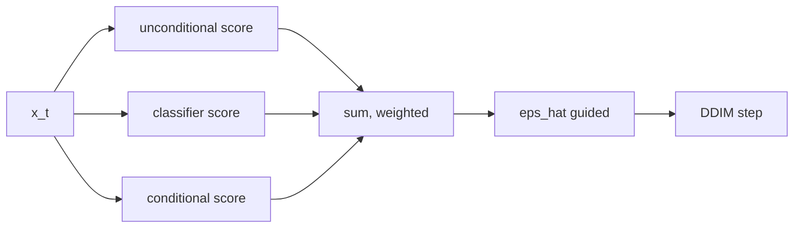

# Guidance — steering a diffusion model with a second score

`guidance.py` · Generative · Tier 2 · 4 variants

A diffusion model learns one thing: the score of the data distribution at every
noise level, $\nabla\log q_t(x_t)$, which it represents as a noise prediction
$\hat\epsilon$. Guidance is the observation that a second score can be added to
it — from a classifier, from a second denoiser, or from a difference of two
denoisers — and the sum is the score of a *different* distribution, one tilted
toward whatever the second score prefers. The four variants here are four ways
to obtain that second score, and the file measures what each one buys and what
it costs.

## Intuition

Think of the reverse trajectory as a particle rolling down a learned potential.
Guidance adds a force. If the force is the gradient of a classifier's
log-probability, the particle is pushed toward inputs the classifier scores
highly. If the force is the difference between a conditional and an
unconditional denoiser, the particle is pushed toward the conditional model's
prediction. Either way the sampler is unchanged — only the noise prediction it
consumes changes, one vector per step.



Two consequences are easy to state and easy to get wrong.

The first is that **guidance acts in clean-data space, not noise space**. Because
the clean prediction is an affine function of the noise prediction, a weighted
sum of noise predictions is the same weighted sum of clean predictions. At
weight $w$ the model generates from

$$
\hat x_0^{g}=(1-w)\,\hat x_0^{u}+w\,\hat x_0^{c},
$$

so $w=1$ is the conditional model, $0<w<1$ is a point on the segment between the
two predictions, and $w>1$ extrapolates past the conditional prediction. The
demo shows all three regimes. At $w=0.2$ the samples have mean radius 0.583
although both endpoints average about 0.71 and 0.80 — the segment between two
modes passes *inside* the circle. At $w=14$ the radius is 0.917: extrapolation
leaves the shell.

The second is that **a guidance term is only as good as its information**. The
classifier here is trained on noisy inputs at every rung, exactly as classifier
guidance requires, and it matches the exact Bayes ceiling of the Gaussian
mixture to within 0.02 at every noise level. That ceiling is 1.000 at $t=5$,
0.849 at $t=50$, 0.678 at $t=100$ and 0.497 at $t=200$: above $t\approx100$ the
attribute is simply not in the input, so no classifier can supply a useful
gradient there. Guiding anyway does not fail loudly; it accumulates a random
push, and the sample leaves the data. That is why the variant guides only in a
late window, and why the window is a parameter rather than a constant.

Classifier-free guidance has no such problem, because both of its terms are
denoisers trained on the data. It is also cheaper at sampling time and needs no
extra model. That combination is why it displaced classifier guidance in
practice, and the numbers here show both sides: classifier guidance reaches a
0.978 attribute rate at $\gamma=1$ but pulls the mean radius to 0.664, while
CFG at $w=1$ produces exact conditional samples at radius 0.803.

## Variants

| variant | knob | metric | value | modes | dist | radius |
|:--|:--|:--|--:|--:|--:|--:|
| `classifier` | $\gamma=0.3$ | right half | 0.66 | 8/8 | 0.308 | 0.662 |
| `classifier_free` | $w=3$ | mode 3 | 1.00 | 1/8 | 0.078 | 0.872 |
| `negative_prompt` | $n_w=1$ | mode 7 | 0.05 | 8/8 | 0.283 | 0.843 |
| `rescale_cfg` | $w=7$ | mode 3 | 1.00 | 1/8 | 0.063 | 0.788 |

All four use the same denoiser: 2048 points from eight Gaussians of radius 0.8
and spread 0.07, placed at angles $22.5^\circ+45^\circ k$ so that no mode sits on
the classifier's decision boundary; a cosine schedule with 200 training rungs; a
$2+4+8\to64\to64\to2$ SiLU network (5250 parameters) trained for 3000 Adam
steps with 10% label dropout; and 50 DDIM rungs at sampling time. The
`classifier` variant trains one more network, a 4738-parameter attribute
classifier on noised inputs.

**`classifier`** — classifier guidance with a late window $(0,100)$ and
$\gamma=0.3$. The attribute is $x>0$, so a random sample scores 0.48. Guidance
raises it to 0.66 while the distance to the nearest mode stays 0.31. At
$\gamma=1$ the rate reaches 0.978; without the window it reaches 1.000 but the
mean radius jumps to 1.190 and the distance to 0.508. The window is the whole
design question, and the table below isolates it.

**`classifier_free`** — CFG at $w=3$, a typical production value. Every sample
is the requested mode 3, the distance to its centre is 0.078 (the data's own
spread gives about 0.088), and the mean radius is 0.872. This is the sharpened
regime: the model is asked for a *more* confident version of the conditional
distribution, and returns samples tighter than the data.

**`negative_prompt`** — the unconditional model pushed away from mode 7 with
$n_w=1$, active for $t\ge100$. Mode 7's share falls from 0.125 to 0.050
(a 60% reduction) while all eight modes remain and the radius stays at 0.843.
Neither earlier nor later works as well: from $t=0$ the push destroys the sample
(three modes, radius 2.924), and from $t=150$ it is too weak (share 0.075).

**`rescale_cfg`** — CFG at $w=7$ followed by a per-sample norm rescale. At
$w=7$ plain guidance gives distance 0.103 and radius 0.898; rescaling gives
0.063 and 0.788, essentially the $w=1$ fidelity. At $w=14$ it repairs 0.917 to
0.782. The attribute is unchanged throughout — rescaling changes where the
sample sits, not what it depicts.

## Derivation

### The guided score

Let $q_t$ be the marginal of the forward process. Tweedie's formula gives the
score in terms of the optimal denoiser:

$$
\nabla\log q_t(x_t)=-\frac{\mathbb E[\epsilon\mid x_t]}{\sqrt{1-\bar\alpha_t}}
=-\frac{\hat\epsilon}{\sqrt{1-\bar\alpha_t}} .
\qquad (1)
$$

Suppose a classifier $p_\phi(y\mid x_t)$ is available at every rung. Bayes' rule
on the *noised* distribution gives the tilted score:

$$
\nabla\log q_t(x_t\mid y)
=\nabla\log q_t(x_t)+\nabla\log p_\phi(y\mid x_t).
\qquad (2)
$$

Substituting (1) into (2) and multiplying by $-\sqrt{1-\bar\alpha_t}$ gives the
guidance rule in noise space:

$$
\hat\epsilon_g
=\hat\epsilon_u-\sqrt{1-\bar\alpha_t}\,\gamma\,
\nabla_{x_t}\log p_\phi(y\mid x_t).
\qquad (3)
$$

The classifier's gradient is with respect to the *noisy* input, which is why it
must be trained on noised inputs at the rungs where it will be used. A
classifier trained on clean data has no gradient at high noise, and a classifier
that is merely at chance there contributes exactly zero expected signal and a
large variance.

### Classifier-free guidance

Train the same network twice, once with the label and once with the label
replaced by a null token, by dropping the label with probability $p$:

$$
\mathcal L
=\mathbb E_{t,x_0,\epsilon,y}\bigl[
\mathbb 1[\text{keep}]\,\lVert v-v_\theta(x_t,t,y)\rVert^2
+\mathbb 1[\text{drop}]\,\lVert v-v_\theta(x_t,t,\varnothing)\rVert^2
\bigr].
\qquad (4)
$$

Then combine the two predictions:

$$
\hat\epsilon_g=(1-w)\,\hat\epsilon_u+w\,\hat\epsilon_c .
\qquad (5)
$$

Equation (5) is *not* a new model; it is a one-parameter family of models. To
see what family, solve (3) for the classifier that would produce it:

$$
\nabla\log p_w(y\mid x_t)
=-\frac{w}{\sqrt{1-\bar\alpha_t}}
\bigl(\hat\epsilon_c-\hat\epsilon_u\bigr).
\qquad (6)
$$

So CFG is classifier guidance with an implicit classifier whose score is the
difference of the two denoisers. That classifier is the ratio
$p(x\mid y)/p(x)$ raised to the power $w$; it is exact in the sense that both
terms were trained on the data, and it needs no separate model.

The clean-space form follows from the affine relation between $\hat\epsilon$ and
$\hat x_0$. For any coefficients summing to one,

$$
\hat x_0^{g}=(1-w)\,\hat x_0^{u}+w\,\hat x_0^{c},
\qquad
\hat x_0=\frac{x_t-\sqrt{1-\bar\alpha_t}\,\hat\epsilon}{\sqrt{\bar\alpha_t}} .
\qquad (7)
$$

Equation (7) is the picture to keep: $w$ interpolates between two predictions of
the same clean point, and only $w=1$ is guaranteed to be on the data.

### Negative prompts

A negative prompt adds a second conditional term with the opposite sign:

$$
\hat\epsilon_g
=\hat\epsilon_u+w\,(\hat\epsilon_p-\hat\epsilon_u)
-n_w\,(\hat\epsilon_n-\hat\epsilon_u).
\qquad (8)
$$

Reading (8) as a score, the first bracket tilts toward $p$, the second tilts
away from $n$. In clean space,

$$
\hat x_0^{g}
=\hat x_0^{p}-n_w\,(\hat x_0^{n}-\hat x_0^{u}),
\qquad (9)
$$

at $w=1$. The negative term is a *difference* from the unconditional prediction,
not the negative prediction itself, so whatever the two share — the data's
overall scale and shape — cancels and only the class-specific part is repelled.
That is why (8) can remove a concept without moving the whole sample.

### Rescaling

Guidance at large $w$ changes the norm of the clean prediction, because the
extrapolation in (7) does not stay on the data manifold. The fix is to rescale
the guided prediction to a statistic of the unguided conditional one:

$$
\hat x_0^{g}\leftarrow
\hat x_0^{g}\,
\frac{\lVert\hat x_0^{c}\rVert}{\lVert\hat x_0^{g}\rVert}.
\qquad (10)
$$

The published form uses the standard deviation over the image tensor; on data
that lives on a circle the natural statistic is the per-sample norm, and (10) is
its two-dimensional analogue. It restores the radius but not the mode identity:
a sample that guidance pulled between two modes is still between them.

### The trajectory

Sampling uses the deterministic DDIM update, with the velocity parameterisation
that keeps the high-noise conversion well conditioned:

$$
x_s=\sqrt{\bar\alpha_s}\,\hat x_0
+\sqrt{1-\bar\alpha_s}\,\hat\epsilon,
\qquad
\hat x_0=\sqrt{\bar\alpha_t}\,x_t-\sqrt{1-\bar\alpha_t}\,v,
\qquad
\hat\epsilon=\sqrt{\bar\alpha_t}\,v+\sqrt{1-\bar\alpha_t}\,x_t .
\qquad (11)
$$

Substituting $\hat\epsilon_g$ from (3) or (5) into (11) is the entire
implementation: one vector changes, the integrator does not. The sensitivity
that makes guidance powerful and dangerous is

$$
\frac{\partial\hat x_0}{\partial\hat\epsilon}
=-\frac{\sqrt{1-\bar\alpha_t}}{\sqrt{\bar\alpha_t}},
\qquad (12)
$$

which is about 4000 at the last rung of this schedule. A guidance term applied
at high noise is therefore amplified enormously in clean space, and a term
applied at low noise is barely felt.

### Where a term can act

Let the guidance term be active only on a window $[t_{\mathrm{lo}},t_{\mathrm{hi}}]$:

$$
\hat\epsilon_g=\hat\epsilon_u
+\mathbb 1[t_{\mathrm{lo}}\le t\le t_{\mathrm{hi}}]\,\Delta.
\qquad (13)
$$

For a classifier, $\Delta$ carries information only where $p_\phi(y\mid x_t)$ is
better than chance, and by (12) its effect on $\hat x_0$ is largest where the
classifier is worst. The window is the compromise: the demo's late window
$(0,100)$ keeps the classifier in the region where its ceiling is at least 0.68,
and the result is 0.978 correct at radius 0.664. Widening it to all rungs buys
the last 0.022 of attribute rate and costs 0.526 of radius.

For a model-based term, $\Delta$ is a difference of two on-data predictions, so
it is meaningful at every rung, but its *magnitude* is not: at high noise the
label changes the prediction very little, and at low noise (12) shrinks the
step. The negative prompt's window $(100,200)$ sits where both factors are
usable, and the table in the demo shows the two failure sides.

### The exact ceiling

Because the data is a Gaussian mixture, the posterior used by the classifier can
be computed exactly:

$$
q_t(y\mid x_t)\propto
\mathcal N\bigl(x_t;\sqrt{\bar\alpha_t}\,\mu_y,\,
(\bar\alpha_t\sigma^2+1-\bar\alpha_t)I\bigr),
\qquad
p(a=1\mid x_t)=\sum_{y\in R}q_t(y\mid x_t),
\qquad (14)
$$

where $R$ is the set of modes on the right. Comparing the trained classifier to
(14) separates two explanations for a failure: a network that is below the
ceiling is undertrained, and a ceiling near 0.5 means the information is not
there. Here the two columns agree to within 0.02 at every rung, including the
0.497 at $t=200$ — the classifier is as good as the data allows, and the data
allows nothing.

## Code walkthrough

Training differs from an unconditional denoiser in one line. The label is
zeroed for a random tenth of each batch, which is what teaches the network the
null token that (5) needs:

```python
            x0, lab = x[idx], labels[idx].copy()
            lab[rng.random(len(idx)) < DROPOUT] = 0.0
            t = rng.integers(1, STEPS + 1, self.batch)
            eps = rng.normal(0.0, 1.0, x0.shape)
            abar = self.abar[t][:, None]
            xt = np.sqrt(abar) * x0 + np.sqrt(1.0 - abar) * eps
            target = np.sqrt(abar) * eps - np.sqrt(1.0 - abar) * x0
```

The same network serves both branches: the label is a one-hot vector
concatenated to the input, and the null label is the zero vector. No second
forward pass is needed at training time, which is why CFG is cheap to add to an
existing conditional model.

The conversion from velocity to noise is (11)'s second and third identities.
Both are multiplications, so nothing divides by a small number at the noisiest
rung:

```python
    def _eps(self, x: np.ndarray, t: int, lab: np.ndarray) -> np.ndarray:
        """The velocity prediction turned into a noise prediction."""
        v = self._predict(x, t, lab)
        abar = self.abar[t]
        return np.sqrt(abar) * v + np.sqrt(1.0 - abar) * x
```

The classifier gradient is an ordinary backpropagation through the attribute
network, stopped at the input. `p[:, 1] -= 1.0` is the derivative of the
cross-entropy for the positive attribute, and what is returned is that
derivative with respect to the first two inputs — the image coordinates, not the
time features:

```python
    def _classifier_grad(self, x: np.ndarray, t: int) -> np.ndarray:
        """dCE/dx for the positive attribute, shape (n, 2)."""
        inp = np.concatenate([x, _time_features(np.full(len(x), t), STEPS)],
                             axis=1)
        logits, cache = _forward(self.clf, inp)
        z = logits - logits.max(axis=1, keepdims=True)
        p = np.exp(z) / np.exp(z).sum(axis=1, keepdims=True)
        p[:, 1] -= 1.0
        return _backward(self.clf, cache, p)[1][:, :DIM]
```

The classifier is trained the same way, on inputs noised to every rung. It
never sees the label or the clean point; its only job is to map a noisy sample
to the attribute, which is exactly the function classifier guidance
differentiates:

```python
            logits, cache = _forward(
                clf, np.concatenate([xt, _time_features(t, STEPS)], axis=1))
            z = logits - logits.max(axis=1, keepdims=True)
            p = np.exp(z) / np.exp(z).sum(axis=1, keepdims=True)
            p[np.arange(len(idx)), target[idx]] -= 1.0
            opt.step(clf, _backward(clf, cache, p / len(idx))[0])
```

The sampling loop is where the four variants meet. The unconditional prediction
is computed once; each active term adds its difference; the rescale rebuilds the
noise prediction from the rescaled clean one using the inverse of (11):

```python
            base = self._eps(x, t, zero)
            e = base
            if lo <= t <= hi and labels is not None and weight > 0.0:
                cond = self._eps(x, t, lab)
                e = base + weight * (cond - base)
                if rescale:
                    x0c = (x - np.sqrt(1.0 - abar) * cond) / np.sqrt(abar)
                    x0g = (x - np.sqrt(1.0 - abar) * e) / np.sqrt(abar)
                    scale = (np.linalg.norm(x0c, axis=1, keepdims=True)
                             / np.maximum(np.linalg.norm(
                                 x0g, axis=1, keepdims=True), 1e-12))
                    x0g = x0g * scale
                    e = (x - np.sqrt(abar) * x0g) / np.sqrt(1.0 - abar)
            if lo <= t <= hi and negative is not None and neg_w > 0.0:
                away = self._eps(x, t, neg)
                e = e - neg_w * (away - base)
            if lo <= t <= hi and gamma > 0.0:
                e = e + np.sqrt(1.0 - abar) * gamma * self._classifier_grad(x, t)
```

The classifier term is added, not subtracted, because `_classifier_grad`
returns the cross-entropy derivative, which is the negative of the log-probability
gradient; (3) has a minus sign in front of the latter. The negative term is
subtracted because (8) subtracts it. The asymmetry is the whole sign convention,
and it is worth checking against one step of the demo.

The ceiling is four lines of Gaussian log-densities. `mu` is
$\sqrt{\bar\alpha_t}\mu_y$, `var` includes the data's own spread, and the
attribute probability is a sum over the right-hand modes:

```python
        abar = self.abar[t]
        var = abar * SPREAD ** 2 + (1.0 - abar)
        mu = np.sqrt(abar) * centres()
        xt = (np.sqrt(abar) * x
              + np.sqrt(1.0 - abar) * rng.normal(0.0, 1.0, x.shape))
        logp = -0.5 * ((xt[:, None, :] - mu[None]) ** 2).sum(axis=2) / var
        p = np.exp(logp - logp.max(axis=1, keepdims=True))
        right = p[:, RIGHT].sum(axis=1) / p.sum(axis=1)
```

The same noise draw feeds the trained classifier in `classifier_accuracy`, so
the two numbers in each row of the ceiling table are computed on identical
inputs. Without that detail the comparison would mix model error with sampling
error.

## Complexity

A guided step costs as many denoiser evaluations as guidance terms plus one.
The unconditional prediction is always needed: classifier guidance and the
negative prompt both subtract it, and CFG uses it as the base. So a CFG step is
two forward passes, a negative-prompt step is three, and classifier guidance is
one denoiser plus one classifier forward and backward — the cheapest in
parameters, the most expensive in per-step work relative to the denoiser.

The denoiser has 5250 parameters. At batch 1024 a forward pass is about 5.4M
multiply-adds, so 50 CFG steps cost 0.54G, a negative-prompt run 0.81G, and a
plain conditional run 0.27G. The classifier adds 4738 parameters, a forward and
a forward and a backward per step, roughly 0.7G over the trajectory. Training
dominates all of this: four denoisers at 3000 steps and one classifier come to
about 59G, and the demo spends most of its 20 seconds there.

Memory is the usual batch of activations plus the models. The one structural
cost of guidance is that the conditional and unconditional branches cannot share
a forward pass: their inputs differ in the label, so they are two batches. A
production implementation batches them together, which turns two half-batches
into one full batch and recovers most of the throughput.

## Failure modes

**A classifier without information.** At $t=200$ the Bayes ceiling is 0.497 and
the trained network is at 0.506. A guidance term built on it is noise with a
large amplitude, because (12) amplifies whatever it says by roughly 4000. The
demo's all-rungs row at $\gamma=1$ shows the consequence: attribute rate 1.000,
distance 0.508, radius 1.190. The fix is a window, not a bigger classifier.

**A window in the wrong place.** The negative-prompt table is the clean example.
From $t=0$ the push is applied when the label barely changes the prediction and
the step is enormous, and the sample ends at radius 2.924 with three modes left.
From $t=150$ the push is applied only in the last fifty rungs, where the step is
small, and it removes 0.05 of the target's 0.125 share instead of 0.075. The
usable band is narrow and has to be measured.

**Interpolation is not sampling.** At $w=0.2$ the model returns points on the
segment between mode predictions, which lie inside the circle: radius 0.583
against 0.707 for the unconditional model and 0.803 for the conditional one.
Averaging two scores is not the same as sampling from a mixture of the two
distributions, and the difference is visible in any geometry where the classes
are separated.

**Extrapolation leaves the manifold.** At $w=14$ the distance to the nearest
centre is 0.123 and the radius is 0.917; at $w=2$ the distance is 0.068, tighter
than the data's own 0.088. The first is off the data, the second is sharper than
the data. Neither is a bug: $w$ is a dial between diversity and adherence, and
above 1 it is not reproducing the conditional distribution.

**Rescaling fixes the norm, not the mode.** Equation (10) restores the radius,
and the table shows it working at all three weights. It cannot undo the fact
that guidance merged two neighbouring modes: the rescaled samples at $w=14$ have
distance 0.060 and radius 0.782, but they are still an arc rather than two
modes. The repair is a smaller $w$ or a better conditioning signal.

**Attribute boundaries.** The classifier's attribute is $x>0$, and a mode placed
at $x=0$ would make the label a coin flip for that mode's samples, capping the
ceiling near 0.9 no matter how good the network is. The data is offset by
$\pi/8$ for exactly this reason. Real attribute datasets have the same issue
whenever a class straddles the decision boundary, and it shows up as an
irreducible error that no amount of training removes.

**A negative prompt with nothing to steer toward.** Used alone at $t\ge100$ the
negative term removes 60% of mode 7 and keeps the sample intact, but it has no
notion of where to go instead: coverage stays at eight modes because the
unconditional model supplies the alternatives. With a strong positive prompt,
the same term has almost nothing left to remove — at $w=3$ the requested mode is
already 100% of the batch — and its only measurable effect is to pull the sample
off the shell.

## Applications

**Text-to-image generation.** CFG is the default way to trade adherence for
diversity in every large text-to-image model. The usual weight is 5–10, which is
the sharpened regime in the table; $w=1$ is rarely used because the conditional
model alone under-represents the prompt.

**Negative prompts.** The same algebra with a second text condition removes
concepts — watermarks, styles, anatomy errors — without retraining. Production
interfaces expose it as a second text box, and the implementation is (8).

**Classifier guidance.** Dhariwal and Nichol's original result used an
ImageNet classifier to push samples toward a class. It needs a noise-robust
classifier and an extra backward pass, and it was largely superseded by CFG, but
it remains the cleanest way to add a signal that is not a text prompt: a
detector, a CLIP score, a aesthetic predictor.

**Editing and img2img.** Guidance composes with inversion: invert an image,
apply a guided trajectory with a modified condition, resample. The window
controls how much of the original survives, and the norm rescale keeps the
edited result on the data manifold.

**Composing conditions.** Because scores add, several guidance terms can be
combined in one step: a text term, a depth term, a style reference. The weights
set the relative strength, and the failure modes above apply to the sum, not to
each term separately.

**Safety and filtering.** A classifier that detects unwanted content can be
used with a negative weight, which is a cheap post-hoc filter that needs no
retraining. The same caveat applies: the classifier must have information at the
rungs where it acts, or it will push the sample off the data without removing
the content.

**Autoguidance and beyond.** Recent work replaces the unconditional model with a
weaker version of the same model, which makes the guidance direction meaningful
at every noise level. That is (5) with a different pair of models, and the
argument is the same: a difference of two scores is a classifier, and its
quality is the quality of the difference.

## References

- Dhariwal & Nichol (2021). *Diffusion Models Beat GANs on Image Synthesis.*
  NeurIPS.
- Ho & Salimans (2022). *Classifier-Free Diffusion Guidance.* NeurIPS Workshop.
- Song, Sohl-Dickstein, Kingma, Kumar, Ermon & Poole (2021). *Score-Based
  Generative Modeling through Stochastic Differential Equations.* ICLR.
- Nichol, Dhariwal, Ramesh, Shyam, Mishkin, McGrew, Sutskever & Chen (2022).
  *GLIDE: Towards Photorealistic Image Generation and Editing with Text-Guided
  Diffusion Models.* ICML.
- Rombach, Blattmann, Lorenz, Esser & Ommer (2022). *High-Resolution Image
  Synthesis with Latent Diffusion Models.* CVPR.
- Meng, He, Song, Song, Wu, Zhu & Ermon (2022). *SDEdit: Guided Image Synthesis
  and Editing with Stochastic Differential Equations.* ICLR.
- Liu, Li, Du, Torralba & Tenenbaum (2022). *Compositional Visual Generation
  with Composable Diffusion Models.* ECCV.
- Epstein, Jabri, Poole, Efros & Holynski (2023). *Diffusion Self-Guidance for
  Controllable Image Generation.* SIGGRAPH.
- Bansal, Chu & Schwarzschild (2022). *Universal Guidance for Diffusion Models.*
  CVPR.
- Karras, Aittala, Kynkäänniemi, Lehtinen, Aila & Laine (2024).
  *Guiding a Diffusion Model with a Bad Version of Itself.* NeurIPS.
