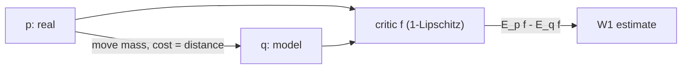

# Wasserstein GAN — the earth-mover distance and four Lipschitz constraints

`wgan.py` · Generative · Tier 2 · 4 variants

A GAN's discriminator is a classifier, and a classifier's gradient is only
useful while it is uncertain. When the model distribution and the data are far
apart, a perfect discriminator separates them with probability one, its output
saturates, and the generator receives a gradient of zero. The Wasserstein GAN
replaces the classifier with a *critic*: a function trained to measure how much
mass has to move to turn one distribution into the other. That quantity has a
gradient everywhere, including when the distributions do not overlap — which is
the situation at the start of every training run. The price is a constraint the
critic must satisfy: it has to be 1-Lipschitz. This file compares the four ways
of imposing that constraint that are in common use, on eight Gaussians, with the
critic's shape measured rather than assumed.

## Intuition

The Wasserstein-1 distance between two distributions is the cheapest way to
transport one onto the other when moving a unit of mass a unit of distance costs
one:



You cannot compute the infimum over transport plans directly. The
Kantorovich-Rubinstein duality turns it into a supremum over functions: the best
1-Lipschitz $f$ gives $W_1$ as the difference of its expectations. So the critic
is not asked "is this real?" — it is asked "how high can you score the real data
relative to the fake data, without ever rising faster than slope one?" The
answer is a number whose units are distance, not a probability.

That change of question fixes the vanishing gradient. Two disjoint point masses
at distance $d$ have $W_1=d$ and a critic with slope one between them, so the
generator's gradient is proportional to $d$ from the first step. With a
classifier the same configuration has a constant loss and no gradient at all.

It also moves the difficulty. A classifier can be arbitrarily sharp; a critic
may not. Every variant in this file is a different answer to one question: how
do you keep a neural network 1-Lipschitz?

- **Clip the weights.** The original answer. After each critic step, clamp every
  weight to $[-c,c]$. Simple, and it works, but the clamp is a blunt instrument:
  it also crushes the critic's overall scale, so the signal the generator needs
  shrinks with it.
- **Penalise the slope, two-sided.** Add $\lambda(\lVert\nabla f\rVert-1)^2$ at
  points interpolated between real and fake. This is WGAN-GP, and it is the
  default in most code you will read.
- **Penalise the slope, one-sided.** Same term, but only where the slope exceeds
  one. WGAN-LP. The extra freedom matters exactly where a critic wants to be
  flat: at a maximum.
- **Normalise the weights spectrally.** Divide each matrix by its top singular
  value after each step, so the product of layer norms is one.

The last two sentences are the whole result of this file. On data with eight
separated modes, the optimal critic is a potential that peaks at each mode and
slopes down between them. A *peak* has zero gradient. A two-sided penalty
forbids zero, so it forbids peaks, so the critic cannot separate the modes; the
one-sided penalty allows plateaus and recovers the shape. The demo measures the
critic's value and slope at a mode centre and halfway between two modes, and the
table below is that measurement, not an opinion.

There is a second, quieter theme: the Wasserstein estimate itself. It is a
difference of two sample means, and with a powerful critic on a finite batch it
is biased upward — the critic can separate the batch even when it cannot
separate the distributions. A negative estimate after training is normal and is
not a bug (the two-sided variant here ends at $-0.071$).

## Variants

| variant | constraint | modes | share | distance | $\hat W$ | $\lVert\nabla D\rVert$ |
|:--|:--|--:|--:|--:|--:|--:|
| `wgan` | clip $c=0.01$ | 8/8 | 0.15 | 0.237 | +0.000 | 0.000 |
| `wgan_gp` | two-sided, $\lambda=10$ | 5/8 | 0.31 | 0.425 | −0.071 | 0.993 |
| `wgan_lp` | one-sided, $\lambda=10$ | 8/8 | 0.14 | 0.100 | +0.015 | 0.457 |
| `spectral_norm` | power iteration | 8/8 | 0.19 | 0.262 | +0.019 | 0.165 |

All four share the data, the architecture, the optimiser and the budget: 2048
points from eight Gaussians of radius 0.8 and spread 0.07; a critic
$2\to64\to64\to1$ with leaky ReLU (4417 parameters); a generator
$2\to64\to64\to2$ with ReLU and a tanh output (4482 parameters); 3000 steps of
Adam at $10^{-4}$ with $\beta_1=0.5$; four critic updates per generator update;
batches of 128. The metrics are computed on 1024 fresh samples: modes won, the
largest mode's share, the mean distance to the nearest centre, the Wasserstein
estimate on fresh data, and the mean critic slope at the test points.

**`wgan`** — the original (Arjovsky, Chintala & Bottou 2017). Weight clipping
is the cheapest constraint to implement and the most destructive: after
clipping, the critic's slope is bounded by the product of its layers' Frobenius
norms, about $0.0058$ for these dimensions at $c=0.01$, and the measured value
is $2.0\times10^{-4}$: across the whole test set the critic's value moves by
$4\times10^{-4}$. The critic is effectively constant, so the generator is
from almost nothing — yet it covers all eight modes at distance 0.237, because
the critic was informative for the first few hundred steps, before the clamp
wore it down. Coverage alone would call this row a success.

**`wgan_gp`** — the gradient penalty (Gulrajani et al. 2017), two-sided with the
paper's $\lambda=10$. It reaches five modes. The penalty is
satisfied — the slope at a mode centre is 0.983 and between modes 1.072 — and
that is exactly the problem: the critic is forced to climb at unit rate through
the point where a separating critic needs to turn over. Its value across a mode
and its neighbouring gap differs by less than 0.1, so it cannot tell them apart.
The demo repeats the run at $\lambda=1$ and gets all eight modes at distance
0.146, with slopes 0.736 and 0.843: the same penalty, relaxed enough to allow a
rounded peak. This is the file's main finding.

**`wgan_lp`** — the one-sided penalty (Petzka, Fischer & Lukovnicov 2017). The
threshold at one leaves the critic free below it, and it uses that freedom
exactly as theory says it should: slope 0.127 at the mode centres and 0.474
between them, with the critic's value $+0.12$ on the modes and $-0.08$ in the
gaps. Flat plateaus on the data, steep valleys between — a critic that measures
transport cost. Best sample distance of the four (0.100).

**`spectral_norm`** — normalise each weight matrix by its top singular value
(Miyato et al. 2018), one power iteration per step, carrying the vectors
between steps. No penalty, no clipping, and the Lipschitz constant of the whole
critic is at most one by construction. All eight modes at 0.262. The critic is
flatter than the one-sided penalty's (0.166 in both places), so the generator's
signal is weaker and the samples are looser; the advantage is that the
constraint never has to be tuned.

The $\lambda=1$ diagnostic — all eight modes with a rounded peak — is the shape
to look for. The two-sided row at $\lambda=10$ is the shape to be suspicious of.

## Derivation

### The distance and its dual

Let $\Pi(p,q)$ be the set of couplings: joint distributions with marginals $p$
and $q$. The Wasserstein-1 distance is

$$
W_1(p,q)=\inf_{\gamma\in\Pi(p,q)}
\mathbb E_{(x,y)\sim\gamma}\bigl[\lVert x-y\rVert\bigr].
\qquad (1)
$$

The infimum is over an infinite-dimensional set of plans, which is not something
to optimise with a neural network. Kantorovich duality exchanges it for a
supremum over functions:

$$
W_1(p,q)=\sup_{\lVert f\rVert_L\le 1}
\Bigl(\mathbb E_{x\sim p}f(x)-\mathbb E_{y\sim q}f(y)\Bigr),
\qquad (2)
$$

where $\lVert f\rVert_L$ is the Lipschitz constant of $f$. Two facts make the
dual useful. First, the supremum is attained by $f(x)=\mathrm{dist}(x,A)$ when
$p$ is supported on a set $A$ and $q$ elsewhere — a distance function, not a
classifier. Second, the bound is sharp: if you can find any 1-Lipschitz $f$, its
objective is a lower bound on $W_1$, so maximising it is a well-posed problem
even when you cannot solve it exactly.

### The game

Write the critic $f_\theta$ and the generator $G_\phi$. The WGAN objective is

$$
\max_{\theta}\;\mathbb E_{x\sim p}f_\theta(x)
-\mathbb E_{z}f_\theta(G_\phi(z)),
\qquad
\min_{\phi}\;-\mathbb E_{z}f_\theta(G_\phi(z)),
\qquad (3)
$$

under a constraint on $\lVert f_\theta\rVert_L$ that the four variants implement
differently. Note what is absent: a sigmoid, a log, a ratio. Both expectations
are of the critic's raw output, and the generator's loss is the negative of its
own expectation. The critic is *not* trained to output one for real data and
zero for fake; only the difference matters, and the scale is set by the
constraint.

The gradients follow directly:

$$
\nabla_\theta\Bigl(\mathbb E_p f_\theta-\mathbb E_q f_\theta\Bigr)
=\mathbb E_p\nabla_\theta f_\theta-\mathbb E_q\nabla_\theta f_\theta,
\qquad (4)
$$

which is two backward passes with opposite signs. Getting that sign wrong —
descending on the objective instead of ascending — trains the critic to prefer
fakes, and the generator follows it into a single blob. This is not a
hypothetical: it is the first bug this file hit.

The generator's gradient is the critic's slope at the generated points,
propagated through $G$:

$$
\nabla_\phi\,\mathbb E_z f_\theta(G_\phi(z))
=\mathbb E_z\Bigl[\Bigl(\frac{\partial G_\phi(z)}{\partial\phi}\Bigr)^{\mathsf T}
\nabla_x f_\theta(G_\phi(z))\Bigr].
\qquad (5)
$$

Equation (5) is where the Lipschitz constraint pays off. The signal is
$\nabla_x f$, whose norm is bounded below by the constraint only indirectly —
but unlike a classifier's sigmoid derivative, it does not vanish when the two
distributions are far apart: a 1-Lipschitz critic that separates distant modes
*must* have slope near one somewhere between them.

### Clipping

With every weight in $[-c,c]$, each layer's spectral norm is at most its
Frobenius norm, so

$$
\lVert f_\theta\rVert_L\le\prod_{\ell=1}^{3}c\sqrt{m_\ell n_\ell}
=0.01\sqrt{2\cdot 64}\;\cdot\;0.01\sqrt{64\cdot 64}\;\cdot\;
0.01\sqrt{64}\approx0.0058 .
\qquad (6)
$$

The bound is loose but the message is exact: clipping does not merely bound the
slope, it bounds the whole function's scale, and with three layers the bound
compounds. The measured slope is $0.0004$ — three orders of magnitude below the
unit slope the dual would like, and below the resolution of the demo's table.
The weights are also clipped after *every* critic step, so the effective step
size shrinks as the weights pile up against the box.

### The two-sided penalty

WGAN-GP drops the hard constraint for a soft one. Sample a point on the segment
between a real and a generated point and penalise deviation of the slope from
one:

$$
\mathcal L_{\mathrm{GP}}=\mathbb E_{\hat x}
\bigl(\lVert\nabla_{\hat x}f_\theta(\hat x)\rVert-1\bigr)^2,
\qquad
\hat x=\epsilon x+(1-\epsilon)\tilde x,
\quad\epsilon\sim U(0,1).
\qquad (7)
$$

The segment is the important part. The critic only needs unit slope where it is
being asked to separate, which is between the two distributions; penalising
everywhere would be wasteful and would fight the data's own geometry. The
penalty enters the critic's loss as $\lambda\mathcal L_{\mathrm{GP}}$, and
$\lambda=10$ is the paper's default.

Computing (7) requires differentiating the critic's gradient — a double backward
pass. For the three-layer critic, with masks $m_1,m_2\in\{1,\text{slope}\}$ at
the two hidden layers and $w_3$ the last weight column,

$$
\nabla_x f=W_1^{\mathsf T}\,\mathrm{diag}(m_1)\,W_2^{\mathsf T}\,
\mathrm{diag}(m_2)\,w_3 .
\qquad (8)
$$

The critic is piecewise linear, so its second derivative is zero almost
everywhere and the masks can be treated as constants. Writing
$v=m_2\odot w_3$, $t=m_1\odot(W_2^{\mathsf T}v)$, $n=\lVert W_1^{\mathsf T}t\rVert$,
$c=2(n-1)$ and $\hat g=W_1^{\mathsf T}t/n$ per sample, the parameter gradients
are three matrix products:

$$
\frac{\partial\mathcal L}{\partial W_1}=\frac1N\sum_n c_n\,\hat g_n\,t_n^{\mathsf T},
\qquad
\frac{\partial\mathcal L}{\partial W_2}=\frac1N\sum_n c_n\,
\bigl(m_1\odot(W_1\hat g_n)\bigr)v_n^{\mathsf T},
\qquad (9)
$$

$$
\frac{\partial\mathcal L}{\partial w_3}=\frac1N\sum_n c_n\,
m_2\odot\bigl(W_2\,(m_1\odot(W_1\hat g_n))\bigr).
\qquad (10)
$$

Two details in (9)–(10) are easy to get wrong and are worth checking numerically.
The $1/N$ is there because the penalty is a mean; without it the penalty is $N$
times too strong. And $c_n$ already contains the $1/n$ from differentiating
$\lVert\cdot\rVert$, so $\hat g_n$ must be divided by $n$ exactly once. The demo
checks the whole gradient against central differences and gets a maximum error
of $2.7\times10^{-10}$.

### The one-sided penalty

The relaxation is one line:

$$
\mathcal L_{\mathrm{LP}}=\mathbb E_{\hat x}
\bigl(\max(0,\lVert\nabla_{\hat x}f_\theta(\hat x)\rVert-1)\bigr)^2 .
\qquad (11)
$$

Slopes below one cost nothing, so the critic may be flat. That sounds like a
weaker guarantee — and it is, in the sense that the critic is no longer forced
to be exactly 1-Lipschitz — but the inequality $\lVert f\rVert_L\le 1$ is all
the dual needs, and flat regions are consistent with it. What (11) buys is the
freedom to have a maximum.

Why a maximum is non-negotiable here: a separating critic on eight point masses
is essentially $\min_k\lVert x-c_k\rVert$-like, which has a *cusp* at each mode
and slope one on the Voronoi boundaries. A cusp is not differentiable, so in
practice the critic approximates it with a rounded peak, whose slope at the top
is below one. The two-sided penalty charges for that rounding; the one-sided
penalty does not. The measurements are the signature: `wgan_lp` has slope 0.127
at the centres and 0.474 between them, while `wgan_gp` has 0.983 and 1.072 —
unit slope straight through the peak.

### Spectral normalisation

Take the largest singular value of each weight matrix and divide:

$$
v\leftarrow\frac{W^{\mathsf T}u}{\lVert W^{\mathsf T}u\rVert},
\quad
u\leftarrow\frac{Wv}{\lVert Wv\rVert},
\quad
W\leftarrow\frac{W}{\sigma_1(W)},
\quad
\sigma_1(W)\approx\lVert Wv\rVert.
\qquad (12)
$$

The power iteration estimates $\sigma_1$ from a pair of vectors carried between
steps; one iteration per training step is enough because $W$ changes slowly.
Since the spectral norm is sub-multiplicative, normalising every layer bounds
the critic by one:

$$
\lVert f\rVert_L\le\prod_{\ell}\sigma_1(W_\ell)=1 .
\qquad (13)
$$

Unlike clipping, this does not shrink the function's scale: a matrix with all
its singular values equal to one is an isometry, which can move mass as far as
the data requires. The constraint is enforced by direction rather than by
magnitude, and there is nothing to tune.

### The estimate

For reporting, the dual is evaluated on samples:

$$
\hat W=\frac1m\sum_{i=1}^m f(x_i)-\frac1m\sum_{j=1}^m f(G(z_j)).
\qquad (14)
$$

$\hat W$ is a lower bound on $W_1$ *for a fixed critic*, and it is maximised
over the critic, so it inherits the critic's overfitting to the batch. On 1024
points it is noisy, and after the generator has adapted to the critic it can go
negative: that means the critic scores this batch of fakes above this batch of
reals, which is a statement about the two samples, not about the distributions.
The table reports it because it is the quantity the critic is trained on, not
because it ranks the variants.

## Code walkthrough

The critic's input gradient is the whole of the gradient penalty's inner
computation, and it is also the diagnostic the demo uses. It is written as the
product of the layer matrices with the activation masks taken at `x`:

```python
def _input_grad(params: list, x: np.ndarray) -> np.ndarray:
    """The critic's gradient with respect to its input, (n, DIM).

    The critic is piecewise linear, so the gradient is a product of the
    layer matrices with the activation masks taken at `x`.
    """
    _, cache = _forward(params, x, LEAK, "linear")
    w = params[-1]["W"][:, 0]
    d = np.broadcast_to(w, (len(x), len(w)))
    for i in range(len(params) - 2, -1, -1):
        pre = cache[i][1]
        d = (d * np.where(pre > 0.0, 1.0, LEAK)) @ params[i]["W"].T
    return d
```

The penalty reuses that product but keeps the intermediate vectors, because
differentiating through it needs them. The masks come from the same forward
pass:

```python
    _, cache = _forward(params, xh, LEAK, "linear")
    m1 = np.where(cache[0][1] > 0.0, 1.0, LEAK)
    m2 = np.where(cache[1][1] > 0.0, 1.0, LEAK)
    w1, w2, w3 = params[0]["W"], params[1]["W"], params[2]["W"][:, 0]
    v = m2 * w3
    t = m1 * (v @ w2.T)
    g = t @ w1.T
    n = np.linalg.norm(g, axis=1)
    coef = 2.0 * (n - 1.0)
    if one_sided:
        coef = np.where(n > 1.0, coef, 0.0)
    coef = coef / len(xh)
    ghat = g / np.maximum(n, 1e-12)[:, None]
```

`coef` is $c_n/N$ and `ghat` is $\hat g_n$ from (9)–(10). The three parameter
gradients are then three `einsum`s, each one a sum over the batch of an outer
product:

```python
    gw1 = np.einsum("n,nd,nh->dh", coef, ghat, t)
    w1g = ghat @ w1
    gw2 = np.einsum("n,nh,nk->hk", coef, w1g * m1, v)
    p = (m1 * w1g) @ w2
    gw3 = np.einsum("n,nh->h", coef, m2 * p)
    return float(np.mean(n)), [
        {"W": gw1, "b": np.zeros_like(params[0]["b"])},
        {"W": gw2, "b": np.zeros_like(params[1]["b"])},
        {"W": gw3[:, None], "b": np.zeros_like(params[2]["b"])},
    ]
```

Biases do not appear in the penalty at all: adding a constant to the critic
changes its value but not its slope, so the gradient with respect to every bias
is exactly zero, and the code returns zeros rather than omitting the keys.

The spectral update divides by the estimate from the carried vectors. After the
division the ratio measured with the *same* vector is one exactly, which is why
the demo can assert it to $10^{-5}$:

```python
    for layer, u in zip(params, us, strict=True):
        w = layer["W"]
        v = w.T @ u
        v /= np.linalg.norm(v) + 1e-12
        u[...] = w @ v
        u /= np.linalg.norm(u) + 1e-12
        layer["W"] = w / (np.linalg.norm(w @ v) + 1e-12)
```

The critic step is two backward passes with opposite signs — equation (4) —
followed by whichever constraint the variant selects. The schema is the same for
all four, and only the tail differs:

```python
                gr, _ = _backward(d_params, cr,
                                  np.full((self.batch, 1), -1.0 / self.batch),
                                  LEAK, "linear")
                gf, _ = _backward(d_params, cf,
                                  np.full((self.batch, 1), 1.0 / self.batch),
                                  LEAK, "linear")
                grads = [{key: gr[i][key] + gf[i][key] for key in gr[i]}
                         for i in range(len(d_params))]
```

The penalty branch interpolates a real point and a fake one, calls `_penalty`,
and adds $\lambda$ times its gradient. The other two branches clamp or
normalise after the update:

```python
                if self.constraint in ("two_sided", "one_sided"):
                    eps = rng.random((self.batch, 1))
                    xh = eps * xr + (1.0 - eps) * fake
                    _, pg = _penalty(d_params, xh,
                                     self.constraint == "one_sided")
                    grads = [{key: grads[i][key] + self.lam * pg[i][key]
                              for key in grads[i]}
                             for i in range(len(d_params))]
                opt_d.step(d_params, grads)
                if self.constraint == "clip":
                    for L in d_params:
                        for key in L:
                            np.clip(L[key], -self.clip, self.clip, out=L[key])
                elif self.constraint == "spectral":
                    _spectral(d_params, us)
```

The generator step goes through the critic once more: one forward pass at the
current fakes, one backward pass to get $\nabla_x f$, and one backward pass
through $G$ with that as the upstream gradient. This is equation (5) in code,
and it is the only place where the generator sees the critic:

```python
            z = rng.normal(0.0, 1.0, (self.batch, LATENT))
            fake, cg = _forward(g_params, z, 0.0, "tanh")
            _, cf = _forward(d_params, fake, LEAK, "linear")
            _, dx = _backward(d_params, cf,
                              np.full((self.batch, 1), -1.0 / self.batch),
                              LEAK, "linear")
            gg, _ = _backward(g_params, cg, dx, 0.0, "tanh")
            opt_g.step(g_params, gg)
```

One implementation note that the earlier atoms share: `_backward` always
propagates through the first matrix, so its second return value is the gradient
with respect to the *input*, not to the first hidden activation. The critic
hands that value straight to the generator. A version that stops after the
first layer returns a vector in the wrong space, and the shapes fail loudly —
which is how the bug was found here.

## Complexity

The critic has 4417 parameters and the generator 4482: two hidden layers of 64,
so almost all of the weight is in the $64\times64$ matrices. A forward pass on a
batch of 128 is therefore about 0.57M multiply-adds, and a backward pass about
twice that.

A step runs four critic updates and one generator update. Without a penalty that
is $4\times$ (two forwards plus two backwards) plus (one forward through $G$,
one through $D$, and two backwards), roughly 17M multiply-adds. The gradient
penalty adds one forward and one double backward per critic update — the double
backward is two more matrix products — about 1.7M each, for roughly 24M per step
with a penalty. Over 3000 steps that is about 70G multiply-adds.

The comparison with a plain GAN is instructive: there the discriminator does one
forward and one backward, and the ratio of critic to generator work is one to
one. WGAN spends four to five times more on the critic, because the dual
requires an approximately optimal critic for the generator's gradient to mean
anything. That is the real cost of the Wasserstein objective, and it is the
reason WGAN was displaced in practice by objectives that need less inner
optimisation.

Sampling is a single forward pass through $G$ — 4482 multiply-adds per point,
independent of the number of training steps. Nothing here is sequential, unlike
diffusion.

Memory is dominated by Adam's two moments per parameter: 3× the parameter count
per network, plus the activations of one batch per layer (128×64 numbers per
hidden layer). The double backward needs the critic's cached activations, not a
second graph, because the masks are all it uses from the forward pass.

## Failure modes

**A critic crushed by clipping.** The bound in (6) compounds over layers, and
three layers at $c=0.01$ leave a slope of $2\times10^{-4}$ — the critic is
constant, the
generator's signal is gone, and the samples are inherited from the first few
hundred steps. A larger clip ($0.05$, $0.1$) restores the slope, but now the
constraint is looser and the whole point of the method is diluted. Weight
clipping is a constraint you set by hand, and the useful range is narrow.

**A two-sided penalty that forbids the optimum.** This is the file's headline.
The penalty is satisfied to 0.02 and the critic still cannot separate five of
the eight modes, because a separating critic needs a maximum at each mode and a
maximum needs a zero slope. $\lambda=10$ is strong enough that the critic spends
its capacity satisfying the constraint rather than separating; at $\lambda=1$
the same code finds all eight modes. The lesson is not "GP is broken" — it is
that the penalty constant is a real modelling choice, and that a satisfied
penalty is not evidence of a good critic.

**Reading $\hat W$ as a score.** The estimate is a difference of sample means
with an optimised critic, and it goes negative after the generator has adapted
(`wgan_gp` ends at −0.071 while covering five modes). Its scale is not
comparable across variants with different constraints, because the constraints
set different function scales. It is a training diagnostic — is the critic
separating this batch? — not a metric.

**A penalty that is not a mean.** Omitting the $1/N$, or dividing by
$\lVert g\rVert$ twice, changes the effective $\lambda$ by a factor of the batch
size or of the slope, and the symptom is a critic that either ignores the
penalty or is frozen by it. The numerical gradient check in the demo is three
lines of central differences and catches both; it is the cheapest test in the
file and the one that found the actual bug.

**One power iteration per step.** Spectral normalisation assumes the top
singular vector changes slowly. It does here, but a large learning rate or a
rapidly changing critic makes the estimate lag, and the true top singular value
drifts above one — the constraint is then violated by an amount the code cannot
see. The demo measures the true value with an SVD after training and finds it
within $2.4\times10^{-7}$ of one; a production model with a larger learning rate
would want two or three iterations.

**Mode coverage without quality.** `wgan` covers all eight modes and has the
second-worst distance, because coverage counts which centre wins each sample,
not how tightly the samples cluster. `wgan_lp` wins on distance with the same
coverage. A single number is never enough: the demo reports coverage, share,
distance, slope and critic shape for this reason.

**A critic that is too strong or too weak.** Four critic updates per generator
update is a compromise. Fewer and the dual is not estimated; more and the critic
overfits the batch, $\hat W$ inflates, and the generator chases a critic that no
longer reflects the data. The WGAN paper's advice — keep the critic near its
optimum without letting it memorise — has no closed form, which is the honest
summary of GAN tuning.

## Applications

**Image generation, 2017–2019.** WGAN-GP was the standard recipe for
high-resolution image synthesis before style-based generators, and the
one-sided variant and spectral normalisation are still used as regularisers in
modern discriminators. BigGAN's discriminator is spectrally normalised, and the
constraint is applied per layer exactly as in (12).

**Generative models with a meaningful loss.** Because $\hat W$ approximates a
distance, it can be monitored during training in a way that a classifier's
accuracy cannot. That is useful for debugging and for model selection when the
downstream metric is expensive.

**Optimal transport and domain adaptation.** The dual in (2) is the same object
used to learn transport maps between domains, to match distributions in
representation learning, and to define Wasserstein autoencoders. The critic is
the Kantorovich potential, and its gradient is the transport direction.

**Inverse problems and physics.** A Wasserstein critic is a loss for matching
distributions of fields, particles or spectra where per-sample losses are
meaningless — for example matching the distribution of simulated turbulence to
measurements. The Lipschitz constraint is what makes the loss a metric rather
than a classifier's confidence.

**Evaluating and compressing generators.** Distances between generated and real
feature distributions (FID and its relatives) are Wasserstein-2-like quantities
computed in a fixed feature space; WGAN-style critics are the trainable version
of the same idea. GAN compression and distillation use a critic as the teacher's
signal for the same reason.

**Anywhere a classifier saturates.** Setting up a GAN on a new modality is
easier when the loss is a distance: the failure mode is "the critic is not
Lipschitz enough", which has a diagnostic (the slope), rather than "the
discriminator is too good", which has none. That is the practical argument for
the Wasserstein objective even when a plain GAN would train.

## References

- Arjovsky, Chintala & Bottou (2017). *Wasserstein GAN.* arXiv:1701.07875.
- Arjovsky & Bottou (2017). *Towards Principled Methods for Training Generative
  Adversarial Networks.* ICLR.
- Gulrajani, Ahmed, Arjovsky, Dumoulin & Courville (2017). *Improved Training of
  Wasserstein GANs.* NeurIPS.
- Petzka, Fischer & Lukovnicov (2017). *On the Regularization of Wasserstein
  GANs.* arXiv:1712.01026.
- Miyato, Kataoka, Koyama & Yoshida (2018). *Spectral Normalization for
  Generative Adversarial Networks.* ICLR.
- Brock, Donahue & Simonyan (2019). *Large Scale GAN Training for High Fidelity
  Natural Image Synthesis.* ICLR.
- Tolstikhin, Bousquet, Gelly & Schölkopf (2018). *Wasserstein Auto-Encoders.*
  ICLR.
- Mescheder, Geiger & Nowozin (2018). *Which Training Methods for GANs do
  actually Converge?* ICML.
- Villani (2009). *Optimal Transport: Old and New.* Springer.
- Salimans, Goodfellow, Zaremba, Cheung, Radford & Chen (2016). *Improved
  Techniques for Training GANs.* NeurIPS.
