<div align="center">

# MLAtoms

**The periodic table of machine learning.**

One algorithm per file. Every variant of it. A derivation that fits on a page.

</div>

---

## What this is

A reference implementation library, not a framework. Each atom is a single
Python file you can read in one sitting, next to a Markdown companion that
explains the intuition, derives the update rule, names the failure modes and
says where the thing is actually the right tool.

- **One file, no framework.** `import numpy as np` and nothing else. No
  `BaseEstimator`, no pipelines, no hidden preprocessing.
- **Every variant.** `attention` ships multi-head, MQA, GQA, sliding-window,
  linear and a tiled flash-style kernel in the same file, behind `variant=`.
  The catalog lists 1,300+ named variants across ~250 atoms.
- **Honest documentation.** The `.md` is not a paper summary. It is what you
  needed the first time you implemented it, including the part that breaks.

## The idea: atoms and variants

An **atom** is an algorithm family: one `.py`, one `.md`, one mathematical core.

```
00-primitives/
├── activations.py    17 variants, one forward/backward pair
└── activations.md    why GELU ≠ ReLU in one sentence and one integral
```

A **variant** is a named specialisation of that core — a different loss, a
different regulariser, a different approximation.

```python
Attention(variant="gqa", n_heads=32, n_kv_heads=8)
PCA(variant="kernel", kernel="rbf")
SVM(variant="nu", kernel="rbf", C=1.0)
```

Variants exist so the repository can be exhaustive without becoming 1,500
micro-files: one place to read the idea, one switch to pick the flavour.

## Quickstart

```bash
git clone https://github.com/Abhinav-Prabhakar/MLAtoms.git
cd MLAtoms
uv sync

uv run python 00-primitives/activations.py     # run any atom's demo
uv run python tools/catalog.py stats           # what is in here
uv run pytest                                  # catalog invariants
```

Every atom runs standalone:

```bash
uv run python 04-trees-and-ensembles/cart.py
uv run python 07-clustering/hdbscan.py
uv run python 21-causality/doubly_robust.py
```

## Map

```mermaid
flowchart LR
  subgraph F["Foundations"]
    A00[00 · Primitives]
    A01[01 · Optimization]
    A12[12 · Neural blocks]
    A20[20 · Evaluation]
  end
  subgraph C["Classical learning"]
    A02[02 · Linear]
    A03[03 · Kernels]
    A04[04 · Trees]
    A05[05 · Probabilistic]
    A06[06 · Latent]
    A07[07 · Clustering]
    A08[08 · Manifolds]
    A09[09 · Density]
  end
  subgraph S["Ordered data"]
    A10[10 · Sequences]
    A11[11 · Time series]
    A22[22 · Signals]
  end
  subgraph M["Modern"]
    A13[13 · Training]
    A14[14 · Generative]
    A15[15 · Graphs]
    A16[16 · Representation]
    A17[17 · Recommenders]
    A18[18 · RL]
    A19[19 · Tabular]
  end
  subgraph D["Decisions"]
    A21[21 · Causality]
  end
  F --> C --> S --> M
  C --> D
  M --> D
```



## Contents

<!-- catalog:begin -->
| # | Chapter | Atoms | Variants | Tier 1 | Focus |
|:--|:--|--:|--:|--:|:--|
| 00 | [Primitives](00-primitives/README.md) | 12 | 142 | 8 | Functions, losses, metrics, distances and numerics that every later folder composes. |
| 01 | [Optimization](01-optimization/README.md) | 16 | 97 | 5 | How a gradient becomes an update: first-order, adaptive, matrix-preconditioned and schedule design. |
| 02 | [Linear models](02-linear-models/README.md) | 15 | 90 | 6 | Closed-form, penalised and likelihood-based regression — still the best value per line of code. |
| 03 | [Kernels & instance-based](03-kernels-and-instance/README.md) | 13 | 74 | 3 | Similarity is a model: margins, kernels, prototypes and neighbours. |
| 04 | [Trees & ensembles](04-trees-and-ensembles/README.md) | 14 | 81 | 6 | Recursive partitioning and the boosting/bagging machines that still win tabular benchmarks. |
| 05 | [Probabilistic models](05-probabilistic/README.md) | 15 | 87 | 4 | Probability as the model: priors, posteriors, filters and approximate inference. |
| 06 | [Latent structure & factorisation](06-latent-factorization/README.md) | 12 | 58 | 2 | Low-rank structure: components, topics, codes and factors. |
| 07 | [Clustering](07-clustering/README.md) | 16 | 76 | 6 | Grouping without labels: centroid, density, graph, hierarchy and mixtures. |
| 08 | [Manifolds & embeddings](08-manifold/README.md) | 12 | 47 | 4 | Trust the manifold: nonlinear embeddings for visualisation, structure and features. |
| 09 | [Density & anomaly](09-density-and-anomaly/README.md) | 11 | 49 | 3 | How likely is this point? Density estimation and the detectors built on it. |
| 10 | [Sequences](10-sequences/README.md) | 12 | 78 | 6 | Order matters: Markov structure, alignments, recurrences and state-space models. |
| 11 | [Time series](11-time-series/README.md) | 16 | 77 | 3 | Forecasting atoms: from exponential smoothing to patch transformers. |
| 12 | [Neural blocks](12-neural-blocks/README.md) | 14 | 95 | 5 | Architectural atoms: the layers modern networks are assembled from. |
| 13 | [Training](13-training/README.md) | 18 | 126 | 2 | The craft: how models are actually fitted, compressed and adapted. |
| 14 | [Generative models](14-generative/README.md) | 13 | 64 | 3 | Models that produce data: latent, adversarial, flow and diffusion. |
| 15 | [Graphs](15-graphs/README.md) | 12 | 56 | 3 | Relational structure: centrality, communities and message passing. |
| 16 | [Representation](16-representation/README.md) | 12 | 60 | 4 | Turning raw tokens into vectors: counting, predicting and contrasting. |
| 17 | [Recommenders & ranking](17-recommender/README.md) | 14 | 53 | 3 | Ranking what comes next: collaborative filtering, sequence models and learned rankers. |
| 18 | [Reinforcement learning](18-reinforcement-learning/README.md) | 18 | 87 | 8 | Learning from consequences: values, policies, models and preferences. |
| 19 | [Tabular frontier](19-tabular/README.md) | 9 | 36 | 1 | The current state of the art on the most common data type in industry. |
| 20 | [Evaluation & uncertainty](20-evaluation/README.md) | 11 | 68 | 4 | Knowing whether you are right — and how much you do not know. |
| 21 | [Causality](21-causality/README.md) | 16 | 75 | 3 | From correlation to intervention: identification, estimation and discovery. |
| 22 | [Signals & vision](22-signals-and-vision/README.md) | 9 | 45 | 0 | Classical feature extraction that still runs on the edge. |

**23 chapters · 310 atoms · 1721 variants**
<!-- catalog:end -->

## Anatomy of an atom

Every atom is exactly two files with the same stem.

**`name.py`** — the implementation.

```python
"""Gradient boosting — functional gradient descent with shrinkage.

Chapter:   04-trees-and-ensembles
Companion: gradient_boosting.md
Tier 1 · 7 variants: regression, binary, multiclass, ...
"""
```

**`name.md`** — the companion, in this order: intuition → variants → derivation
→ complexity → failure modes → applications → references.

The `.md` answers the four questions a competent reader has, in the fewest words
that answer them:

1. *What is the one idea?*
2. *What exactly is being optimised, and what is the update?*
3. *How does it break?*
4. *When should I reach for it instead of something else?*

## Reading paths

| You are | Start at | Then |
|:--|:--|:--|
| **Learning the field** | 00 primitives | 02 linear → 04 trees → 07 clustering → 08 manifolds → 12 neural blocks |
| **Shipping a model** | [`docs/recipes.md`](docs/recipes.md) | the atoms for your task, in the order given |
| **Doing research** | 01 optimization | 05 probabilistic → 10 sequences → 21 causality → tier 3 everywhere |
| **Interviewing** | 00 → 02 → 04 → 05 → 07 → 20 | be able to write each tier-1 atom from memory |

## Status

This is a live build. The catalog — chapters, atoms, variants, tiers — is
complete and stable. Implementations land in phases, tier 1 first; see
[`docs/roadmap.md`](docs/roadmap.md). The chapter indexes mark each atom ✓ once
both its files exist.

## Documents

| File | What it covers |
|:--|:--|
| [`docs/conventions.md`](docs/conventions.md) | the file contract, atom/variant rules, how to add one |
| [`docs/tiers.md`](docs/tiers.md) | what the tier column promises |
| [`docs/recipes.md`](docs/recipes.md) | task → atoms, with the traps |
| [`docs/notation.md`](docs/notation.md) | symbols used across every derivation |
| [`docs/roadmap.md`](docs/roadmap.md) | phases and exit criteria |

## Contributing

Read [`docs/conventions.md`](docs/conventions.md) first. The short version: one
atom, every variant, numpy only, a demo that asserts, and a `.md` that says
something the reader could not have guessed.

```bash
uv run python tools/scaffold.py 04-trees-and-ensembles hist_gbdt
uv run python tools/catalog.py check
uvx ruff check .
uv run pytest
```

## License

MIT. Use it, teach from it, ship it.
